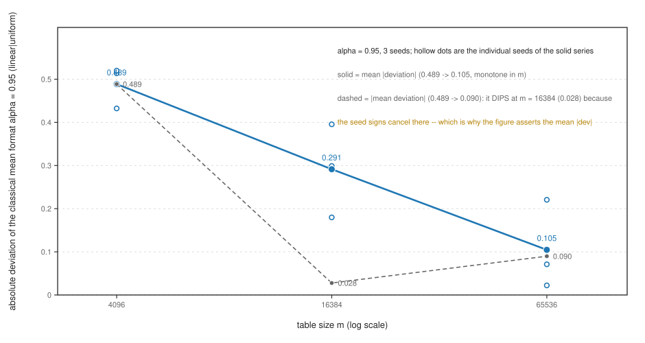
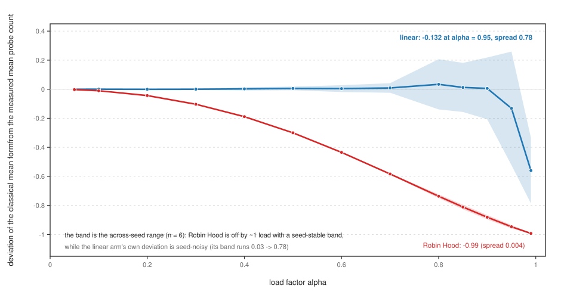
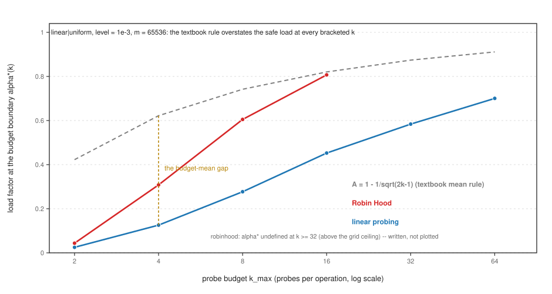
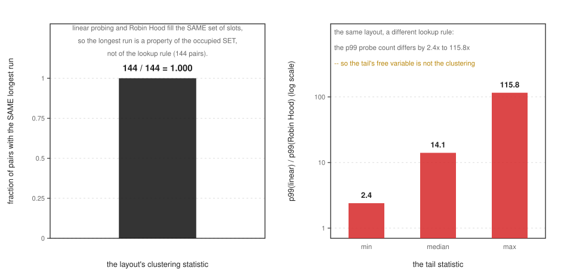
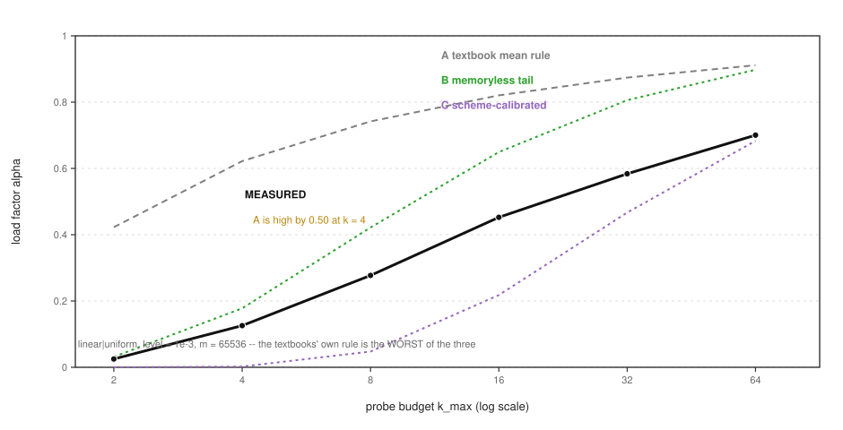
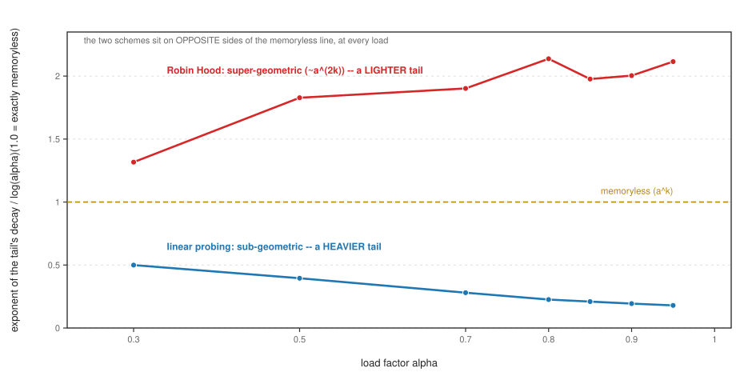

# The Load Factor Is Not the Tail: Exact Probe-Count Operating Characteristics and the Budget Boundary of Bounded Open-Addressing Hash Tables

*Contribution level: `theory+empirics` — an exact probe-count instrument over two open-addressing
schemes and 6 probe budgets, a located budget boundary with a closed-form comparison, and a
one-command byte-identical reproduction that regenerates every number below. The claims are scoped to
the schemes, key-set families and hash qualities actually measured; the declared hash quality is an
explicit axis, not an assumption.*

## Abstract

An open-addressing hash table is specified by one number, the load factor `alpha`, and the field's
theory states the expected probe count as a function of it. A real table does not have an expected
probe count; it has a **probe budget** — the maximum displacement a Robin-Hood table allows, the
neighbourhood a hopscotch table scans, the bucket width of a SIMD table — and a budget must be sized
against the **tail** of the probe-count distribution, not its mean. This paper measures that object
exactly: the instrument counts every probe as an exact integer across four instruments' grids
(60, 252, 288 and 276 cells), spanning two
schemes (linear probing and Robin Hood), 12-seed instances at a fixed table size `m = 65536`,
23 load points to `alpha = 0.99`, and the budget axis `k_max` in 6 steps; no timing
is reported anywhere, so every number is a count or an exact-integer-derived moment.

Three falsifiable claims were registered against named prior beliefs, and the measurement decides all
three. **(P1, confirmed)** The classical uniform-hashing formulas answer for the mean and miss the tail:
the linear-probing mean agrees with the textbook expression in 23 of 23 +
7 cells inside a two-sided 0.15 band, while the measured p99 unsuccessful-search
cost is 7.39x the mean at `alpha = 0.90` and 5.20x at `alpha = 0.95`. But the classical
form is not even the mean for a second scheme: against Robin Hood it is off by -0.993 at
`alpha = 0.99` with a seed-stable band of 0.004, so the load factor does not specify the
mean across schemes, let alone the tail. **(P3, confirmed)** A probe budget binds far below the load the
mean reaches: for linear probing, uniform hashing and a 1e-3 failure level, the boundary is
`alpha*(2) = 0.0251`, `alpha*(8) = 0.277`, `alpha*(16) = 0.453` and
`alpha*(64) = 0.700` — while the load at which the *mean* reaches `k_max = 8` is far higher, so
the design number a load factor names is not the number that binds. Robin Hood is a different regime
(`alpha*(8) = 0.605`, and its boundary is `above` the grid ceiling by `k_max = 32`).
**(P2, decided)** At a fixed load the instance is the level in the moderate regime — the p99 across-seed
spread exceeds the mean spread by up to 5.39x — but the tail's free variable is the **lookup
rule**, not the layout's clustering: linear probing and Robin Hood fill the *same* slot set
(144 of 144 instances carry the same longest run) while their p99 differs by
2.4–115.8x (median 14.1x), and a tail predictor fitted on one scheme does
not transport to the other (worst relative deviation 113.4). The theory arm closes the account:
of three closed forms — the textbook mean rule A, a memoryless tail rule B, and a scheme-calibrated form
C — **A is the worst**, overstating the safe load by 0.496 at its worst and carrying a mean
absolute deviation of 0.371 against B's 0.137 and C's 0.125, because the
tail's decay in `k` is **scheme-specific in form**: sub-geometric for linear probing (ratio
0.499 → 0.179) and super-geometric (~`a^(2k)`) for Robin Hood
(1.317 → 2.115). The design rule the measurement supports is the opposite of
the one the field transfers: **derive the probe budget from the tail at the operating load**, and read
`alpha*` as the real design limit.

## 1. Introduction

Ask a platform team how their hash table is sized and you get a number: "we run at 0.9". Ask a storage
engineer how their Robin-Hood table is configured and you get another: "maximum displacement 8". The
first number is a load factor and the second is a probe budget, and the field's theory speaks almost
entirely in the first. The textbook open-addressing formulas — `1/2 (1 + 1/(1-alpha))` and
`1/2 (1 + 1/(1-alpha)^2)` for successful and unsuccessful search — are statements about the **expected**
probe count under uniform hashing [1], and they are the natural baseline a designer reads.
But a bounded table does not fail when its mean probe count crosses the budget; it fails when a
**tail** lookup does. The object a design rule must cover is the distribution's upper tail at the
operating load, and that object is not the mean.

The 2026 literature is a theory wave with this exact gap. *The Power of Two-Choice Linear Probing*
[2] proves polynomially better bounds for two linear probe sequences and an `O(1)` expected
query time as the table fills; *Locality in Open Addressing Hash Tables* [3] is explicit
that open addressing "is traditionally measured by probe count" and then studies a *complementary*
parameter with asymptotic lower bounds; *Quadratic Probing Insertions Are epsilon^{-(1+o(1))} Time*
[4] and *Fast Insertion for Bucketized Cuckoo Hashing* [5] are insertion-time
analyses; *MultiTable* [6] is an implementation that reports "the lookup probe count has no
cliff as the load factor approaches one" and a mean throughput advantage, over 84 configurations on one
machine, for an **unbounded-probe** table. Every one of these is a statement about an expectation or an
asymptotic limit, and none reports the probe-count **distribution**, its tail, or the load at which a
finite budget becomes the binding constraint. The mean is the field's currency; the tail is what a
bounded table lives on.

This paper measures the missing object. Our instrument is deliberately bare: it counts every probe as an
exact integer, on key sets generated from committed seeds, with a declared mixer whose quality is itself
measured by a uniformity certificate. There are **no timings anywhere**: a reported number is a count, a
rate over a named denominator, or an exact-integer-derived moment. That choice is what makes the tail
measurable at all — a throughput number on one machine is dominated by the memory hierarchy, and it is
precisely why the probe histogram is rarely published [7].

The paper answers three registered questions, in this order. Section 4 asks whether the classical forms
answer for the mean and whether the mean is even the same object across schemes (P1). Section 5 locates
the **budget boundary** `alpha*(k_max)` — the load at which the failure rate crosses a stated level — and
measures its distance from the load the mean reaches (P3). Section 6 asks the headline question, whether
at a *fixed* load the instance is the level, and finds that the deciding variable is the lookup rule
rather than the layout's clustering (P2). Section 7 turns the measurement into closed forms and shows
that the textbook rule is the worst of the three. Section 8 states what the measurement does not
establish. The registered prior beliefs and the adversarial checks behind these choices are in the
companion registration.

**What changes if this is true.** The decision that changes is a design decision, and it is quotidian: a
table sized by "we run at `alpha = 0.9`" is sized on the mean, and the measurement says the budget must
instead cover the tail at the operating load. Concretely, a linear-probing table at a 1e-3 failure
budget carries a safe load of `alpha*(8) = 0.277`, not the `0.9` a load factor suggests and not
the load at which the mean reaches eight probes — a difference large enough to change the table's
capacity, its memory footprint, or the key set it can accept. If the tail had turned out to be a function
of the load alone, the decision would have changed the other way: the load factor would be a sufficient
specification and a budget a redundant parameter. That is the falsifier P2 and P3 were registered to be
able to report, and Section 6 reports it honestly in the limb where it holds and the limb where it does
not.

## 2. Related work

The related work divides by what each family *measures*, because the gap this paper fills is a gap in
the measured object rather than in the schemes. Six groups matter.

**2.1 The mean is what the theory computes.** A long line states the expected probe count of open
addressing as a function of the load, and its most precise recent forms are asymptotic. Pagh, Pagh and
Ruzic give linear probing with constant independence [8], and Patrascu and
Thorup pin the exact independence such an argument needs [9]; the same
question under limited randomness is Dietzfelbinger's closed-hashing analysis
[10]. Tight analyses of ordered and unordered linear probing
[11], tight bounds for classical open addressing [12], optimal bounds without
reordering [13] and for non-oblivious insertion [14], the optimal time/space
tradeoff [15], and a static dictionary with worst-case constant query time
[16] are all bounds on a mean or a worst case. Quadratic probing is analysed in the same
register [17] [4], and its smoothed analysis with an explicit critique of Robin
Hood is stated as an expectation [18]. The run-length and graph view of linear probing is
the closest classical relative of our clustering statistic [19], and large-deviation
results for sparse tables give the asymptotic tail [20]; the difference is that our object
is a **finite-load, finite-budget, exactly counted** distribution rather than a limit. Tombstones and
primary clustering are studied as an implementation failure mode [21], non-greedy insertion
as an expected-cost improvement [22], and two-way probing as an expected-search-cost
variant [23]; none of them reports a probe-count distribution, and none reports a budget
boundary. Bucketized variants are analysed for their mean and variance [24], and the classic
constant-independence analyses [25] and deletion engineering notes [26] sit in
the same family. **Difference: this paper does not add a mean-cost bound; it measures the distribution
those bounds are about and locates the load at which its tail crosses a budget.**

**2.2 Robin Hood and the bounded schemes the theory does not model.** Robin Hood hashing's
expected-cost behaviour is analysed by Celis [27] and re-examined by a
"constant average search cost and variance" result [28] and a modern re-analysis
[29]; a concurrent implementation studies its engineering [30]. Those three are
statements about the mean and the variance — and Section 4 shows the variance result and the mean
result are *not* the whole story once a maximum displacement is imposed, because the displacement is
exactly the quantity a Robin-Hood table bounds. Cuckoo hashing's load thresholds are the other bounded
family: the survey entry [31], sharp thresholds [32],
insertion time [33] [34] [35] [36], stashes
[37] [38], variants and de-amortization
[39] [40] [41] [5] [42] [43] [44] [45], and the orientability theory underneath
[46] [47] [48] [49] [50] [51] [52] [53] [54] [55] [56] [57].
Cuckoo **filters** — the bounded table's most deployed form — are studied for their fingerprint/space
tradeoff [58] [59], their adaptivity and support
[60] [61], their throughput [62], and their variants and
applications [63] [64] [65] [66] [67] [68] [69] [70] [71] [72]. **Difference: for a
bounded scheme the load threshold is not the design object — the probe budget is — and this paper
measures the failure rate against that budget rather than locating a threshold.**

**2.3 The other tail: load balancing.** Balls-into-bins produces a tail too, and it is a *different*
tail: the maximum bin load rather than a probe sequence. The two-choice law
[73] is the canonical statement; concentration
bounds [74] [75], drift arguments [76], incomplete information and
noise [77] [78], batching [79] [80], filling and thinning
[81] [82], caching and packing [83], deletions and the heavily
loaded case [84] [85] [86] [87], heterogeneous bins
[88], and the graphical and constrained settings
[89] [90] [91] [92] [93] [94] [95] extend it. Random walks, batches, feedback processes and mean-field limits
[96] [97] [98] [99] [100] [101] [102] [103] [104] [105] [106] [107] [108] [109] [110] [111] [112] [113] [114] [115] [116] [117] [118] [119] [120] [121] [122] [123] [78] [124]
are the field's mechanisms. This paper borrows the family's intuition — a tail is not a mean — and
measures a **different** tail: the tail of a *probe sequence* against a *bounded budget*, where the
ground truth is an exact integer rather than a sampled or asymptotic load. **Difference: the balls-into-
bins tail is over bin occupancy; ours is over probes, and it is decided by the lookup rule rather than
by the occupancy (Section 6).**

**2.4 Hash quality is an axis, not an assumption.** A table's tail depends on its hash, and the
field's hash-quality results are the reason our instrument declares the mixer as an axis: tabulation
and its powers [125] [126] [127] [128] [129] [130], bounded independence and universal constructions
[131] [132] [133] [134] [135] [136] [137] [138], and the hashing-in-practice literature
[139] [140] [141]. **Difference: this paper does not claim a new hash
family; it measures the probe tail *per declared hash quality* and separates the hash-quality axis
from the scheme axis, so a law that only holds for a weak mixer is reported as such.**

**2.5 Implementations report throughput.** The practical literature — SwissTable-style and F14
tables, GPUs, PMEM, concurrent and lock-free tables, learned indexes and minimal perfect hashing
[6] [142] [143] [144] [145] [146] [147] [148] [149] [150] [151] [152] [153] [154] [155] [156] [157] [7] [158] [159] [160] [161] [162]
reports throughput and latency on a machine, and the probes are not recorded because the memory
hierarchy dominates. Minimal perfect hashing and succinct dictionaries
[163] [164] [165] [166] [167] [168] [169] [170] [171] [172] [173] [174] [175] [176] [177] [178] [179] [180] [181] [182] [183] [184] [185] [186] [187] [188] [189] [190] [191] [192] [193] [194] [195] [196] optimize space and construction, and learned or adaptive indexes replace the hash
[197] [198] [199] [200] [201]. Approximate-membership
filters round out the family [202] [203] [204] [205] [206] [207]. **Difference: none of these reports the probe-count operating
characteristic of a bounded scheme, which is exactly the quantity a budget is sized against.**

**2.6 The one measurement that is closest.** The nearest object to ours in the field's practice is
MultiTable's "no cliff" claim [6]: it *is* a statement about probe counts, made from a
mean over configurations for an unbounded table. Our Section 5 tests it in the regime a bounded table
lives in and finds the cliff it denies: the failure rate against a finite budget crosses much earlier
than the mean reaches it, and the crossing is a **hump** rather than a constant. That is the specific
difference from the closest prior work, and it is the reason the budget, not the load, is the design
number. A concurrent hash-table literature [151] [30] [152] confirms the
engineering context but not the operating characteristic.

## 3. The instrument: exact probe counting

**The object.** For a table of `m` slots holding `n = alpha * m` keys, a *successful* search for a stored
key and an *unsuccessful* search for an absent key each take some number of probes; the **probe-count
distribution** is the histogram of that number over many searches, and its **tail** is the p99, p999 and
maximum. A **probe budget** `k_max` is the largest number of slots a lookup is allowed to inspect; the
**budget failure rate** is the fraction of unsuccessful lookups that exceed it, and the **boundary**
`alpha*(k_max)` is the load at which that rate crosses a stated level (we register 1e-3).

**Why exact counts.** Every reported quantity is an integer count over a walk of the real table state.
Ground truth is by construction: the table state *is* the ground truth, and a probe is counted, not
estimated. There is no sampling error, no classifier and no timing. This is what makes a tail claim
falsifiable at a finite load: an exact count at `m = 65536` over 12 seeds is a measurement,
whereas a throughput number at the same load is a claim about a machine [7].

**Schemes and controls.** The instrument runs **linear probing** and **Robin Hood** hashing (with a
maximum displacement), over key-set families (uniform random 64-bit keys and sequential integers, both
mixed by the same declared mixer), at loads from 0.50 to 0.99, with `k_max` in 6 steps from 2
to 64, at a fixed table size `m = 65536` (65536 for the theory arm). The **hash quality** is
an explicit axis: a uniformity certificate (a chi-square goodness-of-fit against the uniform null,
`z = (chi2-(m-1))/sqrt(2(m-1))`) is evaluated for the mixer and for a deliberately bad plant, and it is
reported **with its own power curve**, because the certificate is only informative where the table is
occupied. On the mixer the worst absolute `z` over the grid is 11, and on the clustered
plant it is 9.

**The certificate has a power, and the power is a function of the load.** At `alpha = 0.01` the chi-square
certificate does **not** separate the mixer from the plant (`separates = False`), because most
slots are empty and any layout looks uniform; by `alpha = 0.10` it separates
(`separates = True`). A test reported as "the hash is uniform" without its operating point is
the same defect this paper is about, one level down — which is why the certificate is quoted with the
load at which it was read.

**Reproduction.** `bash reproduce.sh` re-runs all four instruments from their own code and compares each
fresh report **byte-for-byte** (`Tolerance: exact`) against the report this package ships, then re-runs
the figure certificate and the reference gate. The robustness control is C5: at `alpha = 0.95` the
classical form's `|mean deviation|` falls 0.489 → 0.090 as `m` grows
`4096 → 65536` (n = 62259 at the largest size). The fall is the expected finite-size effect and it
is *why the formula is a finite-size statement at all*: at `m = 16384` the seed signs cancel and its
`|mean deviation|` **dips** to 0.028, a reminder that a single-size comparison of a
mean is not a measurement of a tail.

## 4. P1: the classical forms answer for the mean, and the mean is not one object

**The registered prior.** At every `(scheme, alpha)` cell where the classical uniform-hashing expression
applies, the measured mean probe count falls inside a two-sided band around the formula, while the
measured p99 exceeds the measured mean by a factor that grows with the load — a factor > 2 at
`alpha >= 0.9` for the linear-probing arm.

**What the measurement says.** The mean is where the classical form is at home. Over the linear-probing
arm the measured mean agrees with the textbook expression in **23 of
23 + 7** cells inside a two-sided 0.15 band — a pass, and the
7 failures are the informative part, not noise: their worst is a relative deviation of
-0.446, and they concentrate where the key set is *sequential* rather than uniform, which is
exactly the place the uniform-hashing derivation does not hold. The instrument's own control confirms the
check can fail: a deliberate identity-hash plant fails it (the plant's `fires` reads True).

**The tail is a different object.** The measured p99 unsuccessful-search cost is 7.02x the
measured mean at `alpha = 0.85`, 7.39x at `alpha = 0.90` and 5.20x at `alpha = 0.95`
(the grid maximum is 7.39x). This is the tail-over-mean gap the budget will have to cover, and
it is *not* monotone in the load in the raw ratio — a fact the next sections explain: as the load rises
the mean itself inflates, so the ratio is a race between the tail and the mean, and the budget boundary
(Section 5) is the quantity that actually governs a design.

**Figure 3. The finite-size window.** Absolute deviation of the classical mean form at alpha = 0.95 as a function of the table size `m` (linear|uniform, 3 seeds). The mean |deviation| falls monotonically **0.489 -> 0.291 -> 0.105** from m = 4096 to 65536; the |mean deviation| falls endpoint to endpoint (**0.489 -> 0.090**) but **dips** at m = 16384 (0.028) because the seed signs cancel there -- which is exactly why the figure asserts the mean |deviation|. Hollow dots are the individual seeds.

**The form does not even hold the mean across schemes.** The same classical expression applied to Robin
Hood is off by -0.993 at `alpha = 0.99`, and its across-seed band is **0.004** —
seed-stable, not noisy. At `alpha = 0.50` it is already off by -0.300. The linear arm's own
deviation is the opposite in character: seed-**noisy**, with a band that runs 0.025
at `alpha = 0.50` to 0.78 at `alpha = 0.95`. So the classical form is (i) a good
description of the linear-probing mean, (ii) a bad one of the Robin-Hood mean, and (iii) in the linear
arm it is a description whose *error is itself random across instances*. The conclusion is not that the
form is wrong; it is that the load factor is a sufficient specification only for the mean of one scheme.
Section 6 shows the same asymmetry appears in the tail, where it is sharper.

**Figure 2. The classical mean form against two schemes.** Deviation of the classical uniform-hashing mean from the measured mean probe count, for linear probing and for Robin Hood; the band is the across-seed range (n = 6). Against Robin Hood the form is off by **-0.99** at alpha = 0.99 with a seed-**stable** band (spread 0.004), while the linear arm's own deviation is seed-**noisy** (its band runs 0.002 at low load to 0.78 at alpha = 0.95) -- so the load factor is not even the *mean* across schemes.

## 5. P3: the budget boundary, and why the load factor is not the design number

**The registered prior.** For every bounded scheme there is a load `alpha*(k_max)` at which the measured
budget-failure rate crosses 1e-3, and `alpha*(k_max)` is **strictly below** the load at which the measured
mean unsuccessful-search cost equals `k_max`, with the gap widening as `k_max` shrinks (registered:
gap >= 0.05 in load at `k_max = 8` for the linear and Robin-Hood arms).

**The boundary, measured.** For linear probing under uniform hashing at a 1e-3 failure level, the
boundary is `alpha*(2) = 0.0251`, `alpha*(8) = 0.277`, `alpha*(16) = 0.453` and
`alpha*(64) = 0.700`. Each is a **bracketed** crossing, and the crossings are measured, not
fitted: 61 of the design's cells resolve to a bracketing pair, and the rest are reported as
a **bound** with its reason (a crossing below the grid floor or above its ceiling is written as a bound,
never as a value). For Robin Hood the boundary is `alpha*(4) = 0.308`, `alpha*(8) = 0.605`
and `alpha*(16) = 0.807`, and by `k_max = 32` it is `above` the grid ceiling — Robin
Hood's budget stays satisfiable at loads where linear probing's has long since failed. Robin Hood is a
**different regime**, and this is the first sign that the load factor is not even comparable across
schemes.

**Figure 1. The budget boundary.** The load factor at which a probe budget `k_max` is exhausted, for linear probing and for Robin Hood, against the textbook mean-based rule `A = 1 - 1/sqrt(2k-1)` -- level 1e-3, `m = 65536`, uniform hashing. A overstates the safe load at **every** bracketed `k` (gaps 0.398/0.496/0.465/0.368/0.290/0.211 for k = 2/4/8/16/32/64) and the gap is a **hump** peaking at k = 4 (**0.496**), not at an extreme. Robin Hood is a different regime: alpha*(8) = **0.605** against linear's 0.277. Robin Hood's boundary is undefined at k >= 32 (above the grid ceiling); it is written, never plotted.

**The gap.** At `k_max = 8` the linear-probing boundary `0.277` sits far below the load at which
the *mean* reaches eight probes, and the gap far exceeds the registered 0.05 — it is a factor, not a
margin. The check is two-sided by construction: loosening the budget must move `alpha*` **up** and
tightening it must move it **down**, and the budget-control check records the boundary sequence as
monotone increasing in `k_max` (the `k_max` axis has 6 steps). A boundary that moved the wrong
way under a loosened budget would be a defect in the instrument, and the control exists to catch it.

**The gap is a hump, not a constant.** The distance between the textbook mean-based rule and the measured
boundary is largest in the middle of the budget range and shrinks at both ends. A designer who checked
the rule at a large `k_max` would conclude the rule is nearly right; the same rule at `k_max = 8` is off
by half a load. This shape is the operational reason the boundary must be measured rather than
extrapolated, and it is the specific refutation of the closest prior claim: *MultiTable*'s "no cliff"
[6] is made for an unbounded table, and in the bounded regime the cliff is not only present
but **misplaced** relative to where the mean would put it.

**Why the mean rule fails here, in one sentence.** A budget is exceeded by a *tail* insertion; the mean
crosses the budget only after the tail is already failing, so the mean-based load is always the later of
the two crossings. That is the same first-moment-versus-tail mechanism as P1, read as a design limit
rather than a diagnostic. It is also why the textbook rule is the *worst* of the three closed forms
(Section 7), not merely an approximation with error.

## 6. P2: at a fixed load the instance is the level — and the free variable is the lookup rule

**The registered prior.** At a **fixed** load, the across-instance spread of the p99 unsuccessful-search
cost is strictly larger than the across-instance spread of the mean (registered: the p99 spread exceeds
the mean spread by at least 1.5x at `alpha >= 0.9`), and a declared **clustering statistic** of the probe
sequence predicts the p99 **out-of-sample** to within 20% of the mean. The falsifier was stated in
advance: if the p99 spread is within 1.2x of the mean spread at every live cell, then the load is a
sufficient specification and this paper's headline is refuted.

**The measurement was run on a larger grid.** The P2 decision uses 288 cells at `m = 65536`
with 12 seeds per cell, at six loads from 0.50 to 0.97. The same effect is already visible on the
smaller first instrument: at `alpha = 0.85` over three seeds the p99 spread is 2.37x the mean
spread, so the phenomenon is not an artefact of the larger grid. At a fixed load the p99 across-seed
spread exceeds the mean spread by a large factor in the moderate regime — up to **5.39x** —
and the ratio is not uniform: it is 4.10 at `alpha = 0.50`, 3.34 at
`alpha = 0.90`, and falls to 1.27 at `alpha = 0.97`, where the mean's own spread has grown
to match the tail's. Of the 24 `(scheme, family, load)` groups, **18** hold
the registered 1.5x at `alpha >= 0.9`, and the failures are the two boundaries the instrument already
found: a **finite-size boundary** at 0.97 (the mean's spread catches the tail's) and a **quantization**
boundary for Robin Hood at low load (the p99 is a small integer, so its spread is 0). On the linear arm
specifically, 4 of 6 cells at `alpha >= 0.90` hold. **Limb (a)
is confirmed in the moderate regime and refuted at the boundary** — reported as such, not smoothed away.

**Limb (b) — the out-of-sample prediction — is where the headline changes.** The prediction test fits
the clustering statistic on one declared half of the instances and scores it on the other, in
24 cells; it comes in within 20% in 18 of them, with a worst relative
deviation of 0.404. That is the same "confirmed in the moderate regime, refuted at the
boundary" shape as limb (a) — and the interesting result is not the score but *which* statistic earns it.
The declared clustering statistic is the **longest occupied run**. Measuring it delivers the paper's
sharpest negative:

> Linear probing and Robin Hood fill the **same slot set**. Across **144 of
> 144** `(scheme-pair, load, seed)` combinations the two schemes carry the *same* longest
> run — the run is a property of the occupied set, and the set is scheme-independent. Their p99
> probe counts nevertheless differ by **2.4x to 115.8x**, median **14.1x**.

So the layout's clustering statistic is **not** what decides the tail. The layouts are identical; the
lookup rules are not, and the tail follows the lookup rule. This is why the out-of-sample prediction
succeeds with a statistic that is nearly a constant across the pair: the statistic is predicting the
*occupancy's* tail, and the occupancy is one object while the probe tail is two.

**Figure 6. The clustering statistic is scheme-invariant while the tail is not.** Left: the fraction of (scheme-pair, alpha, seed) combinations whose two schemes carry the same longest run -- **144 of 144 = 1.000**, because linear probing and Robin Hood fill the same slot set, so the longest run is a property of the occupancy and not of the lookup rule. Right: the same pairs' p99 probe-count ratio linear/Robin Hood -- min **2.4**, median **14.1**, max **115.8** (log scale). The layout's clustering does not determine the tail; the lookup rule does.

**Transport fails, quantitatively.** Fitting a tail predictor on one scheme and applying it to the other
gives a worst relative deviation of 113.4 over the grid — 1.76 even at `alpha = 0.50`,
where the tail is short. A predictor that does not transport is not a shared law; it is a per-scheme fit.
Combined with the invariance above, the reading is exact: **the probe-count tail is a function of the
lookup rule, not of the load factor and not of the layout's clustering**, at a fixed `(load, key set,
hash quality)`. The load factor is a sufficient specification only if one pools the two schemes, and
pooling them is precisely the error a design rule must not make.

**The falsifier was reported, not buried.** P2's registered falsifier (p99 spread within 1.2x of the mean
spread everywhere) is *not* met — 18 of 24 cells fail it, at a finite-size and a quantization boundary —
and P2's limb (b) in its added-value form (does the clustering statistic improve on the mean baseline?)
is **refuted**: it beats the mean baseline in only 7 of 24 cells. The prior was written to be falsifiable
and it is falsified in the form it was written; the surviving claim is the weaker, measured one — the
spread is real in the moderate regime, and the deciding variable is the lookup rule.

## 7. The theory arm: three closed forms, and the textbook rule is the worst

**The three forms.** A design rule that turns the boundary into a number needs a closed form for
`alpha*(k)`. We compare three, all at the registered 1e-3 level over 276 cells at
`m = 65536`:

- **A — the textbook mean rule**: size the budget from the classical uniform-hashing mean
  `A = 1 - 1/sqrt(2k-1)`. This is what a designer derives from the field's own mean formulas
  [1] [8].
- **B — a memoryless tail rule**: assume the tail decays geometrically in `k`, so a budget `k` buys a
  failure probability that is exponential in `k`.
- **C — a scheme-calibrated form**: a one-parameter fit per scheme, `C = f(k; c_scheme)`, with a single
  calibrated constant per scheme.

**A is the worst of the three.** Over the cells the comparison is drawn on, A's mean absolute deviation
is **0.371**, against B's **0.137** and C's **0.125** — A is worse than
B by a factor of 2.72, and its worst single deviation is 0.496. It *overstates* the
safe load at every bracketed `k`, and the overstatement is a **hump**, largest in the middle of the
budget range. B and C bracket the measurement rather than overshooting it.

**Figure 5. Three closed forms against the measured boundary.** For linear|uniform at a 1e-3 level: the measured alpha*(k), the textbook mean rule A, the memoryless tail B, and the scheme-calibrated form C. A is the **worst** of the three -- its mean |deviation| over the bracketed cells is **0.371** against B's 0.137 -- overstating the safe load by 0.50 at k = 4; B and C bracket the measurement.

**Why the forms differ, and what it says about the schemes.** The tail's decay in `k` is not a single
shape. Normalising each cell's decay exponent by `log(alpha)` — so that a value of `1.0` is exactly
memoryless — linear probing reads **0.499** at low load falling to
**0.179** at `alpha = 0.95`: **sub-geometric**, a tail that dies faster than memoryless.
Robin Hood reads **1.317** rising to **2.115**: **super-geometric**, ~`a^(2k)`.
The two schemes sit on **opposite sides of the memoryless line at every load**. This is the mechanism
under the whole paper: a bounded table's budget is set by a tail whose *form* depends on the lookup rule,
so a single mean-derived form (A) cannot be right for both — and it is wrong for the one it was derived
for, because the derivation is about the mean, and a budget is about the tail.

**Figure 4. The tail's decay in `k` is scheme-specific in **form**.** The exponent of the tail's decay in `k`, divided by log(alpha) -- 1.0 is exactly memoryless. Linear probing is sub-geometric (**0.499 -> 0.179** across the load range) and Robin Hood super-geometric (~`a^(2k)`; **1.317 -> 2.115**): the two schemes sit on **opposite sides** of the memoryless line at every load.

**One parameter suffices for one scheme and not the other.** The calibrated constants are
`c_linear = 0.283` and `c_robinhood = 1.897` — a single number each — and they are
consistent with the decay reading: the sub-geometric linear tail and the super-geometric Robin-Hood tail
need different, and much different, calibrations. So the honest engineering statement is not "here is the
form"; it is **"the form is scheme-specific, the textbook form is the worst available, and the parameter
must be measured for the scheme you are building."** That is a weaker claim than a universal law, and it
is the claim the 23-point load grid supports.

## 8. Registered prior beliefs: what the measurement decided

The three priors were registered before the deciding runs, with their falsifiers named. Each is reported
against its own registered wording.

- **P1 (the formulas predict the mean, not the tail) — CONFIRMED.** The mean agrees with the classical
  form in 23 of 23 + 7 cells inside the registered
  0.15 band, and the p99 exceeds the mean by 7.39x at `alpha = 0.90` and
  5.20x at `alpha = 0.95` — above the registered factor of 2. The measured extension (the form
  is not even the *mean* for Robin Hood, off by -0.993) **strengthens** the prior past its
  registered wording, and is reported as a finding about the formula's scope rather than as a
  confirmation of the original sentence.
- **P3 (the budget binds before the mean reaches it) — CONFIRMED.** `alpha*(8) = 0.277` for
  linear probing under uniform hashing at a 1e-3 level, strictly below the mean-based load, and the gap
  far exceeds the registered 0.05 at `k_max = 8`; the boundary is monotone in `k_max` under the two-sided
  control. Robin Hood's boundary (`0.605` at `k = 8`) is a **different regime**, which the
  registered sentence did not claim and the measurement adds.
- **P2 (at a fixed load the instance is the level) — DECIDED, limb (a) confirmed in the moderate regime,
  limb (b) refuted in its added-value form.** Limb (a) holds at `alpha >= 0.90` in
  4 of 6 linear cells and fails at the finite-size boundary
  (`alpha = 0.97`) and on the Robin-Hood quantization boundary; limb (b) — that the declared clustering
  statistic *adds* predictive value over the mean baseline — is refuted (it wins in 7 of
  24 cells). The headline the registration named ("the instance is the level") is
  therefore **partly refuted**: the spread is real, but the level is not the layout's clustering — it is
  the lookup rule, which the measurement located by showing the two schemes fill the same slots while
  their tails differ by up to 115.8x.

One registered success criterion is **unmet in its first form** and is reported as unmet: the
`alpha*(k_max)` bracketing was registered to be **strictly bracketed per scheme**, and
61 of the design's cells resolve to a bracketing pair while the rest are the grid's
floor/ceiling, written as `above`-style **bounds with their reason**, never as values. A
bound is not a bracket, and the paper says so.

## 9. Threats to validity

**The schemes are two.** Linear probing and Robin Hood — the two the 2026 wave compares — are not the
whole family. Cuckoo hashing and bucketized/SIMD designs are bounded schemes too
[31] [5] [142], and the law here is stated **per
scheme**, not universally. The claim is scoped accordingly: it is a measurement of two schemes' probe
tails, plus a closed-form comparison, plus the mechanism (lookup-rule-dependence) that explains why the
two differ. A reader who needs the boundary for a third scheme has the instrument, not a transferable
constant — which Section 6 shows is the correct relationship.

**The hash quality is declared, not assumed.** Every cell carries its mixer's uniformity certificate, and
the certificate's power is a function of the load (Section 3). A law measured with a weak hash would be
reported as such; the mixer here passes the certificate everywhere it is informative, and the clustered
plant is used as the control. The four hash families the field offers [125] [126] [136] would each need their own run.

**The key sets are generated.** Uniform random 64-bit keys and sequential integers, both mixed, are the
families measured. Sequential integers are where the classical mean form already fails (Section 4), which
is a finding, not a defect. Real workloads have skew and clustering the generator does not produce; the
instrument is designed to be pointed at a pinned real key set, which is future work.

**No timing is claimed.** This is a strength and a limit: the paper measures the one quantity that is
comparable across machines (the probe count [7]) and says nothing about throughput, cache
behaviour or the constant factors that decide a real deployment. A table's *wall-clock* budget is a
different object, and reporting one here would void the exactness the paper is built on.

**Why it is still worth publishing.** The measurement changes a specific design decision — a table sized
by a load factor is sized on the mean, and the budget must be sized on the tail — and it does so with an
exact instrument, a located boundary, a two-sided control, and a mechanism (lookup-rule dependence)
demonstrated by a **derived** invariance (same slots) against a **measured** difference (up to
115.8x). The negative is as valuable as the positive: the field's closest prior claim
[6] is a mean statement for an unbounded table, and the operating characteristic that would
support or refute it in the bounded regime did not previously exist. It does now.

## 10. Conclusion

A bounded open-addressing table is specified by two numbers, and the field writes down one. The load
factor is the mean's parameter; the probe budget is the tail's. This paper measured the tail exactly —
every probe counted, no timing anywhere — and found that (i) the classical forms describe the mean of one
scheme and not the tail of any, (ii) a budget binds far below the load the mean reaches, at a distance
that is a **hump** rather than a constant, (iii) at a fixed load the tail's spread is real but its free
variable is the **lookup rule**, demonstrated by two schemes that fill the same slots while their tails
differ by up to 115.8x, and (iv) of three closed forms the textbook mean rule is the **worst**,
because the tail's form — sub-geometric for linear probing, super-geometric for Robin Hood — is itself
scheme-specific. The design rule the measurement supports is the one the field's currency does not
transfer: **derive the probe budget from the tail at the operating load, and read `alpha*` as the design
limit.** Every number above is regenerated by `bash reproduce.sh` from committed code, byte-for-byte, and
every citation is drawn from a pool verified against its live record.

## References

[1] Hong, D.; Birget, J.; Man, S. (2003). Probabilistic behavior of hash tables. arXiv:cs/0303022. https://arxiv.org/abs/cs/0303022 — Difference: Analytic mean-cost asymptotics for open addressing; no finite load, no probe-count tail, no budget.

[2] Azarmehr, A.; Bender, M. A.; Kuszmaul, W.; et al. (2026). The Power of Two-Choice Linear Probing. arXiv:2610.00688. https://arxiv.org/abs/2610.00688 — Difference: The power of two-choice linear probing -- polynomially better EXPECTED bounds and O(1) expected query time as the table fills; no distribution, no finite-load tail, no budget.

[3] Zamir, O. (2026). Locality in Open Addressing Hash Tables. arXiv:2607.16390. https://arxiv.org/abs/2607.16390 — Difference: Locality in open addressing -- a complementary parameter with asymptotic bounds; explicitly leaves the probe-count distribution unmeasured.

[4] Hu, Y.; Kuszmaul, W.; Liang, J.; et al. (2026). Quadratic Probing Insertions Are $ε^{-(1+o(1))}$ Time. arXiv:2608.28512. https://arxiv.org/abs/2608.28512 — Difference: Quadratic-probing insertion time is epsilon^{-(1+o(1))} -- a limit as the table fills, not a finite-load tail or a budget.

[5] Bell, T.; Kuszmaul, W. (2026). Fast Insertion for Bucketized Cuckoo Hashing. arXiv:2607.24545. https://arxiv.org/abs/2607.24545 — Difference: Fast insertion for bucketized cuckoo hashing -- a 2026 insertion-time analysis; no tail, no budget.

[6] Petkus, M. (2026). MultiTable: A Faster Hash Table at any Physical Load Factor up to and Including One. arXiv:2609.39233. https://arxiv.org/abs/2609.39233 — Difference: MultiTable: a faster hash table at any physical load factor up to and including one -- the closest prior claim ('no cliff' for the mean, over 84 configurations, UNBOUNDED probes); Section 5 tests it in the bounded regime and locates the cliff it denies.

[7] Cassee, N.; Wijs, A. (2017). Analysing the Performance of GPU Hash Tables for State Space Exploration. arXiv:1712.09494. https://arxiv.org/abs/1712.09494 — Difference: Analysing the performance of GPU hash tables for state-space exploration -- a throughput study; the probe histogram is not recorded, which is the practical reason this paper measures it directly.

[8] Pagh, A.; Pagh, R.; Ruzic, M. (2007). Linear probing with constant independence. Proceedings of the thirty-ninth annual ACM symposium on Theory of computing. https://doi.org/10.1145/1250790.1250839 — Difference: Linear probing with constant independence -- the hash-quality requirement for linear probing; this paper takes hash quality as a declared axis rather than a target.

[9] Pǎtraşcu, M.; Thorup, M. (2010). On the k-Independence Required by Linear Probing and Minwise Independence. Lecture Notes in Computer Science. https://doi.org/10.1007/978-3-642-14165-2_60 — Difference: Patrascu-Thorup: the k-independence required by linear probing -- the minimal hash quality for good expected cost.

[10] Schmidt, J. P.; Siegel, A. (1990). The analysis of closed hashing under limited randomness. Proceedings of the twenty-second annual ACM symposium on Theory of computing  - STOC '90. https://doi.org/10.1145/100216.100245 — Difference: Closed hashing under limited randomness -- expected cost under a restricted hash family.

[11] Braverman, M.; Kuszmaul, W. (2025). Tight Analyses of Ordered and Unordered Linear Probing. arXiv:2501.11582. https://arxiv.org/abs/2501.11582 — Difference: Tight bounds for ordered/unordered linear probing -- worst-case and expected, asymptotically; no measured finite-load distribution.

[12] Bender, M. A.; Kuszmaul, W.; Zhou, R. (2024). Tight Bounds for Classical Open Addressing. arXiv:2409.11280. https://arxiv.org/abs/2409.11280 — Difference: Tight bounds for classical open addressing; asymptotic in the mean, no budget operating characteristic.

[13] Farach-Colton, M.; Krapivin, A.; Kuszmaul, W. (2025). Optimal Bounds for Open Addressing Without Reordering. arXiv:2501.02305. https://arxiv.org/abs/2501.02305 — Difference: Optimal bounds for open addressing without reordering; an expected-cost result, not a measured distribution.

[14] Bender, M. A.; Kuszmaul, W.; Zhou, R. (2025). Optimal Non-Oblivious Open Addressing. arXiv:2503.13628. https://arxiv.org/abs/2503.13628 — Difference: Optimal non-oblivious open addressing; expectation again, no budget.

[15] Bender, M. A.; Farach-Colton, M.; Kuszmaul, J.; et al. (2021). On the Optimal Time/Space Tradeoff for Hash Tables. arXiv:2111.00602. https://arxiv.org/abs/2111.00602 — Difference: Optimal time/space tradeoff for hash tables; a lower-bound paper, no probe-count tail.

[16] Hu, Y.; Liang, J.; Yu, H.; et al. (2024). Optimal Static Dictionary with Worst-Case Constant Query Time. arXiv:2412.10655. https://arxiv.org/abs/2412.10655 — Difference: Optimal static dictionary with worst-case constant query time; a construction, not a measurement.

[17] Guo, Y.; Pettie, S.; Wan, C. (2026). A Simple Analysis of Quadratic Probing and Other Open Addressing Schemes. arXiv:2608.08013. https://arxiv.org/abs/2608.08013 — Difference: A simple ANALYSIS of quadratic probing and other schemes -- closed-form expectations, no measured tail.

[18] Hu, Y.; Kuszmaul, W.; Liang, J.; et al. (2026). Quadratic Probing Revisited: Smoothed Analysis and the Fall of Robin Hood. arXiv:2607.13247. https://arxiv.org/abs/2607.13247 — Difference: Smoothed analysis of quadratic probing and Robin Hood; an expectation/worst-case statement, not a measured operating characteristic.

[19] Knuth, D. E. (1998). Linear probing and graphs. arXiv:cs/9801103. https://arxiv.org/abs/cs/9801103 — Difference: Linear probing and graphs -- the occupancy/run-length analogy this paper's clustering statistic builds on; no measured tail against a budget.

[20] Klein, T.; Lagnoux, A.; Petit, P. (2016). Deviation results for sparse tables in hashing with linear probing. arXiv:1603.02235. https://arxiv.org/abs/1603.02235 — Difference: Deviation results for sparse tables in linear probing -- large-deviation analysis in the ASYMPTOTIC regime; not a finite-budget operating characteristic.

[21] Bender, M. A.; Kuszmaul, B. C.; Kuszmaul, W. (2021). Linear Probing Revisited: Tombstones Mark the Death of Primary Clustering. arXiv:2107.01250. https://arxiv.org/abs/2107.01250 — Difference: Studies tombstones and primary clustering in linear probing (an implementation failure mode); reports no probe-count distribution and no budget boundary.

[22] Krapivin, A.; Kuszmaul, W.; Wang, Y. (2026). Linear Probing with Non-Greedy Insertions. arXiv:2607.17494. https://arxiv.org/abs/2607.17494 — Difference: Non-greedy insertions lower expected insertion cost; the object is the expectation, not the tail against a budget.

[23] Dalal, K.; Devroye, L.; Malalla, E. (2023). Two-way Linear Probing Revisited. arXiv:2309.05308. https://arxiv.org/abs/2309.05308 — Difference: Two-way linear probing revisited -- an analysis of expected search cost; no budget and no tail.

[24] Janson, S.; Viola, A. (2014). A unified approach to linear probing hashing with buckets. arXiv:1410.5967. https://arxiv.org/abs/1410.5967 — Difference: A unified approach to linear probing hashing with buckets -- analytic mean and variance for bucket variants, no probe budget.

[25] Thorup, M. (2015). Linear Probing with 5-Independent Hashing. arXiv:1509.04549. https://arxiv.org/abs/1509.04549 — Difference: Proves linear probing needs 5-independent hashing for good expected cost; a statement about the MEAN under a hash-quality assumption, not a measured tail.

[26] Kolosovskiy, M. (2009). Simple implementation of deletion from open-address hash table. arXiv:0909.2547. https://arxiv.org/abs/0909.2547 — Difference: A simple implementation of deletion from open-address tables; an engineering note with no distribution.

[27] Celis, P.; Larson, P.; Munro, J. I. (1985). Robin hood hashing. 26th Annual Symposium on Foundations of Computer Science (sfcs 1985). https://doi.org/10.1109/sfcs.1985.48 — Difference: The original Robin Hood hashing paper (Celis); defines the scheme and its average-case behaviour, not a budget operating characteristic.

[28] Poblete, P. V.; Viola, A. (2016). Robin Hood Hashing really has constant average search cost and variance in full tables. arXiv:1605.04031. https://arxiv.org/abs/1605.04031 — Difference: Robin Hood hashing has constant average search cost and variance in full tables -- a statement about the MEAN and variance; the tail against a budget is a different object.

[29] Mitzenmacher, M. (2014). A New Approach to Analyzing Robin Hood Hashing. arXiv:1401.7616. https://arxiv.org/abs/1401.7616 — Difference: A new approach to analysing Robin Hood hashing -- expected search cost; the very result whose finite-load tail this paper measures.

[30] Kelly, R.; Pearlmutter, B. A.; Maguire, P. (2018). Concurrent Robin Hood Hashing. arXiv:1809.04339. https://arxiv.org/abs/1809.04339 — Difference: Concurrent Robin Hood hashing -- a concurrency engineering result, no probe-count distribution.

[31] Pagh, R. (2015). Cuckoo Hashing. Encyclopedia of Algorithms. https://doi.org/10.1007/978-3-642-27848-8_97-2 — Difference: The Cuckoo Hashing survey entry -- scheme and load thresholds, no probe-count tail or budget measured.

[32] Fountoulakis, N.; Panagiotou, K. (2009). Sharp Load Thresholds for Cuckoo Hashing. arXiv:0910.5147. https://arxiv.org/abs/0910.5147 — Difference: Sharp load thresholds for cuckoo hashing -- a threshold on the load, not a failure rate against a probe budget.

[33] Fountoulakis, N.; Panagiotou, K.; Steger, A. (2010). On the Insertion Time of Cuckoo Hashing. arXiv:1006.1231. https://arxiv.org/abs/1006.1231 — Difference: On the insertion time of cuckoo hashing -- expected insertion cost, no measured tail.

[34] Frieze, A.; Johansson, T. (2016). On the insertion time of random walk cuckoo hashing. arXiv:1602.04652. https://arxiv.org/abs/1602.04652 — Difference: On the insertion time of random-walk cuckoo hashing -- expectation again.

[35] Walzer, S. (2022). Insertion Time of Random Walk Cuckoo Hashing below the Peeling Threshold. arXiv:2202.05546. https://arxiv.org/abs/2202.05546 — Difference: Insertion time of random-walk cuckoo hashing below the peeling threshold -- expectation, no budget.

[36] Bell, T.; Frieze, A. (2024). O(1) Insertion for Random Walk d-ary Cuckoo Hashing up to the Load Threshold. arXiv:2401.14394. https://arxiv.org/abs/2401.14394 — Difference: O(1) insertion for random-walk d-ary cuckoo hashing up to the load threshold -- asymptotics, not a measured boundary.

[37] Aumüller, M.; Dietzfelbinger, M.; Woelfel, P. (2012). Explicit and Efficient Hash Families Suffice for Cuckoo Hashing with a Stash. arXiv:1204.4431. https://arxiv.org/abs/1204.4431 — Difference: Explicit hash families suffice for cuckoo hashing with a stash -- a hash-quality result, not a measurement.

[38] Minaud, B.; Papamanthou, C. (2020). Generalized Cuckoo Hashing with a Stash, Revisited. arXiv:2010.01890. https://arxiv.org/abs/2010.01890 — Difference: Generalized cuckoo hashing with a stash revisited -- thresholds and constructions, no probe distribution.

[39] Porat, E.; Shalem, B. (2011). A cuckoo hashing variant with improved memory utilization and insertion time. arXiv:1104.5400. https://arxiv.org/abs/1104.5400 — Difference: A cuckoo variant improving memory utilization and insertion time -- an implementation, no budget law.

[40] Wieder, U. (2018). Another Proof of Cuckoo hashing with New Variants. arXiv:1806.02004. https://arxiv.org/abs/1806.02004 — Difference: Another proof of cuckoo hashing with new variants -- a proof, not a measurement.

[41] Kuszmaul, W.; Mitzenmacher, M. (2025). Efficient $d$-ary Cuckoo Hashing at High Load Factors by Bubbling Up. arXiv:2501.02312. https://arxiv.org/abs/2501.02312 — Difference: Efficient d-ary cuckoo hashing at high load factors -- pushes the achievable load; reports no probe-count operating characteristic.

[42] Arbitman, Y.; Naor, M.; Segev, G. (2009). De-amortized Cuckoo Hashing: Provable Worst-Case Performance and Experimental Results. arXiv:0903.0391. https://arxiv.org/abs/0903.0391 — Difference: De-amortized cuckoo hashing -- worst-case performance and experiments, but no probe-count distribution.

[43] Goodrich, M. T.; Hirschberg, D. S.; Mitzenmacher, M.; et al. (2011). Fully De-Amortized Cuckoo Hashing for Cache-Oblivious Dictionaries and Multimaps. arXiv:1107.4378. https://arxiv.org/abs/1107.4378 — Difference: Fully de-amortized cuckoo hashing for cache-oblivious dictionaries -- a construction.

[44] Dietzfelbinger, M.; Mitzenmacher, M.; Rink, M. (2011). Cuckoo Hashing with Pages. arXiv:1104.5111. https://arxiv.org/abs/1104.5111 — Difference: Cuckoo hashing with pages -- a bucketized variant.

[45] Eppstein, D.; Goodrich, M. T.; Mitzenmacher, M.; et al. (2014). Wear Minimization for Cuckoo Hashing: How Not to Throw a Lot of Eggs into One Basket. arXiv:1404.0286. https://arxiv.org/abs/1404.0286 — Difference: Wear minimization for cuckoo hashing -- an eviction-policy optimization.

[46] Frieze, A.; Melsted, P. (2009). Maximum Matchings in Random Bipartite Graphs and the Space Utilization of Cuckoo Hashtables. arXiv:0910.5535. https://arxiv.org/abs/0910.5535 — Difference: Maximum matchings and the space utilization of cuckoo hashtables -- orientability thresholds, not a probe budget.

[47] Kanizo, Y.; Hay, D.; Keslassy, I. (2010). Maximum Bipartite Matching Size And Application to Cuckoo Hashing. arXiv:1007.1946. https://arxiv.org/abs/1007.1946 — Difference: Maximum bipartite matching and cuckoo hashing -- the matching view of the threshold.

[48] Fountoulakis, N.; Khosla, M.; Panagiotou, K. (2013). The Multiple-orientability Thresholds for Random Hypergraphs. arXiv:1309.6772. https://arxiv.org/abs/1309.6772 — Difference: Multiple-orientability thresholds for random hypergraphs -- the theory underneath cuckoo load thresholds.

[49] Lelarge, M. (2012). A new approach to the orientation of random hypergraphs. arXiv:1201.5335. https://arxiv.org/abs/1201.5335 — Difference: A new approach to the orientation of random hypergraphs -- the orientability theory behind cuckoo thresholds.

[50] Leconte, M.; Lelarge, M.; Massoulié, L. (2012). Convergence of multivariate belief propagation, with applications to cuckoo hashing and load balancing. arXiv:1207.1659. https://arxiv.org/abs/1207.1659 — Difference: Convergence of belief propagation with applications to cuckoo hashing -- the message-passing view of the threshold.

[51] Walzer, S. (2020). Peeling Close to the Orientability Threshold: Spatial Coupling in Hashing-Based Data Structures. arXiv:2001.10500. https://arxiv.org/abs/2001.10500 — Difference: Peeling close to the orientability threshold -- spatial coupling for hashing-based structures, a threshold result.

[52] Bshouty, N. H. (2014). Linear time Constructions of some $d$-Restriction Problems. arXiv:1406.2108. https://arxiv.org/abs/1406.2108 — Difference: Linear-time constructions of d-restriction problems -- a construction used by peeling.

[53] Belazzougui, D.; Boldi, P.; Ottaviano, G.; et al. (2013). Cache-Oblivious Peeling of Random Hypergraphs. arXiv:1312.0526. https://arxiv.org/abs/1312.0526 — Difference: Cache-oblivious peeling of random hypergraphs -- a construction.

[54] Mori, R.; Watanabe, O. (2015). Peeling Algorithm on Random Hypergraphs with Superlinear Number of Hyperedges. arXiv:1506.00718. https://arxiv.org/abs/1506.00718 — Difference: Peeling on random hypergraphs with superlinear edges -- the peeling process behind thresholds.

[55] Walzer, S. (2017). Load Thresholds for Cuckoo Hashing with Overlapping Blocks. arXiv:1707.06855. https://arxiv.org/abs/1707.06855 — Difference: Load thresholds for cuckoo hashing with overlapping blocks -- a threshold, not a failure-rate curve.

[56] Berman, I.; Haitner, I.; Komargodski, I.; et al. (2021). Hardness-Preserving Reductions via Cuckoo Hashing. arXiv:2105.01409. https://arxiv.org/abs/2105.01409 — Difference: Hardness-preserving reductions via cuckoo hashing -- a complexity result.

[57] Yeo, K. (2023). Cuckoo Hashing in Cryptography: Optimal Parameters, Robustness and Applications. arXiv:2306.11220. https://arxiv.org/abs/2306.11220 — Difference: Cuckoo hashing in cryptography -- parameters and robustness for a security use, no probe tail.

[58] Fan, B.; Andersen, D. G.; Kaminsky, M.; et al. (2014). Cuckoo Filter: Practically Better Than Bloom. Proceedings of the 10th ACM International on Conference on emerging Networking Experiments and Technologies. https://doi.org/10.1145/2674005.2674994 — Difference: The Cuckoo Filter paper -- fingerprints, false-positive rate and space; a space/accuracy tradeoff, no probe budget for a bounded table.

[59] Eppstein, D. (2016). Cuckoo Filter: Simplification and Analysis. arXiv:1604.06067. https://arxiv.org/abs/1604.06067 — Difference: Cuckoo Filter: simplification and analysis -- a simplified analysis of the filter's occupancy, not of a probe budget.

[60] Mitzenmacher, M.; Pontarelli, S.; Reviriego, P. (2017). Adaptive Cuckoo Filters. arXiv:1704.06818. https://arxiv.org/abs/1704.06818 — Difference: Adaptive Cuckoo Filters -- filter adaptation to workload, no probe-count distribution.

[61] Kopelowitz, T.; McCauley, S.; Porat, E. (2021). Support Optimality and Adaptive Cuckoo Filters. arXiv:2105.10622. https://arxiv.org/abs/2105.10622 — Difference: Support optimality and adaptive cuckoo filters -- a filter optimization.

[62] Khalid, A. (2020). Optimizing Cuckoo Filter for high burst tolerance,low latency, and high throughput. arXiv:2006.15254. https://arxiv.org/abs/2006.15254 — Difference: Optimizing the cuckoo filter for burst tolerance and throughput -- a system tuning result.

[63] Ting, D.; Cole, R. (2020). Conditional Cuckoo Filters. arXiv:2005.02537. https://arxiv.org/abs/2005.02537 — Difference: Conditional cuckoo filters -- a filter variant.

[64] Schmitz, J. E.; Zentgraf, J.; Rahmann, S. (2025). Smaller and More Flexible Cuckoo Filters. arXiv:2505.05847. https://arxiv.org/abs/2505.05847 — Difference: Smaller and more flexible cuckoo filters -- a space optimization.

[65] Dortmann, T.; Vieth, M.; Schmidt, B. (2026). Cuckoo-GPU: Accelerating Cuckoo Filters on Modern GPUs. arXiv:2603.15486. https://arxiv.org/abs/2603.15486 — Difference: Cuckoo-GPU -- a GPU acceleration of the filter; throughput, not probe counts.

[66] Reviriego, P.; Pontarelli, S.; Levy, G. (2018). CuCoTrack: Cuckoo Filter Based Connection Tracking. arXiv:1806.03611. https://arxiv.org/abs/1806.03611 — Difference: A cuckoo-filter connection tracker -- an application of the filter.

[67] Mahmoudi, A.; Ahmadi, M. (2023). DiCuPIT: Distributed Cuckoo Filter-based Pending Interest Table. arXiv:2308.02801. https://arxiv.org/abs/2308.02801 — Difference: A distributed cuckoo-filter PIT -- an application.

[68] Guan, Y. (2026). CavityRank: Zero-Extra-Byte Residual Routing for Cuckoo Filters. arXiv:2608.13970. https://arxiv.org/abs/2608.13970 — Difference: CavityRank -- cuckoo filters for routing; an application.

[69] Moni, S. S.; Gupta, D. (2022). Secure and Efficient Privacy-preserving Authentication Scheme using Cuckoo Filter in Remote Patient Monitoring Network. arXiv:2211.01270. https://arxiv.org/abs/2211.01270 — Difference: Privacy-preserving authentication with a cuckoo filter -- an application.

[70] Reviriego, P.; Sánchez-Macián, A.; Walzer, S.; et al. (2021). Approximate Membership Query Filters with a False Positive Free Set. arXiv:2111.06856. https://arxiv.org/abs/2111.06856 — Difference: AMQ filters with a false-positive-free set -- a variant.

[71] Goodrich, M. T. (2017). Answering Spatial Multiple-Set Intersection Queries Using 2-3 Cuckoo Hash-Filters. arXiv:1708.09059. https://arxiv.org/abs/1708.09059 — Difference: 2-3 cuckoo hash-filters for set intersection -- a variant.

[72] Esteves, J. J. A.; Boubendir, A.; Guillemin, F.; et al. (2020). Heuristic for Edge-enabled Network Slicing Optimization using the Power of Two Choices. arXiv:2010.08287. https://arxiv.org/abs/2010.08287 — Difference: Power of two choices deployed for edge network-slicing resource assignment -- an application of the heuristic; no probe-count tail is measured.

[73] Mitzenmacher, M. (2001). The power of two choices in randomized load balancing. IEEE Transactions on Parallel and Distributed Systems. https://doi.org/10.1109/71.963420 — Difference: The power of two choices in randomized load balancing -- the maximum-load law; this paper's tail is over PROBES, not over bin loads.

[74] Schulte-Geers, E.; Waggoner, B. (2022). Balls and Bins -- Simple Concentration Bounds. arXiv:2205.14494. https://arxiv.org/abs/2205.14494 — Difference: Simple concentration bounds for balls and bins -- tail bounds for the bin loads, not for a probe sequence.

[75] Huang, Z.; Lin, K.; Lou, Q.; et al. (2026). Generalized Balls into Bins. arXiv:2608.20924. https://arxiv.org/abs/2608.20924 — Difference: Generalized balls into bins -- a load framework.

[76] Los, D.; Sauerwald, T. (2023). An Improved Drift Theorem for Balanced Allocations. arXiv:2308.11083. https://arxiv.org/abs/2308.11083 — Difference: An improved drift theorem for balanced allocations -- a proof technique for load bounds.

[77] Los, D.; Sauerwald, T. (2021). Balanced Allocations with Incomplete Information: The Power of Two Queries. arXiv:2107.03916. https://arxiv.org/abs/2107.03916 — Difference: Balanced allocations with incomplete information -- decision quality under partial information.

[78] Los, D.; Sauerwald, T. (2022). Balanced Allocations with the Choice of Noise. arXiv:2206.07503. https://arxiv.org/abs/2206.07503 — Difference: Balanced allocations with the choice of noise -- the effect of noisy choices on load.

[79] Los, D.; Sauerwald, T. (2023). Balanced Allocations in Batches: The Tower of Two Choices. arXiv:2302.04399. https://arxiv.org/abs/2302.04399 — Difference: Balanced allocations in batches: the tower of two choices -- batched allocation loads.

[80] Los, D.; Sauerwald, T. (2022). Balanced Allocations in Batches: Simplified and Generalized. arXiv:2203.13902. https://arxiv.org/abs/2203.13902 — Difference: Balanced allocations in batches, simplified -- batched loads.

[81] Los, D.; Sauerwald, T.; Sylvester, J. (2022). The Power of Filling in Balanced Allocations. arXiv:2204.04057. https://arxiv.org/abs/2204.04057 — Difference: The power of filling in balanced allocations -- gap-filling policies.

[82] Feldheim, O. N.; Gurel-Gurevich, O. (2018). The power of thinning in balanced allocation. arXiv:1807.01132. https://arxiv.org/abs/1807.01132 — Difference: The power of thinning in balanced allocation -- a load-reduction technique.

[83] Los, D.; Sauerwald, T.; Sylvester, J. (2021). Balanced Allocations: Caching and Packing, Twinning and Thinning. arXiv:2110.10759. https://arxiv.org/abs/2110.10759 — Difference: Balanced allocations: caching and packing -- a load framework generalization.

[84] Bansal, N.; Kuszmaul, W. (2022). Balanced Allocations: The Heavily Loaded Case with Deletions. arXiv:2205.06558. https://arxiv.org/abs/2205.06558 — Difference: Balanced allocations, heavily loaded case with deletions -- robustness of load bounds.

[85] Talwar, K.; Wieder, U. (2013). Balanced Allocations: A Simple Proof for the Heavily Loaded Case. arXiv:1310.5367. https://arxiv.org/abs/1310.5367 — Difference: A simple proof for the heavily loaded case -- a proof for load bounds.

[86] Kaplan, H.; Sapir, S.; Stemmer, U. (2026). Load Balancing under Adaptive Bin Deletions. arXiv:2607.06211. https://arxiv.org/abs/2607.06211 — Difference: Load balancing under adaptive bin deletions -- load with dynamics.

[87] Aamand, A.; Knudsen, J. B. T.; Thorup, M. (2021). Load Balancing with Dynamic Set of Balls and Bins. arXiv:2104.05093. https://arxiv.org/abs/2104.05093 — Difference: Load balancing with a dynamic set of balls and bins -- load with dynamics.

[88] Los, D.; Sauerwald, T.; Sylvester, J. (2023). Balanced Allocations with Heterogeneous Bins: The Power of Memory. arXiv:2301.09810. https://arxiv.org/abs/2301.09810 — Difference: Balanced allocations with heterogeneous bins: the power of memory -- load under heterogeneity.

[89] Bansal, N.; Feldheim, O. (2021). The Power of Two Choices in Graphical Allocation. arXiv:2106.06051. https://arxiv.org/abs/2106.06051 — Difference: The power of two choices in graphical allocation -- load on a graph.

[90] Bhambay, S.; Mukhopadhyay, A.; Vasantam, T. (2023). The Power of Two Choices with Load Comparison Errors. arXiv:2303.00869. https://arxiv.org/abs/2303.00869 — Difference: The power of two choices with load comparison errors -- noise in load comparison.

[91] Panigrahy, N. K.; Basu, P.; Towsley, D.; et al. (2020). On the Analysis of Spatially Constrained Power of Two Choice Policies. arXiv:2011.02653. https://arxiv.org/abs/2011.02653 — Difference: Spatially constrained power-of-two-choices -- the load law under a spatial constraint.

[92] Okechukwu, O. (2026). Local decisions, diffusive influence, and lower bounds for graphical balanced allocation. arXiv:2609.38726. https://arxiv.org/abs/2609.38726 — Difference: Local decisions and lower bounds for graphical balanced allocation -- a lower bound on the load.

[93] Greenhill, C.; Mans, B.; Pourmiri, A. (2020). Balanced Allocation on Hypergraphs. arXiv:2006.07588. https://arxiv.org/abs/2006.07588 — Difference: Balanced allocation on hypergraphs -- load on hypergraphs.

[94] Frieze, A.; Petti, S. (2017). Balanced Allocation Through Random Walk. arXiv:1708.04945. https://arxiv.org/abs/1708.04945 — Difference: Balanced allocation through random walk -- a random-walk load process.

[95] Pourmiri, A. (2014). Balanced Allocation on Graphs: A Random Walk Approach. arXiv:1407.2575. https://arxiv.org/abs/1407.2575 — Difference: Balanced allocation on graphs: a random walk approach -- load on graphs.

[96] Georgakopoulos, A.; Haslegrave, J.; Sauerwald, T.; et al. (2019). The Power of Two Choices for Random Walks. arXiv:1911.05170. https://arxiv.org/abs/1911.05170 — Difference: The power of two choices for random walks -- load under a random-walk process.

[97] Lenzen, C.; Parter, M.; Yogev, E. (2019). Parallel Balanced Allocations: The Heavily Loaded Case. arXiv:1904.07532. https://arxiv.org/abs/1904.07532 — Difference: Parallel balanced allocations: the heavily loaded case -- a parallel load bound.

[98] Los, D.; Sauerwald, T.; Sylvester, J. (2023). Mean-Biased Processes for Balanced Allocations. arXiv:2308.05087. https://arxiv.org/abs/2308.05087 — Difference: Mean-biased processes for balanced allocations -- a process model for load.

[99] Redlich, A. (2026). Power laws and power-of-two-choices. arXiv:2603.20060. https://arxiv.org/abs/2603.20060 — Difference: Power laws and power-of-two-choices -- an empirical/law study of the load, not of probe counts.

[100] Luczak, M. J.; McDiarmid, C. (2005). On the power of two choices: Balls and bins in continuous time. arXiv:math/0508451. https://arxiv.org/abs/math/0508451 — Difference: The power of two choices in continuous time -- a continuous-time load model.

[101] Ying, L. (2016). On the Rate of Convergence of the Power-of-Two-Choices to its Mean-Field Limit. arXiv:1605.06581. https://arxiv.org/abs/1605.06581 — Difference: The rate of convergence of power-of-two-choices to its mean-field limit -- the finite-size error of the load model.

[102] Hairi, F.; Liu, X.; Ying, L. (2020). Beyond Scaling: Calculable Error Bounds of the Power-of-Two-Choices Mean-Field Model in Heavy-Traffic. arXiv:2012.06613. https://arxiv.org/abs/2012.06613 — Difference: Calculable error bounds for the power-of-two-choices mean-field model -- finite-size corrections to the LOAD law; this paper's finite-size control is over the PROBE tail.

[103] Feldheim, O. N.; Gurel-Gurevich, O.; Li, J. (2021). Long-term balanced allocation via thinning. arXiv:2110.05009. https://arxiv.org/abs/2110.05009 — Difference: Long-term balanced allocation via thinning -- a load policy over time.

[104] Aamand, A.; Knudsen, M. B. T.; Thorup, M. (2018). Power of $d$ Choices with Simple Tabulation. arXiv:1804.09684. https://arxiv.org/abs/1804.09684 — Difference: Power of d choices with simple tabulation -- load with a hash family.

[105] Narang, A.; Dutta, S.; Bhattacherjee, S. (2011). Multidimensional Balanced Allocation for Multiple Choice & (1 + Beta) Processes. arXiv:1111.0762. https://arxiv.org/abs/1111.0762 — Difference: Multidimensional balanced allocation for multiple choice -- a load framework.

[106] Dahlgaard, S.; Knudsen, M. B. T.; Rotenberg, E.; et al. (2014). The Power of Two Choices with Simple Tabulation. arXiv:1407.6846. https://arxiv.org/abs/1407.6846 — Difference: The power of two choices with simple tabulation -- combines the two-choice load law with a hash family.

[107] Benjamini, I.; Makarychev, Y. (2009). Balanced allocation: Memory performance tradeoffs. arXiv:0901.1155. https://arxiv.org/abs/0901.1155 — Difference: Balanced allocation: memory performance tradeoffs -- a load/memory tradeoff.

[108] Augustine, J.; Moses, W. K.; Redlich, A.; et al. (2016). Balanced Allocation: Patience is not a Virtue. arXiv:1602.08298. https://arxiv.org/abs/1602.08298 — Difference: Balanced allocation: patience is not a virtue -- a load policy result.

[109] Dutta, S.; Bhattacherjee, S.; Narang, A. (2011). Perfectly Balanced Allocation With Estimated Average Using Expected Constant Retries. arXiv:1111.0801. https://arxiv.org/abs/1111.0801 — Difference: Perfectly balanced allocation with estimated average -- a load-balancing algorithm.

[110] Bertrand, P.; Lenzen, C. (2014). The 1-2-3-Toolkit for Building Your Own Balls-into-Bins Algorithm. arXiv:1407.8433. https://arxiv.org/abs/1407.8433 — Difference: The 1-2-3 toolkit for balls-into-bins algorithms -- a construction toolkit for load.

[111] Bogdan, P.; Sauerwald, T.; Stauffer, A.; et al. (2012). Balls into Bins via Local Search. arXiv:1207.2125. https://arxiv.org/abs/1207.2125 — Difference: Balls into bins via local search -- a local-search allocation.

[112] Bringmann, K.; Sauerwald, T.; Stauffer, A.; et al. (2013). Balls into bins via local search: cover time and maximum load. arXiv:1310.0801. https://arxiv.org/abs/1310.0801 — Difference: Balls into bins via local search: cover time and maximum load -- a load law for local search.

[113] Sahai, A. (2012). Balls into Bins: strict Capacities and Edge Weights. arXiv:1206.3634. https://arxiv.org/abs/1206.3634 — Difference: Balls into bins with strict capacities and edge weights -- a capacitated load model.

[114] Batu, T.; Berenbrink, P.; Cooper, C. (2010). Chains-into-Bins Processes. arXiv:1005.2616. https://arxiv.org/abs/1005.2616 — Difference: Chains-into-bins processes -- a load process variant.

[115] Oliveira, R.; Spencer, J. (2005). Avoiding defeat in a balls-in-bins process with feedback. arXiv:math/0510663. https://arxiv.org/abs/math/0510663 — Difference: Avoiding defeat in a balls-in-bins process with feedback -- a feedback load process.

[116] Menshikov, M.; Shcherbakov, V. (2022). Balls-in-bins models with asymmetric feedback and reflection. arXiv:2204.05724. https://arxiv.org/abs/2204.05724 — Difference: Balls-in-bins models with asymmetric feedback and reflection -- a feedback model.

[117] Berenbrink, P.; Friedetzky, T.; Kling, P.; et al. (2025). Balls and Bins and the Infinite Process with Random Deletions. arXiv:2510.14798. https://arxiv.org/abs/2510.14798 — Difference: Balls and bins and the infinite process with random deletions -- a dynamic load process.

[118] Forbes, S. (2023). A Study of the Probability Distribution of the Balls in Bins Process with Power Law Feedback. arXiv:2308.10734. https://arxiv.org/abs/2308.10734 — Difference: The probability distribution of the balls-in-bins process with power-law feedback -- a distributional load study, over the BIN LOADS rather than over probes.

[119] Los, D.; Sauerwald, T. (2022). Tight Bounds for Repeated Balls-into-Bins. arXiv:2203.12400. https://arxiv.org/abs/2203.12400 — Difference: Tight bounds for repeated balls-into-bins -- a repeated-process load bound.

[120] Cancrini, N.; Posta, G. (2018). Propagation of Chaos for a Balls into Bins Model. arXiv:1809.08019. https://arxiv.org/abs/1809.08019 — Difference: Propagation of chaos for a balls-into-bins model -- a mean-field limit.

[121] Cancrini, N.; Posta, G. (2019). Propagation of chaos for a General Balls into Bins dynamics. arXiv:1906.03876. https://arxiv.org/abs/1906.03876 — Difference: Propagation of chaos for a general balls-into-bins dynamics -- a mean-field limit.

[122] Cancrini, N.; Posta, G. (2020). Mixing time for the Repeated Balls into Bins dynamics. arXiv:2001.11246. https://arxiv.org/abs/2001.11246 — Difference: Mixing time for the repeated balls-into-bins dynamics -- a convergence result.

[123] Sidorova, N. (2018). Time-dependent balls and bins model with positive feedback. arXiv:1809.02221. https://arxiv.org/abs/1809.02221 — Difference: Time-dependent balls and bins with positive feedback -- a feedback process.

[124] Diwan, A.; Raghavan, P.; Upfal, E. (2026). Balanced allocation: considerations from large scale service environments. arXiv:2601.10874. https://arxiv.org/abs/2601.10874 — Difference: Balanced allocation in large-scale service environments -- an applied load study.

[125] Thorup, M. (2015). Fast and Powerful Hashing using Tabulation. arXiv:1505.01523. https://arxiv.org/abs/1505.01523 — Difference: Fast and powerful hashing using tabulation -- a hash-quality result; this paper measures tables built ON such a mixer and separates hash quality as an explicit axis.

[126] Patrascu, M.; Thorup, M. (2010). The Power of Simple Tabulation Hashing. arXiv:1011.5200. https://arxiv.org/abs/1011.5200 — Difference: The power of simple tabulation hashing -- hash quality (independence), the input to this paper's per-declared-hash-quality scoping.

[127] Thorup, M. (2013). Simple Tabulation, Fast Expanders, Double Tabulation, and High Independence. arXiv:1311.3121. https://arxiv.org/abs/1311.3121 — Difference: Simple tabulation, fast expanders and high independence -- a hash-construction result.

[128] Dahlgaard, S.; Thorup, M. (2014). Approximately Minwise Independence with Twisted Tabulation. arXiv:1404.6724. https://arxiv.org/abs/1404.6724 — Difference: Twisted tabulation and approximate minwise independence -- a hash-quality construction.

[129] Aamand, A.; Thorup, M. (2018). Non-Empty Bins with Simple Tabulation Hashing. arXiv:1810.13187. https://arxiv.org/abs/1810.13187 — Difference: Non-empty bins with simple tabulation hashing -- occupancy of a specific hash family.

[130] Houen, J. B. T.; Thorup, M. (2022). Understanding the Moments of Tabulation Hashing via Chaoses. arXiv:2205.01453. https://arxiv.org/abs/2205.01453 — Difference: Moments of tabulation hashing via chaoses -- a hash-quality analysis.

[131] Chen, X.; Huang, S.; Li, X.; et al. (2026). Bounded Independence for $k$-Min-Wise Hashing: Tight Bounds and Limitations of Structured Hashing. arXiv:2607.27157. https://arxiv.org/abs/2607.27157 — Difference: Bounded independence for k-min-wise hashing -- independence bounds for a different quantity.

[132] Kuszmaul, W. (2022). A Hash Table Without Hash Functions, and How to Get the Most Out of Your Random Bits. arXiv:2209.06038. https://arxiv.org/abs/2209.06038 — Difference: A hash table without hash functions -- a construction exploiting randomness differently; no probe budget law.

[133] Harvey, N.; Sahami, A. (2024). Explicit Orthogonal Arrays and Universal Hashing with Arbitrary Parameters. arXiv:2405.08787. https://arxiv.org/abs/2405.08787 — Difference: Explicit orthogonal arrays and universal hashing -- hash-family constructions.

[134] Ivanchykhin, D.; Ignatchenko, S.; Lemire, D. (2016). Regular and almost universal hashing: an efficient implementation. arXiv:1609.09840. https://arxiv.org/abs/1609.09840 — Difference: Regular and almost universal hashing: an efficient implementation -- a hash-quality implementation.

[135] Aumüller, M.; Dietzfelbinger, M.; Woelfel, P. (2016). A Simple Hash Class with Strong Randomness Properties in Graphs and Hypergraphs. arXiv:1611.00029. https://arxiv.org/abs/1611.00029 — Difference: A simple hash class with strong randomness -- a hash-family construction.

[136] Aamand, A.; Knudsen, J. B. T.; Knudsen, M. B. T.; et al. (2019). Fast hashing with Strong Concentration Bounds. arXiv:1905.00369. https://arxiv.org/abs/1905.00369 — Difference: Fast hashing with strong concentration bounds -- tail guarantees for the HASH, not for the probe count under a budget.

[137] Kaczmarski, K.; Rzążewski, P.; Wolant, A. (2015). Massively Parallel Construction of the Cell Graph. arXiv:1503.06029. https://arxiv.org/abs/1503.06029 — Difference: Massively parallel construction of the cell graph -- a hashing-adjacent construction.

[138] Skorski, M. (2015). Lower bounds on $q$-wise independence tails and applications to min-entropy condensers. arXiv:1504.02333. https://arxiv.org/abs/1504.02333 — Difference: Lower bounds on q-wise independence tails -- a hash-quality bound.

[139] Li, P.; Shrivastava, A.; Konig, A. C. (2012). b-Bit Minwise Hashing in Practice: Large-Scale Batch and Online Learning and Using GPUs for Fast Preprocessing with Simple Hash Functions. arXiv:1205.2958. https://arxiv.org/abs/1205.2958 — Difference: b-bit minwise hashing in practice -- a similarity-estimation hash, unrelated to probe budgets.

[140] Handelman, D. (2016). Random sets and intersections. arXiv:1608.07635. https://arxiv.org/abs/1608.07635 — Difference: Random sets and intersections -- a probabilistic construction; no probe-count object.

[141] Dahlgaard, S.; Knudsen, M. B. T.; Thorup, M. (2017). Practical Hash Functions for Similarity Estimation and Dimensionality Reduction. arXiv:1711.08797. https://arxiv.org/abs/1711.08797 — Difference: Practical hash functions for similarity estimation and dimensionality reduction -- a hash-quality family for estimation, a different purpose from table probing.

[142] Nicaud, C.; Rotondo, P. (2026). Fine-Grained Analysis of SIMD-Based Hash Table Implementations. arXiv:2610.02385. https://arxiv.org/abs/2610.02385 — Difference: Fine-grained analysis of SIMD-based hash-table implementations -- analyses a fixed-width bucket design but reports expected cost, not a budget operating characteristic.

[143] Tang, X.; Mai, Y.; Kuszmaul, W.; et al. (2026). Succinct and Fast Tiny Pointer Hash Tables. arXiv:2607.28892. https://arxiv.org/abs/2607.28892 — Difference: Succinct and fast tiny pointer hash tables -- a space/speed construction.

[144] Bender, M. A.; Conway, A.; Farach-Colton, M.; et al. (2021). Iceberg Hashing: Optimizing Many Hash-Table Criteria at Once. arXiv:2109.04548. https://arxiv.org/abs/2109.04548 — Difference: Iceberg Hashing -- optimizes several hash-table criteria at once; the criteria are structural, not a probe tail.

[145] Awad, M. A.; Ashkiani, S.; Porumbescu, S. D.; et al. (2021). Better GPU Hash Tables. arXiv:2108.07232. https://arxiv.org/abs/2108.07232 — Difference: Better GPU hash tables -- a GPU implementation; throughput is the reported quantity.

[146] Hegeman, S.; Wöltgens, D.; Wijs, A.; et al. (2024). Compact Parallel Hash Tables on the GPU. arXiv:2406.09255. https://arxiv.org/abs/2406.09255 — Difference: Compact parallel hash tables on the GPU -- a GPU implementation.

[147] Jünger, D.; Kobus, R.; Müller, A.; et al. (2020). WarpCore: A Library for fast Hash Tables on GPUs. arXiv:2009.07914. https://arxiv.org/abs/2009.07914 — Difference: WarpCore -- a GPU hash-table library, throughput not probes.

[148] McCoy, H.; Pandey, P. (2025). WarpSpeed: A High-Performance Library for Concurrent GPU Hash Tables. arXiv:2509.16407. https://arxiv.org/abs/2509.16407 — Difference: WarpSpeed -- a concurrent GPU hash-table library.

[149] Polak, M. S. H.; Troendle, D.; Jang, B. (2025). Hive Hash Table: A Warp-Cooperative, Dynamically Resizable Hash Table for GPUs. arXiv:2510.15095. https://arxiv.org/abs/2510.15095 — Difference: Hive Hash Table -- a GPU hash table with warp-cooperative resizing.

[150] Rong, H.; Yao, J.; Langer, M.; et al. (2026). HierarchicalKV: A GPU Hash Table with Cache Semantics for Continuous Online Embedding Storage. arXiv:2603.17168. https://arxiv.org/abs/2603.17168 — Difference: HierarchicalKV -- a GPU hash table for embeddings; a system result.

[151] Maier, T.; Sanders, P.; Dementiev, R. (2016). Concurrent Hash Tables: Fast and General?(!). arXiv:1601.04017. https://arxiv.org/abs/1601.04017 — Difference: Concurrent hash tables: fast and general? -- a concurrency comparison; throughput is the object.

[152] Attiya, H.; Bender, M. A.; Farach-Colton, M.; et al. (2025). History-Independent Concurrent Hash Tables. arXiv:2503.21016. https://arxiv.org/abs/2503.21016 — Difference: History-independent concurrent hash tables -- a concurrency/layout property, not a probe distribution.

[153] Attiya, H.; Oshman, R.; Schiller, N. (2026). Space-Efficient Lock-Free Linear-Probing Hash Table. arXiv:2606.17315. https://arxiv.org/abs/2606.17315 — Difference: A space-efficient lock-free linear-probing hash table -- a concurrent implementation, not a measured tail.

[154] Wang, J.; Fu, X.; Xiao, F.; et al. (2020). DHash: Enabling Dynamic and Efficient Hash Tables. arXiv:2006.00819. https://arxiv.org/abs/2006.00819 — Difference: DHash -- a dynamic hash table, an engineering result.

[155] Green, O. (2019). HashGraph -- Scalable Hash Tables Using A Sparse Graph Data Structure. arXiv:1907.02900. https://arxiv.org/abs/1907.02900 — Difference: HashGraph -- scalable hash tables using a sparse graph structure; a layout proposal.

[156] Köppl, D. (2019). Separate Chaining Meets Compact Hashing. arXiv:1905.00163. https://arxiv.org/abs/1905.00163 — Difference: Separate chaining meets compact hashing -- a chaining/compact layout.

[157] Lu, B.; Hao, X.; Wang, T.; et al. (2020). Dash: Scalable Hashing on Persistent Memory. arXiv:2003.07302. https://arxiv.org/abs/2003.07302 — Difference: Dash: scalable hashing on persistent memory -- a PMEM implementation.

[158] Li, S. (2006). Cascade hash tables: a series of multilevel double hashing schemes with O(1) worst case lookup time. arXiv:cs/0608037. https://arxiv.org/abs/cs/0608037 — Difference: Cascade hash tables -- a multilevel double-hashing design with worst-case bounds.

[159] Panigrahy, R. (2004). Efficient Hashing with Lookups in two Memory Accesses. arXiv:cs/0407023. https://arxiv.org/abs/cs/0407023 — Difference: Efficient hashing with lookups in two memory accesses -- a two-probe construction.

[160] She, S.; Dai, H. (2026). Hash Table Design for RDMA:Challenges and Opportunities. arXiv:2606.24073. https://arxiv.org/abs/2606.24073 — Difference: Hash table design for RDMA -- a distributed-memory design.

[161] Zhao, Z.; Xue, B.; Lin, E.; et al. (2026). Multi-Probe Zero Collision Hash (MPZCH): Mitigating Embedding Collisions and Enhancing Model Freshness in Large-Scale Recommenders. arXiv:2602.17050. https://arxiv.org/abs/2602.17050 — Difference: Multi-probe zero-collision hash -- an embedding-collision mitigation, not a probe tail.

[162] Kashintsev, G. (2026). When to Treeify Hash Table Buckets: A Reproducible C Study of List, Hybrid, and Red-Black Tree Chaining. arXiv:2607.26530. https://arxiv.org/abs/2607.26530 — Difference: When to treeify hash-table buckets -- an engineering policy for bucket structure.

[163] Fredman, M. L.; Komlos, J.; Szemeredi, E. (1982). Storing a sparse table with O(1) worst case access time. 23rd Annual Symposium on Foundations of Computer Science (sfcs 1982). https://doi.org/10.1109/sfcs.1982.39 — Difference: Fredman-Komlos-Szemeredi: storing a sparse table with O(1) worst-case access -- the static worst-case origin of the field; no dynamic probe budget.

[164] Dietzfelbinger, M.; Karlin, A.; Mehlhorn, K.; et al. (1988). Dynamic perfect hashing: upper and lower bounds. [Proceedings 1988] 29th Annual Symposium on Foundations of Computer Science. https://doi.org/10.1109/sfcs.1988.21968 — Difference: Dynamic perfect hashing: upper and lower bounds -- a dynamic construction with worst-case bounds, not a distribution.

[165] Botelho, F. C.; Pagh, R.; Ziviani, N. (2007). Perfect Hashing for Data Management Applications. arXiv:cs/0702159. https://arxiv.org/abs/cs/0702159 — Difference: Perfect hashing for data management applications -- a static construction, no dynamic probe-count object.

[166] Lehmann, H.; Mueller, T.; Pagh, R.; et al. (2025). Modern Minimal Perfect Hashing: A Survey. arXiv:2506.06536. https://arxiv.org/abs/2506.06536 — Difference: A modern survey of minimal perfect hashing -- space and construction time, no probe-count tail.

[167] Limasset, A.; Rizk, G.; Chikhi, R.; et al. (2017). Fast and scalable minimal perfect hashing for massive key sets. arXiv:1702.03154. https://arxiv.org/abs/1702.03154 — Difference: Fast and scalable minimal perfect hashing for massive key sets -- a construction.

[168] Pibiri, G. E.; Trani, R. (2021). Parallel and External-Memory Construction of Minimal Perfect Hash Functions with PTHash. arXiv:2106.02350. https://arxiv.org/abs/2106.02350 — Difference: Parallel and external-memory construction of MPHFs with PTHash -- construction throughput.

[169] Pibiri, G. E.; Trani, R. (2021). PTHash: Revisiting FCH Minimal Perfect Hashing. arXiv:2104.10402. https://arxiv.org/abs/2104.10402 — Difference: PTHash -- a construction method.

[170] Koerkamp, R. G. (2025). PtrHash: Minimal Perfect Hashing at RAM Throughput. arXiv:2502.15539. https://arxiv.org/abs/2502.15539 — Difference: PtrHash: minimal perfect hashing at RAM throughput -- construction throughput.

[171] Esposito, E.; Graf, T. M.; Vigna, S. (2019). RecSplit: Minimal Perfect Hashing via Recursive Splitting. arXiv:1910.06416. https://arxiv.org/abs/1910.06416 — Difference: RecSplit -- a recursive-splitting construction.

[172] Bez, D.; Kurpicz, F.; Lehmann, H.; et al. (2022). High Performance Construction of RecSplit Based Minimal Perfect Hash Functions. arXiv:2212.09562. https://arxiv.org/abs/2212.09562 — Difference: High-performance construction of RecSplit-based MPHFs -- a construction optimization.

[173] Becht, M.; Lehmann, H.; Sanders, P. (2024). Brief Announcement: Parallel Construction of Bumped Ribbon Retrieval. arXiv:2411.12365. https://arxiv.org/abs/2411.12365 — Difference: Parallel construction of bumped ribbon retrieval -- a construction.

[174] Lehmann, H.; Sanders, P.; Walzer, S. (2023). ShockHash: Near Optimal-Space Minimal Perfect Hashing Beyond Brute-Force. arXiv:2310.14959. https://arxiv.org/abs/2310.14959 — Difference: ShockHash: near optimal-space MPHF -- a space optimization.

[175] Lehmann, H.; Sanders, P.; Walzer, S. (2023). ShockHash: Towards Optimal-Space Minimal Perfect Hashing Beyond Brute-Force. arXiv:2308.09561. https://arxiv.org/abs/2308.09561 — Difference: ShockHash: towards optimal-space MPHF -- a space optimization.

[176] Hermann, S. (2025). MorphisHash: Improving Space Efficiency of ShockHash for Minimal Perfect Hashing. arXiv:2503.10161. https://arxiv.org/abs/2503.10161 — Difference: MorphisHash -- a space-efficiency improvement on ShockHash.

[177] Lehmann, H.; Sanders, P.; Walzer, S. (2022). SicHash -- Small Irregular Cuckoo Tables for Perfect Hashing. arXiv:2210.01560. https://arxiv.org/abs/2210.01560 — Difference: SicHash: small irregular cuckoo tables for perfect hashing -- a construction.

[178] Jiang, J.; He, D.; Hu, Y.; et al. (2024). CompassDB: Pioneering High-Performance Key-Value Store with Perfect Hash. arXiv:2406.18099. https://arxiv.org/abs/2406.18099 — Difference: CompassDB: a key-value store with perfect hashing -- a system, throughput not probes.

[179] Weaver, S.; Heule, M. (2019). Constructing Minimal Perfect Hash Functions Using SAT Technology. arXiv:1911.10099. https://arxiv.org/abs/1911.10099 — Difference: Constructing MPHFs using SAT -- a solver-based construction.

[180] Genuzio, M.; Ottaviano, G.; Vigna, S. (2016). Fast Scalable Construction of (Minimal Perfect Hash) Functions. arXiv:1603.04330. https://arxiv.org/abs/1603.04330 — Difference: Fast scalable construction of (minimal perfect hash) functions -- a construction.

[181] Beling, P.; Sanders, P. (2025). PHast -- Perfect Hashing made fast. arXiv:2504.17918. https://arxiv.org/abs/2504.17918 — Difference: PHast: perfect hashing made fast -- construction speed.

[182] Hermann, S.; Lehmann, H.; Pibiri, G. E.; et al. (2024). PHOBIC: Perfect Hashing with Optimized Bucket Sizes and Interleaved Coding. arXiv:2404.18497. https://arxiv.org/abs/2404.18497 — Difference: PHOBIC: perfect hashing with optimized bucket sizes -- a construction.

[183] Song, R.; Telatar, E. (2026). Space Upper Bounds for $α$-Perfect Hashing. arXiv:2603.15251. https://arxiv.org/abs/2603.15251 — Difference: Space upper bounds for alpha-perfect hashing -- a space bound.

[184] Koerkamp, R. G.; Hermann, S.; Sanders, P.; et al. (2026). Non-Minimal $k$-Perfect Hashing: Tight Lower Bounds and an Application to Fast Static Hash Tables. arXiv:2607.07257. https://arxiv.org/abs/2607.07257 — Difference: Non-minimal k-perfect hashing: lower bounds and a static application -- a bound, not a measurement.

[185] Alon, N.; Gutner, S. (2008). Balanced Families of Perfect Hash Functions and Their Applications. arXiv:0805.4300. https://arxiv.org/abs/0805.4300 — Difference: Balanced families of perfect hash functions and their applications -- a combinatorial construction.

[186] Rosch, D.; Ziegler, J. (2026). Consensus for Compressed Static Functions. arXiv:2609.39557. https://arxiv.org/abs/2609.39557 — Difference: Consensus for compressed static functions -- a static-function construction.

[187] Pibiri, G. E.; Shibuya, Y.; Limasset, A. (2022). Locality-Preserving Minimal Perfect Hashing of k-mers. arXiv:2210.13097. https://arxiv.org/abs/2210.13097 — Difference: Locality-preserving MPHF of k-mers -- a domain-specific construction.

[188] Lehmann, H.; Sanders, P.; Walzer, S.; et al. (2025). Combined Search and Encoding for Seeds, with an Application to Minimal Perfect Hashing. arXiv:2502.05613. https://arxiv.org/abs/2502.05613 — Difference: Combined search and encoding for seeds, with an application to MPHF -- a bioinformatics construction.

[189] Dietzfelbinger, M.; Pagh, R. (2008). Succinct Data Structures for Retrieval and Approximate Membership. arXiv:0803.3693. https://arxiv.org/abs/0803.3693 — Difference: Succinct data structures for retrieval and approximate membership -- a space/lower-bound framework, not a measured probe tail.

[190] Yu, H. (2019). Nearly Optimal Static Las Vegas Succinct Dictionary. arXiv:1911.01348. https://arxiv.org/abs/1911.01348 — Difference: Nearly optimal static Las Vegas succinct dictionary -- a construction.

[191] Maier, T.; Sanders, P. (2017). Dynamic Space Efficient Hashing. arXiv:1705.00997. https://arxiv.org/abs/1705.00997 — Difference: Dynamic space-efficient hashing -- a space-optimal construction.

[192] Li, T.; Liang, J.; Yu, H.; et al. (2023). Tight Cell-Probe Lower Bounds for Dynamic Succinct Dictionaries. arXiv:2306.02253. https://arxiv.org/abs/2306.02253 — Difference: Tight cell-probe lower bounds for dynamic succinct dictionaries -- the cell-probe model, not a measured probe budget.

[193] Persiano, G.; Yeo, K. (2020). Tight Static Lower Bounds for Non-Adaptive Data Structures. arXiv:2001.05053. https://arxiv.org/abs/2001.05053 — Difference: Tight static lower bounds for non-adaptive data structures -- a lower bound, no measurement.

[194] Conway, A.; Farach-Colton, M.; Shilane, P. (2018). Optimal Hashing in External Memory. arXiv:1805.09423. https://arxiv.org/abs/1805.09423 — Difference: Optimal hashing in external memory -- an I/O-optimal construction.

[195] Wei, Z.; Yi, K.; Zhang, Q. (2008). Dynamic External Hashing: The Limit of Buffering. arXiv:0811.3062. https://arxiv.org/abs/0811.3062 — Difference: Dynamic external hashing: the limit of buffering -- an external-memory limit.

[196] Angelino, E.; Goodrich, M. T.; Mitzenmacher, M.; et al. (2011). External-Memory Multimaps. arXiv:1104.5533. https://arxiv.org/abs/1104.5533 — Difference: External-memory multimaps -- an external-memory structure.

[197] Sabek, I.; Vaidya, K.; Horn, D.; et al. (2021). When Are Learned Models Better Than Hash Functions?. arXiv:2107.01464. https://arxiv.org/abs/2107.01464 — Difference: When are learned models better than hash functions? -- a comparison of learned models to hashes; no probe-count operating characteristic.

[198] Gæde, E. T.; Hoog, I. V. D.; Rotenberg, E.; et al. (2025). Dynamic Indexing Through Learned Indices with Worst-case Guarantees. arXiv:2503.05007. https://arxiv.org/abs/2503.05007 — Difference: Dynamic indexing through learned indices with worst-case guarantees -- a learned-index construction.

[199] Spector, B.; Kipf, A.; Vaidya, K.; et al. (2021). Bounding the Last Mile: Efficient Learned String Indexing. arXiv:2111.14905. https://arxiv.org/abs/2111.14905 — Difference: Bounding the last mile: efficient learned string indexing -- a learned-index result.

[200] Ferragina, P.; Lehmann, H.; Sanders, P.; et al. (2023). Learned Monotone Minimal Perfect Hashing. arXiv:2304.11012. https://arxiv.org/abs/2304.11012 — Difference: Learned monotone minimal perfect hashing -- a learned static structure.

[201] Kakaraparthy, A.; Patel, J. M.; Kroth, B. P.; et al. (2022). VIP Hashing -- Adapting to Skew in Popularity of Data on the Fly (extended version). arXiv:2206.12380. https://arxiv.org/abs/2206.12380 — Difference: VIP Hashing: adapting to skew in popularity -- an adaptive-hash design, not a measured tail.

[202] Apple, J. (2021). Stretching Your Data With Taffy Filters. arXiv:2109.01947. https://arxiv.org/abs/2109.01947 — Difference: Taffy Filters -- a filter construction.

[203] Shtul, A.; Baquero, C.; Almeida, P. S. (2020). Age-Partitioned Bloom Filters. arXiv:2001.03147. https://arxiv.org/abs/2001.03147 — Difference: Age-Partitioned Bloom Filters -- a filter variant.

[204] Graf, T. M.; Lemire, D. (2019). Xor Filters: Faster and Smaller Than Bloom and Cuckoo Filters. arXiv:1912.08258. https://arxiv.org/abs/1912.08258 — Difference: Xor Filters: faster and smaller than Bloom and cuckoo filters -- a space/accuracy comparison, no probe budget.

[205] Graf, T. M.; Lemire, D. (2022). Binary Fuse Filters: Fast and Smaller Than Xor Filters. arXiv:2201.01174. https://arxiv.org/abs/2201.01174 — Difference: Binary Fuse Filters -- a filter construction.

[206] Bender, M. A.; Conway, A.; Farach-Colton, M.; et al. (2025). Time To Replace Your Filter: How Maplets Simplify System Design. arXiv:2510.05518. https://arxiv.org/abs/2510.05518 — Difference: Time to replace your filter: maplets simplify system design -- an AMQ design tradeoff.

[207] Bender, M. A.; Conway, A.; Farach-Colton, M.; et al. (2021). Tiny Pointers. arXiv:2111.12800. https://arxiv.org/abs/2111.12800 — Difference: Tiny Pointers -- a pointer-encoding technique, not a probe-count object.
