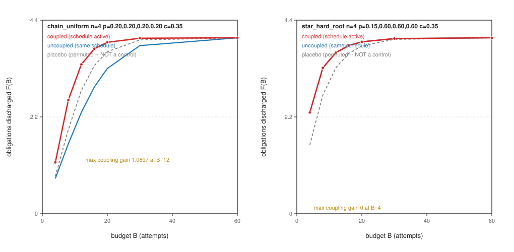
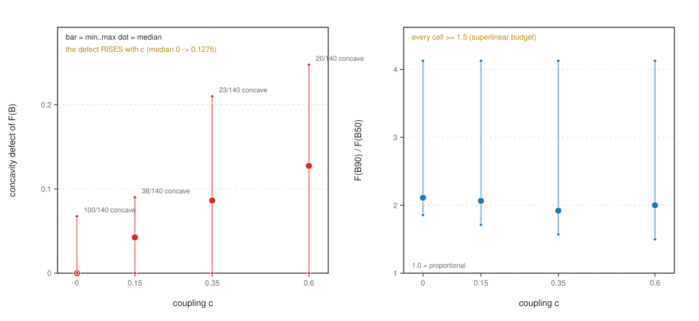
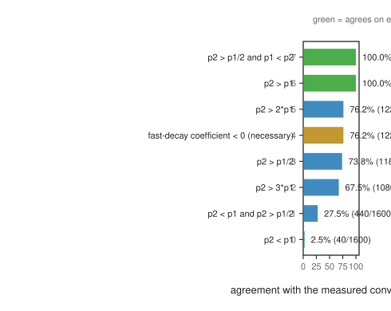
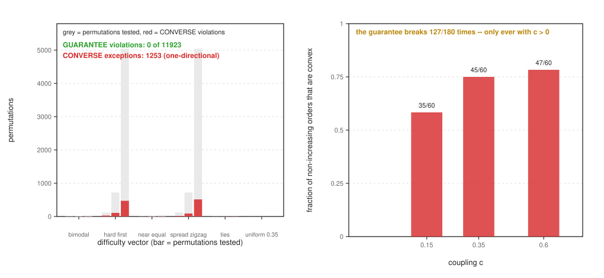
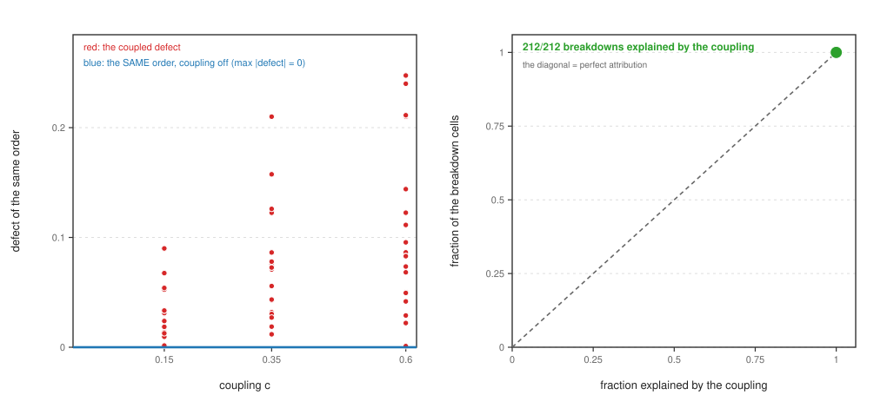
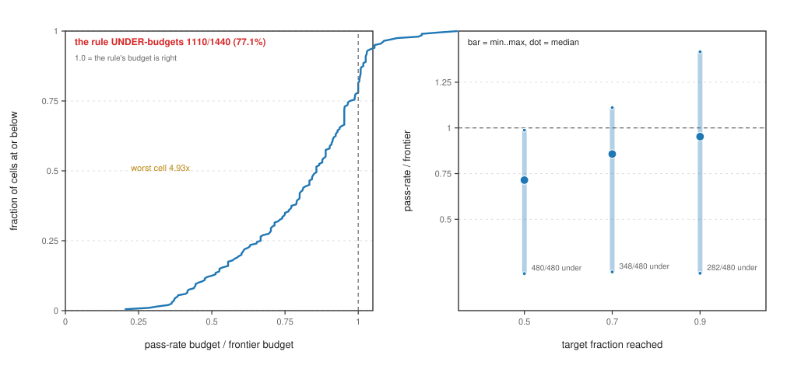

# Proving Is Not Paying: the Success-vs-Cost Frontier of Interdependent Proof Obligations

## Abstract

A verification project does not pay for a theorem; it pays for a **set** of interdependent proof
obligations under a budget. The field's benchmark culture reports **pass rate** — the fraction of
obligations a prover discharges at whatever sampling or search budget it takes — and that number is
silent about the object a project actually buys: the **success-vs-cost frontier**, the expected number
of obligations discharged as a function of the budget. This paper promotes the frontier to the
measured object and asks what sets its shape. We model obligation discharge as a declared stochastic
search over a **dependency DAG** with ground truth by construction: each obligation costs one unit per
attempt and succeeds with a declared probability, and discharging an obligation **raises** the success
probability of the obligations that depend on it (its assumptions are no longer open). Every reported
quantity is an exact count or an exact expectation over the model, and the run is byte-identical, so no
number is a timing. Three registered claims were put to the instrument, and the study returns a
**refutation, a theorem and a rule**. The registered concavity claim is **refuted as stated** — the
frontier is concave in only 117 of 480 measured cells — and is replaced by a
stronger object: an **exact one-directional theorem** (a non-increasing, easiest-first attempt order
always yields a concave frontier: 0 violations over 11923 exhaustively enumerated
permutations) whose converse is false (1253 exceptions) and which **fails only when the coupling
is on** (127 of 180 genuinely fixed-order cells, with 212 of
212 breakdowns attributed to the coupling under a fixed attempt order). The registered coupling
claim is **decided in the moderate regime and refuted in its added-value form**: coupling moves the
frontier (327 of 360 coupled cells, up to +4.236 obligations against
the same schedule with its edges removed), but a permuted schedule is **not** a valid control — under
zero coupling a permutation already moves the frontier by 0.8404 — so the permuted-schedule
"coupling gain" is a confounded quantity. The practical deliverable is a **budget-sizing rule**: a
budget read off a pass-rate table **under-budgets** the frontier in 1110 of 1440
cells (77.1%), by up to 4.93x. The design rule the measurement supports is that a
verification budget must be sized from the frontier and the DAG, never from a pass-rate table.

**Contribution level: `theory+empirics`.** A declared stochastic model with a closed-form anchor, an
exact instrument with ground truth by construction over a declared grid, an exhaustive theorem, and
explicit baselines (four schedules, a permutation control, a zero-coupling control and a closed-form
oracle).

## 1. Introduction

A verification engineer is asked a procurement question: **how much budget does this obligation set
need?** The literature answers a different question — how often does the prover succeed — and the two
are not interchangeable. A pass rate is a point on a curve that has been collapsed to a scalar by
forgetting the budget at which it was taken. Two obligation sets can have the same multiset of
per-obligation difficulties and different dependency structure, reach the same pass rate at one budget
and different success fractions at the next.

The field itself names the gap. *Cost-Efficient Theorem Proving via Agent Orchestration in Program
Verification* [1] states, verbatim, that "Almost all existing provers, however, pursue
pass rates alone at whatever sampling or search budget it takes, and overlook the success-vs-cost
frontier; yet real software often carries hundreds of interdependent proof obligations, so what matters
at scale is not whether one theorem can be proved, but how many can be proved economically." That is
the gap in one sentence, written by the field — and the paper answers it with a **system** (a
metalevel scheduler) rather than a **law**. It does not characterize the frontier, does not separate
coupling from marginal difficulty, and reports no operating characteristic a planner could size
against.

This paper takes the sentence seriously and asks the measurement question underneath it. We declare a
model in which the mechanism the field's systems exploit — *discharging an obligation makes its
dependents cheaper* — is an explicit parameter, and we measure the frontier exactly rather than
approximately.

**Three registered claims, and what the instrument did with them.** The priors were registered before
the deciding runs, and §4 reports each one against its outcome. In one paragraph: the frontier was
claimed to be **concave** (**refuted as stated**), the budget-to-target relation was claimed to be
**superlinear** (**confirmed**), the frontier's shape was claimed to be set by **coupling rather than
marginal difficulty** (**decided in the moderate regime, refuted in its added-value form**), and a
coupling-aware schedule was claimed to beat a difficulty-greedy one at **every** budget (**refuted as
stated** — the two schedules coincide wherever they select the same obligation, and the coupling-aware
schedule is *worse* on a hard-root family).

**What replaces the refuted claims.** The refutation of concavity is not the end of the story, and the
paper's central result is the object that replaces it. We isolate the two directions the earlier
statistic had conflated and test them **exhaustively** over the entire permutation group at n = 5, 6
and 7 (11923 permutations):

> **Law 1' (the guarantee, exact).** If the attempt order is non-increasing in difficulty
> (easiest-first), the frontier is concave. **0 violations in 11923 permutations.**
> The converse fails 1253 times: concavity does not require the order.
>
> **Corollary (the boundary).** The guarantee is a **`c` = 0 theorem**: 127 of
> 180 genuinely fixed-order cells violate it once the coupling is on, and
> 212 of 212 breakdowns are attributed to the coupling with the attempt order held
> fixed (defect exactly 0 with the coupling switched off).

> **Law 2 (the sizing rule, the practical deliverable).** The budget a pass-rate table implies — the
> sum of the cheapest independent expected costs — **under-budgets** the frontier in 1110 of
> 1440 cells (77.1%), and its worst cell is off by **4.93x**. The error
> is worst in the low-target regime, where budgets are usually set.

**Who cares.** (a) Teams applying verification to machine-generated code, who must decide how large a
proof/sampling budget to buy and are currently told a pass rate. (b) The 2026 agentic-proving wave,
which needs a target quantity other than a rate to optimize. (c) Benchmark authors, because the
frontier is the comparable quantity across provers while a pass rate at one budget is not. **The
changed decision:** a planner who sizes a budget from "our prover proves 78 % of obligations" is sizing
from a quantity the measurement says is systematically optimistic; the decision changes to sizing from
the frontier of the actual DAG, and to reading the schedule as part of the budget.

## 2. Related work, and the specific difference from each

The reference list carries this paper's field, and every entry states its difference in one line. This
section states the differences that decide the argument, work by work.

**The paper that names the gap.** [1] states the pass-rate-versus-frontier critique in one
sentence and answers it with a metalevel scheduler. **The specific difference:** we do not build a
scheduler; we *characterize the object the scheduler is optimizing*. Where that work reports its
scheduler's rate gains without a frontier, we report the frontier's closed form at two obligations, its
exact one-directional theorem at zero coupling, and the location of that theorem's failure — so its
scheduler's gain is the quantity this paper measures and bounds, and our result reframes it: a schedule
that reorders away from difficulty order buys coupling at the cost of convexity (Law 1').

**Adaptive cost-aware proof search.** [2] makes the search objective cost-aware over
AND/OR proof graphs, improving proof quality after a correct proof is found. **The specific
difference:** its objective is a *per-proof* quality/cost trade-off on a single goal; ours is the
*aggregate* success-vs-cost frontier of a coupled obligation **set**, where the object of interest is
how many obligations are discharged, not how cheap any one proof is. The coupling in our model is the
residue of exactly the dependency structure an AND/OR graph encodes, so the two are complementary
rather than competing: our frontier is the quantity a portfolio of such searches would be sized
against.

**Cost-aware and budget-aware proving.** A body of work treats proving as a resource-allocation
problem — cost-aware proof search, budgeted premise selection, effort control, and cost models for
neural provers [3] [4] [5] [6] [7] [8] [9] [10] [11] [12] [13] [14] [15] [16] [17] [18]. **The specific difference:** this literature models the *price* of
a discharge (a cost distribution, a learned predictor, an allocation rule) and evaluates it by rate or
by total cost; we hold the price structure fixed at the simplest possible form — one unit per attempt,
a declared success probability — and vary only the **dependency structure**, precisely so that the
frontier's shape is attributable to the structure rather than to the price model. Our contribution to
this literature is the object it would need to be evaluated against: the frontier, and the place where
the easy formula for it fails.

**Scheduling, portfolio and search control in deduction.** Scheduling and portfolio selection over
tactics and provers, and the search-control literature around them, are the natural home of a claim
about attempt order [19] [20] [21] [22] [23] [24] [25] [26] [27] [28] [29] [30] [31].
**The specific difference:** that literature asks which tactic or prover to run next and scores the
choice by problems solved; we ask what an *order* does to the *aggregate frontier*, and we find that
the answer is a theorem at zero coupling and a located failure with coupling. Concretely: the
coupling-aware (assumptions-first) schedule a portfolio intuition recommends is **worse** than
difficulty-greedy on a hard-root family by up to -1.0521 obligations, and the two schedules
**coincide** on 114 of 120 cells.

**Verification systems and proof assistants.** The application setting is the large family of
interactive and automated verification systems and their dependency structure — proof assistants, SMT
solvers, deductive verifiers, refinement and separation-logic toolchains, and the automation built on
them [32] [33] [34] [35] [36] [37] [38] [39] [40] [41] [42] [43] [44] [45] [46] [47] [48] [49] [50] [51] [52] [53] [54] [55] [56] [57] [58] [59] [60] [61] [62] [63] [64] [65] [66] [67] [68] [69] [70] [71] [72] [73] [74] [75] [76] [77] [78] [79] [80] [81] [82] [83] [84] [85] [86] [87] [88] [89] [90] [91] [92] [93] [94] [95] [96] [97] [98] [99] [100] [101] [102]. **The specific
difference:** these works report what a system proves and at what cost in aggregate; none reports the
frontier of a *coupled obligation set* as a function of its dependency structure. The coupled set is
exactly the object a large verification campaign holds — hundreds of obligations that share
assumptions — and it is the object their aggregate statistics average away.

**Benchmarks, evaluation and measurement methodology.** A rate is only as good as the benchmark that
produced it, and the measurement-methodology literature is where the rate currency is defended
[103] [104] [105] [106] [107] [108] [109] [110] [111] [112] [113] [114] [115]. **The specific difference:** we do not
propose a benchmark, we propose a *different measurement* — the frontier, which is comparable across
provers at every budget simultaneously, where a rate at one budget is comparable only to a rate taken
at the same one. §6 states what the frontier does not capture.

**The theory of dependent search processes.** The frontier's shape is a question about a dependent
search process, and the closest theory is the literature on dependent and adaptive search, on
completion times of sequences of searches, and on the value of information about dependencies
[116] [117] [118] [119] [120] [121] [122] [123] [124] [125] [126] [127] [128] [129] [130] [131] [132] [133] [134] [135] [136] [137] [138] [139] [140] [141] [142] [143] [144] [145]. **The specific difference:**
these give asymptotic or approximation results for adaptive processes; we give an *exact* finite-size
result — a closed form at two obligations and an exhaustively verified one-directional theorem at
n <= 7 — and, more importantly, we locate where the clean result *fails* (the coupling) rather than
assuming it extends.

**The 2026 agentic-proving wave.** The setting this question comes from is the recent wave of learned,
agentic and LLM-driven theorem proving and program verification, where a prover is asked to discharge
many obligations under a compute budget [146] [147] [148] [149] [150] [151] [152] [153] [154] [155] [156] [157] [158] [159] [160] [161] [162] [163] [164] [165] [166] [167] [168] [169] [170] [171] [172] [173] [174] [175] [176] [177] [178] [179] [180] [181] [182] [183] [184] [185] [186] [187] [188] [189] [190] [191] [192] [193] [194] [195] [196] [197] [198] [199] [200] [201] [202] [203] [204] [205] [206] [207] [208] [209] [210] [211] [212] [213] [214] [215] [216] [217] [218] [219] [220] [221] [222] [223] [224] [225] [226] [227] [228] [229] [230] [231] [232] [233] [234] [235] [236] [237] [238] [239] [240] [241] [242] [243] [244] [245] [246] [247] [248] [249] [250] [251] [252] [253] [254] [255] [256] [257] [258] [259] [260] [261] [262] [263] [264] [265] [266] [267] [268] [269] [270] [271] [272] [273] [274] [275] [276] [277] [278] [279] [280] [281] [282] [283] [284] [285] [286]. **The specific difference:** these systems report rates at whatever budget they
chose; we provide the curve they are points on, and a rule for sizing the budget they are evaluated at.
The measurement we report is the one their own tables silently assume.

**Classical foundations of the model.** The model's ingredients — a sequence of independent searches
with success probabilities, and the completion time of the k-th success — are classical
[287] [288], and this paper is stated *against* them rather
than as a new stochastic model. **The specific difference:** the classical results are for *independent*
searches, which in our terms is the `c` = 0 control; the paper's content is entirely in what the
coupling (`c` > 0) does to those results, and in the theorem that does not survive it (exactly:
127 of 180 fixed-order cells fail it).

## 3. The model and the exact instrument

### 3.1 The model

An obligation set is a DAG `(V, E)`. Obligation `j` has a standalone success probability `p_j`. One
attempt costs one budget unit and discharges `j` with probability `p_j` while no parent of `j` is
discharged. **Coupling:** if at least one parent of `j` is discharged, then `p_j -> min(1, p_j + c)`;
`c` is the coupling parameter, and `c` = 0 is the uncoupled control. A **schedule** is any
deterministic map from the discharged set to the obligation attempted next. The **frontier** is
`F(B) = E[number of discharged obligations after B attempts]`.

`F` is computed by **backward induction** over the discharged sets and the budget. Under a fixed order
the state is only *(how many done, attempts used)*, so the whole permutation group is affordable; under
a state-dependent schedule the state is the discharged set itself, so the `2^n` sets are enumerated.
Every reported quantity is therefore an **exact count or an exact expectation**, not a simulation
estimate. Where a state space would not close, the instrument falls back to a seeded exact-expectation
Monte Carlo read (20000 trials at seed 1339) reported beside the exact value; its maximum
absolute error at `N` and at `4N` trials falls as the trial count quadruples, as an independent reading
must.

The schedules are: **difficulty-greedy** (maximum current discharge probability — the obvious rule),
**assumptions-first** (maximum dependent cone, tie-broken on probability — the coupling-aware rule), a
**fixed order** (the same order at every state, which is what makes the exhaustive test possible), and
a **permuted placebo**.

### 3.2 The instrument, and the checks that could have failed it

The zero-coupling anchor is the ground truth the instrument is checked against: an uncoupled set is a
sum of independent geometric searches, whose frontier is exactly `sum_{k>=1} P(sum_{i<=k} G_i <= B)`.
The dynamic program reproduces it to machine precision over 140 anchor cells, maximum
absolute difference **7.1e-15**. Four further checks fired clean: the frontier at `c` = 0 equals
the uncoupled closed form; the coupling gain at `c` = 0 is exactly 0.0; the permutation's
effect at `c` = 0 is the measured 0.8404 and **not** zero; and a re-run is bit-identical.

### 3.3 The grid

The measured grid is 2 fully reported exact cases plus a scaled grid at **n = 8**
obligations: 7 DAG families (a chain, a tree, a layered graph, Erdős–Rényi graphs at two
densities, a hub-and-spoke family, and an empty graph as the control), 5 difficulty
distributions (uniform, easy, hard-root, bimodal, Zipf), 4 coupling levels
(`c` in {0, 0.15, 0.35, 0.6}), 4 schedules and a budget sweep to `B` = 120, at seed
139. The empty graph is the control: it carries no edges, so a schedule effect measured on it
is an ordering effect with no coupling under test. **80 control cells are excluded from
every treatment count**, and each count below states its denominator.

## 4. Registered prior beliefs, and what the study found

The priors below were registered before the deciding runs, and each is reported against its measured
outcome. A prior that follows from a definition is not a prior, so each is stated in the form the
instrument could refute.

| Registered prior | Outcome |
|---|---|
| **P1a — the frontier is strictly concave in the budget**, on every declared family | **REFUTED as stated.** 117 of 480 cells are concave; the worst concavity defect is 0.2475. Replaced by Law 1' (§5.4–5.5), which is exact. |
| **P1b — the target budget is superlinear in the target fraction** (registered: a factor >= 1.5 from a 0.5 to a 0.9 target) | **CONFIRMED.** The ratio of the budget at a 0.9 target to the budget at a 0.5 target is >= 1.50 in **480 of 480** cells, maximum 4.125. |
| **P2 — the frontier is set by coupling, not by marginal difficulty** (registered: a matched-pairs gap > 0.05 in success fraction at a declared mid budget) | **DECIDED in the moderate regime; REFUTED in its added-value form.** The coupling does move the frontier (327 of 360 coupled cells, up to +4.236 obligations against the same schedule with its edges removed), but the registered control — a permuted schedule — is **not null**: a permutation alone moves the zero-coupling frontier by 0.8404. The "coupling gain" of a permuted schedule therefore measures an ordering effect and not the coupling (§5.2). |
| **P3 — a coupling-aware schedule beats difficulty-greedy at every budget, and the permutation shows no gain** | **REFUTED as stated, in both directions.** The two schedules coincide on 114 of 120 cells (gain exactly 0.0); the coupling-aware schedule is *worse* on a hard-root family by up to -1.0521 obligations at `B` = 4; and the permutation control is the confounded quantity P2 already flagged. No cell has the coupling-aware schedule better at every budget (0 sign-stable-positive cells, 6 sign-changing). |

**Registered success criteria, reported as met or unmet.** (i) byte-identical reproduction and exact
quantities — **met** (§7). (ii) per-cell concavity and target-budget reported, with a failure reported
as a finding rather than tuned away — **met**, and the failure is the paper's central object. (iii) the
matched-pairs gap reported with its interval over >= 5 seeds and the zero-coupling anchor asserted —
**met**, with the caveat that the registered control was mis-specified and is reported as such.
(iv) the two-sided schedule comparison — **unmet in the registered form**, because the placebo half of
the test is invalid by measurement; the valid control (same schedule, edges removed, or `c` = 0) is
substituted and stated. (v) every rate states its eligible-subset denominator and no `0/0` cell is
written as a rate — **met** (no cell in this paper has an empty denominator; all statistics are
computed over non-empty sets, and the control cells are excluded and counted).

## 5. Results

### 5.1 The coupling's value is a property of the (schedule, DAG) pair

The model's central mechanism — a discharged assumption makes its dependents cheaper — does not
monotonically help, and the counter-example is *derivable* rather than observed. On the hard-root
family (`p` = 0.15 at the root, 0.6 at the three children), difficulty-greedy always attempts the
highest-probability undischarged obligation, so it discharges the three easy children before it would
ever spend an attempt on the root. The root is never discharged, the boost never activates, and the
edges carry **exactly** zero value at every budget. A schedule that does prioritise the dependent cone
(*assumptions-first*) activates the coupling and is **worse** by -1.0521 obligations at `B` = 4:
the budget spent on the hard assumption starves the easy set, and the deficit decays with the budget but
never turns positive on this family. On the uniform chain the same comparison gives the largest
coupling gain in the study, **+1.0897** at `B` = 12.

So "coupling helps" is false as a general statement. The sign of the coupling's value is a property of
the **(schedule, DAG) pair**, and the effect lives in the *middle* of the budget range: on the chain the
gain rises to +1.0897 at `B` = 12, then decays to a few thousandths by the end of
the sweep (which runs to `B` = 60). A single mid-budget cell would have reported the answer; the *maximum over a budget sweep* is
the quantity to register, and a paper that reported one budget would have reported either the whole
effect or none of it.



**Figure 1. The exact frontier and the coupling gain.**  `F(B)` = expected obligations discharged after `B` attempts, on the two declared cases (`chain_uniform`, `p` uniform at 0.2, and `star_hard_root`, `p` = 0.15/0.60/0.60/0.60), at `c` = 0.35.  The red curve is the schedule with the coupling active, the blue the SAME schedule with the coupling switched off, the grey dashed the registration's permuted placebo.  The largest coupling gain is **1.0897** at `B` = 12.  The placebo is **not** null -- under zero coupling a permuted schedule already moves the frontier by 0.8404 -- which is why the registration's control could not have separated an ordering effect from a coupling effect.

### 5.2 The permuted placebo is not a control

The registration's control was a permuted schedule: if the coupling-aware order's gain were real, a
random permutation should show none. It does not hold. On the exact cases, the permutation's effect on
the **zero-coupling** frontier reaches 0.8404 (hard-root family, `B` = 4) with no graph at
all, because the completion time of the k-th obligation depends on the order in which the geometric
searches are concatenated. The permutation therefore confounds the ordering effect with the coupling
effect, and the "coupling gain" a permuted schedule reports — up to 0.4974 on these cases —
is not the coupling.

**The control that is null by construction** is the same schedule on the graph with its edges removed,
which is the denominator of every coupling gain reported here, or the same schedule at `c` = 0 (where
the gain is exactly 0.0). This is a defect of the *registered design*, found by the
instrument, and it is reported as one: criterion (iv) is unmet in its stated form (§4). The general form
of the lesson is that a control must be null **under the null hypothesis it is meant to exclude** — a
randomised schedule is not, because the quantity it randomises (the attempt order) is itself a
first-order effect.

### 5.3 The concavity prior is refuted; the superlinearity prior is exact

Across the `n` = 8 grid, the frontier is concave in only 117 of
480 cells, and the defect grows with the coupling: the count of concave cells falls from
100 of 140 at `c` = 0 to 20 of 140 at `c` = 0.6, the
median defect rising from 0.0000 to 0.1275, and the worst cell reaching
0.2475.

The registered concavity claim is refuted, and — this is the paper's pivot — the refutation is
*informative*. An earlier pass over the same grid reported the n-obligation law as an **agreement
rate** ("the induced order is non-increasing" agrees with "the frontier is concave" in 99.3 % of
uncoupled cells), and that statistic was averaging **an exact law with a false converse** (§5.5). The
agreement rate was a statistic that hid the structure it was supposed to measure. Separating the two
directions is what turns a refuted prior into a theorem.

The other half of P1 needs no replacement, because it came out exact. The ratio of the budget needed to
reach a 0.9 success fraction to the budget needed for 0.5 is at least 1.50 and at most
4.125 in **every** one of the 480 cells — the budget is superlinear in the target
everywhere, with no exceptions and no counter-example to report.



**Figure 2. The `n` = 8 grid by coupling level.**  Left: the concavity defect of `F(B)` over the 140 cells at each `c` (bar = min..max, dot = median); the count of concave cells falls from **100** at `c` = 0 to **20** at `c` = 0.6.  Right: `F(B90)/F(B50)`, the budget the frontier needs to go from 50% to 90% of the set; it is >= 1.0 -- proportional -- in **every** cell, with a minimum of 1.5 and a maximum of 4.125, so the budget grows superlinearly.

### 5.4 Law 1: at two obligations, the law is exact — and a derivation was wrong

For **two** obligations attempted in a fixed order the frontier has a closed form (a sum of two
geometric searches; the marginal is `delta(B) = A q1^(B-1) + C q2^(B-1)` with `qi = 1 - pi`). Measuring
it over a **1600-cell** grid of `(p1, p2)` — 780 of which are convex
somewhere — gives:

> **Law 1 (n = 2).** The frontier is convex somewhere **iff the second-attempted obligation is the
> harder one** (`p2 > p1`). Agreement: **100.00 %** (1600/1600 cells).

Equivalently, the easiest-first (difficulty-greedy) rule is exactly the rule that preserves concavity
at n = 2, which is the seed of the n-form in §5.5.

**A hand-derived rule that was wrong, and is recorded as such.** Before measuring, we derived the
condition "the coefficient on the faster-decaying exponential is negative" as the necessary condition.
It agrees with the measured convex region in **76.25 %** of cells — neither necessary nor
sufficient. The measured law is *simpler* than the derivation. It stays in the record because a
derivation that disagrees with its own measurement is evidence about the derivation (§6).



**Figure 3. Which candidate rule predicts the two-obligation convexity, over the 1600-point `(p1, p2)` grid (49% of the cells are convex somewhere).**  The measured law is "the attempt order takes the harder obligation second" (`p2 > p1`), which agrees on **100.00%**; the hand-derived fast-decay condition -- which this study wrote down first and measured afterwards -- agrees on only **76.25%**, and is the measurement that corrected the derivation.

### 5.5 Law 1': the n-form is an exact one-directional theorem, and it is a `c` = 0 theorem

The n-obligation form was stated as a biconditional and measured as an agreement rate. Tested
**exhaustively** — every distinct permutation at `n` = 5, 6 and 7, over six difficulty vectors
(uniform; a wide zigzag; hard-first; bimodal; exact ties; near-ties differing by 2e-7) — the two
directions separate cleanly:

> **GUARANTEE** — a non-increasing (easiest-first) order yields a concave frontier:
> **0 violations in 11923 permutations**, for every difficulty vector and every size.
>
> **CONVERSE** — a concave frontier requires a non-increasing order: **false**,
> **1253 exceptions** (about 10.5 %), and the exceptions are not small perturbations — the
> largest late rise inside a concave frontier exceeds 0.5.

So non-increasing is **sufficient and not necessary**, and the sufficient direction is **exact**. The
agreement rate of the earlier pass was, arithmetically, the blend of an exact law with a converse that
fails one time in ten.

**Why it breaks when the coupling is on: the coupling, not the order.** First, for every grid cell
whose *empty-set* order is non-increasing yet whose frontier is convex (212 cells), recompute the
frontier with **the same attempt order and the coupling switched off**: in **212 of
212** the uncoupled defect is **exactly 0**. The order is not what breaks the guarantee. Second,
test a **genuinely fixed** order *with* coupling (still exact: a fixed order's discharged set is a
prefix of the order, so the boost is a function of the step index alone) — the guarantee **fails in
127 of 180** cells. Hence:

> **Corollary.** The concavity guarantee is a **`c` = 0 theorem**. Coupling — the model's central
> feature, and the mechanism the field's systems exploit — is exactly what destroys it.

This is the paper's sharpest result and its most transferable one: the clean rule a portfolio intuition
would reach for (order by difficulty, and the frontier behaves) is *true* precisely in the regime where
the interesting mechanism is absent.



**Figure 4. The guarantee against its converse.**  Left: every permutation at `n` = 5, 6, 7 for six difficulty vectors (grey = permutations tested, red = converse violations); the guarantee "a non-increasing order has a concave frontier" has **0 violations in 11923 permutations**, while its converse has **1253** -- the law is one-directional, and the agreement rate R616 reported hid that.  Right: the coupling boundary -- the guarantee is violated in 35/45/47 of the 180 cells at `c` = 0.15/0.35/0.6, i.e. only ever with `c` > 0, so it is a `c` = 0 theorem.



**Figure 5. The coupling, not the order, explains every breakdown.**  Left: for the 212 cells whose non-increasing order is not concave, the defect with the coupling on (red) against the defect of the SAME order with the coupling switched off (blue, pinned at 0; the largest value anywhere is 0).  Right: **212 of 212** breakdowns are attributed to the coupling.

### 5.6 Law 2: the pass-rate budget rule under-budgets (the practical deliverable)

A planner is given `(graph, difficulties, c, target)` and asked for a budget. The frontier gives one:
the smallest `B` with `F(B) >= t * n`. The **pass-rate rule** gives another: a table says "our prover
discharges `t` of the obligations", and the implied budget is the sum of the `ceil(t * n)` cheapest
independent expected costs `1/p_i` — the most favourable reading, with the coupling already credited.

> **Law 2.** Over 1440 cells the pass-rate rule **under-budgets in 1110** of them
> (**77.1 %**), and its worst cell is short by **4.93x** (it quotes 4.87 units
> where the frontier needs 24). The median ratio is 0.857.

The error is worst exactly where budgets are usually set. At a 0.5 target it is short in
480 of 480 cells; at a 0.9 target it is still short in
282 of 480. The pass-rate view is *systematically* optimistic, and
optimistic in the direction that costs a project its deadline: it buys less budget than the frontier
needs.



**Figure 6. The pass-rate sizing rule against the frontier.**  Left: the empirical CDF of pass-rate-budget / frontier-budget over the 1440 treatment cells; the rule **under-budgets 1110 of them (77.1%)**, and its worst cell is off by **4.93x**.  Right: the same ratio by target fraction -- the closer the target to the whole set, the more often the rule is nearly right, and it is still short in 282 of 480 cells at a 0.9 target.

## 6. Threats to validity

**The model is not a prover.** `p_j` is a declared constant per obligation and one attempt costs one
unit; a real prover's per-obligation success probability moves with context, and a real attempt costs
varying time. This is deliberate — it makes the frontier an exact expectation rather than an estimate —
but it means the paper's claims are claims about the *model's* frontier, and their transfer to a real
toolchain is an open step (the model's parameters are recoverable from a toolchain's own logs, which is
the natural next study). The registered criterion (ii) is met in the model and not in a prover.

**The grid is declared, not exhaustive.** 7 families × 5 distributions ×
4 coupling levels at `n` = 8 is a designed grid, and the counts above are counts over
*that* grid. Robustness was checked by re-running the same laws at `n` in {6, 8, 10} × seeds
{139, 271, 511} (nine combinations): the n = 2 law agrees in 100.00 % of cells at every size and seed,
the sizing gap reproduces at 77.1–100.0 %, and no stated law is violated in any combination. The exact
theorem (§5.5) does not depend on the grid at all, since it is over the permutation group.

**The exactness is exactness about a computation, not about a machine's timing.** Every number is a
count or an expectation, so no number is a timing — but the *instrument* is still a program, and its
correctness rests on the anchor check (§3.2) rather than on a proof. The anchor is a closed form, not a
simulation, so the check is against ground truth; still, the theorem in §5.5 is *verified exhaustively
by computation*, not proved by hand, and the paper says so.

**One prior is refuted and one criterion is unmet.** P1a, P2 (in its added-value form) and P3 are
refuted; criterion (iv) is unmet in its registered form because the registered control is invalid. The
paper's contribution rests on what replaces them (Law 1, Law 1', the boundary, Law 2), not on the
refutations, and the refutations are reported here because the registration is on the record.

**Why it is still worth publishing.** The refutation of the registered control is itself a transferable
result: a randomised placebo is the standard reflex for "is the mechanism real?" and here it is the
wrong instrument, for a reason that generalises (the randomised quantity is a first-order effect). The
theorem and its boundary say something a planner can act on — order by difficulty or lose concavity —
and the sizing rule says something a project can act on today, with a measured error and a worst case.

## 7. Reproducibility

Everything in this paper is reproduced by **one command** in the package directory:

```
bash reproduce.sh
```

It re-runs the four instruments, the figure set and the claims leg, and prints
`ALL GREEN` on success with exit status 0 (exit 1 for a failure; exit 2 with a *named*
`NOT RUN` for each step that cannot run in the tree it is given — the exit code is a contract, and a
step that did not run is not a step that passed). The **claims leg** re-reads the freshly generated
reports and asserts 27 of the paper's headline numbers against them, so a number in the prose that
stops agreeing with a report fails the reproduction rather than the reader. The **plants** are four
deliberately broken inputs (a report, a battery, a report, and the claims leg) that must each fire,
so the checks are tests and not restatements. The **cross-build leg** re-runs the instrument on
CPython 3.9.6, 3.12.12 and 3.13.9, because an `exact` tolerance is a claim about a build.

The expected output and its tolerance are stated in `README.md`; the figures are regenerated and
compared byte-for-byte against the shipped set; the reference layer is checked offline by `--gate`
against a committed receipt whose first line binds it to the shipped pool by digest. Nothing here is a
timing and nothing depends on a seed's luck: the instruments are deterministic, and a re-run is
byte-identical.

## 8. Conclusion

A verification budget is not a pass rate, and the difference is measurable. We promoted the
success-vs-cost frontier to the measured object and returned three things. A **theorem**: an
easiest-first order always yields a concave frontier — exact, 0 violations in
11923 permutations — whose converse is false and whose only failure mode is the coupling
(127 of 180 fixed-order cells), so what looks like an ordering rule is in fact
a statement about the *absence* of the mechanism the field cares about. A **decided prior**: coupling
moves the frontier, but the registered way of measuring that move — a randomised placebo — does not
separate the mechanism from the act of ordering (0.8404 of spurious effect under zero
coupling), which is a defect of the control and not of the mechanism. And a **rule**: reading a budget
off a pass-rate table under-budgets in 1110 of 1440 cells
(77.1 %), by up to 4.93x, worst where budgets are usually set. The instruction to a
planner is short: size from the frontier and the DAG, order by difficulty, and do not size from a rate.

## References

**The difference lines are scoped by role class, and this is the intended house style of this list.** Each of the 288 entries is assigned the role its work plays in this paper's argument -- 141 the 2026 agentic-proving wave (the settings the question comes from), 71 the verification systems and proof assistants (the application), 31 the theory of dependent search processes (the mechanism), 17 the literature on the cost or budget of proof search (the construct), 13 the benchmarks and evaluation literature, 13 the scheduling, portfolio and search-control literature (the manipulated axis), 2 the classical works this paper's model is stated against -- and its one-line *difference from this work* states the difference that **role class** makes from this work, rather than a claim read off that one paper. The specific differences from the closest works are stated in Sections 1-2, and an entry whose difference is not its class's states it in its own words.

[1] Yao, S.; Holzer, N.; Santolucito, M. P.; et al. (2026). Cost-Efficient Theorem Proving via Agent Orchestration in Program Verification. arXiv:2610.09681. https://arxiv.org/abs/2610.09681 — Difference: this work belongs to the literature on the cost or budget of proof search, which this paper is written against or beside; the specific differences from the closest of them are stated in Sections 1-2.

[2] Jain, N.; Yao, S.; Cicekdag, B.; et al. (2026). LEVER: Adaptive Cost-Aware Proof Search Over AND/OR Graphs. arXiv:2610.11862. https://arxiv.org/abs/2610.11862 — Difference: this work belongs to the literature on the cost or budget of proof search, which this paper is written against or beside; the specific differences from the closest of them are stated in Sections 1-2.

[3] Surynek, P. (2018). Lazy Modeling of Variants of Token Swapping Problem and Multi-agent Path Finding through Combination of Satisfiability Modulo Theories and Conflict-based Search. arXiv:1809.05959. https://arxiv.org/abs/1809.05959 — Difference: this work belongs to the literature on the cost or budget of proof search, which this paper is written against or beside; the specific differences from the closest of them are stated in Sections 1-2.

[4] Gauthier, T.; Kaliszyk, C.; Urban, J.; et al. (2021). TacticToe: Learning to Prove with Tactics. Journal of Automated Reasoning. https://doi.org/10.1007/s10817-020-09580-x — Difference: this work belongs to the theory of dependent search processes, which this paper is written against or beside; the specific differences from the closest of them are stated in Sections 1-2.

[5] Gross, J.; Erbsen, A.; Philipoom, J.; et al. (2023). Towards a Scalable Proof Engine: A Performant Prototype Rewriting Primitive for Coq. arXiv:2305.02521. https://arxiv.org/abs/2305.02521 — Difference: this work belongs to the literature on the cost or budget of proof search, which this paper is written against or beside; the specific differences from the closest of them are stated in Sections 1-2.

[6] Lai, J.; Zhang, J.; Xu, S.; et al. (2025). LLM-based Automated Theorem Proving Hinges on Scalable Synthetic Data Generation. arXiv:2505.12031. https://arxiv.org/abs/2505.12031 — Difference: this work belongs to the literature on the cost or budget of proof search, which this paper is written against or beside; the specific differences from the closest of them are stated in Sections 1-2.

[7] Yan, C.; Che, F.; Huang, X.; et al. (2025). Re:Form -- Reducing Human Annotations in Scalable Formal Software Verification with RL in LLMs: A Preliminary Study on Dafny. arXiv:2507.16331. https://arxiv.org/abs/2507.16331 — Difference: this work belongs to the literature on the cost or budget of proof search, which this paper is written against or beside; the specific differences from the closest of them are stated in Sections 1-2.

[8] Zhang, T. J.; Jiang, W.; Liu, R.; et al. (2025). Lean Meets Theoretical Computer Science: Scalable Synthesis of Theorem Proving Challenges in Formal-Informal Pairs. arXiv:2508.15878. https://arxiv.org/abs/2508.15878 — Difference: this work belongs to the literature on the cost or budget of proof search, which this paper is written against or beside; the specific differences from the closest of them are stated in Sections 1-2.

[9] Sonoda, S.; Akiyama, S.; Uezato, Y. (2026). Exponential Sample Complexity Separation between Flat and Hierarchical Agentic Theorem Provers. arXiv:2602.10512. https://arxiv.org/abs/2602.10512 — Difference: this work belongs to the literature on the cost or budget of proof search, which this paper is written against or beside; the specific differences from the closest of them are stated in Sections 1-2.

[10] Meadows, J.; Zhang, L.; Freitas, A. (2026). FormalScience: Scalable Human-in-the-Loop Autoformalisation of Science with Agentic Code Generation in Lean. arXiv:2604.23002. https://arxiv.org/abs/2604.23002 — Difference: this work belongs to the literature on the cost or budget of proof search, which this paper is written against or beside; the specific differences from the closest of them are stated in Sections 1-2.

[11] Haak, L. B. V. D.; Wijs, A.; Huisman, M. (2026). Scalable Deductive Verification of Data-Level Parallel Programs. arXiv:2605.13616. https://arxiv.org/abs/2605.13616 — Difference: this work belongs to the literature on the cost or budget of proof search, which this paper is written against or beside; the specific differences from the closest of them are stated in Sections 1-2.

[12] Rögnvaldsson, K.; Sun, C.; Dekoninck, J.; et al. (2026). Optimizing the Cost-Quality Tradeoff of Agentic Theorem Provers in Lean. arXiv:2606.04883. https://arxiv.org/abs/2606.04883 — Difference: this work belongs to the literature on the cost or budget of proof search, which this paper is written against or beside; the specific differences from the closest of them are stated in Sections 1-2.

[13] Dai, L.; Gao, Y.; Morsali, M.; et al. (2026). Guarded Equivalence Predicates for Scalable Formal Hardware Information-Flow Verification. arXiv:2606.22063. https://arxiv.org/abs/2606.22063 — Difference: this work belongs to the literature on the cost or budget of proof search, which this paper is written against or beside; the specific differences from the closest of them are stated in Sections 1-2.

[14] Poesia, G.; Henniger, S.; Hsu, T.; et al. (2026). Formal Disco: Scalable Open-Ended Generation of Formally Verified Programs. arXiv:2607.04631. https://arxiv.org/abs/2607.04631 — Difference: this work belongs to the literature on the cost or budget of proof search, which this paper is written against or beside; the specific differences from the closest of them are stated in Sections 1-2.

[15] Lazaropoulos, L.; Paraskevopoulou, Z. (2026). Foundational Refinement Proofs for Deployed Bytecode, at the Price of Tokens. arXiv:2607.26306. https://arxiv.org/abs/2607.26306 — Difference: this work belongs to the literature on the cost or budget of proof search, which this paper is written against or beside; the specific differences from the closest of them are stated in Sections 1-2.

[16] Hetzenberger, M.; Moser, G.; Zuleger, F. (2026). A Cost-Aware Probability Monad for Liquid Haskell. arXiv:2608.04886. https://arxiv.org/abs/2608.04886 — Difference: this work belongs to the literature on the cost or budget of proof search, which this paper is written against or beside; the specific differences from the closest of them are stated in Sections 1-2.

[17] Karayannidis, N. (2026). Pipeline Denotational Design: Correct-by-Construction Data Pipelines at Zero Cost. arXiv:2608.12375. https://arxiv.org/abs/2608.12375 — Difference: this work belongs to the literature on the cost or budget of proof search, which this paper is written against or beside; the specific differences from the closest of them are stated in Sections 1-2.

[18] Viennot, J.; Baudart, G.; Lelarge, M. (2026). Growing an Agent/Prover Interface: Evolutionary Tool Design for Cost-Efficient Theorem Proving in Rocq and Lean. arXiv:2609.39544. https://arxiv.org/abs/2609.39544 — Difference: this work belongs to the literature on the cost or budget of proof search, which this paper is written against or beside; the specific differences from the closest of them are stated in Sections 1-2.

[19] Alama, J.; Heskes, T.; Kühlwein, D.; et al. (2014). Premise Selection for Mathematics by Corpus Analysis and Kernel Methods. Journal of Automated Reasoning. https://doi.org/10.1007/s10817-013-9286-5 — Difference: this work belongs to the scheduling, portfolio and search-control literature, which this paper is written against or beside; the specific differences from the closest of them are stated in Sections 1-2.

[20] Chen, J. (2011). Phase Selection Heuristics for Satisfiability Solvers. arXiv:1106.1372. https://arxiv.org/abs/1106.1372 — Difference: this work belongs to the scheduling, portfolio and search-control literature, which this paper is written against or beside; the specific differences from the closest of them are stated in Sections 1-2.

[21] Gauthier, T.; Kaliszyk, C. (2015). Premise Selection and External Provers for HOL4. arXiv:1509.03534. https://arxiv.org/abs/1509.03534 — Difference: this work belongs to the scheduling, portfolio and search-control literature, which this paper is written against or beside; the specific differences from the closest of them are stated in Sections 1-2.

[22] Silva, R. R. D.; Wu, B.; Dai, J.; et al. (2016). Combined Top-Down and Bottom-Up Approaches to Performance-guaranteed Integrated Task and Motion Planning of Cooperative Multi-agent Systems. arXiv:1607.07797. https://arxiv.org/abs/1607.07797 — Difference: this work belongs to the scheduling, portfolio and search-control literature, which this paper is written against or beside; the specific differences from the closest of them are stated in Sections 1-2.

[23] Słowik, A.; Mangla, C.; Jamnik, M.; et al. (2019). Bayesian Optimisation with Gaussian Processes for Premise Selection. arXiv:1909.09137. https://arxiv.org/abs/1909.09137 — Difference: this work belongs to the scheduling, portfolio and search-control literature, which this paper is written against or beside; the specific differences from the closest of them are stated in Sections 1-2.

[24] Li, Y.; Du, D.; Song, L.; et al. (2024). HunyuanProver: A Scalable Data Synthesis Framework and Guided Tree Search for Automated Theorem Proving. arXiv:2412.20735. https://arxiv.org/abs/2412.20735 — Difference: this work belongs to the scheduling, portfolio and search-control literature, which this paper is written against or beside; the specific differences from the closest of them are stated in Sections 1-2.

[25] Xin, R.; Xi, C.; Yang, J.; et al. (2025). BFS-Prover: Scalable Best-First Tree Search for LLM-based Automatic Theorem Proving. arXiv:2502.03438. https://arxiv.org/abs/2502.03438 — Difference: this work belongs to the scheduling, portfolio and search-control literature, which this paper is written against or beside; the specific differences from the closest of them are stated in Sections 1-2.

[26] Xin, R.; Zheng, Z.; Nie, Y.; et al. (2025). Scaling up Multi-Turn Off-Policy RL and Multi-Agent Tree Search for LLM Step-Provers. arXiv:2509.06493. https://arxiv.org/abs/2509.06493 — Difference: this work belongs to the scheduling, portfolio and search-control literature, which this paper is written against or beside; the specific differences from the closest of them are stated in Sections 1-2.

[27] Yan, Z.; Liu, X.; Zhang, Y.; et al. (2026). GDEPO: Group Dual-dynamic and Equal-right Advantage Policy Optimization with Enhanced Training Data Utilization for Sample-Constrained Reinforcement Learning. arXiv:2601.06795. https://arxiv.org/abs/2601.06795 — Difference: this work belongs to the scheduling, portfolio and search-control literature, which this paper is written against or beside; the specific differences from the closest of them are stated in Sections 1-2.

[28] Yao, L. (2026). Automating Formal Verification with Agent-Guided Tree Search. arXiv:2605.27485. https://arxiv.org/abs/2605.27485 — Difference: this work belongs to the scheduling, portfolio and search-control literature, which this paper is written against or beside; the specific differences from the closest of them are stated in Sections 1-2.

[29] Vamshi, B. K.; Yang, H. (2026). Reward-Oracle MCTS for Formal Theorem Proving: Sample-Efficient Search and the Need for Kernel-Level Proof Auditing. arXiv:2608.28639. https://arxiv.org/abs/2608.28639 — Difference: this work belongs to the scheduling, portfolio and search-control literature, which this paper is written against or beside; the specific differences from the closest of them are stated in Sections 1-2.

[30] Zhou, H.; Li, J. (2026). SCOPE: Certified Theorem Proving with a Language Model as the Policy Planner. arXiv:2610.08319. https://arxiv.org/abs/2610.08319 — Difference: this work belongs to the scheduling, portfolio and search-control literature, which this paper is written against or beside; the specific differences from the closest of them are stated in Sections 1-2.

[31] Hoffmann, J.; Gomes, C.; Selman, B. (2007). Structure and Problem Hardness: Goal Asymmetry and DPLL Proofs in<br> SAT-Based Planning. arXiv:cs/0701184. https://arxiv.org/abs/cs/0701184 — Difference: this work belongs to the scheduling, portfolio and search-control literature, which this paper is written against or beside; the specific differences from the closest of them are stated in Sections 1-2.

[32] Couchot, J.; Giorgetti, A.; Stouls, N. (2009). Graph Based Reduction of Program Verification Conditions. arXiv:0907.1357. https://arxiv.org/abs/0907.1357 — Difference: this work belongs to the verification systems and proof assistants, which this paper is written against or beside; the specific differences from the closest of them are stated in Sections 1-2.

[33] Moura, L. D.; Bjørner, N. (2008). Z3: An Efficient SMT Solver. Lecture Notes in Computer Science. https://doi.org/10.1007/978-3-540-78800-3_24 — Difference: this work belongs to the verification systems and proof assistants, which this paper is written against or beside; the specific differences from the closest of them are stated in Sections 1-2.

[34] Leino, K. R. M. (2010). Dafny: An Automatic Program Verifier for Functional Correctness. Lecture Notes in Computer Science. https://doi.org/10.1007/978-3-642-17511-4_20 — Difference: this work belongs to the verification systems and proof assistants, which this paper is written against or beside; the specific differences from the closest of them are stated in Sections 1-2.

[35] Filliâtre, J.; Paskevich, A. (2013). Why3 — Where Programs Meet Provers. Lecture Notes in Computer Science. https://doi.org/10.1007/978-3-642-37036-6_8 — Difference: this work belongs to the verification systems and proof assistants, which this paper is written against or beside; the specific differences from the closest of them are stated in Sections 1-2.

[36] Leroy, X. (2009). A Formally Verified Compiler Back-end. Journal of Automated Reasoning. https://doi.org/10.1007/s10817-009-9155-4 — Difference: this work belongs to the verification systems and proof assistants, which this paper is written against or beside; the specific differences from the closest of them are stated in Sections 1-2.

[37] Klein, G.; Elphinstone, K.; Heiser, G.; et al. (2009). seL4: formal verification of an OS kernel. Proceedings of the ACM SIGOPS 22nd symposium on Operating systems principles. https://doi.org/10.1145/1629575.1629596 — Difference: this work belongs to the verification systems and proof assistants, which this paper is written against or beside; the specific differences from the closest of them are stated in Sections 1-2.

[38] Dordowsky, F. (2015). An experimental Study using ACSL and Frama-C to formulate and verify Low-Level Requirements from a DO-178C compliant Avionics Project. arXiv:1508.03894. https://arxiv.org/abs/1508.03894 — Difference: this work belongs to the verification systems and proof assistants, which this paper is written against or beside; the specific differences from the closest of them are stated in Sections 1-2.

[39] D'Iddio, A. C.; Huth, M. (2017). Manyopt: An Extensible Tool for Mixed, Non-Linear Optimization Through SMT Solving. arXiv:1702.01332. https://arxiv.org/abs/1702.01332 — Difference: this work belongs to the verification systems and proof assistants, which this paper is written against or beside; the specific differences from the closest of them are stated in Sections 1-2.

[40] Berzish, M.; Zheng, Y.; Ganesh, V. (2017). Z3str3: A String Solver with Theory-aware Branching. arXiv:1704.07935. https://arxiv.org/abs/1704.07935 — Difference: this work belongs to the verification systems and proof assistants, which this paper is written against or beside; the specific differences from the closest of them are stated in Sections 1-2.

[41] Becker, H.; Zyuzin, N.; Monat, R.; et al. (2017). A Verified Certificate Checker for Finite-Precision Error Bounds in Coq and HOL4. arXiv:1707.02115. https://arxiv.org/abs/1707.02115 — Difference: this work belongs to the verification systems and proof assistants, which this paper is written against or beside; the specific differences from the closest of them are stated in Sections 1-2.

[42] Dailler, S.; Marché, C.; Moy, Y. (2018). Lightweight Interactive Proving inside an Automatic Program Verifier. arXiv:1811.10814. https://arxiv.org/abs/1811.10814 — Difference: this work belongs to the verification systems and proof assistants, which this paper is written against or beside; the specific differences from the closest of them are stated in Sections 1-2.

[43] Knüppel, A.; Thüm, T.; Pardylla, C.; et al. (2018). Experience Report on Formally Verifying Parts of OpenJDK's API with KeY. arXiv:1811.10818. https://arxiv.org/abs/1811.10818 — Difference: this work belongs to the verification systems and proof assistants, which this paper is written against or beside; the specific differences from the closest of them are stated in Sections 1-2.

[44] Yang, K.; Deng, J. (2019). Learning to Prove Theorems via Interacting with Proof Assistants. arXiv:1905.09381. https://arxiv.org/abs/1905.09381 — Difference: this work belongs to the verification systems and proof assistants, which this paper is written against or beside; the specific differences from the closest of them are stated in Sections 1-2.

[45] Vamja, H.; Agrawal, R.; Vemuri, R. (2019). Non-Invasive Reverse Engineering of Finite State Machines Using Power Analysis and Boolean Satisfiability. arXiv:1908.01979. https://arxiv.org/abs/1908.01979 — Difference: this work belongs to the verification systems and proof assistants, which this paper is written against or beside; the specific differences from the closest of them are stated in Sections 1-2.

[46] Abdelaziz, I.; Thost, V.; Crouse, M.; et al. (2020). An Experimental Study of Formula Embeddings for Automated Theorem Proving in First-Order Logic. arXiv:2002.00423. https://arxiv.org/abs/2002.00423 — Difference: this work belongs to the verification systems and proof assistants, which this paper is written against or beside; the specific differences from the closest of them are stated in Sections 1-2.

[47] Yao, J.; Ryan, G.; Wong, J.; et al. (2020). Learning Nonlinear Loop Invariants with Gated Continuous Logic Networks (Extended Version). arXiv:2003.07959. https://arxiv.org/abs/2003.07959 — Difference: this work belongs to the verification systems and proof assistants, which this paper is written against or beside; the specific differences from the closest of them are stated in Sections 1-2.

[48] Han, J. M. (2020). Enhancing SAT solvers with glue variable predictions. arXiv:2007.02559. https://arxiv.org/abs/2007.02559 — Difference: this work belongs to the verification systems and proof assistants, which this paper is written against or beside; the specific differences from the closest of them are stated in Sections 1-2.

[49] Teuber, S.; Büning, M. K.; Sinz, C. (2020). An Incremental Abstraction Scheme for Solving Hard SMT-Instances over Bit-Vectors. arXiv:2008.10061. https://arxiv.org/abs/2008.10061 — Difference: this work belongs to the verification systems and proof assistants, which this paper is written against or beside; the specific differences from the closest of them are stated in Sections 1-2.

[50] Berzish, M.; Kulczynski, M.; Mora, F.; et al. (2020). An SMT Solver for Regular Expressions and Linear Arithmetic over String Length. arXiv:2010.07253. https://arxiv.org/abs/2010.07253 — Difference: this work belongs to the verification systems and proof assistants, which this paper is written against or beside; the specific differences from the closest of them are stated in Sections 1-2.

[51] Hamilton, G. W.; Kahsai, T.; Proietti, M. (2022). Proceedings 9th Workshop on Horn Clauses for Verification and Synthesis and 10th International Workshop on Verification and Program Transformation. arXiv:2211.10675. https://arxiv.org/abs/2211.10675 — Difference: this work belongs to the verification systems and proof assistants, which this paper is written against or beside; the specific differences from the closest of them are stated in Sections 1-2.

[52] Zheng, C.; Wang, H.; Xie, E.; et al. (2023). Lyra: Orchestrating Dual Correction in Automated Theorem Proving. arXiv:2309.15806. https://arxiv.org/abs/2309.15806 — Difference: this work belongs to the verification systems and proof assistants, which this paper is written against or beside; the specific differences from the closest of them are stated in Sections 1-2.

[53] Blaauwbroek, L. (2024). The Tactician's Web of Large-Scale Formal Knowledge. arXiv:2401.02950. https://arxiv.org/abs/2401.02950 — Difference: this work belongs to the verification systems and proof assistants, which this paper is written against or beside; the specific differences from the closest of them are stated in Sections 1-2.

[54] Lanzinger, F.; Martin, C.; Reiche, F.; et al. (2024). Quantifying Software Correctness by Combining Architecture Modeling and Formal Program Analysis. arXiv:2401.14320. https://arxiv.org/abs/2401.14320 — Difference: this work belongs to the verification systems and proof assistants, which this paper is written against or beside; the specific differences from the closest of them are stated in Sections 1-2.

[55] Jakubův, J.; Janota, M.; Urban, J. (2024). Solving Hard Mizar Problems with Instantiation and Strategy Invention. arXiv:2406.17762. https://arxiv.org/abs/2406.17762 — Difference: this work belongs to the verification systems and proof assistants, which this paper is written against or beside; the specific differences from the closest of them are stated in Sections 1-2.

[56] Poesia, G.; Broman, D.; Haber, N.; et al. (2024). Learning Formal Mathematics From Intrinsic Motivation. arXiv:2407.00695. https://arxiv.org/abs/2407.00695 — Difference: this work belongs to the verification systems and proof assistants, which this paper is written against or beside; the specific differences from the closest of them are stated in Sections 1-2.

[57] Kasibatla, S. R.; Agarwal, A.; Brun, Y.; et al. (2024). Cobblestone: A Divide-and-Conquer Approach for Automating Formal Verification. arXiv:2410.19940. https://arxiv.org/abs/2410.19940 — Difference: this work belongs to the verification systems and proof assistants, which this paper is written against or beside; the specific differences from the closest of them are stated in Sections 1-2.

[58] Amrollahi, D.; Preiner, M.; Niemetz, A.; et al. (2024). Towards SMT Solver Stability via Input Normalization. arXiv:2410.22419. https://arxiv.org/abs/2410.22419 — Difference: this work belongs to the verification systems and proof assistants, which this paper is written against or beside; the specific differences from the closest of them are stated in Sections 1-2.

[59] Poesia, G.; Loughridge, C.; Amin, N. (2024). dafny-annotator: AI-Assisted Verification of Dafny Programs. arXiv:2411.15143. https://arxiv.org/abs/2411.15143 — Difference: this work belongs to the verification systems and proof assistants, which this paper is written against or beside; the specific differences from the closest of them are stated in Sections 1-2.

[60] Kumar, A.; Zhang, J.; Tizpaz-Niari, S.; et al. (2024). Probabilistic Guarantees for Practical LIA Loop Invariant Automation. arXiv:2412.10657. https://arxiv.org/abs/2412.10657 — Difference: this work belongs to the verification systems and proof assistants, which this paper is written against or beside; the specific differences from the closest of them are stated in Sections 1-2.

[61] Verbeek, F.; Shokri, A.; Engel, D.; et al. (2025). Formally Verified Binary-level Pointer Analysis. arXiv:2501.17766. https://arxiv.org/abs/2501.17766 — Difference: this work belongs to the verification systems and proof assistants, which this paper is written against or beside; the specific differences from the closest of them are stated in Sections 1-2.

[62] Wang, R.; Pan, R.; Li, Y.; et al. (2025). MA-LoT: Model-Collaboration Lean-based Long Chain-of-Thought Reasoning enhances Formal Theorem Proving. arXiv:2503.03205. https://arxiv.org/abs/2503.03205 — Difference: this work belongs to the verification systems and proof assistants, which this paper is written against or beside; the specific differences from the closest of them are stated in Sections 1-2.

[63] Rajaee, S.; Pratik, K.; Cesa, G.; et al. (2025). Local Look-Ahead Guidance via Verifier-in-the-Loop for Automated Theorem Proving. arXiv:2503.09730. https://arxiv.org/abs/2503.09730 — Difference: this work belongs to the verification systems and proof assistants, which this paper is written against or beside; the specific differences from the closest of them are stated in Sections 1-2.

[64] Cao, Y.; Zhuang, J.; Chen, H.; et al. (2025). C*: Unifying Programming and Verification in C. arXiv:2504.02246. https://arxiv.org/abs/2504.02246 — Difference: this work belongs to the verification systems and proof assistants, which this paper is written against or beside; the specific differences from the closest of them are stated in Sections 1-2.

[65] Zhang, J.; Wang, Q.; Ji, X.; et al. (2025). Leanabell-Prover: Posttraining Scaling in Formal Reasoning. arXiv:2504.06122. https://arxiv.org/abs/2504.06122 — Difference: this work belongs to the verification systems and proof assistants, which this paper is written against or beside; the specific differences from the closest of them are stated in Sections 1-2.

[66] Sadykov, R.; Abdullin, A.; Akhin, M. (2025). Cache-a-lot: Pushing the Limits of Unsatisfiable Core Reuse in SMT-Based Program Analysis. arXiv:2504.07642. https://arxiv.org/abs/2504.07642 — Difference: this work belongs to the verification systems and proof assistants, which this paper is written against or beside; the specific differences from the closest of them are stated in Sections 1-2.

[67] Santos, M. D.; Saxcé, H. D.; Wang, H.; et al. (2025). Kimina Lean Server: A High-Performance Lean Server for Large-Scale Verification. arXiv:2504.21230. https://arxiv.org/abs/2504.21230 — Difference: this work belongs to the verification systems and proof assistants, which this paper is written against or beside; the specific differences from the closest of them are stated in Sections 1-2.

[68] Combrink, A.; Do, S.; Bengtsson, K.; et al. (2025). A Comparative Study of SMT and MILP for the Nurse Rostering Problem. arXiv:2505.10328. https://arxiv.org/abs/2505.10328 — Difference: this work belongs to the verification systems and proof assistants, which this paper is written against or beside; the specific differences from the closest of them are stated in Sections 1-2.

[69] Liang, Z.; Song, L.; Li, Y.; et al. (2025). MPS-Prover: Advancing Stepwise Theorem Proving by Multi-Perspective Search and Data Curation. arXiv:2505.10962. https://arxiv.org/abs/2505.10962 — Difference: this work belongs to the verification systems and proof assistants, which this paper is written against or beside; the specific differences from the closest of them are stated in Sections 1-2.

[70] Cataño, N. (2025). pyeb: A Python Implementation of Event-B Refinement Calculus. arXiv:2505.13454. https://arxiv.org/abs/2505.13454 — Difference: this work belongs to the verification systems and proof assistants, which this paper is written against or beside; the specific differences from the closest of them are stated in Sections 1-2.

[71] Jiang, H.; Lin, A. W.; Markgraf, O.; et al. (2025). HornStr: Invariant Synthesis for Regular Model Checking as Constrained Horn Clauses(Technical Report). arXiv:2505.15959. https://arxiv.org/abs/2505.15959 — Difference: this work belongs to the verification systems and proof assistants, which this paper is written against or beside; the specific differences from the closest of them are stated in Sections 1-2.

[72] Ambati, M. (2025). ProofNet++: A Neuro-Symbolic System for Formal Proof Verification with Self-Correction. arXiv:2505.24230. https://arxiv.org/abs/2505.24230 — Difference: this work belongs to the verification systems and proof assistants, which this paper is written against or beside; the specific differences from the closest of them are stated in Sections 1-2.

[73] Xuejun, Y.; Zhong, J.; Feng, Z.; et al. (2025). Mathesis: Towards Formal Theorem Proving from Natural Languages. arXiv:2506.07047. https://arxiv.org/abs/2506.07047 — Difference: this work belongs to the verification systems and proof assistants, which this paper is written against or beside; the specific differences from the closest of them are stated in Sections 1-2.

[74] Cao, C.; Song, L.; Li, Z.; et al. (2025). Reviving DSP for Advanced Theorem Proving in the Era of Reasoning Models. arXiv:2506.11487. https://arxiv.org/abs/2506.11487 — Difference: this work belongs to the verification systems and proof assistants, which this paper is written against or beside; the specific differences from the closest of them are stated in Sections 1-2.

[75] Onda, N.; Kasaura, K.; Oriike, Y.; et al. (2025). LeanConjecturer: Automatic Generation of Mathematical Conjectures for Theorem Proving. arXiv:2506.22005. https://arxiv.org/abs/2506.22005 — Difference: this work belongs to the verification systems and proof assistants, which this paper is written against or beside; the specific differences from the closest of them are stated in Sections 1-2.

[76] Zimmer, M.; Ji, X.; Tutunov, R.; et al. (2025). Bourbaki: Self-Generated and Goal-Conditioned MDPs for Theorem Proving. arXiv:2507.02726. https://arxiv.org/abs/2507.02726 — Difference: this work belongs to the verification systems and proof assistants, which this paper is written against or beside; the specific differences from the closest of them are stated in Sections 1-2.

[77] Zhou, Y.; Zhao, J.; Zhang, Y.; et al. (2025). Solving Formal Math Problems by Decomposition and Iterative Reflection. arXiv:2507.15225. https://arxiv.org/abs/2507.15225 — Difference: this work belongs to the verification systems and proof assistants, which this paper is written against or beside; the specific differences from the closest of them are stated in Sections 1-2.

[78] Jain, R.; Barke, S.; Ebner, G.; et al. (2025). What's in a Proof? Analyzing Expert Proof-Writing Processes in F* and Verus. arXiv:2508.02733. https://arxiv.org/abs/2508.02733 — Difference: this work belongs to the verification systems and proof assistants, which this paper is written against or beside; the specific differences from the closest of them are stated in Sections 1-2.

[79] Varambally, S.; Voice, T.; Sun, Y.; et al. (2025). Hilbert: Recursively Building Formal Proofs with Informal Reasoning. arXiv:2509.22819. https://arxiv.org/abs/2509.22819 — Difference: this work belongs to the verification systems and proof assistants, which this paper is written against or beside; the specific differences from the closest of them are stated in Sections 1-2.

[80] King, D.; Koutavas, V.; Kovacs, L. (2025). A Neurosymbolic Approach to Loop Invariant Generation via Weakest Precondition Reasoning. arXiv:2512.15816. https://arxiv.org/abs/2512.15816 — Difference: this work belongs to the verification systems and proof assistants, which this paper is written against or beside; the specific differences from the closest of them are stated in Sections 1-2.

[81] Wang, Z.; Lin, T.; Chen, M.; et al. (2025). A Tale of 1001 LoC: Potential Runtime Error-Guided Specification Synthesis for Verifying Large-Scale Programs. arXiv:2512.24594. https://arxiv.org/abs/2512.24594 — Difference: this work belongs to the verification systems and proof assistants, which this paper is written against or beside; the specific differences from the closest of them are stated in Sections 1-2.

[82] Zhang, H.; Wang, R.; Pan, R.; et al. (2026). PhysProver: Advancing Automatic Theorem Proving for Physics. arXiv:2601.15737. https://arxiv.org/abs/2601.15737 — Difference: this work belongs to the verification systems and proof assistants, which this paper is written against or beside; the specific differences from the closest of them are stated in Sections 1-2.

[83] Li, Z.; Yang, Z.; He, D.; et al. (2026). Goedel-Code-Prover: Hierarchical Proof Search for Open State-of-the-Art Code Verification. arXiv:2603.19329. https://arxiv.org/abs/2603.19329 — Difference: this work belongs to the verification systems and proof assistants, which this paper is written against or beside; the specific differences from the closest of them are stated in Sections 1-2.

[84] Qiu, R.; Cao, Y.; Liu, J.; et al. (2026). MechMath: Sorrifier-Driven Formal Decomposition Workflow for Automated Theorem Proving. arXiv:2603.24465. https://arxiv.org/abs/2603.24465 — Difference: this work belongs to the verification systems and proof assistants, which this paper is written against or beside; the specific differences from the closest of them are stated in Sections 1-2.

[85] Ju, H.; Gao, G.; Jiang, J.; et al. (2026). Automated Conjecture Resolution with Formal Verification. arXiv:2604.03789. https://arxiv.org/abs/2604.03789 — Difference: this work belongs to the verification systems and proof assistants, which this paper is written against or beside; the specific differences from the closest of them are stated in Sections 1-2.

[86] Li, G.; Tian, R.; Wang, H. (2026). Compile to Compress: Boosting Formal Theorem Provers by Compiler Outputs. arXiv:2604.18587. https://arxiv.org/abs/2604.18587 — Difference: this work belongs to the verification systems and proof assistants, which this paper is written against or beside; the specific differences from the closest of them are stated in Sections 1-2.

[87] Zhang, M.; Dong, Y.; Zhou, L.; et al. (2026). Understanding and Improving Automated Proof Synthesis for Interactive Theorem Provers. arXiv:2604.24354. https://arxiv.org/abs/2604.24354 — Difference: this work belongs to the verification systems and proof assistants, which this paper is written against or beside; the specific differences from the closest of them are stated in Sections 1-2.

[88] Lau, G. R. (2026). Using Aristotle API for AI-Assisted Theorem Proving in Lean 4: A Formalisation Case Study of the Grasshopper Problem. arXiv:2605.20120. https://arxiv.org/abs/2605.20120 — Difference: this work belongs to the verification systems and proof assistants, which this paper is written against or beside; the specific differences from the closest of them are stated in Sections 1-2.

[89] Cimatti, A.; Griggio, A.; Lidström, C.; et al. (2026). Verification of Configurable SRA Systems. arXiv:2605.21385. https://arxiv.org/abs/2605.21385 — Difference: this work belongs to the verification systems and proof assistants, which this paper is written against or beside; the specific differences from the closest of them are stated in Sections 1-2.

[90] Olejniczak, K.; Dimitrov, R.; Huang, X.; et al. (2026). What are the Right Symmetries for Formal Theorem Proving?. arXiv:2605.22257. https://arxiv.org/abs/2605.22257 — Difference: this work belongs to the verification systems and proof assistants, which this paper is written against or beside; the specific differences from the closest of them are stated in Sections 1-2.

[91] Tsoukalas, G.; Kovsharov, A.; Shirobokov, S.; et al. (2026). Advancing Mathematics Research with AI-Driven Formal Proof Search. arXiv:2605.22763. https://arxiv.org/abs/2605.22763 — Difference: this work belongs to the verification systems and proof assistants, which this paper is written against or beside; the specific differences from the closest of them are stated in Sections 1-2.

[92] Rammal, A.; Patel, N.; Gloeckle, F.; et al. (2026). Formalizing Mathematics at Scale. arXiv:2605.29955. https://arxiv.org/abs/2605.29955 — Difference: this work belongs to the verification systems and proof assistants, which this paper is written against or beside; the specific differences from the closest of them are stated in Sections 1-2.

[93] Fu, Y.; Liu, P.; Wang, Z.; et al. (2026). Proof-Refactor: Refactoring Generated Formal Proofs into Modular Artifacts. arXiv:2606.03743. https://arxiv.org/abs/2606.03743 — Difference: this work belongs to the verification systems and proof assistants, which this paper is written against or beside; the specific differences from the closest of them are stated in Sections 1-2.

[94] Mayeux, A. (2026). Towards a Bridge Layer Between Bibliographic and Formalized Mathematical Knowledge. arXiv:2606.11430. https://arxiv.org/abs/2606.11430 — Difference: this work belongs to the verification systems and proof assistants, which this paper is written against or beside; the specific differences from the closest of them are stated in Sections 1-2.

[95] Wang, R.; Pan, R.; Wang, P.; et al. (2026). Diffusion-Proof: Recipe for Formal Theorem Proving Beyond Auto-Regressive Generation. arXiv:2606.19315. https://arxiv.org/abs/2606.19315 — Difference: this work belongs to the verification systems and proof assistants, which this paper is written against or beside; the specific differences from the closest of them are stated in Sections 1-2.

[96] Rahman, A.; Alsharari, M. S. (2026). VeriBound: PAC-Bayesian Generalization Bounds for Process Reward Models Trained with Formal Verification Tools. arXiv:2606.20740. https://arxiv.org/abs/2606.20740 — Difference: this work belongs to the verification systems and proof assistants, which this paper is written against or beside; the specific differences from the closest of them are stated in Sections 1-2.

[97] Huang, P.; Liu, C.; Hsu, C.; et al. (2026). ForEx: A Formal Verification Framework for Explainable Reasoning in Logical Fallacy Detection and Annotation. arXiv:2606.21867. https://arxiv.org/abs/2606.21867 — Difference: this work belongs to the verification systems and proof assistants, which this paper is written against or beside; the specific differences from the closest of them are stated in Sections 1-2.

[98] Xin, J.; Schneidman, A.; Cummins, C.; et al. (2026). AXLE: A Cloud Infrastructure for Lean 4 Theorem Proving Utilities. arXiv:2606.26442. https://arxiv.org/abs/2606.26442 — Difference: this work belongs to the verification systems and proof assistants, which this paper is written against or beside; the specific differences from the closest of them are stated in Sections 1-2.

[99] Liu, Z.; Yu, D.; He, H. (2026). Compiler-Guided Adaptive Proof Search with Cross-Model Synergy on Context-Dependent Theorem Proving. arXiv:2608.18084. https://arxiv.org/abs/2608.18084 — Difference: this work belongs to the verification systems and proof assistants, which this paper is written against or beside; the specific differences from the closest of them are stated in Sections 1-2.

[100] Medeiros, M. D.; Stepanenko, S.; Liu, Z.; et al. (2026). Iris in Lean. arXiv:2609.24252. https://arxiv.org/abs/2609.24252 — Difference: this work belongs to the verification systems and proof assistants, which this paper is written against or beside; the specific differences from the closest of them are stated in Sections 1-2.

[101] Ousherovitch, A.; Tewari, A. (2026). Direct Optimization of Generators for Search in Automated Theorem Proving. arXiv:2609.25575. https://arxiv.org/abs/2609.25575 — Difference: this work belongs to the verification systems and proof assistants, which this paper is written against or beside; the specific differences from the closest of them are stated in Sections 1-2.

[102] Kripner, M.; Straka, M. (2026). NanoProof: Open and Efficient Automated Theorem Proving in Lean 4. arXiv:2610.11605. https://arxiv.org/abs/2610.11605 — Difference: this work belongs to the verification systems and proof assistants, which this paper is written against or beside; the specific differences from the closest of them are stated in Sections 1-2.

[103] Zheng, K.; Han, J. M.; Polu, S. (2021). MiniF2F: a cross-system benchmark for formal Olympiad-level mathematics. arXiv:2109.00110. https://arxiv.org/abs/2109.00110 — Difference: this work belongs to the benchmarks and evaluation literature, which this paper is written against or beside; the specific differences from the closest of them are stated in Sections 1-2.

[104] Blaauwbroek, L.; Cerna, D.; Gauthier, T.; et al. (2024). Learning Guided Automated Reasoning: A Brief Survey. arXiv:2403.04017. https://arxiv.org/abs/2403.04017 — Difference: this work belongs to the benchmarks and evaluation literature, which this paper is written against or beside; the specific differences from the closest of them are stated in Sections 1-2.

[105] Florath, A. (2024). Enhancing Formal Theorem Proving: A Comprehensive Dataset for Training AI Models on Coq Code. arXiv:2403.12627. https://arxiv.org/abs/2403.12627 — Difference: this work belongs to the benchmarks and evaluation literature, which this paper is written against or beside; the specific differences from the closest of them are stated in Sections 1-2.

[106] Lohn, E.; Welleck, S. (2024). miniCodeProps: a Minimal Benchmark for Proving Code Properties. arXiv:2406.11915. https://arxiv.org/abs/2406.11915 — Difference: this work belongs to the benchmarks and evaluation literature, which this paper is written against or beside; the specific differences from the closest of them are stated in Sections 1-2.

[107] Xiong, B.; Lv, H.; Shan, H.; et al. (2025). A Combinatorial Identities Benchmark for Theorem Proving via Automated Theorem Generation. arXiv:2502.17840. https://arxiv.org/abs/2502.17840 — Difference: this work belongs to the benchmarks and evaluation literature, which this paper is written against or beside; the specific differences from the closest of them are stated in Sections 1-2.

[108] Liu, Q.; Zheng, X.; Xia, R.; et al. (2025). Beyond Theorem Proving: Formulation, Framework and Benchmark for Formal Problem-Solving. arXiv:2505.04528. https://arxiv.org/abs/2505.04528 — Difference: this work belongs to the benchmarks and evaluation literature, which this paper is written against or beside; the specific differences from the closest of them are stated in Sections 1-2.

[109] Zhao, H.; Geng, Y.; Tang, S.; et al. (2025). Ineq-Comp: Benchmarking Human-Intuitive Compositional Reasoning in Automated Theorem Proving on Inequalities. arXiv:2505.12680. https://arxiv.org/abs/2505.12680 — Difference: this work belongs to the benchmarks and evaluation literature, which this paper is written against or beside; the specific differences from the closest of them are stated in Sections 1-2.

[110] Hertzberg, N.; Sevenhuijsen, M.; Kåreborn, L.; et al. (2025). CASP: An evaluation dataset for formal verification of C code. arXiv:2508.18798. https://arxiv.org/abs/2508.18798 — Difference: this work belongs to the benchmarks and evaluation literature, which this paper is written against or beside; the specific differences from the closest of them are stated in Sections 1-2.

[111] Li, S.; Lu, W.; Shi, X.; et al. (2025). MSC-180: A Benchmark for Automated Formal Theorem Proving from Mathematical Subject Classification. arXiv:2512.18256. https://arxiv.org/abs/2512.18256 — Difference: this work belongs to the benchmarks and evaluation literature, which this paper is written against or beside; the specific differences from the closest of them are stated in Sections 1-2.

[112] Xin, Y.; Chen, Q.; Durrett, G.; et al. (2026). VeriSoftBench: Repository-Scale Formal Verification Benchmarks for Lean. arXiv:2602.18307. https://arxiv.org/abs/2602.18307 — Difference: this work belongs to the benchmarks and evaluation literature, which this paper is written against or beside; the specific differences from the closest of them are stated in Sections 1-2.

[113] Kim, J.; Han, H.; Hwang, S. (2026). Benchmarking Testing in Automated Theorem Proving. arXiv:2604.23698. https://arxiv.org/abs/2604.23698 — Difference: this work belongs to the benchmarks and evaluation literature, which this paper is written against or beside; the specific differences from the closest of them are stated in Sections 1-2.

[114] Uluşan, Z. A.; Akbudak, B. S.; Erer, C. S.; et al. (2026). FormalRewardBench: A Benchmark for Formal Theorem Proving Reward Models. arXiv:2605.10141. https://arxiv.org/abs/2605.10141 — Difference: this work belongs to the benchmarks and evaluation literature, which this paper is written against or beside; the specific differences from the closest of them are stated in Sections 1-2.

[115] Long, W.; Zhang, Y.; Li, C.; et al. (2026). CAM-Bench: A Benchmark for Computational and Applied Mathematics in Lean. arXiv:2605.17255. https://arxiv.org/abs/2605.17255 — Difference: this work belongs to the benchmarks and evaluation literature, which this paper is written against or beside; the specific differences from the closest of them are stated in Sections 1-2.

[116] Lago, U. D.; Petit, B. (2012). The Geometry of Types (Long Version). arXiv:1210.6857. https://arxiv.org/abs/1210.6857 — Difference: this work belongs to the theory of dependent search processes, which this paper is written against or beside; the specific differences from the closest of them are stated in Sections 1-2.

[117] Kahramanogullari, O. (2014). Interaction and Depth against Nondeterminism in Proof Search. arXiv:1403.2628. https://arxiv.org/abs/1403.2628 — Difference: this work belongs to the theory of dependent search processes, which this paper is written against or beside; the specific differences from the closest of them are stated in Sections 1-2.

[118] Bansal, K.; Reynolds, A.; King, T.; et al. (2015). On Deciding Local Theory Extensions via E-matching. arXiv:1508.06827. https://arxiv.org/abs/1508.06827 — Difference: this work belongs to the theory of dependent search processes, which this paper is written against or beside; the specific differences from the closest of them are stated in Sections 1-2.

[119] Ferles, K.; Geffen, J. V.; Dillig, I.; et al. (2018). Symbolic Reasoning for Automatic Signal Placement (Extended Version). arXiv:1804.02503. https://arxiv.org/abs/1804.02503 — Difference: this work belongs to the theory of dependent search processes, which this paper is written against or beside; the specific differences from the closest of them are stated in Sections 1-2.

[120] Lindner, A.; Guanciale, R.; Metere, R. (2019). TrABin: Trustworthy Analyses of Binaries. arXiv:1901.05456. https://arxiv.org/abs/1901.05456 — Difference: this work belongs to the theory of dependent search processes, which this paper is written against or beside; the specific differences from the closest of them are stated in Sections 1-2.

[121] Bansal, K.; Szegedy, C.; Rabe, M. N.; et al. (2019). Learning to Reason in Large Theories without Imitation. arXiv:1905.10501. https://arxiv.org/abs/1905.10501 — Difference: this work belongs to the theory of dependent search processes, which this paper is written against or beside; the specific differences from the closest of them are stated in Sections 1-2.

[122] Nagashima, Y. (2020). Definitional Quantifiers Realise Semantic Reasoning for Proof by Induction. arXiv:2010.10296. https://arxiv.org/abs/2010.10296 — Difference: this work belongs to the theory of dependent search processes, which this paper is written against or beside; the specific differences from the closest of them are stated in Sections 1-2.

[123] Lin, S.; Sun, X.; Yao, J.; et al. (2021). SciviK: A Versatile Framework for Specifying and Verifying Smart Contracts. arXiv:2103.02209. https://arxiv.org/abs/2103.02209 — Difference: this work belongs to the theory of dependent search processes, which this paper is written against or beside; the specific differences from the closest of them are stated in Sections 1-2.

[124] Reichl, F.; Slivovsky, F.; Szeider, S. (2021). Certified DQBF Solving by Definition Extraction. arXiv:2106.02550. https://arxiv.org/abs/2106.02550 — Difference: this work belongs to the theory of dependent search processes, which this paper is written against or beside; the specific differences from the closest of them are stated in Sections 1-2.

[125] Nguyen, L. V.; Haddad, W.; Johnson, T. T. (2022). Model Checking for Rectangular Hybrid Systems: A Quantified Encoding Approach. arXiv:2207.08775. https://arxiv.org/abs/2207.08775 — Difference: this work belongs to the theory of dependent search processes, which this paper is written against or beside; the specific differences from the closest of them are stated in Sections 1-2.

[126] Cai, S.; Li, B.; Zhang, X. (2022). Local Search For Satisfiability Modulo Integer Arithmetic Theories. arXiv:2211.10219. https://arxiv.org/abs/2211.10219 — Difference: this work belongs to the theory of dependent search processes, which this paper is written against or beside; the specific differences from the closest of them are stated in Sections 1-2.

[127] Frieder, S.; Pinchetti, L.; Chevalier, A.; et al. (2023). Mathematical Capabilities of ChatGPT. arXiv:2301.13867. https://arxiv.org/abs/2301.13867 — Difference: this work belongs to the theory of dependent search processes, which this paper is written against or beside; the specific differences from the closest of them are stated in Sections 1-2.

[128] Pierre, M.; Cohen-Solal, Q.; Cazenave, T. (2023). The Mathematical Game. arXiv:2309.12711. https://arxiv.org/abs/2309.12711 — Difference: this work belongs to the theory of dependent search processes, which this paper is written against or beside; the specific differences from the closest of them are stated in Sections 1-2.

[129] Huang, Y.; Lin, X.; Liu, Z.; et al. (2024). MUSTARD: Mastering Uniform Synthesis of Theorem and Proof Data. arXiv:2402.08957. https://arxiv.org/abs/2402.08957 — Difference: this work belongs to the theory of dependent search processes, which this paper is written against or beside; the specific differences from the closest of them are stated in Sections 1-2.

[130] Wang, H.; Xin, H.; Liu, Z.; et al. (2024). Proving Theorems Recursively. arXiv:2405.14414. https://arxiv.org/abs/2405.14414 — Difference: this work belongs to the theory of dependent search processes, which this paper is written against or beside; the specific differences from the closest of them are stated in Sections 1-2.

[131] Wang, Z. (2024). DNLSAT: A Dynamic Variable Ordering MCSAT Framework for Nonlinear Real Arithmetic. arXiv:2406.18964. https://arxiv.org/abs/2406.18964 — Difference: this work belongs to the theory of dependent search processes, which this paper is written against or beside; the specific differences from the closest of them are stated in Sections 1-2.

[132] Bembenek, A.; Greenberg, M.; Chong, S. (2024). Making Formulog Fast: An Argument for Unconventional Datalog Evaluation (Extended Version). arXiv:2408.14017. https://arxiv.org/abs/2408.14017 — Difference: this work belongs to the theory of dependent search processes, which this paper is written against or beside; the specific differences from the closest of them are stated in Sections 1-2.

[133] Wu, S.; Lu, S.; Gong, Y.; et al. (2024). Alchemy: Amplifying Theorem-Proving Capability through Symbolic Mutation. arXiv:2410.15748. https://arxiv.org/abs/2410.15748 — Difference: this work belongs to the theory of dependent search processes, which this paper is written against or beside; the specific differences from the closest of them are stated in Sections 1-2.

[134] Amy, M.; Lunderville, J. (2024). Linear and non-linear relational analyses for Quantum Program Optimization. arXiv:2410.23493. https://arxiv.org/abs/2410.23493 — Difference: this work belongs to the theory of dependent search processes, which this paper is written against or beside; the specific differences from the closest of them are stated in Sections 1-2.

[135] Zaiser, F.; Murawski, A. S.; Ong, C. -. L. (2024). Guaranteed Bounds on Posterior Distributions of Discrete Probabilistic Programs with Loops. arXiv:2411.10393. https://arxiv.org/abs/2411.10393 — Difference: this work belongs to the theory of dependent search processes, which this paper is written against or beside; the specific differences from the closest of them are stated in Sections 1-2.

[136] Coutelier, R.; Rath, J.; Rawson, M.; et al. (2024). SAT Solving for Variants of First-Order Subsumption. arXiv:2412.16058. https://arxiv.org/abs/2412.16058 — Difference: this work belongs to the theory of dependent search processes, which this paper is written against or beside; the specific differences from the closest of them are stated in Sections 1-2.

[137] Jabs, C.; Berg, J.; Bogaerts, B.; et al. (2025). Certifying Pareto-Optimality in Multi-Objective Maximum Satisfiability. arXiv:2501.17493. https://arxiv.org/abs/2501.17493 — Difference: this work belongs to the theory of dependent search processes, which this paper is written against or beside; the specific differences from the closest of them are stated in Sections 1-2.

[138] Thakur, A.; Tsoukalas, G.; Durrett, G.; et al. (2025). ProofWala: A Framework for Multilingual Proof Data Synthesis and Theorem-Proving. arXiv:2502.04671. https://arxiv.org/abs/2502.04671 — Difference: this work belongs to the theory of dependent search processes, which this paper is written against or beside; the specific differences from the closest of them are stated in Sections 1-2.

[139] Masina, G.; Sebastiani, R. (2025). Exploiting Partial-Assignment Enumeration in Optimization Modulo Theories. arXiv:2502.19963. https://arxiv.org/abs/2502.19963 — Difference: this work belongs to the theory of dependent search processes, which this paper is written against or beside; the specific differences from the closest of them are stated in Sections 1-2.

[140] Liang, Z.; Song, L.; Li, Y.; et al. (2025). Towards Solving More Challenging IMO Problems via Decoupled Reasoning and Proving. arXiv:2507.06804. https://arxiv.org/abs/2507.06804 — Difference: this work belongs to the theory of dependent search processes, which this paper is written against or beside; the specific differences from the closest of them are stated in Sections 1-2.

[141] Shang, S.; Wan, R.; Peng, Y.; et al. (2025). StepFun-Prover Preview: Let's Think and Verify Step by Step. arXiv:2507.20199. https://arxiv.org/abs/2507.20199 — Difference: this work belongs to the theory of dependent search processes, which this paper is written against or beside; the specific differences from the closest of them are stated in Sections 1-2.

[142] Krahl, M.; Güdemann, M.; Wallentowitz, S. (2025). parSAT: Parallel Solving of Floating-Point Satisfiability. arXiv:2509.16237. https://arxiv.org/abs/2509.16237 — Difference: this work belongs to the theory of dependent search processes, which this paper is written against or beside; the specific differences from the closest of them are stated in Sections 1-2.

[143] Gloeckle, F.; Baksys, M.; Feher, D.; et al. (2026). WybeCoder: Verified Imperative Code Generation. arXiv:2603.29088. https://arxiv.org/abs/2603.29088 — Difference: this work belongs to the theory of dependent search processes, which this paper is written against or beside; the specific differences from the closest of them are stated in Sections 1-2.

[144] Sung, C.; Shyamsunder, N. V.; Zhang, H.; et al. (2026). A Barrier-Free Synchronization Algorithm for Multi-Engine AI Accelerators. arXiv:2608.13757. https://arxiv.org/abs/2608.13757 — Difference: this work belongs to the theory of dependent search processes, which this paper is written against or beside; the specific differences from the closest of them are stated in Sections 1-2.

[145] Hickey, J. (2026). AI with Authority, from Application to Silicon. arXiv:2608.21356. https://arxiv.org/abs/2608.21356 — Difference: this work belongs to the theory of dependent search processes, which this paper is written against or beside; the specific differences from the closest of them are stated in Sections 1-2.

[146] Kaliszyk, C.; Mamane, L.; Urban, J. (2014). Machine Learning of Coq Proof Guidance: First Experiments. arXiv:1410.5467. https://arxiv.org/abs/1410.5467 — Difference: this work belongs to the 2026 agentic-proving wave, which this paper is written against or beside; the specific differences from the closest of them are stated in Sections 1-2.

[147] Kusumoto, M.; Yahata, K.; Sakai, M. (2018). Automated Theorem Proving in Intuitionistic Propositional Logic by Deep Reinforcement Learning. arXiv:1811.00796. https://arxiv.org/abs/1811.00796 — Difference: this work belongs to the 2026 agentic-proving wave, which this paper is written against or beside; the specific differences from the closest of them are stated in Sections 1-2.

[148] Chvalovský, K.; Jakubův, J.; Suda, M.; et al. (2019). ENIGMA-NG: Efficient Neural and Gradient-Boosted Inference Guidance for E. arXiv:1903.03182. https://arxiv.org/abs/1903.03182 — Difference: this work belongs to the 2026 agentic-proving wave, which this paper is written against or beside; the specific differences from the closest of them are stated in Sections 1-2.

[149] Bansal, K.; Loos, S. M.; Rabe, M. N.; et al. (2019). HOList: An Environment for Machine Learning of Higher-Order Theorem Proving. arXiv:1904.03241. https://arxiv.org/abs/1904.03241 — Difference: this work belongs to the 2026 agentic-proving wave, which this paper is written against or beside; the specific differences from the closest of them are stated in Sections 1-2.

[150] Sanchez-Stern, A.; Alhessi, Y.; Saul, L.; et al. (2019). Generating Correctness Proofs with Neural Networks. arXiv:1907.07794. https://arxiv.org/abs/1907.07794 — Difference: this work belongs to the 2026 agentic-proving wave, which this paper is written against or beside; the specific differences from the closest of them are stated in Sections 1-2.

[151] Gauthier, T. (2019). Deep Reinforcement Learning for Synthesizing Functions in Higher-Order Logic. arXiv:1910.11797. https://arxiv.org/abs/1910.11797 — Difference: this work belongs to the 2026 agentic-proving wave, which this paper is written against or beside; the specific differences from the closest of them are stated in Sections 1-2.

[152] Crouse, M.; Abdelaziz, I.; Makni, B.; et al. (2019). A Deep Reinforcement Learning Approach to First-Order Logic Theorem Proving. arXiv:1911.02065. https://arxiv.org/abs/1911.02065 — Difference: this work belongs to the 2026 agentic-proving wave, which this paper is written against or beside; the specific differences from the closest of them are stated in Sections 1-2.

[153] Han, J. M.; Rute, J.; Wu, Y.; et al. (2021). Proof Artifact Co-training for Theorem Proving with Language Models. arXiv:2102.06203. https://arxiv.org/abs/2102.06203 — Difference: this work belongs to the 2026 agentic-proving wave, which this paper is written against or beside; the specific differences from the closest of them are stated in Sections 1-2.

[154] Wu, M.; Norrish, M.; Walder, C.; et al. (2021). TacticZero: Learning to Prove Theorems from Scratch with Deep Reinforcement Learning. arXiv:2102.09756. https://arxiv.org/abs/2102.09756 — Difference: this work belongs to the 2026 agentic-proving wave, which this paper is written against or beside; the specific differences from the closest of them are stated in Sections 1-2.

[155] Fischer, M.; Sprecher, C.; Dimitrov, D. I.; et al. (2021). Shared Certificates for Neural Network Verification. arXiv:2109.00542. https://arxiv.org/abs/2109.00542 — Difference: this work belongs to the 2026 agentic-proving wave, which this paper is written against or beside; the specific differences from the closest of them are stated in Sections 1-2.

[156] Piepenbrock, J.; Urban, J.; Korovin, K.; et al. (2022). Machine Learning Meets The Herbrand Universe. arXiv:2210.03590. https://arxiv.org/abs/2210.03590 — Difference: this work belongs to the 2026 agentic-proving wave, which this paper is written against or beside; the specific differences from the closest of them are stated in Sections 1-2.

[157] Borca-Tasciuc, G.; Guo, X.; Bak, S.; et al. (2022). Provable Fairness for Neural Network Models using Formal Verification. arXiv:2212.08578. https://arxiv.org/abs/2212.08578 — Difference: this work belongs to the 2026 agentic-proving wave, which this paper is written against or beside; the specific differences from the closest of them are stated in Sections 1-2.

[158] Yang, K.; Swope, A. M.; Gu, A.; et al. (2023). LeanDojo: Theorem Proving with Retrieval-Augmented Language Models. arXiv:2306.15626. https://arxiv.org/abs/2306.15626 — Difference: this work belongs to the 2026 agentic-proving wave, which this paper is written against or beside; the specific differences from the closest of them are stated in Sections 1-2.

[159] Thakur, A.; Tsoukalas, G.; Wen, Y.; et al. (2023). An In-Context Learning Agent for Formal Theorem-Proving. arXiv:2310.04353. https://arxiv.org/abs/2310.04353 — Difference: this work belongs to the 2026 agentic-proving wave, which this paper is written against or beside; the specific differences from the closest of them are stated in Sections 1-2.

[160] Yao, J.; Zhou, Z.; Chen, W.; et al. (2023). Leveraging Large Language Models for Automated Proof Synthesis in Rust. arXiv:2311.03739. https://arxiv.org/abs/2311.03739 — Difference: this work belongs to the 2026 agentic-proving wave, which this paper is written against or beside; the specific differences from the closest of them are stated in Sections 1-2.

[161] Jiang, A. Q.; Li, W.; Jamnik, M. (2023). Multilingual Mathematical Autoformalization. arXiv:2311.03755. https://arxiv.org/abs/2311.03755 — Difference: this work belongs to the 2026 agentic-proving wave, which this paper is written against or beside; the specific differences from the closest of them are stated in Sections 1-2.

[162] Vishwakarma, R.; Mishra, S. (2023). Enhancing Neural Theorem Proving through Data Augmentation and Dynamic Sampling Method. arXiv:2312.14188. https://arxiv.org/abs/2312.14188 — Difference: this work belongs to the 2026 agentic-proving wave, which this paper is written against or beside; the specific differences from the closest of them are stated in Sections 1-2.

[163] Yang, J.; Wang, Y. (2023). Towards Auto-Modeling of Formal Verification for NextG Protocols: A Multimodal cross- and self-attention Large Language Model Approach. arXiv:2312.17353. https://arxiv.org/abs/2312.17353 — Difference: this work belongs to the 2026 agentic-proving wave, which this paper is written against or beside; the specific differences from the closest of them are stated in Sections 1-2.

[164] Silva, Á.; Mendes, A.; Ferreira, J. F. (2024). Leveraging Large Language Models to Boost Dafny's Developers Productivity. arXiv:2401.00963. https://arxiv.org/abs/2401.00963 — Difference: this work belongs to the 2026 agentic-proving wave, which this paper is written against or beside; the specific differences from the closest of them are stated in Sections 1-2.

[165] Wen, C.; Cao, J.; Su, J.; et al. (2024). Enchanting Program Specification Synthesis by Large Language Models using Static Analysis and Program Verification. arXiv:2404.00762. https://arxiv.org/abs/2404.00762 — Difference: this work belongs to the 2026 agentic-proving wave, which this paper is written against or beside; the specific differences from the closest of them are stated in Sections 1-2.

[166] Li, Z.; Sun, J.; Murphy, L.; et al. (2024). A Survey on Deep Learning for Theorem Proving. arXiv:2404.09939. https://arxiv.org/abs/2404.09939 — Difference: this work belongs to the 2026 agentic-proving wave, which this paper is written against or beside; the specific differences from the closest of them are stated in Sections 1-2.

[167] Song, P.; Yang, K.; Anandkumar, A. (2024). Lean Copilot: Large Language Models as Copilots for Theorem Proving in Lean. arXiv:2404.12534. https://arxiv.org/abs/2404.12534 — Difference: this work belongs to the 2026 agentic-proving wave, which this paper is written against or beside; the specific differences from the closest of them are stated in Sections 1-2.

[168] Liu, Y.; Xue, Y.; Wu, D.; et al. (2024). PropertyGPT: LLM-driven Formal Verification of Smart Contracts through Retrieval-Augmented Property Generation. arXiv:2405.02580. https://arxiv.org/abs/2405.02580 — Difference: this work belongs to the 2026 agentic-proving wave, which this paper is written against or beside; the specific differences from the closest of them are stated in Sections 1-2.

[169] Xin, H.; Guo, D.; Shao, Z.; et al. (2024). DeepSeek-Prover: Advancing Theorem Proving in LLMs through Large-Scale Synthetic Data. arXiv:2405.14333. https://arxiv.org/abs/2405.14333 — Difference: this work belongs to the 2026 agentic-proving wave, which this paper is written against or beside; the specific differences from the closest of them are stated in Sections 1-2.

[170] Murphy, L.; Yang, K.; Sun, J.; et al. (2024). Autoformalizing Euclidean Geometry. arXiv:2405.17216. https://arxiv.org/abs/2405.17216 — Difference: this work belongs to the 2026 agentic-proving wave, which this paper is written against or beside; the specific differences from the closest of them are stated in Sections 1-2.

[171] Gulati, A.; Ladsaria, D.; Mishra, S.; et al. (2024). An Evaluation Benchmark for Autoformalization in Lean4. arXiv:2406.06555. https://arxiv.org/abs/2406.06555 — Difference: this work belongs to the 2026 agentic-proving wave, which this paper is written against or beside; the specific differences from the closest of them are stated in Sections 1-2.

[172] Poiroux, A.; Weiss, G.; Kunčak, V.; et al. (2024). Reliable Evaluation and Benchmarks for Statement Autoformalization. arXiv:2406.07222. https://arxiv.org/abs/2406.07222 — Difference: this work belongs to the 2026 agentic-proving wave, which this paper is written against or beside; the specific differences from the closest of them are stated in Sections 1-2.

[173] Buali, M.; Hoehndorf, R. (2024). Towards Automated Functional Equation Proving: A Benchmark Dataset and A Domain-Specific In-Context Agent. arXiv:2407.14521. https://arxiv.org/abs/2407.14521 — Difference: this work belongs to the 2026 agentic-proving wave, which this paper is written against or beside; the specific differences from the closest of them are stated in Sections 1-2.

[174] Lu, J.; Wan, Y.; Huang, Y.; et al. (2024). FormalAlign: Automated Alignment Evaluation for Autoformalization. arXiv:2410.10135. https://arxiv.org/abs/2410.10135 — Difference: this work belongs to the 2026 agentic-proving wave, which this paper is written against or beside; the specific differences from the closest of them are stated in Sections 1-2.

[175] Dong, K.; Mahankali, A.; Ma, T. (2024). Formal Theorem Proving by Rewarding LLMs to Decompose Proofs Hierarchically. arXiv:2411.01829. https://arxiv.org/abs/2411.01829 — Difference: this work belongs to the 2026 agentic-proving wave, which this paper is written against or beside; the specific differences from the closest of them are stated in Sections 1-2.

[176] Curaba, C.; D'Ambrosi, D.; Minisini, A.; et al. (2024). CryptoFormalEval: Integrating LLMs and Formal Verification for Automated Cryptographic Protocol Vulnerability Detection. arXiv:2411.13627. https://arxiv.org/abs/2411.13627 — Difference: this work belongs to the 2026 agentic-proving wave, which this paper is written against or beside; the specific differences from the closest of them are stated in Sections 1-2.

[177] Mensfelt, A.; Stathis, K.; Trencsenyi, V. (2024). Generative Agents for Multi-Agent Autoformalization of Interaction Scenarios. arXiv:2412.08805. https://arxiv.org/abs/2412.08805 — Difference: this work belongs to the 2026 agentic-proving wave, which this paper is written against or beside; the specific differences from the closest of them are stated in Sections 1-2.

[178] Liu, R.; Chen, M.; Wu, L.; et al. (2024). Enhancing Automated Loop Invariant Generation for Complex Programs with Large Language Models. arXiv:2412.10483. https://arxiv.org/abs/2412.10483 — Difference: this work belongs to the 2026 agentic-proving wave, which this paper is written against or beside; the specific differences from the closest of them are stated in Sections 1-2.

[179] Liu, H.; Sun, J.; Li, Z.; et al. (2025). ProofAug: Efficient Neural Theorem Proving via Fine-grained Proof Structure Analysis. arXiv:2501.18310. https://arxiv.org/abs/2501.18310 — Difference: this work belongs to the 2026 agentic-proving wave, which this paper is written against or beside; the specific differences from the closest of them are stated in Sections 1-2.

[180] Zhong, S.; Zhu, J.; Tian, Y.; et al. (2025). RAG-Verus: Repository-Level Program Verification with LLMs using Retrieval Augmented Generation. arXiv:2502.05344. https://arxiv.org/abs/2502.05344 — Difference: this work belongs to the 2026 agentic-proving wave, which this paper is written against or beside; the specific differences from the closest of them are stated in Sections 1-2.

[181] Chan, W.; Souliman, M.; Nordhagen, J.; et al. (2025). Lean-ing on Quality: How High-Quality Data Beats Diverse Multilingual Data in AutoFormalization. arXiv:2502.15795. https://arxiv.org/abs/2502.15795 — Difference: this work belongs to the 2026 agentic-proving wave, which this paper is written against or beside; the specific differences from the closest of them are stated in Sections 1-2.

[182] George, R. J.; Huang, S.; Song, P.; et al. (2025). LeanProgress: Guiding Search for Neural Theorem Proving via Proof Progress Prediction. arXiv:2502.17925. https://arxiv.org/abs/2502.17925 — Difference: this work belongs to the 2026 agentic-proving wave, which this paper is written against or beside; the specific differences from the closest of them are stated in Sections 1-2.

[183] Yu, Z.; Peng, R.; Ding, K.; et al. (2025). FormalMATH: Benchmarking Formal Mathematical Reasoning of Large Language Models. arXiv:2505.02735. https://arxiv.org/abs/2505.02735 — Difference: this work belongs to the 2026 agentic-proving wave, which this paper is written against or beside; the specific differences from the closest of them are stated in Sections 1-2.

[184] Liu, J.; Lin, X.; Bayer, J.; et al. (2025). CombiBench: Benchmarking LLM Capability for Combinatorial Mathematics. arXiv:2505.03171. https://arxiv.org/abs/2505.03171 — Difference: this work belongs to the 2026 agentic-proving wave, which this paper is written against or beside; the specific differences from the closest of them are stated in Sections 1-2.

[185] Ospanov, A.; Farnia, F.; Yousefzadeh, R. (2025). APOLLO: Automated LLM and Lean Collaboration for Advanced Formal Reasoning. arXiv:2505.05758. https://arxiv.org/abs/2505.05758 — Difference: this work belongs to the 2026 agentic-proving wave, which this paper is written against or beside; the specific differences from the closest of them are stated in Sections 1-2.

[186] Hu, J.; Zhang, J.; Zhao, Y.; et al. (2025). HybridProver: Augmenting Theorem Proving with LLM-Driven Proof Synthesis and Refinement. arXiv:2505.15740. https://arxiv.org/abs/2505.15740 — Difference: this work belongs to the 2026 agentic-proving wave, which this paper is written against or beside; the specific differences from the closest of them are stated in Sections 1-2.

[187] Kozyrev, A.; Khramov, N.; Solovev, G.; et al. (2025). RocqStar: Leveraging Similarity-driven Retrieval and Agentic Systems for Rocq generation. arXiv:2505.22846. https://arxiv.org/abs/2505.22846 — Difference: this work belongs to the 2026 agentic-proving wave, which this paper is written against or beside; the specific differences from the closest of them are stated in Sections 1-2.

[188] Drechsler, R. (2025). Towards LLM-based Generation of Human-Readable Proofs in Polynomial Formal Verification. arXiv:2505.23311. https://arxiv.org/abs/2505.23311 — Difference: this work belongs to the 2026 agentic-proving wave, which this paper is written against or beside; the specific differences from the closest of them are stated in Sections 1-2.

[189] Zhang, Z.; Xu, J.; He, Z.; et al. (2025). DeepTheorem: Advancing LLM Reasoning for Theorem Proving Through Natural Language and Reinforcement Learning. arXiv:2505.23754. https://arxiv.org/abs/2505.23754 — Difference: this work belongs to the 2026 agentic-proving wave, which this paper is written against or beside; the specific differences from the closest of them are stated in Sections 1-2.

[190] Liu, C.; Yuan, Y.; Yin, Y.; et al. (2025). Safe: Enhancing Mathematical Reasoning in Large Language Models via Retrospective Step-aware Formal Verification. arXiv:2506.04592. https://arxiv.org/abs/2506.04592 — Difference: this work belongs to the 2026 agentic-proving wave, which this paper is written against or beside; the specific differences from the closest of them are stated in Sections 1-2.

[191] Baba, K.; Liu, C.; Kurita, S.; et al. (2025). Prover Agent: An Agent-Based Framework for Formal Mathematical Proofs. arXiv:2506.19923. https://arxiv.org/abs/2506.19923 — Difference: this work belongs to the 2026 agentic-proving wave, which this paper is written against or beside; the specific differences from the closest of them are stated in Sections 1-2.

[192] Carreira, C.; Silva, Á.; Abreu, A.; et al. (2025). Can Large Language Models Help Students Prove Software Correctness? An Experimental Study with Dafny. arXiv:2506.22370. https://arxiv.org/abs/2506.22370 — Difference: this work belongs to the 2026 agentic-proving wave, which this paper is written against or beside; the specific differences from the closest of them are stated in Sections 1-2.

[193] Wu, V.; Mendes, A.; Abreu, A. (2025). Specification-Guided Repair of Arithmetic Errors in Dafny Programs using LLMs. arXiv:2507.03659. https://arxiv.org/abs/2507.03659 — Difference: this work belongs to the 2026 agentic-proving wave, which this paper is written against or beside; the specific differences from the closest of them are stated in Sections 1-2.

[194] Liu, Y.; Zhu, T.; Liu, X.; et al. (2025). Generalized Tree Edit Distance (GTED): A Faithful Evaluation Metric for Statement Autoformalization. arXiv:2507.07399. https://arxiv.org/abs/2507.07399 — Difference: this work belongs to the 2026 agentic-proving wave, which this paper is written against or beside; the specific differences from the closest of them are stated in Sections 1-2.

[195] Beg, A.; O'Donoghue, D.; Monahan, R. (2025). Leveraging LLMs for Formal Software Requirements -- Challenges and Prospects. arXiv:2507.14330. https://arxiv.org/abs/2507.14330 — Difference: this work belongs to the 2026 agentic-proving wave, which this paper is written against or beside; the specific differences from the closest of them are stated in Sections 1-2.

[196] Xu, Q.; Wang, R.; Wang, P.; et al. (2025). A Minimalist Proof Language for Neural Theorem Proving over Isabelle/HOL. arXiv:2507.18885. https://arxiv.org/abs/2507.18885 — Difference: this work belongs to the 2026 agentic-proving wave, which this paper is written against or beside; the specific differences from the closest of them are stated in Sections 1-2.

[197] Huang, Y.; Jin, X.; Liang, S.; et al. (2025). FormaRL: Enhancing Autoformalization with no Labeled Data. arXiv:2508.18914. https://arxiv.org/abs/2508.18914 — Difference: this work belongs to the 2026 agentic-proving wave, which this paper is written against or beside; the specific differences from the closest of them are stated in Sections 1-2.

[198] Sun, M.; Yang, Y.; Zhou, Y. (2025). Once4All: Skeleton-Guided SMT Solver Fuzzing with LLM-Synthesized Generators. arXiv:2508.20340. https://arxiv.org/abs/2508.20340 — Difference: this work belongs to the 2026 agentic-proving wave, which this paper is written against or beside; the specific differences from the closest of them are stated in Sections 1-2.

[199] Quesnel, V.; Sileo, D. (2025). Saturation-Driven Dataset Generation for LLM Mathematical Reasoning in the TPTP Ecosystem. arXiv:2509.06809. https://arxiv.org/abs/2509.06809 — Difference: this work belongs to the 2026 agentic-proving wave, which this paper is written against or beside; the specific differences from the closest of them are stated in Sections 1-2.

[200] Xu, X.; Li, X.; Qu, X.; et al. (2025). Local Success Does Not Compose: Benchmarking Large Language Models for Compositional Formal Verification. arXiv:2509.23061. https://arxiv.org/abs/2509.23061 — Difference: this work belongs to the 2026 agentic-proving wave, which this paper is written against or beside; the specific differences from the closest of them are stated in Sections 1-2.

[201] Zhong, S. C.; Si, X. (2025). Towards Repository-Level Program Verification with Large Language Models. arXiv:2509.25197. https://arxiv.org/abs/2509.25197 — Difference: this work belongs to the 2026 agentic-proving wave, which this paper is written against or beside; the specific differences from the closest of them are stated in Sections 1-2.

[202] Yang, X.; Zhang, Z.; Cao, J.; et al. (2025). FormalML: A Benchmark for Evaluating Formal Subgoal Completion in Machine Learning Theory. arXiv:2510.02335. https://arxiv.org/abs/2510.02335 — Difference: this work belongs to the 2026 agentic-proving wave, which this paper is written against or beside; the specific differences from the closest of them are stated in Sections 1-2.

[203] Guo, Q.; Wang, J.; Zhang, J.; et al. (2025). Autoformalizer with Tool Feedback. arXiv:2510.06857. https://arxiv.org/abs/2510.06857 — Difference: this work belongs to the 2026 agentic-proving wave, which this paper is written against or beside; the specific differences from the closest of them are stated in Sections 1-2.

[204] Zhang, L.; Valentino, M.; Freitas, A. (2025). MASA: LLM-Driven Multi-Agent Systems for Autoformalization. arXiv:2510.08988. https://arxiv.org/abs/2510.08988 — Difference: this work belongs to the 2026 agentic-proving wave, which this paper is written against or beside; the specific differences from the closest of them are stated in Sections 1-2.

[205] Fang, J.; Sun, Y.; Xiong, Y. (2025). Proof Strategy Extraction from LLMs for Enhancing Symbolic Provers. arXiv:2510.10131. https://arxiv.org/abs/2510.10131 — Difference: this work belongs to the 2026 agentic-proving wave, which this paper is written against or beside; the specific differences from the closest of them are stated in Sections 1-2.

[206] Funakura, H.; Kim, H.; Mineshima, K. (2025). A Theorem-Proving-Based Evaluation of Neural Semantic Parsing. arXiv:2510.11225. https://arxiv.org/abs/2510.11225 — Difference: this work belongs to the 2026 agentic-proving wave, which this paper is written against or beside; the specific differences from the closest of them are stated in Sections 1-2.

[207] Breen, B.; Tredici, M. D.; McCarran, J.; et al. (2025). Ax-Prover: A Deep Reasoning Agentic Framework for Theorem Proving in Mathematics and Quantum Physics. arXiv:2510.12787. https://arxiv.org/abs/2510.12787 — Difference: this work belongs to the 2026 agentic-proving wave, which this paper is written against or beside; the specific differences from the closest of them are stated in Sections 1-2.

[208] Cabral, R.; Do, T. M.; Yu, X.; et al. (2025). ProofFlow: A Dependency Graph Approach to Faithful Proof Autoformalization. arXiv:2510.15981. https://arxiv.org/abs/2510.15981 — Difference: this work belongs to the 2026 agentic-proving wave, which this paper is written against or beside; the specific differences from the closest of them are stated in Sections 1-2.

[209] Huang, T.; Wen, J.; Kang, J.; et al. (2025). ParaVul: A Parallel Large Language Model and Retrieval-Augmented Framework for Smart Contract Vulnerability Detection. arXiv:2510.17919. https://arxiv.org/abs/2510.17919 — Difference: this work belongs to the 2026 agentic-proving wave, which this paper is written against or beside; the specific differences from the closest of them are stated in Sections 1-2.

[210] Chen, G.; Wu, J.; Chen, X.; et al. (2025). ReForm: Reflective Autoformalization with Prospective Bounded Sequence Optimization. arXiv:2510.24592. https://arxiv.org/abs/2510.24592 — Difference: this work belongs to the 2026 agentic-proving wave, which this paper is written against or beside; the specific differences from the closest of them are stated in Sections 1-2.

[211] Poiroux, A.; Bosselut, A.; Kunčak, V. (2025). RLMEval: Evaluating Research-Level Neural Theorem Proving. arXiv:2510.25427. https://arxiv.org/abs/2510.25427 — Difference: this work belongs to the 2026 agentic-proving wave, which this paper is written against or beside; the specific differences from the closest of them are stated in Sections 1-2.

[212] Silva, Á.; Mendes, A.; Martins, R. (2025). Inferring multiple helper Dafny assertions with LLMs. arXiv:2511.00125. https://arxiv.org/abs/2511.00125 — Difference: this work belongs to the 2026 agentic-proving wave, which this paper is written against or beside; the specific differences from the closest of them are stated in Sections 1-2.

[213] Li, C.; Ma, W.; Wang, Z.; et al. (2025). SITA: A Framework for Structure-to-Instance Theorem Autoformalization. arXiv:2511.10356. https://arxiv.org/abs/2511.10356 — Difference: this work belongs to the 2026 agentic-proving wave, which this paper is written against or beside; the specific differences from the closest of them are stated in Sections 1-2.

[214] Wang, S.; Yu, L.; Lou, S.; et al. (2025). Improving Autoformalization Using Direct Dependency Retrieval. arXiv:2511.11990. https://arxiv.org/abs/2511.11990 — Difference: this work belongs to the 2026 agentic-proving wave, which this paper is written against or beside; the specific differences from the closest of them are stated in Sections 1-2.

[215] Tu, H.; Zhao, H.; Song, Y.; et al. (2025). Agentic Verification of Software Systems. arXiv:2511.17330. https://arxiv.org/abs/2511.17330 — Difference: this work belongs to the 2026 agentic-proving wave, which this paper is written against or beside; the specific differences from the closest of them are stated in Sections 1-2.

[216] Ospanov, A.; Feng, Z.; Sun, J.; et al. (2025). HERMES: Towards Efficient and Verifiable Mathematical Reasoning in LLMs. arXiv:2511.18760. https://arxiv.org/abs/2511.18760 — Difference: this work belongs to the 2026 agentic-proving wave, which this paper is written against or beside; the specific differences from the closest of them are stated in Sections 1-2.

[217] Biyani, P.; Kirtania, S.; Bajpai, Y.; et al. (2025). IndiMathBench: Autoformalizing Mathematical Reasoning Problems with a Human Touch. arXiv:2512.00997. https://arxiv.org/abs/2512.00997 — Difference: this work belongs to the 2026 agentic-proving wave, which this paper is written against or beside; the specific differences from the closest of them are stated in Sections 1-2.

[218] Zheng, X.; Li, N.; Luan, X.; et al. (2025). Beyond Correctness: Exposing LLM-generated Logical Flaws in Reasoning via Multi-step Automated Theorem Proving. arXiv:2512.23511. https://arxiv.org/abs/2512.23511 — Difference: this work belongs to the 2026 agentic-proving wave, which this paper is written against or beside; the specific differences from the closest of them are stated in Sections 1-2.

[219] Gokavarapu, C. (2025). Incremental Certificate Learning for Hybrid Neural Network Verification . A Solver Architecture for Piecewise-Linear Safety Queries. arXiv:2512.24379. https://arxiv.org/abs/2512.24379 — Difference: this work belongs to the 2026 agentic-proving wave, which this paper is written against or beside; the specific differences from the closest of them are stated in Sections 1-2.

[220] Liu, J.; Zhou, Z.; Zhu, Z.; et al. (2026). Numina-Lean-Agent: An Open and General Agentic Reasoning System for Formal Mathematics. arXiv:2601.14027. https://arxiv.org/abs/2601.14027 — Difference: this work belongs to the 2026 agentic-proving wave, which this paper is written against or beside; the specific differences from the closest of them are stated in Sections 1-2.

[221] Xu, Q.; Luan, X.; Wang, R.; et al. (2026). Neural Theorem Proving for Verification Conditions: A Real-World Benchmark. arXiv:2601.18944. https://arxiv.org/abs/2601.18944 — Difference: this work belongs to the 2026 agentic-proving wave, which this paper is written against or beside; the specific differences from the closest of them are stated in Sections 1-2.

[222] Liu, J.; Zhou, T.; Jiang, T. (2026). Veri-Sure: A Contract-Aware Multi-Agent Framework with Temporal Tracing and Formal Verification for Correct RTL Code Generation. arXiv:2601.19747. https://arxiv.org/abs/2601.19747 — Difference: this work belongs to the 2026 agentic-proving wave, which this paper is written against or beside; the specific differences from the closest of them are stated in Sections 1-2.

[223] Singh, V.; Cassel, D.; Weir, N.; et al. (2026). VERGE: Formal Refinement and Guidance Engine for Verifiable LLM Reasoning. arXiv:2601.20055. https://arxiv.org/abs/2601.20055 — Difference: this work belongs to the 2026 agentic-proving wave, which this paper is written against or beside; the specific differences from the closest of them are stated in Sections 1-2.

[224] Chen, Z.; Zhang, L.; Zhang, Z.; et al. (2026). Beyond Basic Specifications? A Systematic Study of Logical Constructs in LLM-based Specification Generation. arXiv:2602.00715. https://arxiv.org/abs/2602.00715 — Difference: this work belongs to the 2026 agentic-proving wave, which this paper is written against or beside; the specific differences from the closest of them are stated in Sections 1-2.

[225] Zhang, J.; Zhang, F.; Lu, J.; et al. (2026). Towards Real-World Industrial-Scale Verification: LLM-Driven Theorem Proving on seL4. arXiv:2602.08384. https://arxiv.org/abs/2602.08384 — Difference: this work belongs to the 2026 agentic-proving wave, which this paper is written against or beside; the specific differences from the closest of them are stated in Sections 1-2.

[226] Ren, Y.; Li, J.; Qi, Y. (2026). MerLean: An Agentic Framework for Autoformalization in Quantum Computation. arXiv:2602.16554. https://arxiv.org/abs/2602.16554 — Difference: this work belongs to the 2026 agentic-proving wave, which this paper is written against or beside; the specific differences from the closest of them are stated in Sections 1-2.

[227] George, R. J.; Cruden, J.; Adkisson, W.; et al. (2026). TorchLean: Formalizing Neural Networks in Lean. arXiv:2602.22631. https://arxiv.org/abs/2602.22631 — Difference: this work belongs to the 2026 agentic-proving wave, which this paper is written against or beside; the specific differences from the closest of them are stated in Sections 1-2.

[228] Requena, B.; Letson, A.; Nowakowski, K.; et al. (2026). A Minimal Agent for Automated Theorem Proving. arXiv:2602.24273. https://arxiv.org/abs/2602.24273 — Difference: this work belongs to the 2026 agentic-proving wave, which this paper is written against or beside; the specific differences from the closest of them are stated in Sections 1-2.

[229] Chang, F.; Yang, Y.; Huang, H.; et al. (2026). SpecLoop: An Agentic RTL-to-Specification Framework with Formal Verification Feedback Loop. arXiv:2603.02895. https://arxiv.org/abs/2603.02895 — Difference: this work belongs to the 2026 agentic-proving wave, which this paper is written against or beside; the specific differences from the closest of them are stated in Sections 1-2.

[230] Taylor, A. K.; Zhang, J.; Ji, E.; et al. (2026). TaoBench: Do Automated Theorem Prover LLMs Generalize Beyond MathLib?. arXiv:2603.12744. https://arxiv.org/abs/2603.12744 — Difference: this work belongs to the 2026 agentic-proving wave, which this paper is written against or beside; the specific differences from the closest of them are stated in Sections 1-2.

[231] Rao, B.; Harrison, J.; Kong, S.; et al. (2026). s2n-bignum-bench: A practical benchmark for evaluating low-level code reasoning of LLMs. arXiv:2603.14628. https://arxiv.org/abs/2603.14628 — Difference: this work belongs to the 2026 agentic-proving wave, which this paper is written against or beside; the specific differences from the closest of them are stated in Sections 1-2.

[232] Xie, Z.; Wang, W. (2026). Can LLMs Reason Like Automated Theorem Provers for Rust Verification? VCoT-Bench: Evaluating via Verification Chain of Thought. arXiv:2603.18334. https://arxiv.org/abs/2603.18334 — Difference: this work belongs to the 2026 agentic-proving wave, which this paper is written against or beside; the specific differences from the closest of them are stated in Sections 1-2.

[233] Lu, H.; Wang, W.; Liu, J. (2026). FormalEvolve: Neuro-Symbolic Evolutionary Search for Diverse Autoformalization. arXiv:2603.19828. https://arxiv.org/abs/2603.19828 — Difference: this work belongs to the 2026 agentic-proving wave, which this paper is written against or beside; the specific differences from the closest of them are stated in Sections 1-2.

[234] Wang, J.; Zhang, J.; Guo, Q.; et al. (2026). LongCat-Flash-Prover: Advancing Native Formal Reasoning via Agentic Tool-Integrated Reinforcement Learning. arXiv:2603.21065. https://arxiv.org/abs/2603.21065 — Difference: this work belongs to the 2026 agentic-proving wave, which this paper is written against or beside; the specific differences from the closest of them are stated in Sections 1-2.

[235] Zhao, H.; Tu, H.; Liu, Z.; et al. (2026). Automated Lemma Discovery in Agentic Program Verification. arXiv:2603.22114. https://arxiv.org/abs/2603.22114 — Difference: this work belongs to the 2026 agentic-proving wave, which this paper is written against or beside; the specific differences from the closest of them are stated in Sections 1-2.

[236] Rashie, D.; Rashi, V. (2026). Type-Checked Compliance: Deterministic Guardrails for Agentic Financial Systems Using Lean 4 Theorem Proving. arXiv:2604.01483. https://arxiv.org/abs/2604.01483 — Difference: this work belongs to the 2026 agentic-proving wave, which this paper is written against or beside; the specific differences from the closest of them are stated in Sections 1-2.

[237] Bryant, D.; Munive, J. J. H. Y.; Kaliszyk, C.; et al. (2026). Munkres' General Topology Autoformalized in Isabelle/HOL. arXiv:2604.07455. https://arxiv.org/abs/2604.07455 — Difference: this work belongs to the 2026 agentic-proving wave, which this paper is written against or beside; the specific differences from the closest of them are stated in Sections 1-2.

[238] Chung, J.; Lin, H.; Jiang, L.; et al. (2026). Awakening the Sleeping Agent: Lean-Specific Agentic Data Reactivates General Tool Use in Goedel Prover. arXiv:2604.08388. https://arxiv.org/abs/2604.08388 — Difference: this work belongs to the 2026 agentic-proving wave, which this paper is written against or beside; the specific differences from the closest of them are stated in Sections 1-2.

[239] Balestra, A.; Nolasco, A.; Molina, F.; et al. (2026). Improving Dynamic Specification Inference with LLM-Generated Counterexamples. arXiv:2604.10761. https://arxiv.org/abs/2604.10761 — Difference: this work belongs to the 2026 agentic-proving wave, which this paper is written against or beside; the specific differences from the closest of them are stated in Sections 1-2.

[240] Liu, C.; Yin, Y.; Yuan, Y.; et al. (2026). Discover and Prove: An Open-source Agentic Framework for Hard Mode Automated Theorem Proving in Lean 4. arXiv:2604.15839. https://arxiv.org/abs/2604.15839 — Difference: this work belongs to the 2026 agentic-proving wave, which this paper is written against or beside; the specific differences from the closest of them are stated in Sections 1-2.

[241] Liu, X.; Dong, Z.; Bai, Y.; et al. (2026). Decompose, Structure, and Repair: A Neuro-Symbolic Framework for Autoformalization via Operator Trees. arXiv:2604.19000. https://arxiv.org/abs/2604.19000 — Difference: this work belongs to the 2026 agentic-proving wave, which this paper is written against or beside; the specific differences from the closest of them are stated in Sections 1-2.

[242] Sun, Y.; Shi, C.; Lyu, H.; et al. (2026). On Reasoning-Centric LLM-based Automated Theorem Proving. arXiv:2604.19558. https://arxiv.org/abs/2604.19558 — Difference: this work belongs to the 2026 agentic-proving wave, which this paper is written against or beside; the specific differences from the closest of them are stated in Sections 1-2.

[243] Xu, D.; Cao, J.; Mo, G.; et al. (2026). LiveFMBench: Unveiling the Power and Limits of Agentic Workflows in Specification Generation. arXiv:2605.01394. https://arxiv.org/abs/2605.01394 — Difference: this work belongs to the 2026 agentic-proving wave, which this paper is written against or beside; the specific differences from the closest of them are stated in Sections 1-2.

[244] Xu, S.; Zhang, J.; Lai, J.; et al. (2026). Rethinking Supervision Granularity: Segment-Level Learning for LLM-Based Theorem Proving. arXiv:2605.11905. https://arxiv.org/abs/2605.11905 — Difference: this work belongs to the 2026 agentic-proving wave, which this paper is written against or beside; the specific differences from the closest of them are stated in Sections 1-2.

[245] Patel, N.; Arias, N.; Babayan, D.; et al. (2026). MathAtlas: A Benchmark for Autoformalization in the Wild. arXiv:2605.14061. https://arxiv.org/abs/2605.14061 — Difference: this work belongs to the 2026 agentic-proving wave, which this paper is written against or beside; the specific differences from the closest of them are stated in Sections 1-2.

[246] Zuo, R.; Zhao, H.; He, G.; et al. (2026). From LLM-Generated Conjectures to Lean Formalizations: Automated Polynomial Inequality Proving via Sum-of-Squares Certificates. arXiv:2605.15445. https://arxiv.org/abs/2605.15445 — Difference: this work belongs to the 2026 agentic-proving wave, which this paper is written against or beside; the specific differences from the closest of them are stated in Sections 1-2.

[247] Wang, H.; Zuo, X.; Sun, Y.; et al. (2026). Event-B Agent: Towards LLM Agent for Formal Model Synthesis and Repair. arXiv:2605.17475. https://arxiv.org/abs/2605.17475 — Difference: this work belongs to the 2026 agentic-proving wave, which this paper is written against or beside; the specific differences from the closest of them are stated in Sections 1-2.

[248] Ahuja, R.; Rowney, T.; Avigad, J.; et al. (2026). ImProver 2: Iteratively Self-Improving LMs for Neurosymbolic Proof Optimization. arXiv:2605.22885. https://arxiv.org/abs/2605.22885 — Difference: this work belongs to the 2026 agentic-proving wave, which this paper is written against or beside; the specific differences from the closest of them are stated in Sections 1-2.

[249] Sosso, A.; Arora, A.; Spitters, B. (2026). Agentic Proving for Program Verification. arXiv:2605.23772. https://arxiv.org/abs/2605.23772 — Difference: this work belongs to the 2026 agentic-proving wave, which this paper is written against or beside; the specific differences from the closest of them are stated in Sections 1-2.

[250] Agarwal, A.; Neamtu, N.; Aggarwal, P.; et al. (2026). Verus-SpecGym: An Agentic Environment for Evaluating Specification Autoformalization. arXiv:2605.26457. https://arxiv.org/abs/2605.26457 — Difference: this work belongs to the 2026 agentic-proving wave, which this paper is written against or beside; the specific differences from the closest of them are stated in Sections 1-2.

[251] Suresh, T.; Korczynski, D.; Vanegue, J. (2026). Agentic Separation Logic Specification Synthesis. arXiv:2605.27531. https://arxiv.org/abs/2605.27531 — Difference: this work belongs to the 2026 agentic-proving wave, which this paper is written against or beside; the specific differences from the closest of them are stated in Sections 1-2.

[252] Tan, M. (2026). Automating Formal Verification with Reinforcement Learning and Recursive Inference. arXiv:2605.30914. https://arxiv.org/abs/2605.30914 — Difference: this work belongs to the 2026 agentic-proving wave, which this paper is written against or beside; the specific differences from the closest of them are stated in Sections 1-2.

[253] Kung, P.; Song, L.; Hwang, D.; et al. (2026). LEAP: Supercharging LLMs for Formal Mathematics with Agentic Frameworks. arXiv:2606.03303. https://arxiv.org/abs/2606.03303 — Difference: this work belongs to the 2026 agentic-proving wave, which this paper is written against or beside; the specific differences from the closest of them are stated in Sections 1-2.

[254] Raiyan, S. R.; Kabir, M.; Mahmud, H.; et al. (2026). Artificial Intelligence for Mathematical Reasoning: An Integrated Survey of Language Models, Neuro-symbolic Systems, and Verified Discovery. arXiv:2606.08728. https://arxiv.org/abs/2606.08728 — Difference: this work belongs to the 2026 agentic-proving wave, which this paper is written against or beside; the specific differences from the closest of them are stated in Sections 1-2.

[255] Pu, L.; Zhang, W.; Xie, X.; et al. (2026). MA-ProofBench: A Two-Tiered Evaluation of LLMs for Theorem Proving in Mathematical Analysis. arXiv:2606.13782. https://arxiv.org/abs/2606.13782 — Difference: this work belongs to the 2026 agentic-proving wave, which this paper is written against or beside; the specific differences from the closest of them are stated in Sections 1-2.

[256] Taylor, J. (2026). No Accidental Software Agent First Canonical Code for Human Code Entropy Reduction and 30 to 500 times Lower Frontier Model Requirements. arXiv:2606.14357. https://arxiv.org/abs/2606.14357 — Difference: this work belongs to the 2026 agentic-proving wave, which this paper is written against or beside; the specific differences from the closest of them are stated in Sections 1-2.

[257] Pirzada, M. A. A.; Parsert, J.; Wang, W.; et al. (2026). Neuro-Symbolic Software Verification: Hyper-charging Local Language Models with Symbolic Reasoning at Scale. arXiv:2606.16886. https://arxiv.org/abs/2606.16886 — Difference: this work belongs to the 2026 agentic-proving wave, which this paper is written against or beside; the specific differences from the closest of them are stated in Sections 1-2.

[258] Kim, M.; Yun, S. (2026). Process-Verified Reinforcement Learning for Theorem Proving via Lean. arXiv:2606.20068. https://arxiv.org/abs/2606.20068 — Difference: this work belongs to the 2026 agentic-proving wave, which this paper is written against or beside; the specific differences from the closest of them are stated in Sections 1-2.

[259] Li, C.; Zhang, T.; Zhao, J.; et al. (2026). Verifiable Geometry Problem Solving: Solver-Driven Autoformalization and Theorem Proposing. arXiv:2606.27926. https://arxiv.org/abs/2606.27926 — Difference: this work belongs to the 2026 agentic-proving wave, which this paper is written against or beside; the specific differences from the closest of them are stated in Sections 1-2.

[260] Moakhar, A. S.; Gholami, I.; Springer, M.; et al. (2026). Beyond the Library: An Agentic Framework for Autoformalizing Research Mathematics. arXiv:2606.31134. https://arxiv.org/abs/2606.31134 — Difference: this work belongs to the 2026 agentic-proving wave, which this paper is written against or beside; the specific differences from the closest of them are stated in Sections 1-2.

[261] Breen, B.; Letson, A.; Pozo, B. R.; et al. (2026). AxDafny: Agentic Verified Code Generation in Dafny. arXiv:2606.32007. https://arxiv.org/abs/2606.32007 — Difference: this work belongs to the 2026 agentic-proving wave, which this paper is written against or beside; the specific differences from the closest of them are stated in Sections 1-2.

[262] Snopov, P.; Magai, G. (2026). Evaluating SageMath-Augmented LLM Agents for Computational and Experimental Mathematics. arXiv:2607.06820. https://arxiv.org/abs/2607.06820 — Difference: this work belongs to the 2026 agentic-proving wave, which this paper is written against or beside; the specific differences from the closest of them are stated in Sections 1-2.

[263] Jiang, E.; Liang, X.; Zhang, Y.; et al. (2026). From Solvers to Research: Large Language Model-Driven Formal Mathematics at the Research Frontier. arXiv:2607.07779. https://arxiv.org/abs/2607.07779 — Difference: this work belongs to the 2026 agentic-proving wave, which this paper is written against or beside; the specific differences from the closest of them are stated in Sections 1-2.

[264] Kripner, M.; Straka, M. (2026). OpenProver: Agentic and Interactive Theorem Proving with Lean 4. arXiv:2607.09217. https://arxiv.org/abs/2607.09217 — Difference: this work belongs to the 2026 agentic-proving wave, which this paper is written against or beside; the specific differences from the closest of them are stated in Sections 1-2.

[265] Liu, T.; Zhang, S.; Geng, Z.; et al. (2026). Efficient Test-Time Optimization for Multi-Agent Proof Autoformalization. arXiv:2607.11307. https://arxiv.org/abs/2607.11307 — Difference: this work belongs to the 2026 agentic-proving wave, which this paper is written against or beside; the specific differences from the closest of them are stated in Sections 1-2.

[266] Zhang, L.; Zhao, Y.; Yao, H.; et al. (2026). Building Shor's Algorithm in Lean: An Agentic Formalization of Quantum Attacks on RSA-2048 and P-256. arXiv:2607.14082. https://arxiv.org/abs/2607.14082 — Difference: this work belongs to the 2026 agentic-proving wave, which this paper is written against or beside; the specific differences from the closest of them are stated in Sections 1-2.

[267] Xu, Q.; Leang, J. O. J.; Wang, R.; et al. (2026). AoA: Theorem Proving Agent over Abstract Syntax Tree of Redesigned Language. arXiv:2607.16372. https://arxiv.org/abs/2607.16372 — Difference: this work belongs to the 2026 agentic-proving wave, which this paper is written against or beside; the specific differences from the closest of them are stated in Sections 1-2.

[268] Zhang, L.; Zhao, Y.; Cao, Y.; et al. (2026). Benchmarking Agents for Proving Theorems in Quantum Algorithms and Quantum Information. arXiv:2607.21533. https://arxiv.org/abs/2607.21533 — Difference: this work belongs to the 2026 agentic-proving wave, which this paper is written against or beside; the specific differences from the closest of them are stated in Sections 1-2.

[269] Yang, Z.; Fang, W.; Chen, C.; et al. (2026). CircuitProver: Agentic Lean 4 Theorem Proving with Reusable Circuit Proof Library for Hardware Verification. arXiv:2607.27259. https://arxiv.org/abs/2607.27259 — Difference: this work belongs to the 2026 agentic-proving wave, which this paper is written against or beside; the specific differences from the closest of them are stated in Sections 1-2.

[270] Tran, H. T. (2026). Open-Source LLM-Driven Formal Verification: A Multi-Agent Pipeline for RTL Repair. arXiv:2607.28877. https://arxiv.org/abs/2607.28877 — Difference: this work belongs to the 2026 agentic-proving wave, which this paper is written against or beside; the specific differences from the closest of them are stated in Sections 1-2.

[271] Gao, R.; Yang, J.; Lyu, B.; et al. (2026). Rethinking Agentic Kernel Generation for Emerging Accelerators. arXiv:2608.00894. https://arxiv.org/abs/2608.00894 — Difference: this work belongs to the 2026 agentic-proving wave, which this paper is written against or beside; the specific differences from the closest of them are stated in Sections 1-2.

[272] Shen, H.; Guo, J.; Cui, T.; et al. (2026). MechGeo: Autoformalizing and Proving Euclidean Geometry in Lean 4. arXiv:2608.02295. https://arxiv.org/abs/2608.02295 — Difference: this work belongs to the 2026 agentic-proving wave, which this paper is written against or beside; the specific differences from the closest of them are stated in Sections 1-2.

[273] Ryan, A.; Erfan, M.; Rahman, A. A. U.; et al. (2026). Can Open-Weight LLMs Produce Kernel-Verified Coq Proofs? A Pilot Study. arXiv:2608.05420. https://arxiv.org/abs/2608.05420 — Difference: this work belongs to the 2026 agentic-proving wave, which this paper is written against or beside; the specific differences from the closest of them are stated in Sections 1-2.

[274] Ye, Z.; Huang, Y.; Jin, H.; et al. (2026). CAKE: Compiler-Agent Co-Design for Frontier Kernel Evolution. arXiv:2608.12629. https://arxiv.org/abs/2608.12629 — Difference: this work belongs to the 2026 agentic-proving wave, which this paper is written against or beside; the specific differences from the closest of them are stated in Sections 1-2.

[275] Yang, F.; Li, X.; Wang, S.; et al. (2026). How Powerful are LLMs in Generating Formal Program Specifications?. arXiv:2608.13077. https://arxiv.org/abs/2608.13077 — Difference: this work belongs to the 2026 agentic-proving wave, which this paper is written against or beside; the specific differences from the closest of them are stated in Sections 1-2.

[276] Lahiri, S. K. (2026). Neuro-Formal Verification: Agentic Language-Agnostic Formal Program Reasoning. arXiv:2608.21516. https://arxiv.org/abs/2608.21516 — Difference: this work belongs to the 2026 agentic-proving wave, which this paper is written against or beside; the specific differences from the closest of them are stated in Sections 1-2.

[277] Robbins, H.; Lawless, C.; Udell, M.; et al. (2026). FLARE: Verifying MILP Reformulations with LLM-Based Theorem Proving. arXiv:2608.25220. https://arxiv.org/abs/2608.25220 — Difference: this work belongs to the 2026 agentic-proving wave, which this paper is written against or beside; the specific differences from the closest of them are stated in Sections 1-2.

[278] Han, H.; Kim, J.; Park, S.; et al. (2026). SHADOWBENCH: Toward Reliable Automatic Evaluation of Semantic Alignment in Autoformalization. arXiv:2608.29270. https://arxiv.org/abs/2608.29270 — Difference: this work belongs to the 2026 agentic-proving wave, which this paper is written against or beside; the specific differences from the closest of them are stated in Sections 1-2.

[279] Wu, A.; Roberts, N.; Huang, T.; et al. (2026). MAGS: Multi-agent Auto-formalization Guarantees Safety for Agentic Outputs. arXiv:2609.19391. https://arxiv.org/abs/2609.19391 — Difference: this work belongs to the 2026 agentic-proving wave, which this paper is written against or beside; the specific differences from the closest of them are stated in Sections 1-2.

[280] Chaurasia, S. (2026). Verification Reward Model for Reinforcement Learning in Chip Design Verification. arXiv:2609.22347. https://arxiv.org/abs/2609.22347 — Difference: this work belongs to the 2026 agentic-proving wave, which this paper is written against or beside; the specific differences from the closest of them are stated in Sections 1-2.

[281] Fan, Y.; Cho, S.; Gupta, A.; et al. (2026). Agentic-IC3: Enabling Semantic Proof Search in IC3 Model Checking. arXiv:2609.27162. https://arxiv.org/abs/2609.27162 — Difference: this work belongs to the 2026 agentic-proving wave, which this paper is written against or beside; the specific differences from the closest of them are stated in Sections 1-2.

[282] Zhang, Q.; Mao, Q.; Cai, H.; et al. (2026). Learning to Prove, Not Just to Answer: Reinforcement Learning from Formal Verification for Natural-Language Logical Reasoning. arXiv:2609.37203. https://arxiv.org/abs/2609.37203 — Difference: this work belongs to the 2026 agentic-proving wave, which this paper is written against or beside; the specific differences from the closest of them are stated in Sections 1-2.

[283] Lwin, N. O. (2026). FORALL-LEAN-AGENT for Auditable Reasoning in Formal Mathematics and Software Verification. arXiv:2610.00885. https://arxiv.org/abs/2610.00885 — Difference: this work belongs to the 2026 agentic-proving wave, which this paper is written against or beside; the specific differences from the closest of them are stated in Sections 1-2.

[284] Han, S. S.; Takashima, Y.; Wei, A.; et al. (2026). Law And Order: Tax Law Autoformalization. arXiv:2610.02792. https://arxiv.org/abs/2610.02792 — Difference: this work belongs to the 2026 agentic-proving wave, which this paper is written against or beside; the specific differences from the closest of them are stated in Sections 1-2.

[285] First, E.; Rabe, M. N.; Ringer, T.; et al. (2023). Baldur: Whole-Proof Generation and Repair with Large Language Models. Proceedings of the 31st ACM Joint European Software Engineering Conference and Symposium on the Foundations of Software Engineering. https://doi.org/10.1145/3611643.3616243 — Difference: this work belongs to the 2026 agentic-proving wave, which this paper is written against or beside; the specific differences from the closest of them are stated in Sections 1-2.

[286] Lample, G.; Lacroix, T.; Lachaux, M.; et al. (2022). HyperTree Proof Search for Neural Theorem Proving. Advances in Neural Information Processing Systems 35. https://doi.org/10.52202/068431-1910 — Difference: this work belongs to the 2026 agentic-proving wave, which this paper is written against or beside; the specific differences from the closest of them are stated in Sections 1-2.

[287] Hoare, C. A. R. (1978). An Axiomatic Basis for Computer Programming. Programming Methodology. https://doi.org/10.1007/978-1-4612-6315-9_9 — Difference: this work belongs to the classical works this paper's model is stated against, which this paper is written against or beside; the specific differences from the closest of them are stated in Sections 1-2.

[288] Nelson, G.; Oppen, D. C. (1979). Simplification by Cooperating Decision Procedures. ACM Transactions on Programming Languages and Systems. https://doi.org/10.1145/357073.357079 — Difference: this work belongs to the classical works this paper's model is stated against, which this paper is written against or beside; the specific differences from the closest of them are stated in Sections 1-2.
