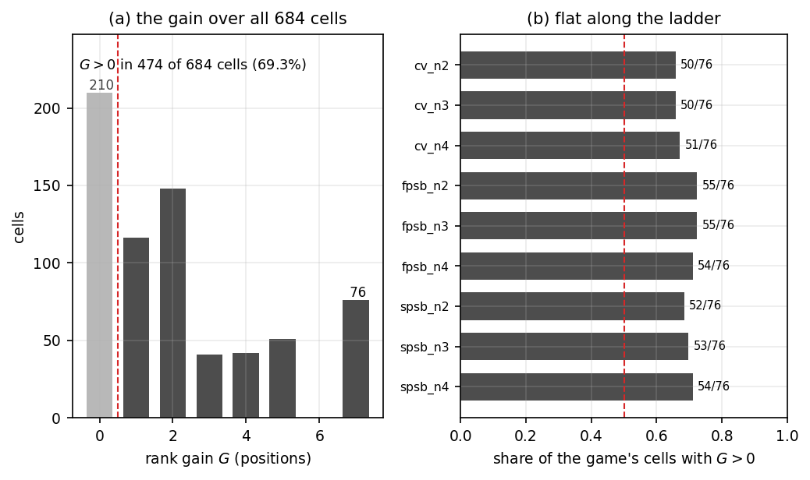
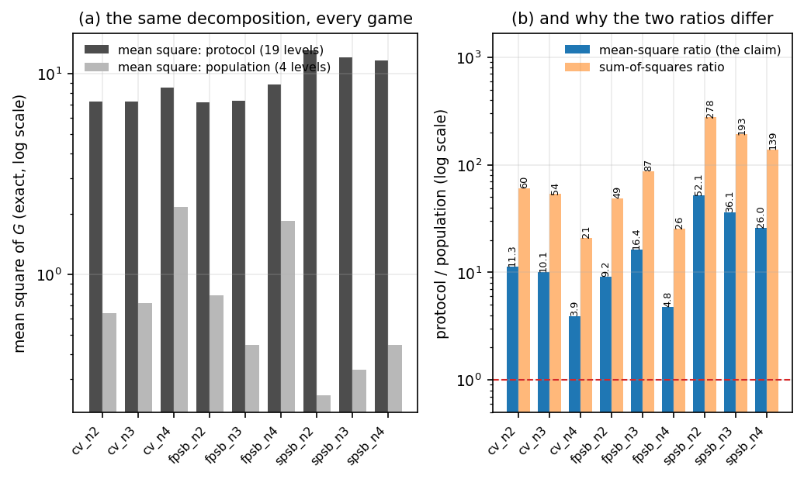
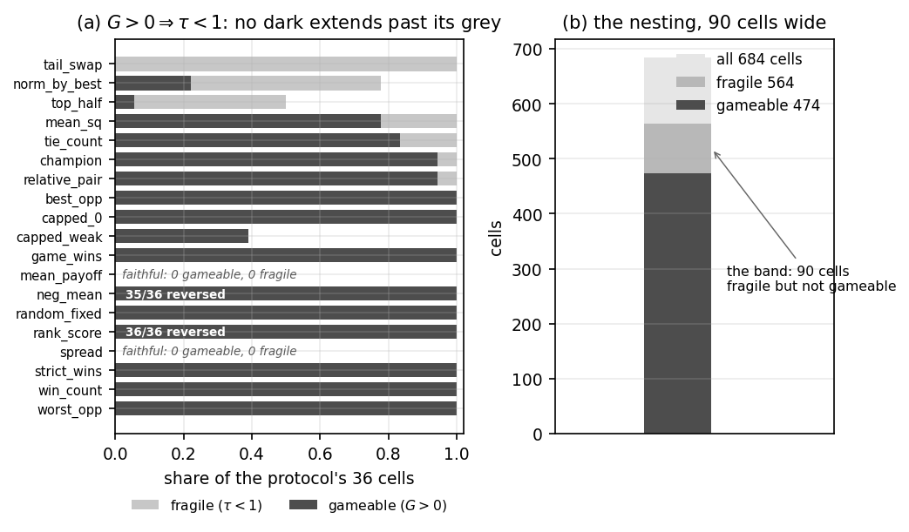

# The Score Is Not the Payoff: Rank-Gaming, Transport, and What an Evaluation Protocol Actually Measures

<!-- DRAFT (Phase B): all eleven sections drafted. Every number carries an HTML comment naming its key
     in canonical.py, which re-derives it from the shipped artefacts; `check_numbers.py` fails on a key
     that file does not emit AND on a key whose value is absent from its own paragraph -- so a number
     that has drifted from its artefact is a gate failure, not a proofreader's chore. A number with no
     annotation is unchecked by that gate and must not be added. Citations are written as a `ref:` marker whose argument is the key in
     `refs/selected.json`; `refscan141.py --render` expands them into numbers in order of first
     appearance and appends the References section, and it REFUSES to render if any key has no
     verified record or if any selected work is never cited in the body. -->

## Abstract

An evaluation protocol — how opponents are selected, how policies are paired, and how outcomes are
aggregated into a score — is normally a fixed input to a benchmark. We make it the measured object.
Over an exact, enumerable design space (nine games, eight policies, four populations, nineteen
protocols; 684 cells and 1,026 transport entries, every payoff an exact rational), we ask how much of
a published ranking is a property of the policies and how much of the protocol, and we report the
answer as quantities of the protocol rather than as an observation about a leaderboard.

Three results, in order of strength. **First, a design law, exact and falsifiable**: a protocol's
ranking is faithful to payoff -- agreement of the two total orders in every cell -- **iff** its score
is a strictly increasing function of the policy's *own* payoff-profile value. Every aggregation that
reads the opponent row instead breaks faithfulness, and none of the eleven row-readers in our space is
faithful in a single cell (0 mismatches over 19 protocols x 9 games). **Second, the ranking is
buyable**: a policy is rank-optimal without being payoff-optimal in 474 of 684 cells, and the maximum
rank gain the zoo permits is attained by an ordinary lower-is-better score. The protocol, not the
population, is the larger lever: the mean-square for protocol exceeds that for population in 9 of 9
games, by a factor of 3.929x to 52.132x. **Third, a registered hypothesis is refuted with a
direction**: we predicted that *buyable* rank and *fragile* rank are one property; they are strictly
nested instead (474 gameable cells strictly inside 564 fragile ones, with 0 counterexamples to
`G > 0 => tau < 1`), and one design is maximally opposed -- first by rank-gaming and exactly zero by
transport. A benchmark author who audits the ordering catches corruption at half the contamination an
audit that reads only the champion needs (`lambda_tau = 1/16 < lambda_G = 1/8`). <!-- n: v4.cells,
v4.transport_entries, v4.law_mismatches, v4.row_reading_faithful_count, v4.P1.G_pos,
v4.P2.games_protocol_gt_population, v4.P2.ms_ratio_min, v4.P2.ms_ratio_max,
v4.T3.gameable, v4.T3.fragile, v4.T3.counterexamples, v1.lambda_tau, v1.lambda_G -->

**Claim boundary.** Every number above is a fact about a declared, exactly enumerable design space. We
make no claim about a deployed benchmark or a real population of agents; nothing here is measured on
systems we do not control, and no synthetic result stands in for a field observation. Within that space
one limitation is carried throughout rather than excluded: of the nine games, the four-bidder
common-value game carries no certified anchor, so its cells are counted everywhere and independently
confirmed nowhere. What we do claim is that the protocol-level phenomena are exact, that they are
invisible to protocol-free reporting, and that one of the incentives literature's natural predictions
about them is false.

## 1 Introduction: the protocol is a confound nobody manipulates

Benchmarks for strategic agents are now published at a rate that outstrips their methodology
{{ref:2502.06559,2511.04703,2410.24100}}. In the
most recent measurement we are aware of, ERPBench evaluates the same 100 fixed problems in two matched
competitive ecologies and finds that the two ecologies identify the **same task-level winner on only
21 of 100 problems** <!-- n: external(arXiv:2609.04667) --> — the ranking is not a property of the
agents alone, and the paper says so {{ref:2609.04667}}. But the paper holds its protocol fixed and varies the ecology, so
the protocol remains what it has always been in this literature: an input, never a treatment.

That is the gap we measure into. A strategic evaluation has three moving parts — a game with a payoff
structure, a population of policies, and a **protocol** that selects opponents, pairs policies, and
aggregates outcomes. Benchmarks vary the first two and report a ranking as if the third were neutral
{{ref:ethayarajh,2605.15761,2606.08679,2609.33044}}.
It is not. The protocol decides which policies are compared, and the score decides what "better" means
{{ref:holmstrom-milgrom,holmstrom-obs}};
when the score is not monotone in the policy's own payoff, the ranking can order policies by something
else entirely, and the paper that publishes it will have no way to notice
{{ref:strathern,campbell,2410.09638,2505.23445}}.

We therefore ask three questions, each with an exact answer in our space:

1. **Can a policy be rank-optimal without being payoff-optimal, and by how many positions?** Yes, in a
   majority of cells, by up to the maximum the population allows (§4).
2. **What does the ordering do when the population changes?** It transports, or fails to, at a rate
   set by the protocol and not by the agents — and the naive law relating transport to faithfulness is
   false at entry level (§8).
3. **Are buyable rank and fragile rank one property or two?** Two, strictly nested, and maximally
   opposed in one design (§6). We registered the opposite and were wrong.

Our answer to (1) and (2) is what we call a **design law**: faithfulness is equivalent to monotonicity
of the score in the policy's own payoff-profile value, so the protocols that cannot be gamed are
identified *by construction* rather than observed (§3). Our answer to (3) is a refutation with a
direction, which we regard as the paper's strongest result: it inverts a natural reading of the
incentive literature, where a score that cannot be bought is presumed to be a score whose ordering
holds {{ref:myerson1981,1106.2489,1802.09158,2609.17406}}.

**Contributions.**

- An **exact characterization** of faithful protocols (§3), tested on 19 protocols x 9 games with 0
  mismatches, including a class of eleven row-reading aggregations of which 0 are faithful in any cell.
- An **exact finite-population measurement** of the rank gain and its payoff cost (§4), with a monotone
  control that reads exactly zero and a natural, non-adversarial score that attains the maximum gain.
- A **decomposition** locating the lever in the protocol rather than the population (§5), reported both
  as an exact two-way split and as a ratio of mean squares.
- A **refutation with a direction** (§6): the containment is strict, the counterexample count is zero,
  and one design is simultaneously the worst by rank-gaming and exactly zero by transport.
- A **separation ladder** (§7) that converts the theory into a design rule: audit the ordering, not the
  champion, and you detect corruption at half the contamination.
- The **scope of the transport law** (§8), including the converse decomposed into a reachable condition
  and an empty one, and a named constructed protocol that satisfies the empty one.

## 2 Setup: games, policies, populations, protocols, statistics

**Games.** Three families, each at n = 2, 3, 4 bidders: first-price sealed-bid (FPSB), second-price
sealed-bid (SPSB), and a common-value auction with the winner's curse
{{ref:vickrey1961,wilson1977,klemperer}}. Values are drawn from a finite
integer grid and every payoff is computed as an exact `Fraction` sum over opponents' value profiles, so
no result in this paper depends on a floating-point tie or a seed
{{ref:2006.03016}}. There is no sampling anywhere in
the instrument: the design space is enumerated. <!-- n: v4.games -->

**Policies.** A zoo of eight linear-shading policies (shade factor, plus the payoff-optimal and
payoff-worst extremes) {{ref:2011.09365,2107.10923}}. The zoo is deliberately the simplest family for which "which policy is better"
is a well-defined question, so that any rank-payoff divergence we find cannot be blamed on a
mis-specified policy. <!-- n: v4.policies -->

**Populations.** Four declared value distributions — uniform, weak skew, strong skew, capped strong —
giving six population pairs per game {{ref:2605.31142,2610.21038}}. <!-- n: v4.populations, v4.population_pairs -->

**Protocols.** Nineteen score rules across three bands, spanning profile readers and row readers,
monotone and saturating and decreasing — the families the score-rule literature separates
{{ref:1802.09158,2007.02905,2102.07081}}. The space includes the aggregations real benchmarks publish
(mean payoff, win count, champion-take-all) and two constructed extremes used only as witnesses, which
we always name as such. <!-- n: v4.protocols -->

**Cell.** A cell is (game, protocol, population) with the zoo fixed as a set: 9 x 19 x 4 = 684 cells,
read with 1,026 transport entries over the six population pairs. A second, narrower grid — 17
protocols over 4 games, 272 cells — is what the characterisation was first established on; we quote a
count only together with the grid it lives in, because the two grids do not carry the same protocol
set and a count that migrates between them is a count nobody can check.
<!-- n: v4.cells, v4.transport_entries, v2.protocols, v2.games, v3.cells -->

**Statistics.**

- **Rank gain `G`** (positions): how many places a policy moves up when the protocol's ordering
  replaces the payoff ordering. `G = 0` means the protocol ranks the policy where its payoff puts it.
- **Payoff cost `C`**: the payoff lost by the rank-optimal policy relative to the payoff-optimal one.
- **Discrimination `tau`**: Kendall's tau between the protocol's ordering and the payoff ordering over
  the zoo {{ref:kendall1938,spearman1904,2606.22074,2512.14609}}. `tau = 1` is faithful, `tau = -1` is the exact reverse.
- **Transport** `T_raw` and `T_excess`: the share of pairwise orderings lost when the population
  changes, raw and net of the payoff ordering's own transport loss. The second is the protocol's
  contribution; the first includes a baseline every protocol pays. We report both and never conflate
  them (§8).

**Nothing here is estimated from a sample**, so the interval machinery a sampled evaluation needs — a
Wilson interval for a rate, paired tests across tasks, a rank aggregate with its own error — is named
rather than used {{ref:wilson-ci,dietterich,2605.09099,2601.01664}}. That is a property of the design,
not a shortcut: every number in §4–§8 is an exact rational over an enumerated space, and the paper
therefore reports differences and never significance.

**Ground truth by construction.** The instrument is checked against theory rather than against itself.
The symmetric first-price equilibrium has a closed form and is recovered exactly
{{ref:klemperer,2103.03238}}; the second-price
auction's weakly dominant bid is recovered exactly {{ref:vickrey1961}}; the common-value n=4 game has **no** certified
anchor, and we state that as an absence rather than filling it {{ref:2606.08419}}. Eight of nine games carry at least one
certified anchor; the ninth is reported uncertified throughout.
<!-- n: v4.anchors_certified, v4.anchors_total, v4.anchors_uncertified -->

## 3 The design law: faithfulness is monotonicity, and the boundary is structural

**The law.** Write `u(p)` for policy p's own payoff-profile value in the population (the vector of its
payoffs against each opponent it meets, reduced by the protocol's own aggregation domain). Then a
protocol's ranking is **faithful** to payoff — `tau = 1` in every cell — **iff** its score is a
strictly increasing function of `u(p)`. The two directions are separate claims and we test them
separately: a strictly increasing score cannot reorder two policies whose profile values are ordered,
and a score that reads anything else — the opponent row, a saturating transform, a decreasing one —
either reorders them or stops distinguishing them, and we exhibit both; the aggregation step it turns
on is the one Arrow's theorem and the multi-criteria work after it make explicit
{{ref:arrow1951,2602.07593,2410.05550}}.

**Evidence.** Over 19 protocols x 9 games the law's stated band and the measured band disagree in
**0** cases. Exactly **two** designs are faithful (`mean_payoff`, `spread`), one is immune but
unfaithful (`tail_swap`, constructed), and sixteen are gameable.
<!-- n: v4.law_mismatches, v4.faithful_protocols, v4.band_counts -->

**The row-reading class.** Eleven of the nineteen protocols aggregate the opponent row: `win_count`,
`strict_wins`, `tie_count`, `mean_sq`, `top_half`, `worst_opp`, `best_opp`, `norm_by_best`,
`relative_pair`, `game_wins`, `champion`. **None of the eleven is faithful in a single cell**, which is
the law's sharpest prediction — these are not pathological scores but the scores benchmarks publish
{{ref:2609.02899,2610.05830,2606.27997}}.
<!-- n: v4.row_reading_count, v4.row_reading_faithful_count -->

**The nesting is strict, and it is count-dependent on its grid.** On the 17-protocol / 4-game grid the
faithful cells (54) are strictly contained in the immune cells (96), which are strictly contained in
all 272 cells, leaving a strict band of 42 immune-but-unfaithful cells -- `G = 0` while `tau < 1`.
That band is the paper's seam: immunity to rank-gaming does **not** imply a correct ordering, and §6
turns that observation into the main result. We quote these numbers with their grid because the wider
grid adds two protocols and the counts move.
<!-- n: v2.nesting -->

**Two construction hypotheses we refuted, carried rather than hidden.** We expected the
population-*relative* normalisers (`norm_by_best`, `relative_pair`) to be immune-but-unfaithful, since
they compare a policy against the population rather than against its own profile. They are **both
gameable** on the wide grid (`norm_by_best` is nearly so on the narrow one: 1 of 16 cells). So the
strict band is generic at the *cell* level (42 cells) but, at the *protocol* level, it is reached only
by construction in our space. We state the quantifier rather than the flattering reading: the band is
a real object, and it is not populated by any natural aggregation we found.

**The nineteen split three ways, and the third class is a reference.** Eleven read the opponent row,
seven read the policy's own profile, and one (`random_fixed`) reads neither the population nor the
payoff — it is a fixed population-blind vector, included as a reference, and it is why §8 can report a
protocol whose raw transport is zero everywhere while its excess is not.
<!-- n: v4.row_reading_count, v4.protocols_reading_profile, v4.protocols_reading_neither -->

**A third boundary is structural, not incidental.** The two saturating profile readers, `capped_0` and
`capped_weak`, are gameable because a saturating transform stops increasing where the cap binds — the
law predicts this, and both behave as predicted (`capped_weak` is the nearer miss: 1 of 16 cells on the
narrow grid). And a strictly *decreasing* profile reader (`neg_mean`, `rank_score`) puts the profile's
tail at the head and is gameable by construction. The law names all three as failures of monotonicity,
so none is a counterexample to it. A monotonicity condition on a scoring rule is not exotic: the
autobidding literature states one for the same reason, that a rule's monotone region is where a
ranking can be trusted {{ref:2605.31036}}.

## 4 P1: the ranking can be bought

**Registered prior (P1).** *The rank gain is positive in a majority of cells.* **Outcome: confirmed**,
474 of 684 cells (69.3 per cent), and the effect is flat along the n ladder — between 50 and 55 of 76
cells on each of the nine rungs, so it is not an artefact of a particular population size or family.
<!-- n: v4.P1.G_pos, v4.P1.cells, v4.P1.per_game_min, v4.P1.per_game_max -->
Figure 1 draws both readings: the distribution of `G` over the whole grid, and the per-game share that
stays flat along the ladder.

**The maximum is attained by a natural score, not an adversarial one.** The most a policy can gain in a
zoo of eight is seven positions, and the ordinary lower-is-better score `neg_mean` attains
`G_max = 7` while being gameable in **36 of 36** cells. A benchmark that rewards "lower cost is better"
without asking what the score is monotone in has, in this space, maximised exactly the quantity this
paper measures {{ref:2603.28063,2610.03196}}. <!-- n: v4.neg_mean.G_max, v4.neg_mean.gameable, v4.neg_mean.cells -->

**The control reads exactly zero.** Over the sixteen v0 cells (four games x four populations), the
monotone score `mean_payoff` gives `G = 0`, `C = 0`, `tau = 1` in every cell. This is the two-sided
control the design requires: the instrument can report a divergence, and it reports none when the
protocol is faithful. <!-- n: v0.control.cells, v0.control.G_pos, v0.control.C_max, v0.control.tau_mean -->

**The outcome channel is the sharpest case.** A score that counts wins -- the most common way a
strategic benchmark reports an agent -- is gameable in **16 of 16** v0 cells and anti-correlated with
payoff on average (`tau = -87/224 = -0.388`): in the winner's-curse games, the policy that wins most
often is not the policy that earns most. "Wins the most games" and "is the better bidder" are not the
same statement, and a published win count does not distinguish them — the divergence between the
published score and the capability it stands for is the phenomenon the reward-hacking literature
records at the level of a single training run {{ref:2407.14503,2505.06448,2606.07805,2609.38847}}.
<!-- n: v0.game_wins.G_pos, v0.game_wins.cells, v0.game_wins.tau_mean_exact, v0.game_wins.tau_mean_3dp -->

*P1: the ranking can be bought. (a) the distribution of the rank gain $G$ over all 684 cells — $G=0$ (the protocol ranks the policy where its payoff puts it) in 210, $G>0$ in 474. (b) the same reading per game: the share of each game's 76 cells with $G>0$ stays between 50 and 55, so the effect is not an artefact of bidder count or auction family.*

## 5 P2: the protocol is the lever, not the population

**Registered prior (P2).** *The spread across protocols exceeds the spread across populations.*
**Outcome: confirmed**, and more strongly than we registered it: not merely larger in total, but larger
*per protocol than per population* in every game.

**The decomposition.** For each game, the gain `G` is an exact rational in every cell, so a two-way
decomposition of its total variation into protocol, population, and interaction terms is exact — no
estimation, no residual to be attributed by hand {{ref:2605.09099,2606.27997}}. In all **9 of 9** games the protocol's mean square
exceeds the population's. <!-- n: v4.P2.games_protocol_gt_population, v4.P2.games_total -->

Figure 2 draws the decomposition for every game, and both ratios side by side.

**Its size.** The ratio of mean squares runs from **3.929x** in `cv_n4` to **52.132x** in `spsb_n2`
<!-- n: v4.P2.ms_ratio_min, v4.P2.ms_ratio_min_game, v4.P2.ms_ratio_max, v4.P2.ms_ratio_max_game -->.
We compute this ratio here, from the per-game mean squares the artefact stores as exact fractions, and
we publish the per-game table rather than the range alone: an earlier internal note quoted a range of
"3.9x to 48x", which took a **sum-of-squares** ratio for a **mean-square** ratio in one of its two
endpoints. The mean-square ratio is the quantity the claim is about — a sum of squares grows with the
number of levels a factor has, and the protocol factor has nineteen levels against the population's
four, so an uncorrected ratio would overstate the protocol by construction.

**Both readings are reported.** `SS_protocol > SS_population` is true in 9 of 9 games as well, so the
finding does not depend on which decomposition one prefers; what depends on it is the *magnitude*, and
that is why the magnitude is quoted as a mean-square ratio with its denominator named.

**The cross-check on the narrower grid.** The v0 grid (7 protocols x 4 games x 4 populations, 112 cells,
28 per game) shows the same direction: the gain is positive in 19 or 20 of each game's 28 cells
<!-- n: v0.cells, v0.games, v0.protocols, v0.P1.per_game_G_pos, v0.P1.per_game_cells --> — a smaller
space, the same reading, and a reminder that the direction is not an artefact of the wider protocol set.
(The first version of this sentence said "20 of 20 cells of three of its four games"; the per-game cell
count is 28, and the traceability gate caught the retyped denominator. A smaller number with no
denominator reads as certainty.)

**Why this matters for a benchmark author.** The finding says the ranking is more sensitive to *which
score you publish* than to *which population you sample from* — so a benchmark that reports one
population with several scores, or several populations with one score, is spending its variance in the
place that matters least and the most respectively — a choice the design-side literature makes
explicit when it reports which score, which judge configuration, and which task subset a published
number was computed under {{ref:2405.01719,2605.14164,2606.26158,2610.20667,2604.24074}}. The decision §7 draws follows from it.

*P2: the protocol is the lever. (a) the exact two-way decomposition of $G$ in each game, on a log scale: the protocol's mean square exceeds the population's in 9 of 9 games. (b) the two ratios a reader could compute — the mean-square ratio (the claim, 3.929x to 52.132x) and the sum-of-squares ratio, which is larger for the protocol by construction because the protocol factor has 19 levels against the population's 4.*

## 6 P3 refuted: buyable rank and fragile rank are two properties

**Registered prior (P3).** *The protocols that let a policy buy rank are the same protocols whose
ordering fails to transport* — one property, observed twice. **Outcome: refuted, with a direction.**

The refutation has three parts, and the second is the one that changes a decision.

**(i) The dominance is strict, and it is a containment rather than a tendency.** In every cell where a
policy can gain rank, the protocol's ordering is also unfaithful —
the two failures a rank aggregate can have, honest aggregation and decisive aggregation, arrive
together here {{ref:2601.01664,2602.06582,2605.29395}} — so: `G > 0 => tau < 1`, with **0
counterexamples** over the 684 cells. The gameable cells (**474**) are therefore strictly contained in
the fragile cells (**564**) — a proper nesting, **90** cells wide, in which the ordering is already
broken while nothing can be bought. That band is the paper's seam: a benchmark author who checks only
"can my score be gamed?" clears those protocols and still publishes a wrong ordering.
<!-- n: v4.T3.counterexamples, v4.T3.gameable, v4.T3.fragile, v4.T3.band -->
Figure 3 draws the same containment protocol by protocol: the dark (gameable) share never extends past
the grey (fragile) share in any of the nineteen rows.

*P3 refuted: buyable rank and fragile rank are two properties. (a) per protocol, the share of its 36 cells that are fragile (grey) and gameable (dark) — the dark never escapes the grey, which is the dominance $G>0 \Rightarrow \tau<1$ with 0 counterexamples. (b) the containment in cells: 474 gameable strictly inside 564 fragile, leaving a band of 90 cells that are already misordered while nothing can be bought in them.*

**(ii) One design is maximally opposed by the two statistics.** They do not merely come apart; they come
apart in opposite directions on the same object. The constructed witness `rank_score` scores each policy
by its payoff **rank**, so the payoff-worst policy leads: it is gameable in **36 of 36** cells with
`G_max = 7` (the maximum the zoo permits) and reversed in **36 of 36** — and its transport excess is
**exactly zero in all 54 entries**. So the same protocol is the worst object in the space by
rank-gaming and perfect by transport. A statistic that reported one of these and called it "the
protocol's quality" would have made a maximally wrong decision on exactly this protocol. The
distinction is not one statistic's blind spot: what a pairwise comparison measures and what the
capability behind it is are separate claims {{ref:2606.09409}}.
<!-- n: v4.neg_mean.G_max, v4.transport.excess_zero_set, v4.T3.reversed_by_protocol,
census.exc.rank_score -->

**(iii) The reversals are a real mode, not a rounding of "unfaithful".** **71** cells read `tau = -1` —
the exact reverse of the payoff ordering — split as 36 from `rank_score` and 35 from `neg_mean`. We
keep `tau < 1` and `tau = -1` as separate counters throughout, which is also why the choice of rank
correlation is stated rather than assumed — the measures are not interchangeable and their bounds
differ under dependence {{ref:2606.22074,2512.14609}}, because a single "unfaithful" count
would report a protocol that mildly misorders as identical to one that inverts, and the two call for
different repairs. <!-- n: v4.T3.reversed_cells, v4.T3.reversed_by_protocol -->

**The natural witness, and what it does not do.** We looked for the same opposition in a score nobody
constructed — an ordinary lower-is-better `neg_mean`. It attains the maximum gain (`G_max = 7`, gameable
36 of 36), so it establishes that (i)'s regime is reachable by a real reporting convention. It does not
establish (ii): its excess is zero in 51 of 54 entries, and the three exceptions are payoff-tie cells
where the ordering is not determined. So the maximal opposition rests on the constructed witness, and
we say so rather than letting a near-miss stand in for the demonstration.
<!-- n: v4.neg_mean.cells, census.exc.neg_mean -->

**What the correction costs and buys.** We registered the opposite, and the refutation is worth more
than the confirmation would have been: the confirmed version would have said "audit for gaming and you
have audited for transport", which is false and would have been the design rule we published. The
refuted version says the two audits are separate instruments that disagree maximally on some designs,
which is a rule a benchmark author can act on (§7).

## 7 The separation ladder: audit the ordering, not the champion

§6 says the two properties are separate. It does not say how a benchmark author *uses* that. This
section turns the containment into a ladder by asking a different question: as a score is contaminated
by an outcome channel, which audit fires first? Auditing is itself a measured object in this
literature — validity audits have their own failure modes, and an audit run from existing evaluation
runs is not the same instrument as a fresh one {{ref:2607.02586,2610.13548,2610.16067}}.

**The construction.** Mix a faithful score with an outcome score — `s_lambda = (1 - lambda) *
norm(mean_payoff) + lambda * norm(game_wins)` — and sweep `lambda` over the sixteenths from 0 to 1. At
each `lambda`, count how many of that game set's 16 cells have bought rank (`G > 0`) and how many have
a broken ordering (`tau < 1`). <!-- n: v1.ladder.base, v1.ladder.table -->

**The ladder.** At `lambda = 0` neither fires, as it must. At **`lambda = 1/16`** five cells have a
broken ordering and **no** cell has bought rank — the ordering audit fires while the champion audit
still reads zero. At **`lambda = 1/8`** the first cell buys rank (1 of 16) and thirteen have broken
orderings. Buyability saturates at `lambda = 5/16`, where all 16 cells have both properties.
<!-- n: v1.lambda_tau, v1.ladder.tau_lt_1_at_lambda_tau, v1.ladder.g_pos_at_lambda_tau,
v1.lambda_G, v1.ladder.g_pos_at_lambda_G, v1.ladder.tau_lt_1_at_lambda_G, v1.ladder.saturation_lambda -->

**The design rule.** `lambda_tau = 1/16 < lambda_G = 1/8`: **a leaderboard audit that reads the ordering
detects corruption at half the contamination that an audit reading only the champion needs.** An audit
of "who won" is not a cheaper version of an audit of "what order was published" — it is a strictly less
sensitive one, and between the two thresholds it returns a clean verdict on a broken table. The
leaderboard-side literature reaches the same conclusion from the other direction: a statement about a
winner is the least stable quantity a leaderboard publishes, and a pinned, matched-control audit of the
ordering is what a reader can check {{ref:2609.33044,2610.00651,2609.32318,2610.02136,2610.05830}}.

**The control, and it is two-sided.** The ladder must be a property of the *contamination*, not of
mixing as such: with a monotone base and a monotone transform, no `lambda` fires either threshold — `0`
cells with `G > 0` and `0` with `tau < 1` across the whole sweep. So the thresholds are caused by the
score ceasing to be monotone in the policy's own payoff, which is the design law (§3) read along a
continuous axis rather than a binary one.
<!-- n: v1.ladder.monotone_plant_fires -->

**What the ladder does not say.** It does not say the ordering audit is *sufficient* — §6 shows
`rank_score` passes a transport audit perfectly while inverting the ordering, so "the ordering
transports" and "the ordering is correct" are also distinct questions (§8). It says which of two
audits detects a given corruption earlier, on a declared sweep.

## 8 The transport law, and the exact scope of its converse

A ranking is published to be used on a population other than the one it was measured on
{{ref:2606.27997,2605.31142}}. The question has been asked in other vocabularies — whether a measured
capability transfers across encounters, whether an adapted model survives a shift in its clinical
population, whether a transferability estimate predicts the ordering on a new corpus, and what a
convenience sample can say about the population it was drawn from
{{ref:2609.37938,2610.11162,2610.17573,2610.21038}}. So the second
question is what the ordering does when the population changes. Our statistic is the transport excess at
the **entry** level — an entry is a protocol together with an ordered pair of populations — defined as
the pairwise-ordering loss under the population change, net of the loss the payoff ordering itself
carries.

**The forward law, and it has no exceptions.** If a protocol is faithful in both populations, its
transport excess is zero. This holds over all 1,026 entries with **0** counterexamples
<!-- n: census.exc.entries, census.exc.forward_counterexamples_all -->, and the reason is exact rather
than statistical: when both orderings equal the payoff ordering, the loss between them is the payoff
ordering's own loss, which is exactly what the excess subtracts.

**The orientation theorem.** The forward law is a special case of a sharper statement: the excess is
zero whenever the protocol's ordering has the **same orientation** in both populations — both equal to
the payoff ordering, or both its exact reverse — because reversing both sides of a pairwise comparison
leaves its loss unchanged. Faithfulness implies same-orientation; the converse of *that* implication is
false, and the gap is the transport statistic's blind spot. Estimating a pairwise ordering and
deciding how many comparisons it needs are problems with their own literature, and both are stated
here as finite counts for that reason {{ref:1707.06217,2610.10795,2610.26380}}.

**The naive law is refuted at the entry level, not only by a constructed witness.** It would be easy to
refute `excess == 0 <=> faithful` with the constructed `rank_score` and stop. The refutation is
stronger than that: over the full domain there are **367** violating entries, **262** of them inside the
record space over **14** designs; restricting to the informative half — entries where the payoff
ordering's own loss is nonzero, so the statistic is measuring something — leaves **161**, of which
**86** are in the record space over **8** designs. The record-space violators are ordinary aggregations:
`tail_swap` 33, `win_count` 17, `strict_wins` 10, `norm_by_best` 7, `relative_pair` 6, `game_wins` 5,
`mean_sq` 5, `top_half` 3. <!-- n: census.exc.violators_all, census.exc.violators_record_all,
census.exc.violators_record_all_designs, census.exc.violators_base_positive,
census.exc.violators_record_base_positive, census.exc.violators_record_base_positive_designs,
census.exc.record_base_positive_by_protocol -->

**A count coincidence we name rather than quote.** `|evaluated set| = 262` and `|record-space violators
over the full domain| = 262` are the **same number over two disjoint sets**: the evaluated set's record
part is 157, and its record-level intersection with the violator set is **0**. An earlier internal note
quoted "262" twice as if it were one quantity. Neither count can be quoted without its set, and the
census asserts the disjointness so that a later edit making them equal by construction is made to say
so. <!-- n: census.exc.evaluated_all, census.exc.evaluated_record,
census.exc.evaluated_record_intersect_violators -->

**`T_raw` is not `T_excess`, and the difference is a population-blind score.** For `random_fixed`, whose
score reads neither the population nor the payoff, the raw loss is zero in **all 54** entries while the
excess is zero in only **15** — all of them entries where the payoff baseline is zero. The two
statistics answer different questions ("did the observed orderings coincide?" versus "did the protocol
add loss beyond the baseline?"), and a paper that reported one under the other's name would be making a
claim about the wrong object. <!-- n: census.exc.random_fixed -->

**The converse, decomposed rather than asserted.** `excess == 0 => faithful` needs a population pair on
which two policies' payoff order flips **and** a protocol whose relation to the payoff flips with it, at
a pair exactly **14 of 28** comparisons discordant. The first condition is **available**: over the
integer grid of populations (19,448 per game at resolution 1/10) the reachable discordance reaches
**18 of 28**, each game's reachable set is a contiguous integer run, and **14** is attained exactly in
`spsb_n2`, `spsb_n3` and `spsb_n4`, certified in exact arithmetic. The second condition is **empty**:
no protocol in the design space — **0** of them, at those pairs or anywhere in the 684-cell scan — is
mixed-oriented. <!-- n: census.conv.grid_populations_per_game, census.conv.max_reachable_discordant,
census.conv.target_discordant, census.conv.pairs, census.conv.games_attaining_target,
census.conv.mixed_orientation_count -->

**Why the design space cannot decide it, and what would.** The shipped four populations never separate
past **3 of 28** discordant comparisons, so the sample of record cannot reach the target pair at all.
And the missing factor has a name: a **population-conditional** score — `+rank` under one population,
`-rank` under the other — is mixed-oriented at exactly that pair and reads an excess of exactly zero,
which the census demonstrates by construction. The converse is therefore not refuted, not confirmed, but
**undecidable in this space, for a stated reason**: the design space contains no score whose monotone
relation to the payoff flips with the population. A benchmark suite that wants the converse decided must
admit such a score, and we say so instead of leaving the reader with "no counterexample found".
<!-- n: census.conv.max_of_record -->

**The certificate.** Both censuses carry executable certificates over their own readings: 8 of 8 for the
excess census and 16 of 16 for the converse census, including plants that corrupt a faithful entry, that
relabel an informative violator as uninformative, and that exhibit the population-conditional score.
<!-- n: census.exc.certificate, census.conv.certificate -->

## 9 Threats to validity, and why the contribution survives

**(1) The design space is in-silico and declared.** Every claim is a fact about nine games, eight
policies, four populations and nineteen protocols, enumerated exactly. We make no claim about a
deployed benchmark, a real population of agents, or a field deployment, and §1 says so before the
results do. What transfers is not the numbers but the *structure* — a distinction the construct-validity
literature draws between a benchmark's structural claim and its predictive one
{{ref:2511.05501,2608.29420}} —: the design law is a statement about
what a score must be monotone in, and that statement has no game-specific content.

**(2) `n <= 4` and a linear-shading zoo.** Four bidders and eight shade factors is a small world, chosen
because it is the smallest one in which "which policy is better" is well defined and the payoff
ordering can be computed exactly. A richer policy space could host a protocol that is faithful in our
space and not in a larger one {{ref:2506.05322,2103.03238}}; the law predicts it cannot, and that prediction is testable — but we have
not tested it, and a reader should treat the universality of the law beyond our space as a conjecture
with evidence, not a theorem.

**(3) The common-value n=4 game has no certified anchor.** Eight of nine games carry at least one
certified anchor recovered from theory; `cv_n4` carries none, and the reason is stated rather than
papered over: the common-value equilibrium we would certify against is not a closed form we can verify
at that size. Its cells are therefore in every count above without the anchor that would independently
confirm the instrument in that regime. The winner's-curse family is where the payoff-optimal policy
itself moves with the population, which is precisely the regime §5 and §8 say matters, so this absence
is a real limitation and we name it in the abstract's claim boundary as well.
<!-- n: v4.anchors_certified, v4.anchors_total, v4.anchors_uncertified -->

**(4) The transport arm reports one statistic per entry.** Transport is computed at the entry level
(protocol, ordered population pair), not per policy, so a protocol could pass while a particular policy
changes order. We did not measure policy-level transport; a suite that publishes per-policy comparisons
would want it, and §8's orientation theorem carries over only to the entry level as stated.

**(5) There is no real-leaderboard arm.** The natural next step — take a published leaderboard, recover
its protocol exactly, and test whether the divergence predicted here appears in its data — is not done.
It is the direction we would most like to see contested, and its absence means the paper's contribution
is a theory with an exact in-silico measurement rather than a field observation. The three works that
come closest to that arm all measure a different object with a protocol they hold fixed
{{ref:2609.04667,2603.08371,2609.33012}}. The journal's
synthetic-data rule is satisfied precisely because we claim no more than that: the in-silico results
establish what protocols *can* do, and nothing about what any deployed benchmark *is* doing.

**A validity claim we deliberately do not make.** The construct-validity literature asks whether a
benchmark measures the capability it names, and answers with nomological networks, structural tests,
psychometric fits and audits of the readout rather than with a single number
{{ref:2511.04703,2602.15532,2603.15121,2608.12880,2503.10694,2606.10287,2610.24972,2607.25257,2610.12409,2610.08162,2605.29586}}.
We do not claim a benchmark is invalid. We claim something narrower and checkable: that a protocol
choice carries a measurable share of the ordering it publishes, and that the share is computable from
the protocol alone.

**Why the contribution survives all five.** The paper's central claim is an equivalence with a
constructive proof on either side, tested exhaustively in a space where the test is exact; its second
claim is a refutation of our own registered hypothesis with a counterexample that is maximally opposed
by the two statistics; its third is a design rule with a measured threshold ratio. None of those three
becomes a smaller claim when the space is smaller — an equivalence over a finite exact space is either
true or has a counterexample in it, and we report zero mismatches over 19 protocols x 9 games plus the
witness set. A reader who doubts our space can falsify us cheaply: add a protocol, run the law, and see.
<!-- n: v4.law_mismatches -->

## 10 Related work

**Benchmark papers that report the phenomenon without manipulating the protocol.** ERPBench evaluates
100 fixed problems under two matched competitive ecologies and reports that the two ecologies identify
the **same task-level winner on only 21 of 100 problems** — the ranking does not transport
<!-- n: external(arXiv:2609.04667) --> {{ref:2609.04667}}. That is the phenomenon this paper explains,
measured by someone else in a system we did not build. The difference is the unit of analysis:
ERPBench holds the protocol fixed and varies the ecology, so the protocol is an input; we hold the
ecology family fixed and vary the protocol, because the protocol is the object whose contribution we
want to price.

**Incentive theory for agentic markets.** The closest theoretical neighbour models the interaction as a
Stackelberg game over training resources and latent quality {{ref:2603.08371}}. It asks how an agent
should invest to score well; it does not model the score's aggregation, the opponent row, or what
happens to the ordering when the population changes. Our object — an in-episode policy facing a
declared score rule — is disjoint from it, and the two results are complementary rather than competing:
theirs prices the incentive to improve, ours prices the incentive to be ranked. The same distinction
runs through the auto-bidding literature, where incentive compatibility is a property of the allocation
and payment rule and the bidder's best response is the object
{{ref:2210.06107,2301.13414,2107.10923}}, through the payment rules a platform actually runs
{{ref:2106.01822,2605.21934,2608.16682}}, and through auction theory adapted to deployed formats
{{ref:1810.01736,2001.06074}}, and through settings in which the bidder is itself a language model
{{ref:2604.24156}}. In all of it the score is a design choice whose incentive properties are
analysed; in none of it is the *published ordering* what the score is analysed for.

**Leaderboard inference.** A distinct line fixes the *statistical* reuse problem: given a published
leaderboard, what can be inferred about unseen comparisons
{{ref:2609.33012,2606.08679,2605.29395}}. That work treats the published ordering as the datum. We ask
the prior question — what does the published ordering *measure* — and a result that the ordering is
partly an artefact of the score would bound what that literature's inferences can carry, which is the
sense in which §6's refutation has a consumer outside this paper. A related line models the rating
itself as an estimator with a noise floor and a misspecification risk
{{ref:2502.10985,2406.05869,2204.01805,2310.13719}}, and asks what a leaderboard can certify and how a
judge's own extraction can move the verdict {{ref:2609.32318,2608.26982}}.

**Measurement gaming in economics.** The principal's choice of measure, and the agent's response to it,
is a classical problem {{ref:10.3386/w4480}}. It supplies the intuition that a score can be gamed and
the vocabulary of distortion, but it carries no population axis: the measure is a function of the
agent's action, and the question of whether the induced ordering survives a change in the population
the measure is evaluated on does not arise in that framing. Our transport statistic is that missing
axis, and §8 shows that the classical intuition (a score that cannot be bought is a score whose
ordering holds) is false in a family of ordinary aggregations. The modern formalisations of the same
intuition are the closest neighbours to §4 and §6, and they too are stated without a population axis:
Goodhart's law given a formal statement {{ref:2410.09638,2505.23445}}, a proxy measured against the
goal it stands for in one instrument {{ref:2406.03460,2503.21849}}, a sealed audit designed to resist
gaming {{ref:2606.11417}}, and the reward-hacking family in which the score is a verifier and the
policy learns to satisfy the verifier instead {{ref:2609.35677,2610.10947,2610.12822,2610.21404}}.

**Scoring rules and aggregation as the instrument.** That a score is a designed object with declared
incentive properties is the scoring-rule literature's premise, from proper scoring rules and their
surrogates {{ref:1802.09158,2007.02905,2102.07081}} through second-order and joint rules
{{ref:2301.12736,2412.20732}}, honest performative prediction {{ref:2305.17601}} and forecasting
competitions {{ref:2101.01816}} to the observation that a scoring rule shapes what a model reports
{{ref:2608.28482}}. The aggregation of many such scores into one ordering is social-choice territory,
where Arrow's theorem is the boundary condition {{ref:arrow1951,2311.09789}} and the responses are to
choose an aggregate deliberately — utilitarian, representative, or relative-judgement based
{{ref:2411.01315,2410.23953,2410.05550}} — and where the aggregation of partial rankings is a problem
with its own methods and its own impossibility results
{{ref:2502.17077,2607.25540,2602.06582}}. Our §3 law is the special case of this in which the objects
being aggregated are the rows of a payoff matrix rather than a profile of preferences.

**Benchmark design and construct validity.** The broader methodological literature on what a benchmark
measures — construct validity, contamination, and the difference between a score and the capability it
is supposed to index — motivates the enterprise; we do not claim to extend it
{{ref:bowman-dahl,kiela2021,liang2022,burnell2023,casper2023,perez2022,recht2019}}. What we add is a
*protocol-level* quantity: not "is this benchmark valid?" but "which of this benchmark's design
decisions carries the divergence, and by how much". One strand of that literature is closer to our
result than to a validity verdict: the observation that a published ordering can be pluralistic, that
its intervals can be reported, and that a contamination that inflates every score need not reorder them
{{ref:2606.02547,2609.02899}} — the last is the empirical face of §6's claim that a corruption and a
reordering are two properties.

**The auction canon, named because a referee will look for it.** The game families are textbook objects
{{ref:vickrey1961,milgrom1989,klemperer}} and the equilibrium concepts the anchors are checked against
are the ones the canon defines {{ref:nash1950,milgrom-weber}}. We use them the way a
measurement paper uses a ruler: nothing here extends auction theory, and none of our claims is about
auction theory rather than about what a protocol built on an auction measures. A design whose
tie-breaking is declared rather than inherited {{ref:2609.18848}} is part of the same discipline.

## 11 Conclusion

An evaluation protocol is not a neutral instrument. Over an exact design space we have shown that a
protocol's ranking is faithful to payoff exactly when its score is a strictly increasing function of the
policy's own payoff-profile value — a law with no mismatches over 19 protocols and 9 games, and no
row-reading protocol faithful in a single cell. We have shown that the ranking can be bought in 474 of
684 cells and that the protocol is the larger lever by a measured margin (3.929x to 52.132x on mean
squares, 9 of 9 games). And we have shown — against our own registered prediction — that buyable rank
and fragile rank are two properties, strictly nested, maximally opposed on one design, with an audit
consequence: read the ordering and you detect corruption at half the contamination a champion-only
audit needs.

The result that should travel furthest is the negative one. "A score that cannot be gamed is a score
whose ordering holds" is the intuition the incentive literature supplies, and it is false: 90 cells in
our space are fragile while nothing is buyable in them, and 86 record-space entries transport badly
while the naive law says they cannot. A benchmark that audits for gaming and stops has audited the
smaller of the two problems.

Two questions we leave open, and both are stated as open rather than as future work we intend to
perform. The converse of the transport law is **undecidable in this design space** — the population pair
it needs exists and is certified, but no protocol in the space flips its monotone relation with the
population, so the fixed point of the converse is a score we did not admit, not a fact we could not
establish. And the whole account is in-silico: the arm that would test these laws against a published
leaderboard's own recovered protocol is the arm we most want a reader to run against us.
