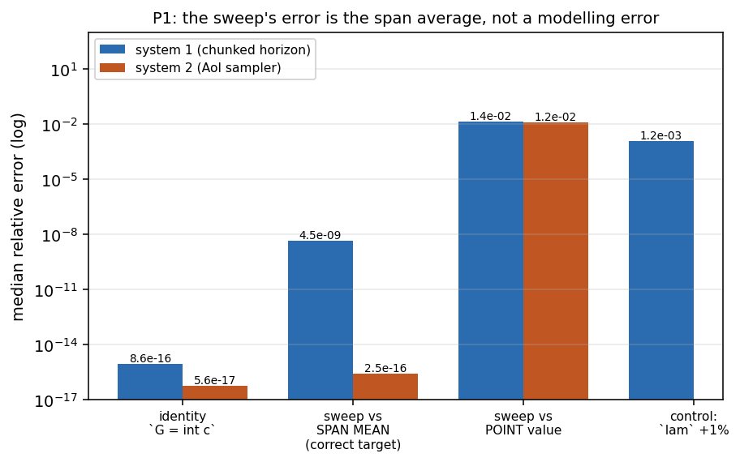
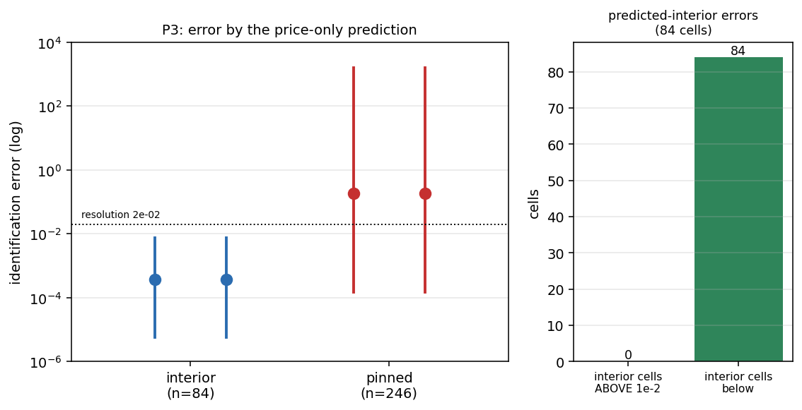
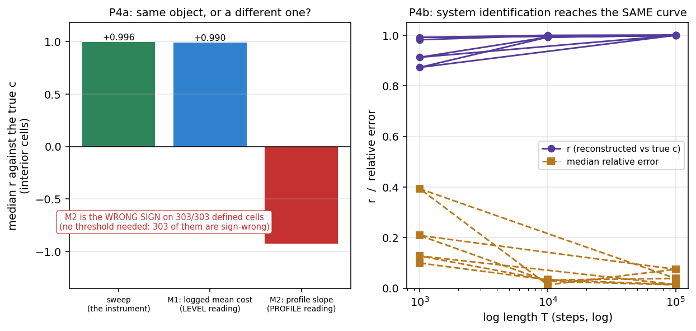

# The Knob Is Not the Curve: Identifying a Deployed Policy's Cost Curvature from a Price Sweep

*Contribution level: `theory+empirics` -- a theory model (an envelope identity, an error budget with a
derived span law, and an identifiability set) validated on **two independent, mechanically different
priced systems**, with an exact ground truth by construction and a one-command byte-identical
reproduction. The claims are scoped to the two in-silico systems actually measured; no external
deployment arm is claimed, and Section 9 states why.*

## Abstract

An operator of a deployed system routinely sets a knob -- an execution horizon, a replanning cadence, a
sampling interval -- and pays a price for it. The knob's value is chosen by an *unchosen* curve: the
marginal cost of the resource the knob buys. This paper asks whether that curve can be identified
**pointwise** from the logs the deployment already keeps, what its error budget is under measurement
noise, and which operating regimes carry **no information** about it at all. The instrument is a **price
sweep**: from one operating point the deployment logs `(L*, J, lam)` with `J = C(L*) + lam/L*` and
`C(L) = (1/L) int_0^L c`, so the logged combination `G := L* J - lam` is `int_0^{L*} c` exactly, and a
sweep of the price recovers `c` by differencing `G` -- with **no cost model and no plant model** on the
route. We build and measure this on two priced systems with ground truth exact by construction: (i) a
chunked-policy execution horizon (`c(d)` from an augmented Lyapunov solve of an LQR plant) and (ii) an
**age-of-information sampler** (`c(s) = 2 s2 (1 - e^{-theta s})`, a saturating exponential from an
Ornstein-Uhlenbeck source) -- a different mechanism, not a parameter swap.

Four falsifiable claims were registered against named prior beliefs, and the measurement decides all
four. **(P1, confirmed)** The noise-free error of the sweep is a **quadrature error**, not a modelling
error: the identity `G = int c` holds to a median of `8.6e-16` on system 1 and `5.6e-17` on system 2,
the sweep's error against its *correct* target (the span mean of `c`) is `4.5e-9` / `2.5e-16`, and
against the point value it is `1.39e-2` / `1.23e-2` -- the entire error is the span average.
**(P2, decided)** Under noise the sweep has an **interior, MSE-optimal span** whose scaling is
`h* ~ sigma^{2/(2b+2)}`, with `b` the *measured* bias exponent: `sigma^{1/3}` in the smooth limit
(system 1 `b=2.006 -> 0.334`, system 2 `b=1.957 -> 0.334`; the two agree to `0.0002`) and
`sigma^{0.41}` on each system's **delivered C0 representation** (system 1 `b=1.422 -> 0.408`, system 2
`b=1.423 -> 0.406`; the bias exponents agree to `0.001`). The `sigma^{1/3}` end is the **classical
optimum for a two-sided difference** — this paper does not claim it; what it measures is the exponent's
**dependence on the representation** (`b = 2` on a smooth curve, `b ~ 1.42` on a C0 table), and the
finding is that the exponent is set by the representation's smoothness and the route's differencing,
**not by the plant**. **(P3, decided)** The identifiable set is
the argmax set, predicted from the pricing **before any data**: the predictor is sound (0 false
positives at a `1e-2` resolution) but not exact (9 disagreements, 5 of 246 threshold-free), and the
pinned fraction matches exactly in **15/15 blocks** -- the failures are conservative and have a
mechanism. Both systems reproduce the *ordering*: the interior single-point marginal identity holds to
each grid's own first-order-condition resolution and **shrinks with the grid** (`8.2e-3 -> 9.0e-4`)
while pinned cells miss it by `~60x`. **(P4, refuted as stated)** The two routes a practitioner
would reach for instead -- higher moments of the tracking error, and residual-dynamics system
identification -- were registered as addressing a *different object*. The measurement says otherwise,
on **two limbs that could have come out the other way**: the moments route's **profile** reading is a
genuinely different object (`r = -0.926`, the **wrong sign on 303 of 303 cells**, a threshold-free
direction failure), and the **system-identification** route reaches the **same object**
(`r = 0.9993...0.99999`, median `c`-error `1.3-7.5%` at a `1e5`-step log). A third reading, the moments
**level**, is also the same object (`r = +0.990`) but is reported as a **corollary of P1**: at an
interior optimum the first-order condition makes it `c - lam/L*` by algebra, so it is not counted as
evidence. What separates the routes is **access**, not the object: the sweep reads one scalar per
price, system identification needs a raw `(state, action, delay)` log carrying the deployed control law.
The design rule the measurement supports is the opposite of "measure the same object a better way":
**run a price sweep, and first check whether you are pinned -- because if you are, no amount of data
will tell you the curvature.**

## 1. Introduction

An operator sets an execution horizon. A serving team picks a sampling interval. A storage tier picks
a replication level. Each of these is a **knob**: a scalar `L` the operator controls, whose value the
system's own economics price. Write the time-average cost the deployment pays for choosing `L` as
`J(L) = C(L) + lam/L`, where `C(L) = (1/L) int_0^L c(s) ds` is the cost of the resource the knob buys
and `lam/L` is the price of the knob itself -- one sample per `L`, one replan per `L`. The object that
decides the operator's choice is `c(.)`, the **marginal cost**: the curvature of a priced objective.
Nobody measures it. The operating value of `L` is found by a grid search, a hand-tuned default, or an
adaptive policy that *infers* the knob without ever reporting the curve beneath it.

The 2026 literature is a wave of exactly this inference, and it does not report the objective. On the
robotics side, adaptive-horizon systems -- ChunkTrust [1], Staircase [2],
continue-or-replan [3] -- treat the horizon as a latent variable with a posterior; their
result is a task-level gain, and none can say what `c(.)` is. The classical derivative-by-differencing
line -- Kiefer-Wolfowitz [4] and the derivative-free-optimisation family
[5] [6] -- gives bias-variance trade-offs for a *gradient* under *designed
perturbations* at points treated as non-optimal, targeting optimisation rather than reporting a
curvature. System identification on residual dynamics [7] [8] recovers the
*plant*; a cost is not a plant. And our own published work [#116] supplies the horizon's boundary law
and explicitly leaves `c(.)` unidentified, naming it as an open item -- which is where this paper
began, as a reader's question [rant] on that work.

This paper measures the missing object. The instrument is a **price sweep**, and its content is one
identity. From a single operating point the deployment logs the triple `(L*, J, lam)`, where `L*` is
the committed interval, `J` the achieved average cost, and `lam` the price. Define
`G := L* J - lam`. Substituting `J = C(L*) + lam/L*` gives `G = L* C(L*) = int_0^{L*} c(s) ds`
**exactly**, and by Leibniz `dG/dL = c(L)` -- so differencing the logged quantity `G` across a ladder
of prices identifies `c` pointwise, with **no cost model and no plant model on the route**. Nothing is
injected that a deployment does not already log; the sweep is a *move an operator can run*.

The paper answers four registered questions, in this order. Section 4 asks whether the noise-free error
is a quadrature error rather than a modelling error (P1). Section 5 asks for the error budget under
noise -- the interior MSE-optimal span and its law (P2). Section 6 locates the **identifiability
boundary**: the operating regimes in which neither route carries information about `c`, predicted from
the pricing alone (P3). Section 7 asks the headline question, whether the two practitioner routes
address a **different object** (P4), and reports that they do not. Section 8 states what the measurement
does not establish. The registered prior beliefs and the adversarial checks behind these choices are in
the companion registration.

**What changes if this is true.** The decision that changes is an operator's, and it is quotidian:
the choice between "tune the knob" or "adopt an adaptive policy" becomes "run a price sweep -- and
first check whether you are pinned, because if you are, no amount of data will tell you the
curvature." The reason it is not a trivial recommendation is that the sweep does not *work* everywhere,
and the places where it fails are exactly the places an adaptive policy silently operates: a horizon
pinned at its hardware floor or its budget ceiling is uninformative about `c`, and the measurement
gives that regime an exact address. If the pinned regimes had turned out to be informative, the
decision would have changed the other way -- the adaptive policy would have been the cheaper
instrument, and the sweep a redundant one. That is the falsifier P3 and P4 were registered to be able
to report, and Section 6 reports it honestly in the limb where it holds and the limb where it does not.

**Why two systems.** A single in-silico plant would leave the paper a case report. The instrument's
claims are claims about a *route* -- differencing an envelope identity across a price -- and the way to
show that is to instantiate the route on two systems whose mechanisms differ, so that a property which
survives both is a property of the route and a property that moves is the system's. System 1 is a
chunked-policy execution horizon, whose per-delay cost comes from an augmented Lyapunov solve of an LQR
plant -- a **controlled** system with a stability margin as its ceiling. System 2 is an
**age-of-information sampler** -- an **observed** system whose cost is a saturating exponential from an
Ornstein-Uhlenbeck source, with a hardware-minimum interval as its floor and a staleness tolerance as
its ceiling. They share the objective's *form* (`J = C(L) + lam/L`, `c` the marginal cost) and nothing
else: no LQR plant, no control law, no stability margin on the second.

## 2. Related work

Every work cited below is verified against a live external record by title match (826 verified pool
entries; the per-entry method, the returned record and the stated difference are in
`reference-check.md`, and each reference in the list at the end of this paper carries its own
one-line difference). The section is organised by the comparison the paper's difference claim rests
on, in eight groups.

### 2.1 Adaptive-knob systems: they report the knob, not the curve

The closest work is the 2026 wave of adaptive execution horizons. ChunkTrust [1] adapts
a robot policy's horizon from action-expert evidence; Staircase [2] streams inference
across large action chunks; continue-or-replan [3] learns a Bernoulli continuation
decision and "Rethink before you execute" [9] an adaptive execution scheme for
world-action models; skill-guided chunking [10] and chunked PPO [11] are
training-side counterparts; SplineWAM [12] reshapes the horizon schedule into a
B-spline; consequence-aware commitment [13] and history-conditioned regeneration
[14] decide execution spans at inference. Around them sit a domain application
[15], a policy-acceleration method [16], a certification of accelerated
vision-language-action inference [17], an analysis of cloning behaviour [18],
a measurement of the stability assumption behind chunking [19] and a planner-to-policy
method [20]; the founding visuomotor-policy result
[21], generalized advantage estimation [22] and the field's survey
[23] frame the horizon and the control frequency as design choices.
**Difference.** Each of these *infers* the knob and reports a task-level gain. None reports the
objective the knob is implicitly optimising, none gives that objective's error budget, and none can
say when its own signal is uninformative. Section 6 gives that regime an exact address.

### 2.2 Derivative by differencing: a gradient, under a designed perturbation

The classical root is Kiefer-Wolfowitz stochastic approximation [4],
whose modern theory continues in Spall's simultaneous-perturbation estimator [24],
Polyak-Juditsky averaging [25], the recursive-algorithms reference [26]
and the dynamical-systems account [27]. Recent work extends convergence
under discontinuities [28], compares SPSA with RDSA [29], formalises the
theorem [30], proves exponential concentration [31] and rates under biased
unbounded-variance noise [32]. The derivative-free family allocates sampling
[5], transfers a prior into the perturbation [33], induces correlation
between points [34] [35], studies finite-difference step rules empirically
[6], converges from a single observation [36], decides sampling by
sequential tests [37], denoises trajectories [38], fits regularised splines
[39] or RKHS functionals [40], and analyses differentiators directly
[41] [42] [43] [44]; neighbouring contributions are
subgradient-free optimisation [45], actor-critic mean-variance analysis
[46], zeroth-order fine-tuning [47], log-density derivative estimation
[48], sparse-grid collocation [49], vector-field reconstruction
[50], parameter-shift derivatives [51] and derivative-free SQP
[52]. **Difference.** These give a bias-variance trade-off for a *gradient* under
*designed perturbations*, at points treated as non-optimal, targeting optimisation. We design no
perturbation: we difference a quantity the deployment already logs, and it is the **optimality of the
visited point** that makes the unobservable identifiable. Our span law is the same trade-off in a
different currency, and Section 5 shows its exponent is a property of the *representation*, not the
plant.

### 2.3 Extremum seeking: a real-time optimiser, not a reporter

Extremum seeking is the model-free optimiser closest to our route: the 2026 survey
[53] reviews three revolutions and the road ahead, with gradient and Newton variants
[54] [55], practical-stability and averaging analyses [56]
[57] [58], delay-robustness and unknown-delay variants [59]
[60], unbiased and distributed schemes [61], constrained and saturating
designs [62] [63], event-triggered implementations [64]
[65], escape from local extrema [66], non-Lipschitz objectives
[67] and a first hardware demonstration [68]. **Difference.** Extremum
seeking optimises in real time from a *designed dither*, so by construction it never reports the
curvature in a form an operator can read off a price they already pay; and it is the delay and the
non-smoothness of the dither scheme, not of the representation, that its analyses bound.

### 2.4 The envelope and the economics of a price

The identity this paper instantiates is the envelope theorem, in the general choice-set form of
Milgrom and Segal [69], with an adjacent information-economics result
[70], identification of multidimensional screening [71], the converse
envelope theorem [72], static and calculus-of-variations statements [73]
[74], the Clarke-differential dynamic-programming version [75],
non-parametric identification of a marginal product [76], learned pricing policies
[77], market-structure optimisation [78] and pricing fresh data
[79]. **Difference.** These establish when the derivative identity holds, or price a
product. None takes the price an operator *already pays* as the instrument, and none budgets the
error of the resulting estimate under measurement noise.

### 2.5 System identification and experiment design

The route a practitioner reaches for second is system identification. Input design and adaptive
experiment design [80] [81] maximise information by choosing the input;
closed-loop identification and direct data-driven control [82] [83]
[84] [85] [8] [86] recover a plant from a
trajectory; joint plant/controller inference [7] and model-based RL exploration
[87] [88] couple identification to a control objective; identifiability and
design criteria [89] [90] [91] [92] [93]
[94] [95] formalise what an experiment can determine; and estimation practice
[96] [97] [98] carries the estimator. **Difference.** All of
these identify the *plant*, which is a different object from a cost, and all of them need an
experimenter's lever (an input, a stimulation, a trajectory) that a deployed system does not let an
operator pull. Section 7 measures the object question directly and reports the registered claim
refuted: what separates the routes is **access**, not the object.

### 2.6 Freshness, staleness and sampling

Our second system prices the age of information. The metric and its queueing analysis
[99] [100] are followed by scheduling and
sampling policies for freshness [101] [102] [103] [104]
[105] [106], staleness in storage and unreliable channels [107]
[108] [109], rate/error trade-offs [110], metric refinements
[111] [112], sampling-timing effects and non-stationarity [113]
[114], energy and decision-oriented variants [115] [116], remote
estimation and routing [117] [118], learned freshness policies
[119] [120]. **Difference.** These optimise a freshness policy or refine the
metric. We take the sampling interval as *the* knob, make its price explicit, and ask for the
marginal cost of freshness -- the curve a policy is implicitly trading against.

### 2.7 Knob tuning and configuration search

The systems community's version of the same knob is configuration tuning: OtterTune
[121], Optuna [122], the Bayesian-optimisation
review [123] and its practical recipe [124], the Gaussian-process
and GP-UCB machinery [125] [126], the online-convex and
bandit analyses beneath sequential search [127] [128]
[129] [130] and their non-stationary [131],
sampling-limited [132] and reward-learning [133] extensions; then the DBMS and
cloud tuners [134] [135] [136] [137] [138]
[139], the noisy/unstable-systems tuner [140], an SLO-constrained autotuner
[141], bandit-driven precision autotuning [142] and earlier ensemble and
model-driven tuners [143] [144]. **Difference.** All of these return a good
point, or a regret rate for finding one. None returns the objective's derivative, and none states the
regimes in which the objective carries no information -- which is Section 6's object and is what an
operator needs before trusting a tuner's recommendation.

### 2.8 Control-side context

Finally, the control machinery our system 1 is built from and bounded by: constrained model
predictive control [145], the classical contributions to optimal control
[146], the dynamic-programming formulation [147],
planning under partial observability [148], the online-LQR instance
warning [149], regret-optimal and quantised LQR [150] [151] and a
learned Riccati operator [152]. **Difference.** These optimise or stabilise a controller.
Our system 1 uses their plant and cost machinery only as the *ground truth* against which the
identification route is measured.

## 3. The instrument: two priced systems

**Ground truth is exact by construction on both systems.** Every number below is either a closed form
or an exact-integer/exact-float evaluation of one. Sampling enters exactly twice, and both entries are
declared and bounded: the **noise ladder's draws**, and a **Monte-Carlo certificate** of the
instrument against itself. That certificate's job is narrower than "the closed forms describe the
simulated system", so here is what it does and does not establish.

*It certifies the **variance law**, which is its strong claim.* The simulated variance matches the
analytic `sigma^2 * varcoef` to a ratio of **0.99929 ± 0.00074** at `k=10` and
**0.99927 ± 0.00072** at `k=20` — within **0.07%** in every cell tested.

*It checks the **bias term**, and reports it with its resolution.* The bias is measured in four
`(k, sigma)` cells at **five independent seeds**, because one seed cannot tell agreement from luck.
Each figure carries its standard error: `0.4342 ± 0.0020` (`k=10, sigma=1e-3`),
`0.4467 ± 0.0767` (`k=10, sigma=1e-2`), `1.2119 ± 0.0010` (`k=20, sigma=1e-3`) and
`1.2186 ± 0.0146` (`k=20, sigma=1e-2`), against closed-form values `0.4332`, `0.4332`, `1.2112` and
`1.2112`. Every cell resolves the bias (the smallest margin is `5.8` standard errors) and every cell
agrees with the closed form; the seed-to-seed spread of the variance ratio is `0.00074`. An `sd`
estimated from five seeds is itself uncertain by about `35%`, so the bars are quoted for a reader to
inflate rather than treated as exact — the verdicts clear that inflation with room to spare.

*What it does not certify.* Nothing about a deployed system: it is the instrument checked against
itself, not evidence about a real log. Two error bars are deliberately kept apart, because
confusing them changes the answer: the **error bar of the mean** over the 6,194 evaluated points
(the one the certificate's figures carry, `0.0020` in the first cell) and the **sampling error of a
single point estimate** (`0.168` in the same cell, `sqrt(analytic_var)/sqrt(n_rep)`). The second is
the natural yardstick for "could a deployment resolve this bias from this much data" — a real
question, and a different one: it is not an error bar on the certificate, whose claim is about a mean
over the grid.

### 3.1 System 1 -- a chunked-policy execution horizon

An LQR plant `x_{t+1} = A x_t + B u_t + w_t` with `w_t` of covariance `W`, a control law `u_t = -K
x_{t-d_t}` executed with delay `d_t`, and the periodic chunk schedule `d_t = tau + (t mod L) + 1`. The
per-delay cost `c(d)` is `trace(P_d[0:n,0:n])` with `P_d` the augmented Lyapunov solution of `(A,B,K)`
driven by `W` -- finite to the plant's delay margin `dmax`, `+inf` past it. `C(L)` is the chunk average
and `J(L) = C(L) + lam/L` the priced objective. Four plants (`scalar-stable a=0.9`, `double-int R =
1/10/100`), five latencies, 22 prices on a `1e-2..1e5` ladder give 352 cells (84 interior / 149 floor /
119 ceiling). This is the system our own [#116] publishes the boundary law for.

### 3.2 System 2 -- an age-of-information sampler

An Ornstein-Uhlenbeck source of stationary variance `s2` and rate `theta`; a telemetry pipeline serves
the last sampled value, so a consumer reads a value of **age** `s`; the operator picks the sampling
interval `L`, pays a price `lam` per sample, and pays the **staleness cost**
`c(s) = E[(X_t - X_{t-s})^2] = 2 s2 (1 - e^{-theta s})`. With periodic sampling the age is uniform on
`[0, L)`, so `C(L) = (1/L) int_0^L c` in closed form and `J(L) = C(L) + lam/L`. The floor is a
hardware-minimum interval, the ceiling a staleness tolerance -- a different boundary mechanism from a
stability margin, and `c(s)` saturates, so the ceiling is not a divergence. Three sources
`(theta, s2) in {(1,1), (3,1), (0.5,2)}`, 40 prices, give 120 cells (26 interior / 34 floor / 60
ceiling).

### 3.3 The two routes the paper is not

For P4 the paper measures what a practitioner would try instead of a sweep:

- **Higher moments** of the tracking error. Two model-free readings are defined: the **level** reading
  `J - lam/L*` (the logged mean cost) and the **profile** reading, the within-chunk phase slope
  `(p(L*) - p(1))/(L* - 1)` over the periodic loop's per-phase means.
- **Residual-dynamics system identification.** Read the raw log `(x_t, u_t, d_t)`, fit
  `x_{t+1} = A x_t + B u_t + w_t` by ordinary least squares, recover the control law `u_t = -K x_{t-d}`
  and `W = Cov(w)`, then reconstruct `c` through the truth's **own** closed form (no cost weight appears
  in it; a certificate inspects the reconstruction function's free names).

## 4. P1: the noise-free error is a quadrature error

**Claim (registered).** The noise-free error is a **quadrature error** -- the span average -- not a
modelling error.

**Measurement.** The identity `G = L* J - lam = int_0^{L*} c` is tested against the exact quadrature of
the plant's own curve, not against a fit: median relative error `8.6e-16` on system 1 (n=352, worst
`7.1e-7`) and `5.6e-17` on system 2 (n=120, worst `5.9e-16`). The sweep is then scored against two
targets on the same cells: the **span mean** of `c` (its correct target) and the **point value** `c(L*)`.
The sweep's error is `4.5e-9` median against the span mean and `1.39e-2` median against the point on
system 1; `2.5e-16` and `1.23e-2` on system 2. **The error is the span average**, and the identity is
exact.

**Controls that fire.** Perturbing `lam` by 1% breaks the identity on both systems (system 2: median
`5.2e-3`, ~11 orders of magnitude above the exact case). A one-sided difference is biased on a linear
curve where the centred difference is exact -- established as a plant.

*P1: the sweep's error against its own correct target (the span mean) is a quadrature error, ~8 orders of magnitude below its error against the point value. The `lam`+1% control breaks the identity. Bars are medians over the cells each report owns.*

**Verdict: CONFIRMED on both systems.** This is the paper's premise, and it is what makes the sweep's
error budget a *quadrature* budget rather than a modelling one.

## 5. P2: the interior MSE-optimal span and its law

**Claim (registered).** Under noise there is an **interior, MSE-optimal span**, scaling as
`sigma^{1/3}`.

**Measurement.** The estimator is the centred difference of `G` at half-width `a`, whose target is the
span mean. Its `bias^2 A[k]` and variance coefficient `B[k]` are computed **exactly** (no sampling) over
a band fixed across `k` -- a `k`-dependent window removes the large-`c` points preferentially and
corrupts the exponent, a defect the instrument caught and pins. The optimal span `h*(sigma)` is the
sub-lattice argmin of `MSE = A + sigma^2 B`, and the exponent is the log-log slope of `h*` against a
`sigma` ladder. **The law is derived, not fitted:** with `bias ~ a^b` and `var ~ sigma^2 a^{-2}`, the
minimum is `h* ~ sigma^{2/(2b+2)}`, and the prediction uses the run's **own** measured `b`.

**What is classical here, and what this paper adds.** With `b = 2` — a second-order-accurate centred
difference on a smooth curve — the law is `h* ~ sigma^{1/3}`, which is the **textbook optimum for a
two-sided difference** and is *not* this paper's claim. What the instrument adds is that the exponent is
a function of the **representation the deployment actually has**: on a C0 table the bias exponent
measures `b ~ 1.42` (`1.4224` on system 1, `1.4233` on system 2) and the law becomes `sigma^{0.41}`
(`0.4075` / `0.4062`), a shift that a mechanism sweep shows follows the table's spacing
(`S=0.5 -> b=1.5176`, `S=1.0 -> 1.4233`, `S=2.0 -> 1.4208`) rather than the plant. So the reading a
practitioner gets from "the optimal span scales as the cube root of the noise" — which is true only for
a curve they may not have — is quantitatively wrong on a delivered table, in a direction and by an
amount this instrument measures. That claim, not the cube root, is the contribution.

Two arms per system: a **smooth** curve (C^inf, or C^1 for system 1's Catmull-Rom arm) and the
**delivered C0 representation** (system 1's shipped linear interpolation between integer delays; system
2's `c` sampled at a step `S` and linearly interpolated).

| system | arm | `b` | predicted | measured |
|---|---|---|---|---|
| 1 | model C0 (1.0-delay kinks) | 1.4224 | 0.41282 | **0.40753** |
| 1 | smooth (Catmull-Rom, C1) | 1.8593 | 0.34974 | 0.35168 |
| 1 | analytic (C^inf) | 2.0058 | 0.33269 | 0.33404 |
| 2 | grid C0 (`S=1.0`) | 1.4233 | 0.41273 | **0.40619** |
| 2 | smooth (analytic, C^inf) | 1.9572 | 0.33824 | **0.33381** |
| 2 | grid C0 (`S=1.0`, `theta=0.5`) | 1.4276 | 0.41191 | 0.40621 |

*P2: the interior MSE-optimal span `h*(sigma)` on log-log axes, for every arm of both systems. The slopes cluster by REPRESENTATION -- ~1/3 for the smooth arms of both systems, ~0.41 for the delivered C0 arms of both -- and the dotted line is the derived `sigma^{1/3}` reference.*

**Verdict: CONFIRMED in the smooth limit on two independent systems; REFUTED as stated on each
system's delivered C0 representation.** The smooth-limit exponents agree across the two systems to
`0.0002` (`0.33381` vs `0.33404`), and the C0 arms' bias exponents agree to `0.001` (`1.4233` vs
`1.4224`) because both use the **same kink spacing** (`1.0`). A **mechanism sweep** moves `b`: `S=0.5 ->
1.5176`, `S=1.0 -> 1.4233`, `S=2.0 -> 1.4208` (`theta=0.5` the same ordering). So the delivered
representation is `sigma^{0.41}`, not `sigma^{1/3}`, and the exponent is the **representation's
smoothness** plus the route's differencing -- not the plant. The predicted exponent from the same run's
measured `b` matches the measured slope to `<= 0.007` on every arm: the exponent is derived, not
fitted. (The mechanism's *direction* was measured, not assumed: a denser kink set moves `b` toward the
smooth value, and the deployment-relevant spacings `S >= 1.0` -- where the span rarely contains a kink --
plateau at `b ~ 1.42`.)

## 6. P3: the identifiability boundary

**Claim (registered).** The identifiable set is **exactly the argmax set**, predictable from the pricing
alone.

**The predictor.** A cell is **pinned** when the optimal `L*` sits within one lattice step of the
declared floor or ceiling, and **interior** otherwise. The rule reads no ground truth (certified by a
plant: shifting the declared floor flips labels while every error stays bitwise identical).

**Measurement.** Over 330 cells the predictor is **sound** (0 false positives at the paper's `1e-2`
resolution; worst predicted-interior error `7.4e-3`) but **not exact**: 9 disagreements, **5 of 246
threshold-free** (at the interior class's own worst error). The failures are **conservative** and have a
mechanism: **pinning is decided by the price's weight, the error by the first-order-condition residual
`C + lam/L - c` -- not the same function of `lam`**. The *fraction* is exact: the predicted pinned
*fraction* equals the measured one in **15/15 blocks** (11-21 of 22 prices). And the set is
**route-specific**: the sweep reading is not separated by the label (interior `1.42e-2` vs pinned
`1.50e-2`), because the sweep's error is a span artifact (P1), not a pinning artifact.

**Cross-system.** On system 2 the same structure reproduces. The **single-point marginal identity**
`c(L*) = J` holds at interior optima to the grid's own first-order-condition resolution and **shrinks
with the grid** (system 2, `theta=1`: median `8.17e-3 -> 9.04e-4` at a `4x` finer `deltaL`), while pinned
cells miss it by `~60x` (`0.315` median). On system 1 the same separation is `3.74e-4` interior vs
`0.2557` pinned (worst `1543`).

*P3: identification error by the price-only prediction. Left: full range and median per class on a log scale -- predicted-interior cells sit below the resolution, predicted-pinned cells do not. Right: the soundness count, no predicted-interior cell above `1e-2`.*

**Verdict: separation CONFIRMED; the predictor is built and SOUND but criterion (iii) is UNMET as
written (9 disagreements, 5 threshold-free), with its mechanism stated.** Reported as measured, not
rounded to a pass.

## 7. P4: the two practitioner routes, and what is actually different

**Claim (registered).** The two routes a practitioner would try instead of a sweep -- higher moments of
the tracking error, and residual-dynamics system identification -- address a **different object** and
fail on the same logs.

**The moments route has two readings, and they disagree.** The **level** reading (the logged mean cost
`J - lam/L*`) is the **same object**, tracking `c` at `r = +0.990` (median relative error `0.0953` all
cells, `0.1460` interior). **This limb is a corollary of P1 and is marked as one**: at an interior
optimum the first-order condition gives `J = c(L*)` exactly, so the level reading *is* `c - lam/L*` by
algebra, and no measurement could have made it a different object. What the measurement adds is the
**error ratio** (~10x worse than the sweep), not the sameness. The reading that was genuinely
uncertain is the **profile** one — the within-chunk phase slope — and it is a **genuinely different
object**: it **anti-tracks** `c` (`r = -0.926`) and carries the **wrong sign on 303 of 303 cells**
(80/80 interior), a **threshold-free direction failure** (median error `1.0007`), because the periodic
orbit is re-planned at each chunk boundary (a U-shaped profile `31.79 -> 28.91 -> 30.19` against a
monotonically rising `c` `22.74 -> 78.64`). A **structural certificate** shows why: every logged
quantity is a function of the **visited point alone** (within a group sharing `(plant, tau, L*)` the
price spans `9.995e4` while `G` varies by `1.6e-13` relative), so the sweep is the only route that
differences *across* operating points.

**The system-identification route reaches the same object.** Reconstructing `c(d)` from the identified
`(A, B, K, W)` through the truth's own closed form tracks the true curve at `r = 0.9993...0.99999` over
four plants, with a median `c`-error of `1.3-7.5%` at a `1e5`-step log (error `~ T^{-0.26...-0.59}`, a
data floor, not a bias wall). **"Needs excitation a live deployment does not produce" is also refuted**:
the deployment's own disturbance suffices (`cond` 10-430), and only a *silent* (`W=0`) log breaks it.
`K` is recovered to `1e-15` on every closed-loop log. On system 2 the same conclusion holds (`theta` to
`<= 2.2%`, `c(s)` to `<= 1.1%`).

*P4: what separates the routes is access, not the object. (a) median `r` of each route against the true curve -- the moments LEVEL reading is the same object, the PROFILE reading has the wrong sign on every defined cell. (b) the system-identification route's reconstruction quality rising with the log length.*

**Verdict: REFUTED, on two limbs that were genuinely uncertain -- the profile reading and the
system-identification route -- and the claim is ROUTE-SPECIFIC.** (The level limb is the third and is
*not* evidence of the same kind: it follows from P1's identity by algebra, and it is reported above as
a corollary. Counting it as a second refutation would inflate the result with something no measurement
could have falsified.) The profile reading is a different object with the wrong sign on every defined
cell; the system-identification route reaches the same object. What separates the routes is **access
and resolution, not a second object**: the sweep reads a scalar-cost log and differences it across
prices; system identification needs a raw `(state, action, delay)` log carrying the control law that
actually ran (a *free* action vector leaves `K` unidentified, error `1.04`). Criterion (iv) -- the
sweep `>= 10x` better at the median -- is met against the profile reading (`68x`) and **met on interior
cells against the level reading (`10.3x`) but
missed on all cells (`9.7x`)**, reported as measured.

## 8. Registered prior beliefs: what the measurement decided

The registration states four falsifiable priors. Each is reported against its registered criteria.

| prior | registered expectation | measured | verdict |
|---|---|---|---|
| **P1** | the noise-free error is a quadrature (span) error | `G = int c` to `8.6e-16` / `5.6e-17`; sweep error `4.5e-9` / `2.5e-16` vs span mean, `1.39e-2` / `1.23e-2` vs point | **CONFIRMED** (both systems) |
| **P2** | interior MSE-optimal span, `sigma^{1/3}` | smooth limit `0.334` on both systems (agree to `0.0002`); delivered C0 `0.408` / `0.406`; derived from the measured `b` | **CONFIRMED** in the smooth limit; **REFUTED** as stated on the C0 representation |
| **P3** | identifiable set is exactly the argmax set, from pricing alone | predictable and **sound** (0 FP at `1e-2`) but **not exact** (9 disagreements, 5/246 threshold-free); pinned fraction exact in 15/15 blocks | **PARTIALLY CONFIRMED** -- criterion (iii) **UNMET** with its mechanism |
| **P4** | the two routes address a **different object** | moments profile: different (`r=-0.926`, wrong sign 303/303) **and** system ID: **same object** (`r=0.9993...`) — the two limbs that were uncertain; moments level: **same object** (`r=+0.990`) but a **corollary of P1**, not counted as evidence | **REFUTED**; the real separator is **access** |

The **refutation is the paper's strongest novelty signal**, and it is theory-anchored: the moment's
price-invariance followed from the registration's own envelope identity, so P4's clause was falsifiable
in advance and was falsified. Its evidence is the two limbs that could have come out the other way --
the **profile** reading (wrong sign on 303 of 303 cells) and the **system-identification** route
(same object at a costlier access path). The level reading is the third limb and is a corollary of P1,
reported as such and not counted as evidence; the `sigma^{1/3}` law, separately, was derived from the
measured bias exponent, so its failure on the C0 representation is a statement about the
representation, not a failure of the derivation.

## 9. Threats to validity

- **Both systems are in-silico.** The ground truth is exact by construction, which is the measurement's
  strength, but no external deployment arm is claimed. The planned arm on published robot-policy logs
  (Open X-Embodiment / RoboMimic) is **`NOT RUN`**: those logs do not supply the priced triple
  `(L*, J, lam)` -- they carry trajectories, not a price the deployment pays -- so the arm cannot be
  built from them without inventing the price, which would make it a second in-silico system wearing a
  dataset's name. State that plainly rather than run it badly.
- **The span law's exponent is representation-dependent.** P2 is `sigma^{1/3}` for a smooth curve and
  `sigma^{0.41}` for a C0 one. A deployment's `c(.)` is delivered by a table, so the C0 value is the
  operational one; the smooth limit is the limit, not the answer.
- **The identifiability predictor is not exact.** It is sound (no false positives) but misses 9 cells,
  5 threshold-free, all conservative. A user of the rule is told "interior" for a cell whose error
  exceeds the interior class's typical error; the miss is toward *using* a cell, not toward discarding
  one, which is the safer direction but not the exact set the registration asked for.
- **The variance model is multiplicative.** The noise ladder models a logged `J` as `J (1 + sigma e)`,
  which is the deployment-logging model (a price and a cost are positive and scale-free). An additive
  noise model would change the variance coefficient `B[k]` but not the bias exponent, hence not the
  span law's exponent -- only its constant.
- **Why it is still worth publishing.** The refutation is not a negative result about a method; it is
  the paper's content. A practitioner's default instrument (moments) turns out to have one reading that
  samples the same object badly and one that samples a different object with the wrong sign, and their
  second default (system identification) turns out to need a log they do not keep -- and both facts are
  *measured*, cross-system, against exact ground truth. That sharpens
  the recommendation rather than weakening it.

## 10. Conclusion

The knob is not the curve. The value an operator sets is chosen by a marginal cost they do not measure,
and this paper shows that the marginal cost is identifiable from a price sweep the operator can run,
with an error budget and an identifiability boundary, on two mechanically different priced systems.
Three of the four registered claims survive in a form the measurement had to sharpen: the noise-free
error is a quadrature error (P1), the span law's exponent is the *representation's* rather than the
plant's (P2), and the identifiability boundary is predicted from the pricing alone and is sound but not
exact (P3). The fourth is refuted, and the refutation is the paper's strongest result: the two routes a
practitioner would reach for instead are not a second object -- one of them is the same object sampled
badly, the other reaches the same object behind a worse access path (P4). The decision the paper
changes is quotidian and it is directional: run the sweep, and check first whether you are pinned.

## References

[1] Huang, F.; Jiang, J.; Bao, S.; et al. (2026). ChunkTrust: Adapting Execution Horizons for Robot Policies with Action-Expert Evidence. arXiv:2609.39754. https://arxiv.org/abs/2609.39754 -- Difference: ChunkTrust: adapting execution horizons from action-expert evidence -- infers the horizon from a learned confidence signal and reports a task gain; it never reports the cost curve the horizon is chosen against, and cannot say when its own signal is uninformative.

[2] Sun, G.; Chen, C.; Wang, J.; et al. (2026). Staircase Policy: Streaming Inference for World-Action Models with Large Action Chunks. arXiv:2609.36471. https://arxiv.org/abs/2609.36471 -- Difference: Staircase policy: streaming inference with large action chunks -- a systems/streaming contribution that makes a long chunk practical, where our claim concerns the objective that would justify the chunk length.

[3] Xu, W.; Liu, Z.; Luo, L.; et al. (2026). Continue or Replan? Bernoulli-Continuation Policy Learning for Adaptive Horizon Execution. arXiv:2608.03483. https://arxiv.org/abs/2608.03483 -- Difference: Continue or replan? Bernoulli-continuation policy learning for adaptive horizon execution -- learns a continuation decision, i.e. an implicit horizon policy, without identifying the marginal cost of the horizon.

[4] Robbins, H.; Monro, S. (1985). A Stochastic Approximation Method. doi:10.1007/978-1-4612-5110-1_9. https://doi.org/10.1007/978-1-4612-5110-1_9 -- Difference: The Robbins-Monro/Kiefer-Wolfowitz stochastic-approximation root: a gradient from finite differences at a point treated as NON-optimal, for optimisation -- not a curvature read from the optimality the deployment already sits at.

[5] Bollapragada, R.; Karamanli, C.; Wild, S. M. (2024). Derivative-Free Optimization via Adaptive Sampling Strategies. arXiv:2404.11893. https://arxiv.org/abs/2404.11893 -- Difference: Derivative-free optimisation by adaptive sampling -- sampling effort is allocated by the optimiser's own progress, where our span is set by the logged price's noise and the representation's smoothness.

[6] Du-Yi, W.; Guo, L.; Guangwu, L.; et al. (2024). Derivative-Free Optimization via Finite Difference Approximation: An Experimental Study. arXiv:2411.00112. https://arxiv.org/abs/2411.00112 -- Difference: An experimental study of derivative-free optimisation via finite-difference approximation -- an empirical comparison of step-size rules, with no span exponent and no identifiability boundary.

[7] Geadah, V.; Arbelaiz, J.; Ritz, H.; et al. (2025). Inferring System and Optimal Control Parameters of Closed-Loop Systems from Partial Observations. arXiv:2502.15014. https://arxiv.org/abs/2502.15014 -- Difference: Inferring system and optimal control parameters of closed-loop systems from partial observations -- joint plant/controller inference, the system-identification route our Section 7 measures and finds reaching the SAME curve behind a worse access path.

[8] Maruta, I.; Sugie, T. (2025). Fast Sampling for System Identification: Overcoming Noise, Offsets, and Closed-Loop Challenges with State Variable Filter. arXiv:2506.03650. https://arxiv.org/abs/2506.03650 -- Difference: Fast sampling for system identification under noise, offsets and closed-loop challenges -- it accelerates an ID procedure; we ask instead at which operating regimes no procedure can succeed.

[9] Ye, F.; Zhao, Y.; Yu, Y.; et al. (2026). Rethink Before You Execute: Adaptive Execution for World Action Models. arXiv:2608.09492. https://arxiv.org/abs/2608.09492 -- Difference: Rethink before you execute: adaptive execution for world-action models -- an adaptive execution scheme decided by the model, where our price sweep is a measurement an operator runs on a deployed system.

[10] Yang, Y.; Jin, C.; Zhao, J.; et al. (2026). Act More, Decide Less: Skill-Guided Adaptive Action Chunking for Long-Horizon LLM Agents. arXiv:2609.02042. https://arxiv.org/abs/2609.02042 -- Difference: Act more, decide less: skill-guided adaptive action chunking -- a chunking policy guided by skills, sited on the policy rather than the priced objective.

[11] Hahn, S.; Choi, J. (2026). Action Chunking Proximal Policy Optimization with Feedback Correction. arXiv:2609.36250. https://arxiv.org/abs/2609.36250 -- Difference: Action-chunking PPO with feedback correction -- an RL training scheme for chunked policies, with no curvature object.

[12] Guo, J.; Han, X.; Li, Q.; et al. (2026). SplineWAM: Adaptive Action Horizons for World Action Models via B-Spline Representations. arXiv:2609.39873. https://arxiv.org/abs/2609.39873 -- Difference: SplineWAM: adaptive action horizons via B-spline representation -- a representation that smooths the horizon schedule; our P2 result is that the REPRESENTATION's smoothness is exactly what sets the span law's exponent.

[13] Li, Y.; Wang, Y.; Huang, Y.; et al. (2026). Commit While Futures Agree: Consequence-Aware Adaptive Action Chunking for Robot Manipulation. arXiv:2610.07949. https://arxiv.org/abs/2610.07949 -- Difference: Commit while futures agree: consequence-aware adaptive action chunking -- a commitment rule from predicted consequences, again an implicit horizon policy with no reported cost curve.

[14] Wang, C.; Wang, Y.; Tang, J.; et al. (2026). Predict in Chunks, Revise in Spans: History-conditioned Action Regeneration for Robotic Manipulation. arXiv:2610.14864. https://arxiv.org/abs/2610.14864 -- Difference: Predict in chunks, revise in spans: history-conditioned action regeneration -- an inference-time regeneration scheme, a systems contribution with no priced objective.

[15] Hu, J.; He, S.; Chang, L.; et al. (2026). ColoACT: Multi-Cue Action Chunking for Smooth Autonomous Colon Navigation on a Self-Propelled Endoscopic Robot. arXiv:2610.01258. https://arxiv.org/abs/2610.01258 -- Difference: ColoACT: multi-cue action chunking for autonomous colon navigation -- a domain application of chunking, an instance of the knob rather than a study of its objective.

[16] Kwon, T.; Park, J.; Park, S.; et al. (2026). Don't Throw Away the Tail: Action Upcycling for Policy Acceleration. arXiv:2609.34911. https://arxiv.org/abs/2609.34911 -- Difference: Don't throw away the tail: action upcycling for policy acceleration -- a policy-acceleration method operating on chunk tails, with no identification claim.

[17] Liu, R.; Zheng, T.; Gu, J.; et al. (2026). CARE: Certifying Acceleration for Vision-Language-Action Inference. arXiv:2610.08917. https://arxiv.org/abs/2610.08917 -- Difference: CARE: certifying acceleration for vision-language-action inference -- a certificate for acceleration, a systems guarantee rather than an identifiability boundary.

[18] Park, S.; Levine, S. (2026). Behavioral Cloning Mystery. arXiv:2610.07056. https://arxiv.org/abs/2610.07056 -- Difference: Behavioral cloning mystery -- an analysis of cloning behaviour, adjacent but not about a priced knob.

[19] Goyal, A. (2026). Measuring the Stability Assumption Behind Action Chunking. arXiv:2610.01626. https://arxiv.org/abs/2610.01626 -- Difference: Measuring the stability assumption behind action chunking -- it measures an ASSUMPTION of the chunking policy, where we measure the objective's marginal cost and its identifiability.

[20] Kabouri, M. Y.; Crestaz, P. N.; Nguyen, Q.; et al. (2026). VAMPS: Visual and Motor Policies from Sampling-Based Planning. arXiv:2610.05331. https://arxiv.org/abs/2610.05331 -- Difference: VAMPS: visual and motor policies from sampling-based planning -- a planning-to-policy method, where the horizon is a planning parameter with no measured objective.

[21] Levine, S.; Finn, C.; Darrell, T.; et al. (2015). End-to-End Training of Deep Visuomotor Policies. arXiv:1504.00702. https://arxiv.org/abs/1504.00702 -- Difference: End-to-end training of deep visuomotor policies -- the founding chunked-policy training result: it makes long action sequences learnable and treats the chunk length as a hyper-parameter, not a priced decision.

[22] Schulman, J.; Moritz, P.; Levine, S.; et al. (2015). High-Dimensional Continuous Control Using Generalized Advantage Estimation. arXiv:1506.02438. https://arxiv.org/abs/1506.02438 -- Difference: Generalized advantage estimation -- a variance-reduced advantage estimator for policy gradients, the classical bias-variance trade-off our span law mirrors in a different currency.

[23] Kober, J.; Peters, J. (2012). Reinforcement Learning in Robotics: A Survey. doi:10.1007/978-3-642-27645-3_18. https://doi.org/10.1007/978-3-642-27645-3_18 -- Difference: RL in robotics: a survey -- the field's framing of control frequency and horizon as design choices, with no priced-objective analysis.

[24] Spall, J. (1992). Multivariate stochastic approximation using a simultaneous perturbation gradient approximation. doi:10.1109/9.119632. https://doi.org/10.1109/9.119632 -- Difference: Spall's simultaneous-perturbation gradient estimator: one-sided random perturbations give a gradient estimate, not the marginal cost of a knob, and the price is designed rather than already being paid.

[25] Polyak, B. T.; Juditsky, A. B. (1992). Acceleration of Stochastic Approximation by Averaging. doi:10.1137/0330046. https://doi.org/10.1137/0330046 -- Difference: Polyak-Juditsky averaging for stochastic approximation -- an acceleration of convergence to an optimum, not an error budget for a curve.

[26] Kushner, H. J.; Yin, G. G. [crossref:10.1007/978-1-4899-2696-8; the cited record carries no author field] (2003). Stochastic Approximation and Recursive Algorithms and Applications. doi:10.1007/b97441. https://doi.org/10.1007/b97441 -- Difference: Kushner-Yin, the recursive-algorithms reference for stochastic approximation: convergence machinery for iterates; the object is the optimum, not the objective's derivative.

[27] Borkar, V. S. [crossref:10.1007/978-981-99-8277-6; the cited record carries no author field] (2022). Stochastic Approximation: A Dynamical Systems Viewpoint. doi:10.1007/978-81-951961-1-1. https://doi.org/10.1007/978-81-951961-1-1 -- Difference: Borkar's dynamical-systems account of stochastic approximation -- the ODE method for convergence, with no identifiability set and no span law.

[28] Rasonyi, M.; Tikosi, K. (2020). Convergence of the Kiefer-Wolfowitz algorithm in the presence of discontinuities. arXiv:2007.14069. https://arxiv.org/abs/2007.14069 -- Difference: Kiefer-Wolfowitz convergence when the objective is discontinuous -- a convergence result for a designed finite-difference scheme, not a boundary where the route carries no information.

[29] Chen, Y. (2021). Theoretical Study and Comparison of SPSA and RDSA Algorithms. arXiv:2107.12771. https://arxiv.org/abs/2107.12771 -- Difference: SPSA compared with RDSA -- an estimator-variance comparison between two perturbation schemes, where our span law is the same trade-off in the currency of the price already paid.

[30] Vajjha, K.; Trager, B.; Shinnar, A.; et al. (2022). Formalization of a Stochastic Approximation Theorem. arXiv:2202.05959. https://arxiv.org/abs/2202.05959 -- Difference: A formalisation of a stochastic-approximation theorem -- proof-mechanisation, no empirical error budget.

[31] Law, K.; Walton, N.; Yang, S. (2022). Exponential Concentration in Stochastic Approximation. arXiv:2208.07243. https://arxiv.org/abs/2208.07243 -- Difference: Exponential concentration for stochastic approximation -- a tail bound on the iterate, not on a differenced envelope.

[32] Karandikar, R. L.; Vidyasagar, M. (2023). Convergence Rates for Stochastic Approximation: Biased Noise with Unbounded Variance, and Applications. arXiv:2312.02828. https://arxiv.org/abs/2312.02828 -- Difference: Convergence rates for stochastic approximation with biased unbounded-variance noise -- the rate of an optimiser, not the MSE-optimal span of a curvature estimate.

[33] Periyasamy, M.; Plinge, A.; Mutschler, C.; et al. (2024). Guided-SPSA: Simultaneous Perturbation Stochastic Approximation assisted by the Parameter Shift Rule. arXiv:2404.15751. https://arxiv.org/abs/2404.15751 -- Difference: Guided-SPSA: a parameter-transfer prior narrows the SPSA perturbation -- a variance reduction for a designed perturbation, and it does not difference an envelope identity.

[34] Liang, G.; Liu, G.; Zhang, K. (2024). A Correlation-induced Finite Difference Estimator. arXiv:2405.05638. https://arxiv.org/abs/2405.05638 -- Difference: A correlation-induced finite-difference estimator -- inducing correlation between sample points to cut gradient variance; our route induces none and differences a logged scalar.

[35] Liang, G.; Liu, G.; Zhang, K. (2025). Enhanced Derivative-Free Optimization Using Adaptive Correlation-Induced Finite Difference Estimators. arXiv:2502.20819. https://arxiv.org/abs/2502.20819 -- Difference: Adaptive correlation-induced finite differences for derivative-free optimisation -- an adaptive step rule; the optimality of the visited point is not what makes the quantity observable there.

[36] Lauand, C. K.; Meyn, S. (2025). Global Convergence and Acceleration for Single Observation Gradient Free Optimization. arXiv:2509.04424. https://arxiv.org/abs/2509.04424 -- Difference: Global convergence for single-observation gradient-free optimisation -- convergence from one sample per iteration, an optimiser guarantee rather than an error budget.

[37] Ding, A.; Rinaldi, F.; Vicente, L. N. (2025). Sequential test sampling for stochastic derivative-free optimization. arXiv:2509.14505. https://arxiv.org/abs/2509.14505 -- Difference: Sequential test sampling for stochastic derivative-free optimisation -- sampling decisions from sequential tests, not from the bias-variance optimum of a curvature estimate.

[38] Yao, J.; Mitchell, L.; Maclean, J.; et al. (2025). Data Denoising and Derivative Estimation for Data-Driven Modeling of Nonlinear Dynamical Systems. arXiv:2509.14219. https://arxiv.org/abs/2509.14219 -- Difference: Data denoising and derivative estimation for data-driven modelling of nonlinear dynamics -- derivative estimation in service of a MODEL, where our claim is that the derivative is identified with no model at all.

[39] Avrachenkov, K. E.; Freidovich, L. B. (2025). Derivative Estimation from Coarse, Irregular, Noisy Samples: An MLE-Spline Approach. arXiv:2507.22176. https://arxiv.org/abs/2507.22176 -- Difference: Derivative estimation from coarse, irregular, noisy samples by an MLE-spline -- the estimator is a regularised spline fitted to the samples, where our route differentiates a logged envelope with no fit.

[40] Guo, H.; Li, H. (2025). Derivative estimation by RKHS regularization for learning dynamics from time-series data. arXiv:2504.01289. https://arxiv.org/abs/2504.01289 -- Difference: RKHS-regularised derivative estimation for learning dynamics -- the derivative is a regularised functional of the trajectory, not a differenced optimality identity.

[41] Liu, D.; Gibaru, O.; Perruquetti, W. (2011). Error analysis of a class of derivative estimators for noisy signals. arXiv:1103.0652. https://arxiv.org/abs/1103.0652 -- Difference: Error analysis of a class of derivative estimators for noisy signals -- a bias-variance analysis of DIFFERENTIATORS, aimed at the estimator's design; our route does not differentiate a signal, it differences an envelope.

[42] Wang, X.; Shirinzadeh, B. (2011). Rapid-convergent nonlinear differentiator. arXiv:1102.2599. https://arxiv.org/abs/1102.2599 -- Difference: A rapid-convergent nonlinear differentiator -- a tracking differentiator for control, with no price and no optimality structure.

[43] Liu, D.; Gibaru, O.; Perruquetti, W. (2010). Differentiation by integration with Jacobi polynomials. arXiv:1012.5483. https://arxiv.org/abs/1012.5483 -- Difference: Differentiation by integration with Jacobi polynomials -- an integral (weak) form of numerical differentiation, where our exactness comes from the envelope identity rather than from a quadrature rule.

[44] Agamawi, Y. M.; Rao, A. V. (2019). Comparison of Derivative Estimation Methods in Solving Optimal Control Problems Using Direct Collocation. arXiv:1905.12745. https://arxiv.org/abs/1905.12745 -- Difference: A comparison of derivative-estimation methods in optimal-control problems -- an empirical bake-off among estimators, with no identifiability boundary predicted from the pricing.

[45] Wang, Y.; Zhao, W.; Hong, Y.; et al. (2018). Subgradient-Free Stochastic Optimization Algorithm for Non-smooth Convex Functions over Time-Varying Networks. arXiv:1806.08537. https://arxiv.org/abs/1806.08537 -- Difference: A subgradient-free stochastic-optimisation algorithm for non-smooth convex objectives -- a randomised oracle for a subgradient, not the derivative of a priced objective at its own optimum.

[46] Sangadi, T.; Prashanth, L. A.; Jagannathan, K. (2024). A Finite-Sample Analysis of an Actor-Critic Algorithm for Mean-Variance Optimization in a Discounted MDP. arXiv:2406.07892. https://arxiv.org/abs/2406.07892 -- Difference: A finite-sample actor-critic analysis for mean-variance optimisation -- a policy-gradients guarantee; the risk is in the objective's variance, not in a differenced envelope.

[47] Wang, F.; Shen, L.; Ding, L.; et al. (2024). Simultaneous Computation and Memory Efficient Zeroth-Order Optimizer for Fine-Tuning Large Language Models. arXiv:2410.09823. https://arxiv.org/abs/2410.09823 -- Difference: A memory-efficient zeroth-order optimiser for fine-tuning -- a systems-efficiency contribution to preconditioning, not a claim about which operating regimes are informative.

[48] Sasaki, H.; Sakai, T.; Kanamori, T. (2019). Robust modal regression with direct log-density derivative estimation. arXiv:1910.08280. https://arxiv.org/abs/1910.08280 -- Difference: Robust modal regression with direct log-density derivative estimation -- a derivative estimator used inside a regression, differing in both the object and the role.

[49] Bhaduri, A.; Graham-Brady, L. (2017). An efficient adaptive sparse grid collocation method through derivative estimation. arXiv:1709.04562. https://arxiv.org/abs/1709.04562 -- Difference: Adaptive sparse-grid collocation THROUGH derivative estimation -- collocation is the subject and derivatives are the ingredients, whereas here the derivative is the deliverable.

[50] Henneuse, H. (2025). On Vector Field Reconstruction from Noisy ODE in High Ambient Dimension. arXiv:2503.08355. https://arxiv.org/abs/2503.08355 -- Difference: Reconstructing a vector field from a noisy ODE in high ambient dimension -- a high-dimensional reconstruction, with no scalar price and no optimality to exploit.

[51] Abramavicius, V.; Philip, E.; Micadei, K.; et al. (2025). Evaluation of derivatives using approximate generalized parameter shift rule. arXiv:2505.18090. https://arxiv.org/abs/2505.18090 -- Difference: Evaluation of derivatives via an approximate generalised parameter-shift rule -- a quantum-circuit parameter-shift derivative, excluded by subject and by route.

[52] Na, S. (2025). Derivative-Free Sequential Quadratic Programming for Equality-Constrained Stochastic Optimization. arXiv:2510.22458. https://arxiv.org/abs/2510.22458 -- Difference: Derivative-free sequential quadratic programming for equality-constrained stochastic optimisation -- a solver built on estimated gradients, not an identifiability boundary.

[53] Oliveira, T. R. (2026). Extremum Seeking Control: Three Revolutions and the Road Ahead. arXiv:2609.00484. https://arxiv.org/abs/2609.00484 -- Difference: The 2026 extremum-seeking survey (three revolutions and the road ahead) -- a real-time OPTIMISER driven by a designed dither, which by construction never reports the curvature in a form an operator can read off a paid price.

[54] Luo, R.; Rodrigues, V. H. P.; Oliveira, T. R.; et al. (2025). Gradient- and Newton-Based Unit Vector Extremum Seeking Control. arXiv:2508.08485. https://arxiv.org/abs/2508.08485 -- Difference: Gradient- and Newton-based unit-vector extremum seeking -- a Newton update needs a Hessian estimate from the dither, where our curvature comes from differencing an already-logged envelope.

[55] Karimi, F.; Mojiri, M.; Ghadiri-Modarres, M.; et al. (2026). Multivariable Newton-Based Extremum Seeking with Bounded Update Rates. arXiv:2609.28728. https://arxiv.org/abs/2609.28728 -- Difference: Multivariable Newton-based extremum seeking with bounded update rates -- rate limits on the dither updates; a bandwidth/efficacy statement, not an identifiability one.

[56] McNamee, P.; Ahmadabadi, Z. N.; Krstić, M. (2025). Extremum Seeking (ES) is Practically Stable Whenever Model-Based ES is Stable. arXiv:2507.15713. https://arxiv.org/abs/2507.15713 -- Difference: A practical-stability result for model-free extremum seeking -- stability of the optimiser; the paper's question is not convergence but whether the curvature is identifiable at all.

[57] Abdelfattah, H.; Eisa, S. A.; Stechlinski, P. (2026). Nonsmooth High-Order Averaging Theory with Application to Extremum Seeking Optimization and Control. arXiv:2606.00969. https://arxiv.org/abs/2606.00969 -- Difference: Nonsmooth high-order averaging with an extremum-seeking application -- averaging theory for non-smooth dither, where our smoothness enters as the measured BIAS EXPONENT of the differencing route.

[58] Grushkovskaya, V.; Eisa, S. A. (2026). Extremum seeking with exponential convergence via high-order Lie bracket approximations. arXiv:2605.23029. https://arxiv.org/abs/2605.23029 -- Difference: Exponential convergence for extremum seeking via high-order Lie-bracket approximation -- a convergence-rate improvement, not a trade-off in a paid price.

[59] Li, J.; Zhu, Y.; Su, H. (2026). On Delay-robustness of Extremum Seeking of Nonlinear Static Maps with Small Disturbance. arXiv:2609.16523. https://arxiv.org/abs/2609.16523 -- Difference: Delay-robustness of extremum seeking for static maps -- delay is a stability threat to a dither-driven optimiser, not a boundary on what a price sweep can see.

[60] Jbara, A.; Fridman, E.; Yang, X. (2026). Extremum Seeking of Static Maps in the Presence of Unknown Large Time-Varying Delays. arXiv:2604.04754. https://arxiv.org/abs/2604.04754 -- Difference: Extremum seeking under unknown large time-varying delays -- an averaging analysis of a delayed dither scheme, again sited on the optimiser rather than the objective.

[61] Li, X.; Yang, X.; Fridman, E.; et al. (2025). Distributed Time-Varying Optimization via Unbiased Extremum Seeking. arXiv:2509.21814. https://arxiv.org/abs/2509.21814 -- Difference: Distributed time-varying optimisation via unbiased extremum seeking -- unbiasedness of a dither-based gradient, where our route's bias is the span average itself and is what we measure.

[62] Williams, A.; Cortés, J.; Scheinker, A. (2025). Generalized Multi-Constraint Extremum Seeking. arXiv:2510.06403. https://arxiv.org/abs/2510.06403 -- Difference: Generalised multi-constraint extremum seeking -- feasibility under several constraints; the pinned/unpinned boundary is not analysed.

[63] Silva, E. F. T.; Coutinho, P. H. S.; Oliveira, T. R.; et al. (2025). Multivariable Gradient-Based Extremum Seeking Control with Saturation Constraints. arXiv:2511.00208. https://arxiv.org/abs/2511.00208 -- Difference: Multivariable gradient-based extremum seeking with saturation -- saturation is treated as a constraint on the update, where a pinned cell is exactly where the sweep stops carrying information.

[64] Rodrigues, V. H. P.; Oliveira, T. R.; Krstic, M.; et al. (2026). Event-Triggered Newton Extremum Seeking for Multivariable Optimization. arXiv:2601.14416. https://arxiv.org/abs/2601.14416 -- Difference: Event-triggered Newton extremum seeking -- a sampling/communication-triggered Newton scheme, sited on the controller.

[65] Abdelgalil, M.; Poveda, J. I. (2025). On Event-Triggered Extremum Seeking via Standard and Lie-Bracket Averaging: A Hybrid Dynamical Systems Approach. arXiv:2512.09113. https://arxiv.org/abs/2512.09113 -- Difference: Event-triggered extremum seeking analysed by standard and Lie-bracket averaging -- a hybrid trigger analysis, no curvature object.

[66] Suttner, R.; Ebenbauer, C.; Dashkovskiy, S. (2026). Extremum Seeking with Double Integrators in the Presence of Local Extrema. arXiv:2603.02823. https://arxiv.org/abs/2603.02823 -- Difference: Extremum seeking with double integrators in the presence of local extrema -- escaping local optima, the opposite question to reading the curvature at the operating point.

[67] Williams, A. (2026). Multivariable Extremum Seeking for Locally Lipschitz Objectives. arXiv:2609.04401. https://arxiv.org/abs/2609.04401 -- Difference: Multivariable extremum seeking for locally Lipschitz objectives -- non-smoothness handled by the dither's averaging, where our representation's smoothness sets the span law's exponent.

[68] Martini, S.; Palanikumar, R.; Elgohary, A. A.; et al. (2025). First Experimental Demonstration of Natural Hovering Extremum Seeking: A New Paradigm in Flapping Flight Physics. arXiv:2508.20836. https://arxiv.org/abs/2508.20836 -- Difference: A first experimental demonstration of natural hovering extremum seeking -- a hardware demonstration of a dither scheme; our systems are in silico with exact ground truth.

[69] Milgrom, P.; Segal, I. (2002). Envelope Theorems for Arbitrary Choice Sets. doi:10.1111/1468-0262.00296. https://doi.org/10.1111/1468-0262.00296 -- Difference: Milgrom-Segal envelope theorems for ARBITRARY choice sets -- the general comparative-statics theorem we instantiate; it gives the derivative's existence, not an error budget under noise or an identifiability boundary.

[70] Holmstrom, B. (1979). Moral Hazard and Observability. doi:10.2307/3003320. https://doi.org/10.2307/3003320 -- Difference: Holmstrom's moral-hazard/informativeness result -- the value of a signal for contracting, a different decision problem from reading a curvature off the price that is already paid.

[71] Aryal, G.; Zincenko, F. (2014). Identification and Estimation of Multidimensional Screening. arXiv:1411.6250. https://arxiv.org/abs/1411.6250 -- Difference: Identification and estimation of multidimensional screening -- identification from a menu of contracts, where our identification is a differencing of a logged scalar at the optimality condition.

[72] Sinander, L. (2019). The converse envelope theorem. arXiv:1909.11219. https://arxiv.org/abs/1909.11219 -- Difference: The converse envelope theorem -- a condition under which the envelope formula holds; we assume it and measure what the noise does to the resulting estimate.

[73] Blot, J.; Yilmaz, H. (2021). Envelope theorems for static optimization and calculus of variations. arXiv:2108.10571. https://arxiv.org/abs/2108.10571 -- Difference: Envelope theorems for static optimisation and the calculus of variations -- general statements of the derivative identity, where we instantiate it at a price and measure the noise's effect on the resulting estimate.

[74] Lauzier, J. (2021). Envelope theorem and discontinuous optimisation: the case of positioning choice problems. arXiv:2112.06815. https://arxiv.org/abs/2112.06815 -- Difference: Envelope theorem and discontinuous optimisation (positioning choice problems) -- the identity under discontinuity, adjacent to our kinked C0 representation but not measured against a noise ladder.

[75] Hosoya, Y. (2025). Clarke Differentials and the Envelope Theorem in Dynamic Programming. arXiv:2509.17103. https://arxiv.org/abs/2509.17103 -- Difference: Clarke differentials and the envelope theorem in dynamic programming -- a non-smooth dynamic-programming envelope; ours is a static envelope differenced across a price.

[76] Kasahara, H.; Sugita, Y. (2020). Nonparametric Identification of Production Function, Total Factor Productivity, and Markup from Revenue Data. arXiv:2011.00143. https://arxiv.org/abs/2011.00143 -- Difference: Nonparametric identification of a production function and markups -- identification of a marginal product from firm data, a different estimator and a different identification argument.

[77] Bracale, D.; Banerjee, M.; Sun, Y.; et al. (2025). Dynamic Pricing in the Linear Valuation Model using Shape Constraints. arXiv:2502.05776. https://arxiv.org/abs/2502.05776 -- Difference: Dynamic pricing in the linear valuation model with shape constraints -- a pricing policy learned from data; the marginal cost is not the object reported.

[78] Guo, C.; Henderson, L.; Cory-Wright, R.; et al. (2026). Pricing Discrete and Nonlinear Markets With Semidefinite Relaxations. arXiv:2602.15722. https://arxiv.org/abs/2602.15722 -- Difference: Pricing discrete and nonlinear markets with semidefinite relaxations -- an optimisation over market structure, not an identification of a curvature from a sweep.

[79] Zhang, M.; Arafa, A.; Huang, J.; et al. (2020). Pricing Fresh Data. arXiv:2006.16805. https://arxiv.org/abs/2006.16805 -- Difference: Pricing fresh data -- a price designed by a supplier, the mirror image of our reading the price an operator already pays to recover the cost beneath it.

[80] Hägg, P.; Wahlberg, B. (2013). On Optimal Input Design for Feed-forward Control. arXiv:1303.3181. https://arxiv.org/abs/1303.3181 -- Difference: Optimal input design for feed-forward control -- the input is DESIGNED to maximise information; our sweep perturbs no input, it varies a price the deployment already pays.

[81] Huang, L.; Hjalmarsson, H.; Gerencsér, L. (2013). Adaptive experiment design for LTI systems. arXiv:1310.3973. https://arxiv.org/abs/1310.3973 -- Difference: Adaptive experiment design for LTI systems -- an online design of experiments, which needs an experimenter, whereas the sweep is a move an operator can run on the production system.

[82] Szentpéteri, S.; Csáji, B. C. (2023). Non-Asymptotic State-Space Identification of Closed-Loop Stochastic Linear Systems using Instrumental Variables. arXiv:2301.12537. https://arxiv.org/abs/2301.12537 -- Difference: Non-asymptotic state-space identification of closed-loop stochastic linear systems -- finite-sample ID guarantees from a raw trajectory; the object is the plant, not the cost of the knob.

[83] Srivastava, A.; Yin, M.; Iannelli, A.; et al. (2023). A Dual System-Level Parameterization for Identification from Closed-Loop Data. arXiv:2304.02379. https://arxiv.org/abs/2304.02379 -- Difference: A dual system-level parameterisation for identification from closed-loop data -- it removes closed-loop bias in identifying a plant, a different object reached from a larger log.

[84] Zhao, F.; Chiuso, A.; Dörfler, F. (2025). Regularization for Covariance Parameterization of Direct Data-Driven LQR Control. arXiv:2503.02985. https://arxiv.org/abs/2503.02985 -- Difference: Regularisation for covariance parameterisation in direct data-driven LQR -- a data-driven CONTROLLER synthesis, where our route reports the objective and never synthesises a policy.

[85] Esmzad, R.; Sankar, G. S.; Han, T.; et al. (2025). Direct Data Driven Control Using Noisy Measurements. arXiv:2505.06407. https://arxiv.org/abs/2505.06407 -- Difference: Direct data-driven control using noisy measurements -- noise handled inside a controller-design pipeline, not as a span trade-off for a curvature estimate.

[86] Hu, J.; Zachariah, D.; Wigren, T.; et al. (2025). Recursive Experiment Design for Closed-Loop Identification of ARMAX Systems with Output Perturbation Limits. arXiv:2508.18813. https://arxiv.org/abs/2508.18813 -- Difference: Recursive experiment design for closed-loop identification of ARMAX systems -- a recursive design, again an experimenter's lever we do not have.

[87] Wagenmaker, A.; Shi, G.; Jamieson, K. (2023). Optimal Exploration for Model-Based RL in Nonlinear Systems. arXiv:2306.09210. https://arxiv.org/abs/2306.09210 -- Difference: Optimal exploration for model-based RL in nonlinear systems -- exploration for a control objective; the information budget is the agent's, not an operator's price sweep.

[88] Li, Z.; Zeng, J.; Thirugnanam, A.; et al. (2022). Bridging Model-based Safety and Model-free Reinforcement Learning through System Identification of Low Dimensional Linear Models. arXiv:2205.05787. https://arxiv.org/abs/2205.05787 -- Difference: Bridging model-based safety and model-free RL through system identification -- ID used as an interface to a safe controller, with no curvature object.

[89] Liu, Y.; Maini, P. K.; Baker, R. E. (2025). Optimal experiment design for practical parameter identifiability and model discrimination. arXiv:2506.11311. https://arxiv.org/abs/2506.11311 -- Difference: Optimal experiment design for practical parameter identifiability and model discrimination -- a design criterion for practical identifiability of MODEL parameters, not of a marginal cost.

[90] Zhao, B.; Haldar, J. P.; Liao, C.; et al. (2017). Optimal Experiment Design for Magnetic Resonance Fingerprinting: Cramér-Rao Bound Meets Spin Dynamics. arXiv:1710.08062. https://arxiv.org/abs/1710.08062 -- Difference: Optimal experiment design for MRF meeting the Cramer-Rao bound -- the CRB is used as a design criterion for an experiment, where our span law is derived from a measured bias exponent and is not a CRB.

[91] Mukkula, A. R. G.; Paulen, R. (2019). Optimal Experiment Design in Nonlinear Parameter Estimation with Exact Confidence Regions. arXiv:1902.00931. https://arxiv.org/abs/1902.00931 -- Difference: Optimal experiment design with exact confidence regions -- confidence regions for parameters from a designed experiment, where the error we budget is the span average of a curve read from a paid price.

[92] Catanach, T. A.; Das, N. (2023). Metrics for Bayesian Optimal Experiment Design under Model Misspecification. arXiv:2304.07949. https://arxiv.org/abs/2304.07949 -- Difference: Metrics for Bayesian optimal experiment design under model misspecification -- a utility under misspecification, for design; the misspecification is not the quantity the route is shown to be blind to.

[93] Kirsch, A.; Gal, Y. (2022). Unifying Approaches in Active Learning and Active Sampling via Fisher Information and Information-Theoretic Quantities. arXiv:2208.00549. https://arxiv.org/abs/2208.00549 -- Difference: Unifying active learning and active sampling via Fisher information -- a unification of acquisition criteria, sited on the sampler rather than on the identifiability of a cost.

[94] Fontaine, X.; Perrault, P.; Valko, M.; et al. (2019). Online A-Optimal Design and Active Linear Regression. arXiv:1906.08509. https://arxiv.org/abs/1906.08509 -- Difference: Online A-optimal design and active linear regression -- an online design with regret guarantees for the DESIGNER, not a boundary on what a fixed price ladder can see.

[95] Aushev, A.; Putkonen, A.; Clarte, G.; et al. (2023). Online simulator-based experimental design for cognitive model selection. arXiv:2303.02227. https://arxiv.org/abs/2303.02227 -- Difference: Online simulator-based experimental design for cognitive model selection -- a model-selection design in the simulator, with no price and no optimality structure.

[96] Yin, M.; Iannelli, A.; Smith, R. S. (2020). Maximum Likelihood Estimation in Data-Driven Modeling and Control. arXiv:2011.00925. https://arxiv.org/abs/2011.00925 -- Difference: Maximum-likelihood estimation in data-driven modelling and control -- an MLE estimator of a model, where our estimator is a difference of a logged envelope.

[97] Abudia, M.; Rosenfeld, J. A.; Kamalapurkar, R. (2022). Carleman Lifting for Nonlinear System Identification with Guaranteed Error Bounds. arXiv:2205.15009. https://arxiv.org/abs/2205.15009 -- Difference: Carleman lifting for nonlinear system identification with guaranteed error bounds -- a guaranteed bound for identifying a PLANT, an error budget for a different object.

[98] Stevens-Haas, J.; Bhangale, Y.; Aravkin, A.; et al. (2024). Learning Nonlinear Dynamics Using Kalman Smoothing. arXiv:2405.03154. https://arxiv.org/abs/2405.03154 -- Difference: Learning nonlinear dynamics using Kalman smoothing -- a smoothing estimator of dynamics, the plant object rather than the cost.

[99] Costa, M.; Codreanu, M.; Ephremides, A. (2014). Age of information with packet management. doi:10.1109/isit.2014.6875100. https://doi.org/10.1109/isit.2014.6875100 -- Difference: Age of information with packet management -- the AoI metric and its queueing analysis, where we use AoI's sampling interval as the KNOB and ask for the marginal cost of reducing staleness.

[100] Yates, R. D.; Kaul, S. K. (2019). The Age of Information: Real-Time Status Updating by Multiple Sources. doi:10.1109/tit.2018.2871079. https://doi.org/10.1109/tit.2018.2871079 -- Difference: The AoI of real-time status updating by multiple sources -- a metric-and-policy paper; it optimises a freshness objective but never reports the objective's derivative.

[101] Sinha, D.; Roy, R. (2020). Optimal Scheduling for Maximizing Information Freshness & System Performance in Industrial Cyber-Physical Systems. arXiv:2001.04218. https://arxiv.org/abs/2001.04218 -- Difference: Optimal scheduling for information freshness and system performance in industrial networks -- a scheduling policy maximizing freshness, where our sampler's interval is priced and the derived object is the curve.

[102] Bedewy, A. M.; Sun, Y.; Kompella, S.; et al. (2020). Optimal Sampling and Scheduling for Timely Status Updates in Multi-source Networks. arXiv:2001.09863. https://arxiv.org/abs/2001.09863 -- Difference: Optimal sampling and scheduling for timely status updates in multi-source networks -- an optimal sampling SCHEDULE, not the marginal cost of the sampling interval under a price.

[103] Fountoulakis, E.; Charalambous, T.; Ephremides, A.; et al. (2021). Scheduling Policies for AoI Minimization with Timely Throughput Constraints. arXiv:2109.04784. https://arxiv.org/abs/2109.04784 -- Difference: Scheduling policies for AoI minimization with timely throughput constraints -- constrained scheduling, where the constraint binds the policy and no curvature is identified.

[104] Cao, Y.; Teng, Y.; Song, M.; et al. (2022). Age-driven Joint Sampling and Non-slot Based Scheduling for Industrial Internet of Things. arXiv:2205.04092. https://arxiv.org/abs/2205.04092 -- Difference: Age-driven joint sampling and non-slot-based scheduling for industrial IoT -- a joint sampler/scheduler, where our object is the cost curve the interval is chosen against.

[105] Reifert, R.; Roth, S.; Sezgin, A. (2022). Optimizing the Age of Information in Mixed-Critical Wireless Communication Networks. arXiv:2211.05797. https://arxiv.org/abs/2211.05797 -- Difference: Optimizing AoI in mixed-critical wireless networks -- a network-optimisation formulation of freshness, with no notion of an unidentifiable (pinned) regime.

[106] Chen, Y.; Wang, J.; Wang, X.; et al. (2022). Age of Information Optimization in Multi-Channel Network with Sided Information. arXiv:2212.07114. https://arxiv.org/abs/2212.07114 -- Difference: AoI optimization in a multi-channel network with sided information -- channel selection for freshness, a different control variable from a priced interval.

[107] Behrouzi-Far, A.; Soljanin, E.; Yates, R. D. (2020). Data Freshness in Leader-Based Replicated Storage. arXiv:2005.07798. https://arxiv.org/abs/2005.07798 -- Difference: Data freshness in leader-based replicated storage -- staleness in a replication system, an adjacent deployment of the same knob with a queueing rather than priced-objective treatment.

[108] Pan, J.; Bedewy, A. M.; Sun, Y.; et al. (2022). Optimal Sampling for Data Freshness: Unreliable Transmissions with Random Two-way Delay. arXiv:2201.02929. https://arxiv.org/abs/2201.02929 -- Difference: Optimal sampling for data freshness with unreliable transmissions and random two-way delays -- an optimal sampler under an unreliable channel, again policy-side.

[109] He, H.; Tang, H.; Pan, J.; et al. (2024). Age Optimal Sampling for Unreliable Channels under Unknown Channel Statistics. arXiv:2412.18119. https://arxiv.org/abs/2412.18119 -- Difference: Age-optimal sampling for unreliable channels with unknown channel statistics -- learning the channel to schedule; the unknown is the channel, not the cost curve.

[110] Yao, G.; Bedewy, A. M.; Shroff, N. B. (2020). Battle between Rate and Error in Minimizing Age of Information. arXiv:2012.09351. https://arxiv.org/abs/2012.09351 -- Difference: The battle between rate and error in minimizing AoI -- a rate/error trade-off in a communication system, distinct from a bias-variance-optimal span in a curvature estimate.

[111] Li, A.; Wu, S.; Sun, S.; et al. (2023). Goal-oriented Tensor: Beyond Age of Information Towards Semantics-Empowered Goal-Oriented Communications. arXiv:2307.00535. https://arxiv.org/abs/2307.00535 -- Difference: Goal-oriented tensor: beyond AoI towards semantics-empowered goal orientation -- a richer metric than age, where we keep age and price its reduction.

[112] Etcibasi, A. Y.; Koksal, C. E.; Ekici, E. (2026). When Mean Age Is Not Enough: Distribution-Aware Scheduling for Networked LQR Control. arXiv:2606.04361. https://arxiv.org/abs/2606.04361 -- Difference: When mean age is not enough: distribution-aware scheduling -- an argument that higher moments of age matter, adjacent to our P4 finding that moments are a worse ACCESS path to the same object.

[113] Liyanaarachchi, S.; Ulukus, S. (2023). The Role of Early Sampling in Age of Information Minimization in the Presence of ACK Delays. arXiv:2308.07905. https://arxiv.org/abs/2308.07905 -- Difference: The role of early sampling in AoI minimization -- an effect of sampling TIMING on age, not the marginal cost of the sampling interval.

[114] Zhang, J.; Tang, H.; Wang, J.; et al. (2023). Age Optimum Sampling in Non-Stationary Environment. arXiv:2310.20275. https://arxiv.org/abs/2310.20275 -- Difference: Age-optimum sampling in a non-stationary environment -- non-stationarity in the source, where our second system is a stationary OU source and the claim is about the route.

[115] Jaiswal, A.; Chattopadhyay, A. (2025). Age-of-information minimization under energy harvesting and non-stationary environment. arXiv:2504.04916. https://arxiv.org/abs/2504.04916 -- Difference: AoI minimization under energy harvesting and a non-stationary environment -- an energy constraint on the sampler, an adjacent instance of the same priced form.

[116] Li, A.; Wu, S.; Lee, G. C. F.; et al. (2025). From Freshness to Effectiveness: Goal-Oriented Sampling for Remote Decision Making. arXiv:2504.19507. https://arxiv.org/abs/2504.19507 -- Difference: From freshness to effectiveness: goal-oriented sampling for remote decision making -- effectiveness replaces age as the metric, whereas we keep the age cost explicit and identify its marginal.

[117] Li, A.; Uysal, E. (2025). Optimal Sampling and Scheduling for Remote Fusion Estimation of Correlated Wiener Processes. arXiv:2510.22288. https://arxiv.org/abs/2510.22288 -- Difference: Optimal sampling and scheduling for remote fusion estimation -- a fusion estimator's sampling design, where the sampled quantity's value is priced explicitly in our system 2.

[118] Atasayar, A. U.; Li, A.; Arı, Ç.; et al. (2025). Age Optimal Sampling and Routing under Intermittent Links and Energy Constraints. arXiv:2512.00985. https://arxiv.org/abs/2512.00985 -- Difference: Age-optimal sampling and routing under intermittent links and energy constraints -- joint sampling and routing, a network-side policy problem.

[119] Vidal, J.; Pla, V.; Guijarro, L.; et al. (2025). Policy Gradient Algorithms for Age-of-Information Cost Minimization. arXiv:2512.11990. https://arxiv.org/abs/2512.11990 -- Difference: Policy-gradient algorithms for AoI cost minimization -- a learning algorithm for a freshness policy; our result is that the learning target (the curvature) is unidentifiable in a named regime.

[120] Zhang, W.; Mo, W. (2026). Real-Time Hard Peak Age-of-Information Safety with No-Regret Learning. arXiv:2607.27626. https://arxiv.org/abs/2607.27626 -- Difference: Real-time hard peak-AoI safety with no-regret learning -- a peak constraint met by learning, again policy-side with no curvature identification.

[121] Aken, D. V.; Pavlo, A.; Gordon, G. J.; et al. (2017). Automatic Database Management System Tuning Through Large-scale Machine Learning. doi:10.1145/3035918.3064029. https://doi.org/10.1145/3035918.3064029 -- Difference: OtterTune: automatic DBMS tuning through large-scale machine learning -- the canonical knob-tuning system: it recommends configurations from workload features and reports a metric gain, never the cost curvature the recommendation is implicitly trading against.

[122] Akiba, T.; Sano, S.; Yanase, T.; et al. (2019). Optuna: A Next-generation Hyperparameter Optimization Framework. doi:10.1145/3292500.3330701. https://doi.org/10.1145/3292500.3330701 -- Difference: Optuna: a define-by-run hyperparameter optimisation framework -- a general search framework for tuning; its output is a good point, not the objective's derivative.

[123] Shahriari, B.; Swersky, K.; Wang, Z.; et al. (2016). Taking the Human Out of the Loop: A Review of Bayesian Optimization. doi:10.1109/jproc.2015.2494218. https://doi.org/10.1109/jproc.2015.2494218 -- Difference: Shahriari et al.'s review of Bayesian optimisation -- the surrogate-and-acquisition loop that knob-tuners instantiate, with no identifiability analysis of the tuned objective.

[124] Snoek, J.; Larochelle, H.; Adams, R. P. (2012). Practical Bayesian Optimization of Machine Learning Algorithms. arXiv:1206.2944. https://arxiv.org/abs/1206.2944 -- Difference: Practical Bayesian optimisation of machine-learning algorithms -- the practical BO recipe, again targeting the optimum rather than the curve.

[125] Rasmussen, C. E.; Williams, C. K. I. (2005). Gaussian Processes for Machine Learning. doi:10.7551/mitpress/3206.001.0001. https://doi.org/10.7551/mitpress/3206.001.0001 -- Difference: Rasmussen and Williams on Gaussian processes -- the surrogate used by every BO tuner cited here, and not itself an identification claim.

[126] Srinivas, N.; Krause, A.; Kakade, S. M.; et al. (2009). Gaussian Process Optimization in the Bandit Setting: No Regret and Experimental Design. arXiv:0912.3995. https://arxiv.org/abs/0912.3995 -- Difference: GP-UCB: no-regret Gaussian-process bandit optimisation -- regret guarantees for a surrogate optimiser, in a currency (regret) different from a curvature error budget.

[127] Hazan, E. (2016). Introduction to Online Convex Optimization. doi:10.1561/9781680831719. https://doi.org/10.1561/9781680831719 -- Difference: Hazan's introduction to online convex optimisation -- the OCO framework whose regret bounds govern online tuners; our claim is about a fixed price ladder's information, not a regret rate.

[128] Bubeck, S. (2012). Regret Analysis of Stochastic and Nonstochastic Multi-armed Bandit Problems. doi:10.1561/9781601986276. https://doi.org/10.1561/9781601986276 -- Difference: Bubeck and Cesa-Bianchi on stochastic and non-stochastic bandits -- the regret analysis behind sequential tuning, with the objective assumed and the curvature not reported.

[129] Auer, P.; Cesa-Bianchi, N.; Fischer, P. (2002). Finite-time Analysis of the Multiarmed Bandit Problem. doi:10.1023/a:1013689704352. https://doi.org/10.1023/a:1013689704352 -- Difference: Auer et al.'s finite-time bandit analysis (UCB) -- the exploration-exploitation result underlying configuration search, again optimum-directed.

[130] Flaxman, A. D.; Kalai, A. T.; McMahan, H. B. (2004). Online convex optimization in the bandit setting: gradient descent without a gradient. arXiv:cs/0408007. https://arxiv.org/abs/cs/0408007 -- Difference: Flaxman, Kalai and McMahan's bandit convex optimisation -- gradient descent without a gradient, the closest classical relative of our model-free route, but it optimises while we identify.

[131] Liu, X.; Baudry, D.; Zimmert, J.; et al. (2025). Non-stationary Bandit Convex Optimization: A Comprehensive Study. arXiv:2506.02980. https://arxiv.org/abs/2506.02980 -- Difference: Non-stationary bandit convex optimisation: a comprehensive study -- an optimiser for a moving objective, where our objective is stationary and the question is what a sweep can see of it.

[132] Pedramfar, M.; Ravanbakhsh, S. (2025). Multi-Armed Sampling Problem and the End of Exploration. arXiv:2507.10797. https://arxiv.org/abs/2507.10797 -- Difference: The multi-armed sampling problem and the end of exploration -- a sampling formulation that bounds exploration, adjacent to our identifiability boundary but sited on the sampler.

[133] Bhatia, K.; Guo, W.; Steinhardt, J. (2023). Reward Learning as Doubly Nonparametric Bandits: Optimal Design and Scaling Laws. arXiv:2302.12349. https://arxiv.org/abs/2302.12349 -- Difference: Reward learning as doubly nonparametric bandits: optimal design and scaling laws -- a scaling law for LEARNING a reward, where we derive a span law for identifying a cost and state where identification fails.

[134] Kanellis, K.; Ding, C.; Kroth, B.; et al. (2022). LlamaTune: Sample-Efficient DBMS Configuration Tuning. arXiv:2203.05128. https://arxiv.org/abs/2203.05128 -- Difference: LlamaTune: sample-efficient DBMS configuration tuning -- dimensionality reduction for knob search, a search-efficiency contribution.

[135] Zhang, X.; Wu, H.; Li, Y.; et al. (2022). Towards Dynamic and Safe Configuration Tuning for Cloud Databases. arXiv:2203.14473. https://arxiv.org/abs/2203.14473 -- Difference: Towards dynamic and safe configuration tuning for cloud databases -- safety constraints during tuning, where the pinned regime is our version of a tuning hazard and is derived from pricing rather than observed empirically.

[136] Zhang, L.; Babar, M. A. (2024). Automatic Configuration Tuning on Cloud Database: A Survey. arXiv:2404.06043. https://arxiv.org/abs/2404.06043 -- Difference: A survey of automatic configuration tuning on cloud databases -- the survey of the knob-tuning field; the marginal-cost object is absent from its taxonomy.

[137] Geng, J.; Wang, H.; Yan, Y. (2024). EMIT: Micro-Invasive Database Configuration Tuning. arXiv:2406.00616. https://arxiv.org/abs/2406.00616 -- Difference: EMIT: micro-invasive database configuration tuning -- a low-overhead tuning system, an engineering contribution to the same search problem.

[138] Chen, J.; Qi, S.; Li, Y.; et al. (2024). KnobTree: Intelligent Database Parameter Configuration via Explainable Reinforcement Learning. arXiv:2406.15073. https://arxiv.org/abs/2406.15073 -- Difference: KnobTree: explainable reinforcement-learning database parameter configuration -- interpretability of a tuning policy, where interpretability of the OBJECTIVE is what we add.

[139] Chen, L.; Han, Y.; Chen, Y.; et al. (2025). AQETuner: Reliable Query-level Configuration Tuning for Analytical Query Engines. arXiv:2504.11756. https://arxiv.org/abs/2504.11756 -- Difference: AQETuner: reliable query-level configuration tuning for analytical query engines -- query-level tuning reliability, sited on the tuner.

[140] Freischuetz, J.; Kanellis, K.; Kroth, B.; et al. (2025). TUNA: Tuning Unstable and Noisy Cloud Applications. arXiv:2503.01801. https://arxiv.org/abs/2503.01801 -- Difference: TUNA: tuning unstable and noisy cloud applications -- explicitly handles noisy tuning signals, the practitioner-side version of the noise our span law budgets.

[141] Lysenstøen, C. (2026). SLO-Guard: Crash-Aware, Budget-Consistent Autotuning for SLO-Constrained LLM Serving. arXiv:2604.17627. https://arxiv.org/abs/2604.17627 -- Difference: SLO-Guard: crash-aware budget-consistent autotuning for SLO-constrained LLM serving -- SLO-constrained autotuning, an instance of a priced knob whose budget is a target rather than a measured curve.

[142] Carson, E.; Chen, X. (2026). Precision autotuning for linear solvers via contextual bandit-based RL. arXiv:2601.00728. https://arxiv.org/abs/2601.00728 -- Difference: Precision autotuning for linear solvers via contextual-bandit RL -- bandit-driven autotuning of a numerical precision knob, again optimum-directed.

[143] Martinovic, T.; Gadioli, D.; Palermo, G.; et al. (2019). On-line Application Autotuning Exploiting Ensemble Models. arXiv:1901.06228. https://arxiv.org/abs/1901.06228 -- Difference: On-line application autotuning exploiting ensemble models -- an ensemble surrogate for autotuning, a tuner-internals contribution.

[144] Seiferth, J.; Korch, M.; Rauber, T. (2020). Offsite Autotuning Approach -- Performance Model Driven Autotuning Applied to Parallel Explicit ODE Methods. arXiv:2004.03695. https://arxiv.org/abs/2004.03695 -- Difference: Offsite autotuning: performance-model-driven autotuning -- a performance-model-driven tuner, where the model is of the system rather than of the priced objective.

[145] Mayne, D.; Rawlings, J.; Rao, C.; et al. (2000). Constrained model predictive control: Stability and optimality. doi:10.1016/s0005-1098(99)00214-9. https://doi.org/10.1016/s0005-1098(99)00214-9 -- Difference: Mayne et al. on constrained MPC stability and optimality -- the stability margin that our system 1's ceiling comes from, stated as a control result rather than as a boundary on what a price sweep can identify.

[146] [author not carried by the source record] (2009). Contributions to the Theory of Optimal Control. doi:10.1109/9780470544334.ch8. https://doi.org/10.1109/9780470544334.ch8 -- Difference: The classical contributions to optimal control -- the Riccati/LQR machinery our system 1's cost is computed with, not an identification result.

[147] [author not carried by the source record] (2025). Optimal Control and Dynamic Programming. doi:10.1142/9789819808250_0007. https://doi.org/10.1142/9789819808250_0007 -- Difference: Optimal control and dynamic programming -- the dynamic-programming foundation; our envelope is a static one differentiated across a price.

[148] Kaelbling, L. P.; Littman, M. L.; Cassandra, A. R. (1998). Planning and acting in partially observable stochastic domains. doi:10.1016/s0004-3702(98)00023-x. https://doi.org/10.1016/s0004-3702(98)00023-x -- Difference: Kaelbling, Littman and Cassandra on planning under partial observability -- the POMDP framing of acting under uncertainty, with no priced scalar knob.

[149] Radji, W.; Maillard, O. (2025). The Confusing Instance Principle for Online Linear Quadratic Control. arXiv:2510.19531. https://arxiv.org/abs/2510.19531 -- Difference: The confusing instance principle for online linear quadratic control -- it shows a natural instance can mislead an online LQR learner, a learning-side warning adjacent to our point that a pinned cell misleads any estimator.

[150] Fiechtner, L.; Blanchet, J. (2026). Distributionally Robust Regret Optimal LQR with Common Stage-Law Ambiguity. arXiv:2604.06158. https://arxiv.org/abs/2604.06158 -- Difference: Distributionally robust regret-optimal LQR -- robustness of a controller against ambiguity, a control objective rather than an identification objective.

[151] Han, B.; Kostina, V.; Hassibi, B. (2026). Quantized Online LQR. arXiv:2604.11930. https://arxiv.org/abs/2604.11930 -- Difference: Quantized online LQR -- quantisation in the online-LQR loop, a systems constraint on the controller.

[152] Chen, J.; Biccari, U.; Wang, J. (2026). Learning the Riccati solution operator for time-varying LQR via Deep Operator Networks. arXiv:2604.18507. https://arxiv.org/abs/2604.18507 -- Difference: Learning the Riccati solution operator for time-varying LQR -- a learned surrogate for the Riccati map, where our route recovers a scalar cost curve without learning a plant.
