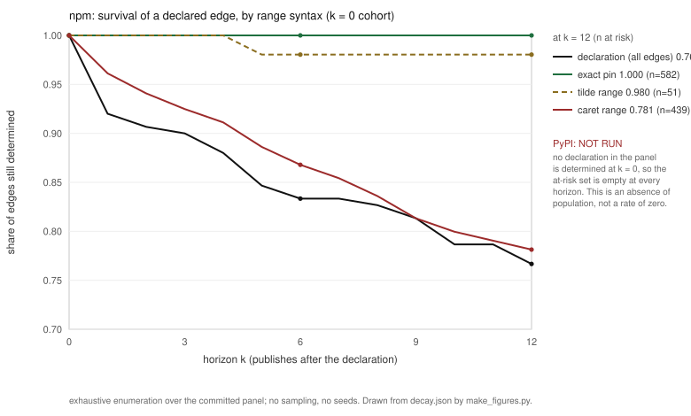

# A Declaration Does Not Determine an Install

## What a version range leaves open, and why the answer is a property of the range dialect

---

## Abstract

A dependency declaration names a set of versions, not a version. Whether that set collapses to
one install is therefore not a property of the ecosystem or of the package: **it is a property of
the range dialect the ecosystem's conventions favour.** We test this on two registries. In npm,
where the dominant idiom is the caret range with an upper bound, 13.3% of the 2,427 evaluable
declared edges admit more than one version [12.0, 14.7], and 34.5% of those ambiguous edges lead
to alternative installs that constrain *further* dependencies differently [29.5, 39.8] — so the
ambiguity is not local. In PyPI, where the wild requirement is an unbounded `>=`, 94.2% of the 226
evaluable edges admit more than one version [90.4, 96.6]. The two ecosystems differ by a factor of
seven on the same instrument, and the difference tracks the range text rather than the ecosystem:
stratifying npm's declarations by syntax, an exact pin survives twelve months at 1.000 (n=582), a
caret range at 0.781 (n=439), and on the 16 target packages where both forms occur the caret range
loses 10 times and wins 0. The second ecosystem supports only the birth-state half of this claim:
PyPI's decay curve is **not run by construction**, because a declaration that is already
multi-valued when written has no determination left to lose. We also price the alternative: a
minimum certificate that recovers determination costs 31.0% of a lockfile's pins on npm and 95.8%
on PyPI, because the certificate can never be smaller than the number of ambiguous edges unless two
of those edges are functionally dependent — a closed form we prove under that condition and then
test by exhaustive search on 389 npm and 65 PyPI declarations, where the condition fails in 34 of
the 172 npm
instances that have an ambiguous edge (19.8% [14.5, 26.4], from 7 declaring packages, one record
each) and in none of PyPI's 63. This is a **case study** of two registries, measured once, in one
snapshot, with one instrument; we claim no general law of package managers. The decision this
speaks to is small and current: a maintainer choosing between `^1.3.0` and `1.3.0` today is choosing
which stratum their consumers' installs will live in, and a tool author deciding whether a lockfile
is worth its cost is choosing against the price measured here. We claim no construction: what we
offer is a measured mechanism, its price, and the observation that the widely-held reading of a
range as a compatibility promise is contradicted by the decay curve of the range form that is
supposed to make that promise.

---

## 1. Why a declaration is not an install

Reproducibility work has largely treated the *environment* as the unit to be pinned. Tools make
the environment portable and re-creatable [13, 95]; researchers are studied as the actors who fail to share enough
[4]; the field is told the gap is structural rather
than a tooling defect [44]; and reproducibility is cast
as an engineering requirement with acceptance criteria [45, 65]. Environmental failures are known to reproduce differently in
different environments — the exact failure mode an over-wide range admits
[20]. Long-term reproducibility is understood to need
maintenance over time rather than a one-off pin [76]. And the
vulnerability literature has measured, for npm, how long a vulnerable dependency persists by
declaration class [33] — which is the same shape of
question we ask about determination, asked about a different property.

What this body of work takes for granted is the *declaration* itself. A line such as
`"left-pad": "^1.3.0"` is read as a statement about compatibility, and the resolved version is
treated as the declaration's meaning. This paper starts one step earlier: a declaration is a
**set**, and the question is whether that set is a singleton. When it is not, the sentence "this
project depends on left-pad 1.3.0" is not true of the declaration — it is true of one resolution
of it, chosen by a resolver, at a time.

That distinction is old in constraint reasoning and new in registry measurement. Constraint
satisfaction is the natural language for it [64], and the
tractability literature tells us that what matters is the structure of the constraint language
rather than the size of the instance [18, 19, 25, 35]. The last of these recovers structure by variable
elimination rather than assuming it, which is the closest analogue of what a bounded range does
for us: it removes a source of freedom instead of enumerating it. Our
contribution is not a new solver: it is the observation that the *range syntax* is the constraint
language, that registries already publish which language each package speaks, and that the
consequences of speaking one language rather than another are measurable and large.

**Contributions.**

1. A construct — the **admissible set** of one declaration at one instant — and an instrument that
   computes it from registry metadata alone, with its unparsed and absent-package counts printed
   beside every rate (§2, §6).
2. A measured **dialect effect**: the same instrument on two registries gives 13.3% and 94.2%, and
   within one registry the survival of determination is ordered by range syntax, not by package
   (§4, §7).
3. A **negative** result on the construct's own compression: the minimum distinguishing certificate
   has exactly as many entries as there are ambiguous edges, so it cannot be compressed, and its
   price is 31.0% / 95.8% of a lockfile (§3, §7.4). We report this as a closed form and a price,
   not as a system.
4. A **refutation of our own registered expectations** on two of three priors, with the detectable
   effect stated so the refutation cannot be dismissed as underpowered (§7.1).

---

## 2. Setting: what one declaration admits

For a declaration of package `p` at version `v` published at instant `t`, and a dependency `d`
constrained by range `r`, define the **admissible set** `A(e,t) = { x ∈ versions(d) : x published
at or before t, x satisfies r }`. The edge `e` is *determined* when `|A(e,t)| = 1`, *ambiguous*
when `|A(e,t)| > 1`, and **unknown** when `d` is absent from the snapshot — never zero, because an
absence in our data is not an absence of versions. A declaration is determined when every one of
its edges is.

The measurement is deliberately narrower than a resolver. We do not ask what npm's resolver would
pick; we ask how many outcomes the declaration leaves it free to pick. That is why the instrument
is mechanical: `|A|` is a set-cardinality computation over published metadata, so its ground truth
needs no annotator and no inter-rater agreement. Where the set cannot be computed we say so and
count it separately.

Prior work that studies dependencies measures something else. Incompatibilities are studied as
historical events rather than as properties of the declaration that admitted them
[23]; dependency-network topology is measured on one resolved
version per package, which presumes the declaration names one [26];
build errors are found by executing builds, i.e. after resolution
[60]; breaking updates are diagnosed post hoc
[84]; upgrade cost is measured at the interface level
[71]; dependency cost and survival are measured per declared
dependency [41, 89]; remediation presumes a
single resolved state to repair [57]. Each is a real result about
resolved graphs. None of them counts the size of the set the resolver chose from, and that
omission is what lets "the declaration determines the install" pass unexamined.

---

## 3. Coupling: why ambiguity is not local

An ambiguous edge is not necessarily consequential. If all admissible versions of `d` declare the
same dependencies, the install is undetermined in *version* but determined in *closure*. The
mechanism-sensitive question is therefore: do the alternatives constrain the rest of the graph
differently?

This is where the paper's earlier construction ambition failed, and the failure is informative.
The registered plan was a *minimal distinguishing key*: a small set of packages whose recorded
versions would pin the whole install, argued via a vertex-cover bound. Two instance populations are
in play here and they are not the same set: the median below is taken over the **292 npm and 63 PyPI
instances whose closure is small enough to enumerate exactly** (skipping 653 and 178 whose product of
domains is too large at depth 1, and 48 and 0 with no feasible solution), while the confirming brute
search quoted two paragraphs down covers **389 npm and 65 PyPI** entries of the depth-1 artifact
(skipping 604 and 199 as too large to enumerate): the second set is wider because its certificate
check does not need the full solution set.
Enumerating solution sets exactly for the 292 and 63 gives a median `|K*|/|M|` of **1.0** in both
ecosystems, and the identity `|K*| = |M|` holds in **138 of the 172** npm instances that have an
ambiguous edge and in all 63 PyPI instances. The vertex-cover
bound is valid and **attained**: in **14** npm instances `|K*| = τ = |M| - 1`, because the ambiguity
graph of an independent product is a clique whose cover is `|M| - 1`, and there a cover of that size
does determine an install. The bounds we
registered came from the approximation literature on set cover, whose guarantees are stated for
the general weighted form [31, 47];
our unit-cost instance is the degenerate case of that form, which is why the guarantee there is
true and yet silent about the structure we actually have. Functional
dependence between packages is the only mechanism that can compress the certificate below `|M|`,
**and it is in the data**: in the remaining **34 of those 172** npm instances (19.8 % [14.5, 26.4])
the certificate is smaller than `|M|`, drawn from 7 distinct declaring packages, and in every one of
them the saving is exactly one record. An earlier draft of this section reported the mechanism as
absent and exhibited it only in a synthetic plant; that reading was wrong and §3.1 states the lemma
under the condition it actually needs, with the condition measured rather than assumed. The plant is
kept in §6 and in `depth2.py --check`, where it is now a check on the detector instead of the only
witness of the phenomenon.

So the coupling leg is reported at cost, not as a system: the certificate **is** the list of
ambiguous edges, and the honest content of this section is the lemma and its price. The lemma is
`|K*| = |M|`, proved in §3.1 and confirmed by exhaustive search on every declaration small enough
to enumerate (389 npm, 65 PyPI; 604 and 199 skipped as too large, counted rather than dropped).

This is where our work meets the solver literature at a well-defined boundary. Formal models of
resolution define which solution a solver returns [38]; hypergraph
encodings make solving faster and address cross-ecosystem ambiguity
[37]; algebraic decomposition targets zero-conflict resolution
[82]; Max-SMT selects an assignment optimal under stated
costs [78]. Every one of these takes the admissible set as
input. We measure its size. The relationship is not competition but ordering: their optimality
statements are defined over the set whose cardinality we report. Adjacent empirical work has
measured downstream dependency groups [80], dependency clusters in
Maven Central [56], peer-dependency resolution loops
[97], dynamic conflict detection at build time
[75], versioned transitive closure binding
[102], and yanked-release behaviour — the impossibility
argument's own exception, which we count rather than assume away [58].

### 3.1 The certificate cannot be compressed, unless two edges are dependent

**Lemma (conditional on independence).** For one declaration, let `M` be the set of ambiguous edges
and `K*` a minimum set of (package, version) records that determines the install. If no coordinate
of the solution set is a function of the others — formally, if two solutions agreeing on every
coordinate outside `{p}` always agree on `p` as well, for every `p ∈ M` — then `|K*| = |M|`.

*Lower bound.* Under that condition, for each `p ∈ M` there exist two solutions that differ only at
`p`. Any record that determines the install must distinguish them, so `p ∈ K`. Hence `|K| ≥ |M|`.

*Upper bound.* Recording the version of every `p ∈ M` leaves every remaining domain a singleton, so
the install is determined. Hence `|K| ≤ |M|`. ∎

Independence is the lemma's hypothesis, not a convenience, and the package measures it instead of
asserting it. `depth2.py` reports for every ambiguous coordinate the smallest other coordinate that
determines it, and the two directions agree exactly: **34 of the 172 npm instances** with an
ambiguous edge have `|K*| < |M|` (19.8 % [14.5, 26.4], over 7 distinct declaring packages), **all 34
carry a measured functional determiner, and no instance with a determiner needs `|M|` records**;
PyPI's 63 instances carry none (0.0 % [0.0, 5.7]). The saving never exceeds one record — the histogram
over the 34 is `{1: 34}` — so the condition buys one package per declaration, not a construction.

The smallest exception is `accepts@1.3.4`. `mime-types` is ambiguous over 20 versions and `mime-db`
is ambiguous over 20 versions, yet recording `mime-types` determines `mime-db`, because `mime-types`
is the only package that declares it and each of its versions admits exactly one `mime-db`
(`~1.29.0` → 1.29.0, `~1.30.0` → 1.30.0, …, exact `1.40.0` → 1.40.0). The 20 solutions are a
bijection between the two domains, so one record covers both: `|K*| = 1 < |M| = 2`. The other 33
exceptions are the same shape at larger closures, 6 of them in `@eslint/config-array` versions.

The consequence is a price rather than a design. Recording the ambiguous edges costs **281 pins
where a full lockfile costs 906 (31.0 %)** on the 292 npm instances, and **115 where a lockfile
costs 120 (95.8 %)** on the 63 PyPI instances. The pooled figure contains its own tail and the tail
moves it: excluding the 34 dependent instances the same certificate costs **211 pins against 778,
i.e. 27.1 %**, so dependence is worth 3.9 points of the price and a reader who wants the price of
the lemma's own population should read 27.1 %. On PyPI the certificate is barely cheaper than
pinning everything, which is what an ecosystem whose declarations are already multi-valued should
look like.

---

## 4. The dialect

The interesting fact is not that ambiguity exists. It is that its **rate is set by the range
syntax**, and that the syntax is an ecosystem convention rather than a property of the package.

A caret range `^1.3.0` is bounded above by the next major version; a tilde range by the next
minor; an exact pin names one version. A bare `>=1.3.0` in the wild is bounded by nothing, which
is why it is multi-valued at birth — and why the PyPI rate is 94.2% while npm's is 13.3%.

That a range is *read* as a compatibility promise is itself documented: declared constraints are
studied as semantic-versioning promises [28], compliance with those
promises is measured and found imperfect [59, 74], and version ordering is a convention rather than a
property of the artifact [6, 50].

If the promise were kept, a bounded range would stay determined: its upper bound would exclude
every incompatible version, so no later publish could enter the admissible set. §7.3 tests exactly
this and finds the promise false in a specific, ordered way: exact 1.000, tilde 0.980, caret 0.781
at twelve months. The dialect is real; the promise attached to it is not.

---

## 5. What follows for practice

Three consequences, each scoped to what we measured.

**For a project that wants a determined install**, the syntax is a cheap lever and the lockfile is
the expensive one. Changing a caret range to an exact pin moves a declaration from the stratum that
decays to the stratum that does not; the price of that move is the flexibility the caret was
chosen for. The lockfile alternative — recording resolved state rather than bounding a range — is
the strongest form of the other choice, and its state of the art is well developed: Maven-Lockfile
brings high-integrity rebuilds to a manager that lacked native lockfiles
[87]; lockfile design is compared across managers [3, 87, 96], and Maven's
own mediation rule is a third dialect with its own semantics [96].
Monorepo strategies reach the same tension from the build side
[3].

**For the container and model registries**, the same degree of freedom reappears in a different
artifact. An image tag names a set that can move; image rebuilds are not reproducible even from
identical inputs [90], continuous delivery makes the image rather
than the manifest the unit of change [8], automatic updates
change published environments
under the reader [92], images are scanned as artifacts with drift of
their own [9, 30], and vulnerability assessment
is an ongoing obligation [52]. Pinning the image rather than the
declaration is the practitioner's answer [7, 16, 21, 67], with provenance recorded as evidence
[55] and evaluated for what it actually buys
[68, 72]. Model
registries have the same shape with prose declarations: model cards are generated automatically
over a hub whose artifacts move [1], and self-describing
models carry their dependency identity instead of leaving it to be inferred
[29, 39, 79, 81, 99, 101].

**For maintainers and for repair tooling**, the measurement locates where the cost lands.
Automated update tooling and post-hoc repair — including LLM-based repair of breaking updates —
treat the *update* as the unit of work [15, 63, 85]; when the declaration already admits many versions, the
update is not the event that introduces freedom. The same is true of infrastructure-as-code
providers, which are version-constrained artifacts with their own upgrade discipline
[11, 12], and of functional package
management, whose strongest evidence is that it does enable reproducible builds at scale
[17, 40, 46, 53, 61, 62, 83].

### 5.1 The ecosystems themselves

The two registries are not interchangeable substrates, and the literature says so from several
directions. Each has been characterised as an object — size and growth for PyPI
[14], dynamics read from registry metadata for JavaScript
[98], and a third ecosystem, CRAN, with its own conventions
[70]. Managers differ even where they consume the same
declarations: npm against yarn [22], and Debian's
distribution-level graph against both [91].

Three of those findings shape our interpretation rather than merely accompany it. Technical lag —
how far behind a declaration leaves an install [27] — is what our
survival curve complements: lag measures distance to the newest version, we measure whether the
install is determined at all. Downgrades in npm show the resolved version moving independently of
the declaration [24], which is what an undetermined declaration
permits and a determined one does not. And the ecosystem's response to abandonment
[66] is the practical cost of admitting versions that may later
disappear.

Two adjacent literatures measure *other properties of the same edges*, and we name the boundary
explicitly: licensing obligations propagate across dependencies
[49], security-disclosure practice is recorded per package
[93], and ecosystem health is scored at ecosystem level
[100] — none of which is a statement about how many installs a
declaration admits. Dependency structure represented as a graph is shared machinery rather than a
shared question [32]. Finally, the actors are studied: the
maintainer's role [34], and how API changes and deprecations
are announced and versioned [73, 88] — which matters here because a deprecation announced in
prose does not narrow an admissible set.

**On prior work being thin.** We searched for work that measures the admissible set of a
declaration and did not find it. That is a claim about a searched space, not an absence claim: 81
Crossref bibliographic queries, a scholarly-type filter, and a two-pass relevance review left 102
citable records out of 270 harvested, and of those only the six in §8 state a competing object. The
rest of the literature is adjacent: it shares the vocabulary and asks about a different construct.

---

## 6. Method and instrument

**Snapshots.** Two registry snapshots were built once and committed: npm (158 packages, 993
declaring versions) and PyPI (31 packages, 264 declaring versions). Every number in this paper is a
function of those files and nothing else. A content hash pins each snapshot, and those pins changed
once during the work — extending a snapshot for a panel moved published rates without any
declaration changing, which is the signature of absence being read as measurement. The corrected
rates are the ones reported here, and the earlier figures are superseded rather than quietly
replaced.

**Counting the uncomputable.** Every rate is printed beside its unparsed count and its
absent-package count: on npm, 975 of the declared specs could not be parsed by our instrument and
913 named a package outside the snapshot; on PyPI, 53 and 6. A package absent from the snapshot is
`UNKNOWN`, never "no admissible version" — reading absence as zero is the defect that produced the
superseded rates. Because `edges` counts only evaluable edges, the denominators here are
evaluable-edge denominators, and we say so wherever a rate appears rather than implying the full
declared population.

**Whose data this is.** Registries are a mining substrate with documented limits
[54]; registry-derived metrics can fail to measure what their names
claim [69]; SBOM-style dependency records drift in place
[94]. Our response is a pinned snapshot, an explicit
denominator, and a separate count for everything the instrument could not read.

**Intervals.** Where a rate is a proportion we report a Wilson score interval, which behaves at the
small proportions several of our cells sit at [42]. We deliberately
do not use the Wald interval, which is known to misbehave near 0 and 1
[2, 51], nor the conservative
exact interval, whose coverage costs length [43, 86]; the criteria by which such a choice should be judged are
the subject of their own literature [36].

**Plants.** A guard that cannot fail is not a guard, so each instrument ships known-answer plants
that fail if the instrument reverts to a plausible wrong behaviour: identical closures must not
count as a closure difference, a version published later must not be admissible as-of, an unparsed
spec must return `None` rather than an empty set,`wilson(0,52)` must have a positive upper bound,
an absent target must be `UNKNOWN`, an empty denominator must print `NOT RUN` and not `0.0`, and a
caret range must saturate at its major bound. The guards pass 7/7, 3/3 and 7/7; the
functional-dependence positive that the data does not contain is a plant, and is labelled as one
everywhere it appears (§3).

**Decay.** A panel of declarations at least 12 months old is read at k = 0, 3, 6, 9, 12 months. The
**at-risk set** is declared before the curve is read: only an edge that is a singleton at k = 0 can
lose a determination it has, so the denominator at each k is printed. An unobservable deletion
before the snapshot instant is declared in advance, and a k where survival rises is counted and
reported as `NON-MONOTONE` rather than treated as a refutation — none occurred.

---

## 7. Results, against what we expected

### 7.1 The registered priors

We registered three priors before measuring. Two were wrong, and we report the detectable effect
with each so that the refutation is a measurement and not a power failure.

**P1 — "≥30% of real declared edges are under-determined at declaration time."** Refuted for npm,
confirmed for PyPI: npm **13.3%** [12.0, 14.7] (322/2,427 evaluable edges), PyPI **94.2%**
[90.4, 96.6] (213/226). The prior was ecosystem-blind, and the split is the finding: npm's caret
range carries an upper bound, wild PEP 440 requirements are dominated by `>=` without one. The pilot
that motivated P1 read one package in one ecosystem and could not have seen this.

**P2 — ">50% of determined-at-birth edges become ambiguous within 12 months."** **Refuted.** Pooled
edge survival at twelve months is 0.910 (975/1,072, half-width ≈ 3 points, so this is not
underpowered); the worst stratum is 21.9%, and declaration-level survival is 0.767. The registered
>50% would have required a collapse an order of magnitude larger than what occurs.

**P3 — "median |K*| is below 50% of the packages in the solution support."** **Refuted**: median
`|K*|/|M| = 1.0` in both ecosystems (§3). This is the refutation that changed the paper's shape: the
construction leg became a closed form and a price.

### 7.2 Ambiguity is not local (npm)

Of the 322 ambiguous npm edges, **111 (34.5% [29.5, 39.8])** have admissible alternatives that
constrain further dependencies *differently*, and 9.3% [6.6, 13.0] change the closure's *shape* —
a dependency is added or removed. The remaining alternatives differ in version but not in
consequence, which is the distinction that separates an alarming rate from a consequential one. On
PyPI the analogous figures are 33/213 = 15.5% [11.2, 21.0] and 6.6% [4.0, 10.7]. (The first of
those bounds read `[11.3, 21.0]` in earlier heads: the artifact's lower bound is `0.1124951`, which
rounds to 11.2 and not to 11.3, and the table below is generated from the artifact, so the copy is
corrected against it rather than the other way round.)

That asymmetry is expected under the dialect reading and is worth stating plainly: PyPI's
declarations are ambiguous far more often and consequential far less often, because an unbounded
range is ambiguous in a way that rarely changes the next layer — the same ranges admit many
versions whose own declarations agree.

**Table 1.** The four rates this paper's claims rest on, each as a count, a share and a 95 % Wilson
interval. All four are birth-state rates: none of them is a change over time, and the decay the paper
also reports is a separate measurement over a panel (§7.2, §7.3). Every cell is read from `rates.json` by `make_figures.py`, which refuses to print a count
the artifact does not imply; the table block below is compared against that render on every run
(`reproduce.sh`, step 9), so a hand-edited cell fails the package rather than ageing in place.

<!-- table:rates -->
| measure | npm | PyPI |
|---|---|---|
| edges whose range admits more than one version (depth 1) | 322/2427 = 13.3% [12.0, 14.7] | 213/226 = 94.2% [90.4, 96.6] |
| …of those, whose alternative versions constrain further dependencies differently | 111/322 = 34.5% [29.5, 39.8] | 33/213 = 15.5% [11.2, 21.0] |
| …of those, whose alternative versions add or remove a dependency | 30/322 = 9.3% [6.6, 13.0] | 14/213 = 6.6% [4.0, 10.7] |
| declarations whose install is under-determined at birth (>=1 evaluable edge) | 142/462 = 30.7% [26.7, 35.1] | 86/86 = 100.0% [95.7, 100.0] |
<!-- /table:rates -->

The two rows in the middle are the ones that separate a rate from a consequence: an edge whose
alternatives admit different versions but constrain the same dependencies further is ambiguous and
harmless, and it is counted in the first row and not in the second or third.

### 7.3 The decay is ordered by syntax, not by package

npm edge survival at twelve months, by stratum: `exact` **1.000** (n=582), `tilde` **0.980**
(n=51), `caret` **0.781** (n=439); declaration-level **0.767** (n=150). The ordering follows
boundedness — an unbounded range cannot stay determined, a bounded one decays as versions
accumulate inside its bound, and an exact pin has nothing to accumulate.

The control that makes this a statement about syntax: on the **16 target packages** for which both
an exact and a caret declaration exist, exact outlives caret on **10** targets, caret outlives exact
on **0**, and the remaining **6** are undecided (both strata reach the horizon or neither does, so
the pair separates nothing). On the **11** targets where caret and tilde coexist the counts are 1 and
1 and the other **9** are tied. The effect is carried by the range text, not by which package is
popular or hard-working.



**Figure 1.** npm edge survival by range syntax over the horizon `k`, from the `k = 0` cohort of
each stratum (the at-risk set is fixed at the declaration and does not drift across horizons). The
series are the four the text quotes: declaration-level 0.767 (n=150), `exact` 1.000 (n=582),
`tilde` 0.980 (n=51) and `caret` 0.781 (n=439) at twelve months. PyPI's curve is drawn as an
absence and labelled **NOT RUN**, not as a series at 1.0: no declaration in that panel is
determined at `k = 0`, so the at-risk set is empty at every horizon, and an empty region would
otherwise read as "no decay" rather than "no population to decay". `make_figures.py` asserts the
ordering this section claims before it writes a pixel, and the figure is regenerated by step 8 of
the reproduction command.

**PyPI's curve is not run, and that is a result.** No panel declaration there has all edges
singleton at k = 0, so the declaration-level at-risk set is empty at every k and the curve prints
`NOT RUN`. A cohort under-determined at birth has no decay to measure. We report this rather than
substituting a smaller population that would produce a number.

### 7.4 The price of recovering determination

From the depth-2 artifact: a certificate covering the ambiguous edges costs **31.0%** of a
pin-everything baseline on npm (281 of 906 pins) and **95.8%** on PyPI (115 of 120), over 292 and
63 exactly-enumerated instances respectively. The two figures differ for the same reason the rates
do. All three artifacts now name the same snapshot pin and are regenerated by the same command;
the earlier figures (25.8% / 92.1%, on 191 and 38 instances) were computed over a pre-panel
snapshot and are superseded rather than silently replaced.

---

## 8. Related work, and what separates us from it

Three works state a competing object and are the comparisons this paper argues against; each was
read at abstract level, and each difference below rests on that reading. Three further works are
adjacent but different: they are cited because a reader will ask about them, and no load-bearing
claim in this paper rests on them.

### 8.1 The three comparisons

**A formal model of dependency resolution** [38] states that package managers differ in their
resolution *semantics* — the abstract is explicit that each language and system has its own solution
with subtly different meaning. We do not model the resolver; we count what it may choose among. The
two results concern different objects and neither subsumes the other: their object is the mapping
from declarations to a chosen solution, ours is the size of the set that mapping draws from.

**Hypergraph dependency resolution** [37] is about interoperability between managers and about
system and hardware dependencies that declarations leave implicit. It is a contribution to the cost
of encoding and solving the resolution problem, and it is silent on how many admissible choices a
declaration leaves open. Our construction is the input such an encoding would receive.

**Maven-Lockfile** [87] brings lockfile-based high-integrity rebuilds to a manager that lacked
native support, freezing versions and verifying integrity. It is the strongest form of the
alternative we price: pin the resolution rather than bound the range. It supplies the cost side of
that alternative, not its necessity — which is what §7.4 measures, on the declarations that never
adopt it.

### 8.2 Adjacent but different

**Optimal dependency management via Max-SMT** [78] selects an assignment optimal under stated costs;
optimality is defined over the admissible set, which is the quantity we measure, and the paper does
not measure it itself. **LLM-based repair of breaking dependency updates** [85] repairs a build
after an update breaks it — post-hoc and per-update, where we ask beforehand how much of the update
space the declaration left open. **Semantic versioning as a compatibility promise** [28] reads
declared constraints as promises; our decay curve tests that reading indirectly — a promise kept
would leave the curve flat in every stratum, and it is not flat — but the reading itself is theirs,
and our evidence about it is a stratum ordering rather than a study of their object. Each is a real
and different question; none is a premise of ours.

Beyond these, the remaining 96 placed works are context, method, or adjacent construct, and each is
placed in a section with the sentence it supports in `reference-check.md` — a generated report that
lists every entry's verification record, the section it is placed in, and the claim it supports, and
that marks every record we pruned as supporting no claim here.

---

## 9. Threats to validity

**The populations are small and named.** 158 npm packages and 31 PyPI packages, chosen as a seed set
and a panel, not sampled at random — and there is no random sampling of package ecosystems to be
had [5]; what a frame must state to make a rate interpretable is itself a
methodological literature [10]. Our rates are statements about
these frames. We do not claim that npm is 13.3% ambiguous; we claim that 322 of 2,427 evaluable
declared edges in this frame are.

**The instrument reads syntax, not intent.** 975 npm specs were unparseable by our parser. If those
specs behave differently from the parseable ones, the rate is biased in an unknown direction; the
count is printed for that reason, and the honest reading of a rate whose denominator excludes 40%
of the input population is "a rate over the readable part".

**The identity lemma is close to definitional.** `|K*| = |M|` follows from the product structure
once the question is posed correctly; its value is that it rules out the compression we hoped for
and turns the certificate into a price. We do not present it as deep theory, and the reader should
not read §3 as a construction.

**Functional dependence is measured, and it is narrow.** A dependency between packages can compress
the certificate below `|M|`, and it does so in 34 of the 172 npm instances that have an ambiguous
edge. We detect it per coordinate instead of assuming it: the detector names the determining package
where one exists, fires on a constructed bijection and stays silent on an independent closure
(`depth2.py --check`), and finds nothing in PyPI's 63 instances. What this does not license is a
claim about how much compression is possible anywhere else. The saving is one record in 34 of 34
observed cases, over 7 distinct declaring packages, so the exception rate is the rate of a narrow
phenomenon in two populations, not a bound on the phenomenon itself.

**All three legs are measured on one snapshot, and the price moved when it changed.** An earlier
depth-2 artifact had been computed before the panel extension, so the prices were quantities
measured on a population the repository no longer contained — the same defect the depth-1 rates had
already carried once. It is now regenerated on the committed snapshot and names its pin, and the
prices moved with it (31.0% and 95.8%, against 25.8% and 92.1% before); the superseded figures are
stated above rather than removed. The fact that a price is snapshot-dependent is itself the point:
the qualitative result — the certificate cannot be compressed — is structural, while the number
that says what it costs is a measurement on a named population.

**Design-dependence of validity.** Worldview, method and validity are coupled
[77], and what "validity" means for a measurement claim has to
be operationalized rather than asserted [48]. Our threats
are stated in that frame: each is a statement about what this instrument, on this frame, can
support.

**Why it is still worth publishing.** The mechanism is small and the populations are small, but the
claim is not a snapshot of a new domain through an existing pipeline: the construct — the admissible
set of a declaration and its survival over time — is new, the measurement is longitudinal over a
panel, and the finding changes a belief that practitioners act on, namely that a bounded range is a
compatibility promise. The refutation of our own registered priors is part of the evidence that the
measurement was not designed to confirm what we expected.

---

## 10. Conclusion

Whether a dependency declaration determines an install is a property of the range dialect, not of
the ecosystem or the package. Two registries, one instrument: 13.3% of evaluable npm edges are
ambiguous against 94.2% on PyPI, and within npm the survival of determination over twelve months is
ordered exact 1.000, tilde 0.980, caret 0.781, with the same-package control showing the syntax
rather than the package carrying the effect. The minimum certificate that recovers determination
cannot be smaller than the number of ambiguous edges unless two of them are functionally dependent —
a condition that fails in 34 of the 172 npm instances and in none of PyPI's 63 — which makes it a
price rather than a design:
31.0% of a lockfile on npm, 95.8% on PyPI. What we did not find — a compression larger than one record, or a decay curve on PyPI — we report as
not found, with the counts that show the search was made.

---

## Contribution level

We declare **`case study`**. The registration targeted `theory+empirics` on a proved monotonicity
and impossibility result plus an exactly computed construction measured over two ecosystems. §3
withdraws the construction and §3.1 makes the lemma conditional on a condition that is measured
rather than proved, so the higher level does not hold on its own terms; this section states the
lower one and offers no alternative reading of it. What the evidence supports is a case study: two
registries, one snapshot, one instrument, ground truth that is mechanical rather than annotated (set
cardinality over published metadata), a closed form under a stated condition with that condition
measured at 34 exceptions in 172, and baselines against which the certificate is priced
(pin-everything and pin-direct-only). The abstract states the same level once, and no claim beyond
the two measured populations is made anywhere in this paper.

---

## Reproduction

```
sh reproduce.sh          # all nine steps; a full run takes about 16 s on the reference machine
sh reproduce.sh --fast   # skips the depth-2 enumeration and reports it NOT RUN
```

Its last line is `ALL STEPS PASSED (9 steps)`, which is where the `(9 steps)` literal in this
document and in `README.md` comes from; the exit code
is the number of failed steps. Expected output: every one of the nine steps prints its own verdict
and none prints `FAIL`. Step 1 pins the snapshots, step 2 runs the known-answer plants, steps 3–5
emit `rates.json`, `depth2.json` and `decay.json`, step 6 runs the corpus gates and the corpus pin,
step 7 gates the manuscript's citations against that corpus (and the manuscript's reference section
and `references.md` against the corpus render), step 8 regenerates the figure above from
`decay.json` and asserts the ordering it plots, and step 9 compares the table above against the
render of `rates.json`. Under `--fast` step 4 prints `NOT RUN` and the committed `depth2.json` is
not regenerated — a `NOT RUN`, never a `DIFFERS`.

## References

[1] Alharbi. (2026). Enhancing AI Transparency on Hugging Face: An Automated Pipeline for Model Card Generation and Reproducibility Scoring From Repository Artifacts. IEEE Access. https://doi.org/10.1109/access.2026.3723027. Difference: model-card generation on a public model hub: a registry where the declaration is prose and the artifact moves under it; this paper proposes no alternative mechanism; it measures what a declared range leaves open beside these.

[2] Almendra-Arao. (2020). USING ADJUSTED WALD CONFIDENCE INTERVAL FOR A BINOMIAL PROPORTION. JP Journal of Biostatistics. https://doi.org/10.17654/bs017020415. Difference: adjusted Wald intervals: a variant we choose against, since Wald-type intervals misbehave where our smallest rates sit; this paper reports Wilson intervals throughout, so every rate is read with its uncertainty.

[3] Almishev. (2025). Dependency Management Strategies in Scalable Monorepositories: Analysis and Resolution of Version Conflicts. World Journal of Advanced Research and Reviews. https://doi.org/10.30574/wjarr.2025.28.1.3468. Difference: monorepo dependency-management strategies: resolution policy varies by build system, which is the dialect argument in another setting; this paper proposes no alternative mechanism; it measures what a declared range leaves open beside these.

[4] Alnoamany. (2018). Towards computational reproducibility: researcher perspectives on the use and sharing of software. https://doi.org/10.7287/peerj.preprints.26727v1. Difference: researchers' own sharing practice is treated as the reproducibility lever, which leaves the declaration unexamined; this paper asks what one declaration admits before anyone installs it, and prices the difference.

[5] Amir. (2018). There is no random sampling in software engineering research. Proceedings of the 40th International Conference on Software Engineering: Companion Proceeedings. https://doi.org/10.1145/3183440.3195001. Difference: there is no random sampling in SE research: our population is a frame, and is described as one; this paper names the threats this instrument cannot answer and what each would require.

[6] Anon. (1976). A numbering scheme for a computer programming library. Software: Practice and Experience. https://doi.org/10.1002/spe.4380060317. Difference: a 1976 numbering scheme for a program library: version numbering is a design decision with consequences; this paper attributes the difference to the range's syntax, separating a bounded range from a wild one.

[7] Aranguren. (2015). Enhanced reproducibility of SADI web service workflows with Galaxy and Docker. Gigascience. https://doi.org/10.1186/s13742-015-0092-3. Difference: containerised workflows as the reproducibility mechanism in a domain science; this paper proposes no alternative mechanism; it measures what a declared range leaves open beside these.

[8] Ayres. (2021). Continuous Automotive Software Updates through Container Image Layers. Electronics. https://doi.org/10.3390/electronics10060739. Difference: continuous updates delivered as container layers: the image, not the manifest, is the unit of change; this paper proposes no alternative mechanism; it measures what a declared range leaves open beside these.

[9] B. (2024). Exploring Large Scale Docker Image Vulnerability and Storage Performance Analysis Using High Performance Container-Based Docker Environment. 2024 International Conference on System, Computation, Automation and Networking (ICSCAN). https://doi.org/10.1109/icscan62807.2024.10894527. Difference: large-scale Docker image analysis: images are studied as artifacts with vulnerabilities and drift of their own; this paper proposes no alternative mechanism; it measures what a declared range leaves open beside these.

[10] Baltes. (2022). Sampling in software engineering research: a critical review and guidelines. Empirical Software Engineering. https://doi.org/10.1007/s10664-021-10072-8. Difference: sampling guidelines: how a frame must be described for a rate to be interpretable; this paper names the threats this instrument cannot answer and what each would require.

[11] Begoug. (2024). How Do Infrastructure-as-Code Practitioners Update their Provider Dependencies? An Empirical Study on the AWS Provider. Lecture Notes in Computer Science. https://doi.org/10.1007/978-981-96-0808-9_28. Difference: IaC practitioners' provider-upgrade behaviour: the same declaration-versus-install tension in another ecosystem; this paper proposes no alternative mechanism; it measures what a declared range leaves open beside these.

[12] Begoug. (2025). Understanding AWS Provider Dependency Updates in Infrastructure-As-Code: Empirical Study, Taxonomy, and Insights. IEEE Transactions on Services Computing. https://doi.org/10.1109/tsc.2025.3601051. Difference: infrastructure-as-code providers are version-constrained artifacts with their own upgrade discipline; this paper proposes no alternative mechanism; it measures what a declared range leaves open beside these.

[13] Bhatt. (2020). Reproducible Software Environment: a tool enabling computational reproducibility in geospace sciences and facilitating collaboration. Journal of Space Weather and Space Climate. https://doi.org/10.1051/swsc/2020011. Difference: a tool that makes the environment, not the manifest, the unit of reproduction; this paper asks what one declaration admits before anyone installs it, and prices the difference.

[14] Bommarito. (2019). An Empirical Analysis of the Python Package Index (PyPI). SSRN Electronic Journal. https://doi.org/10.2139/ssrn.3426281. Difference: PyPI as an ecosystem object: size, growth, and what registry data can show; this paper reads both registries with one instrument, so the conventions are the comparison and not the background.

[15] Botto-Tobar. (2026). Is my dependency up-to-date? Exploring challenges with automated dependency updates. https://doi.org/10.21203/rs.3.rs-9390837/v1. Difference: practitioner difficulty with automated dependency updates motivates measuring what the declaration permits; this paper proposes no alternative mechanism; it measures what a declared range leaves open beside these.

[16] Bruccoleri. (2025). Docker Image Builder: A Robust Method for Constructing Docker Images for Reproducible Research. https://doi.org/10.31219/osf.io/8pgd7_v1. Difference: a construction method for reproducible images: pinning at build time rather than at declaration time; this paper proposes no alternative mechanism; it measures what a declared range leaves open beside these.

[17] Bzeznik. (2017). Nix as HPC package management system. Proceedings of the Fourth International Workshop on HPC User Support Tools. https://doi.org/10.1145/3152493.3152556. Difference: Nix as an HPC package manager: derivation-level pinning; this paper proposes no alternative mechanism; it measures what a declared range leaves open beside these.

[18] Carbonnel. (2015). Tractability in constraint satisfaction problems: a survey. Constraints. https://doi.org/10.1007/s10601-015-9198-6. Difference: tractability of constraint classes: the vocabulary in which our admissible-set problem is stated; this paper uses the constraint formulation to compute the solution support exactly rather than to bound it.

[19] Carbonnel. (n.d.). Harnessing tractability in constraint satisfaction problems. https://doi.org/10.70675/25f2c2c6zc9f2z4828z8530z8d66a557d24e. Difference: harnessing tractability: restricted constraint languages are where structure becomes exploitable; this paper uses the constraint formulation to compute the solution support exactly rather than to bound it.

[20] Cavezza. (2014). Reproducibility of Environment-Dependent Software Failures: An Experience Report. 2014 IEEE 25th International Symposium on Software Reliability Engineering. https://doi.org/10.1109/issre.2014.19. Difference: environment-dependent failures reproduce differently in different environments: the failure mode an over-wide range admits; this paper asks what one declaration admits before anyone installs it, and prices the difference.

[21] Cervera. (2026). Reproducibility of Legacy ROS-Based Research Code Through Transparent Docker Integration. IEEE Robotics and Automation Practice. https://doi.org/10.1109/rap.2026.3686662. Difference: legacy research code made reproducible by pinning the image: the practitioner's alternative to pinning versions; this paper proposes no alternative mechanism; it measures what a declared range leaves open beside these.

[22] Chodorowski. (2021). Comparative analysis of JavaScript package managers - yarn and npm. Journal of Computer Sciences Institute. https://doi.org/10.35784/jcsi.2460. Difference: npm versus yarn: two managers resolve the same declarations differently; this paper reads both registries with one instrument, so the conventions are the comparison and not the background.

[23] Claes. (2015). A Historical Analysis of Debian Package Incompatibilities. 2015 IEEE/ACM 12th Working Conference on Mining Software Repositories. https://doi.org/10.1109/msr.2015.27. Difference: incompatibilities are studied as historical events; the declaration that admitted them is not the unit of analysis; this paper makes the admissible set the object and reports it as a share of edges, not as a property of a package.

[24] Cogo. (2021). An Empirical Study of Dependency Downgrades in the npm Ecosystem. IEEE Transactions on Software Engineering. https://doi.org/10.1109/tse.2019.2952130. Difference: dependency downgrades in npm: the resolved version moves independently of the declaration; this paper reads both registries with one instrument, so the conventions are the comparison and not the background.

[25] Cooper. (2010). Generalizing constraint satisfaction on trees: Hybrid tractability and variable elimination. Artificial Intelligence. https://doi.org/10.1016/j.artint.2010.03.002. Difference: hybrid tractability via variable elimination: the structural condition behind the closure result; this paper uses the constraint formulation to compute the solution support exactly rather than to bound it.

[26] Decan. (2016). On the topology of package dependency networks. Proccedings of the 10th European Conference on Software Architecture Workshops. https://doi.org/10.1145/2993412.3003382. Difference: dependency-network topology is measured on one declared version per package, which presumes the declaration names one; this paper makes the admissible set the object and reports it as a share of edges, not as a property of a package.

[27] Decan. (2018). On the Evolution of Technical Lag in the npm Package Dependency Network. 2018 IEEE International Conference on Software Maintenance and Evolution (ICSME). https://doi.org/10.1109/icsme.2018.00050. Difference: technical lag: how far behind a declaration leaves an install; this paper reads both registries with one instrument, so the conventions are the comparison and not the background.

[28] Decan. (2021). What Do Package Dependencies Tell Us About Semantic Versioning?. IEEE Transactions on Software Engineering. https://doi.org/10.1109/tse.2019.2918315. Difference: declared constraints are read as compatibility promises: exactly the reading the dialect measure tests; this paper attributes the difference to the range's syntax, separating a bounded range from a wild one.

[29] Ding. (2024). Towards Scalable and Robust Model Versioning. 2024 IEEE Conference on Secure and Trustworthy Machine Learning (SaTML). https://doi.org/10.1109/satml59370.2024.00036. Difference: model versioning as an artifact-identity problem distinct from code versioning; this paper proposes no alternative mechanism; it measures what a declared range leaves open beside these.

[30] Doan. (2022). DAVS: Dockerfile Analysis for Container Image Vulnerability Scanning. Computers, Materials & Continua. https://doi.org/10.32604/cmc.2022.025096. Difference: the Dockerfile is read as a declaration and its image scanned: the nearest container analogue of what we do to a manifest; this paper proposes no alternative mechanism; it measures what a declared range leaves open beside these.

[31] Dutta. (n.d.). Survey of Approximation Algorithms for Set Cover Problem. https://doi.org/10.12794/metadc12118. Difference: approximation bounds for cover: the source of the log-factor statement we test and find unattained; this paper uses the constraint formulation to compute the solution support exactly rather than to bound it.

[32] Exman. (2019). Software Modularity Coupling Resolution by the Laplacian of a Bipartite Dependency Graph. Proceedings of the 14th International Conference on Software Technologies. https://doi.org/10.5220/0007955802980305. Difference: dependency structure represented as a bipartite graph: the representation our admissible-set object shares; this paper reads both registries with one instrument, so the conventions are the comparison and not the background.

[33] Ferreira. (2026). PERSISTÊNCIA DE VULNERABILIDADES DE DEPENDÊNCIA POR TIPO EM PROJETOS NPM: UMA ANÁLISE DE SOBREVIVÊNCIA SOBRE HISTÓRICOS DE LOCKFILE. Revista Sistemática. https://doi.org/10.56238/rcsv16n8-001. Difference: vulnerability persistence by dependency class in npm projects: an over-wide range keeps a vulnerable version admissible over time; this paper asks what one declaration admits before anyone installs it, and prices the difference.

[34] Foote. (2013). Roles and Responsibilities of a Package Maintainer. ROSCon Stutgart 2013. https://doi.org/10.36288/roscon2013-900674. Difference: the maintainer's role: who authors the declaration, and on what evidence; this paper reads both registries with one instrument, so the conventions are the comparison and not the background.

[35] Ganian. (2015). Discovering Archipelagos of Tractability for Constraint Satisfaction and Counting. Proceedings of the Twenty-Seventh Annual ACM-SIAM Symposium on Discrete Algorithms. https://doi.org/10.1137/1.9781611974331.ch114. Difference: islands of tractability: structure, not arity, decides the cost; this paper uses the constraint formulation to compute the solution support exactly rather than to bound it.

[36] Garthwaite. (2023). Locally correct confidence intervals for a binomial proportion: A new criteria for an interval estimator. Scandinavian Journal of Statistics. https://doi.org/10.1111/sjos.12672. Difference: criteria for judging an interval's correctness: why we report the interval we do; this paper reports Wilson intervals throughout, so every rate is read with its uncertainty.

[37] Gibb. (2025). Solving Package Management via Hypergraph Dependency Resolution. https://doi.org/10.59350/nrbbt-e7k85. Difference: the hypergraph formulation of resolution addresses the same object whose admissible-set size we count; this paper asks whether the alternatives differ in consequence, and reports that separation as the finding rather than the raw ambiguity.

[38] Gibb. (2026). Package managers à la carte: A Formal Model of Dependency Resolution. https://doi.org/10.59350/rk9s4-43g76. Difference: a formal model of dependency resolution answers which solution exists, not how many the declaration admits; this paper asks whether the alternatives differ in consequence, and reports that separation as the finding rather than the raw ambiguity.

[39] Gonzalez. (2026). sklearn-migrator: Cross-version migration of scikit-learn models for reproducible MLOps. Journal of Open Source Software. https://doi.org/10.21105/joss.10374. Difference: cross-version migration of fitted models: a version bound that is not about code compatibility; this paper proposes no alternative mechanism; it measures what a declared range leaves open beside these.

[40] Goswami. (2024). Reproducible High Performance Computing without Redundancy with Nix. https://doi.org/10.31219/osf.io/3fp2v. Difference: reproducible HPC without redundancy under Nix; this paper proposes no alternative mechanism; it measures what a declared range leaves open beside these.

[41] Gu. (2022). <i>pkgndep</i> : a tool for heaviness analysis on R package dependencies. https://doi.org/10.1101/2022.02.11.480073. Difference: dependency cost is measured per declared dependency, taking the declaration as one object; this paper makes the admissible set the object and reports it as a share of edges, not as a property of a package.

[42] Guan. (2012). A generalized score confidence interval for a binomial proportion. Journal of Statistical Planning and Inference. https://doi.org/10.1016/j.jspi.2011.09.010. Difference: score intervals: the family the Wilson interval belongs to; this paper reports Wilson intervals throughout, so every rate is read with its uncertainty.

[43] Habtzghi. (2014). Modified Clopper-Pearson Confidence Interval for Binomial Proportion. Journal of Statistical Theory and Applications. https://doi.org/10.2991/jsta.2014.13.4.3. Difference: conservative exact intervals: the coverage-versus-shortness trade-off we choose against; this paper reports Wilson intervals throughout, so every rate is read with its uncertainty.

[44] Hatton. (2019). Computational Reproducibility: The Elephant in the Room. IEEE Software. https://doi.org/10.1109/ms.2018.2883805. Difference: the reproducibility gap stated as a field-level problem rather than a tooling defect; this paper asks what one declaration admits before anyone installs it, and prices the difference.

[45] Heroux. (2011). Improving CSE software through reproducibility requirements. Proceedings of the 4th International Workshop on Software Engineering for Computational Science and Engineering. https://doi.org/10.1145/1985782.1985787. Difference: reproducibility treated as an engineering requirement with acceptance criteria; this paper asks what one declaration admits before anyone installs it, and prices the difference.

[46] Hinsen. (2012). The Nix package manager in computational science. https://doi.org/10.59350/c4wzx-s6q80. Difference: Nix in computational science: the store path as the identity; this paper proposes no alternative mechanism; it measures what a declared range leaves open beside these.

[47] Hochbaum. (2008). The multi‐integer set cover and the facility terminal cover problem. Networks. https://doi.org/10.1002/net.20265. Difference: weighted and multi-integer cover: the general form our unit-cost instance degenerates from; this paper uses the constraint formulation to compute the solution support exactly rather than to bound it.

[48] Härtel. (2023). Operationalizing validity of empirical software engineering studies. Empirical Software Engineering. https://doi.org/10.1007/s10664-023-10370-3. Difference: operationalizing validity claims: the frame in which our threats are stated; this paper names the threats this instrument cannot answer and what each would require.

[49] Kechagia. (2010). Open Source Licensing Across Package Dependencies. 2010 14th Panhellenic Conference on Informatics. https://doi.org/10.1109/pci.2010.28. Difference: other properties of the same dependency edges are studied across the graph (licensing); the number of resolutions is not; this paper reads both registries with one instrument, so the conventions are the comparison and not the background.

[50] Keller. (n.d.). A version numbering scheme with a useful lexicographical order. Proceedings of the Eleventh International Conference on Data Engineering. https://doi.org/10.1109/icde.1995.380387. Difference: lexicographic ordering of version numbers: ordering is a convention, not a property of the artifact; this paper attributes the difference to the range's syntax, separating a bounded range from a wild one.

[51] Kim. (2021). A generalized Agresti–Coull type confidence interval for a binomial proportion. Journal of the Korean Statistical Society. https://doi.org/10.1007/s42952-021-00143-3. Difference: Agresti-Coull generalization and behaviour at small proportions, where several of our rates sit; this paper reports Wilson intervals throughout, so every rate is read with its uncertainty.

[52] Kim. (2025). A Robust Framework for Comprehensive Container Image Vulnerability Assessment. IEEE Access. https://doi.org/10.1109/access.2025.3545124. Difference: container image vulnerability assessment as an ongoing obligation rather than a one-off check; this paper proposes no alternative mechanism; it measures what a declared range leaves open beside these.

[53] Kowalewski. (2021). Sustainable Packaging of Quantum Chemistry Software with the Nix Package Manager. https://doi.org/10.22541/au.163462780.05778677/v1. Difference: domain packaging with Nix: the pin is the derivation, not a range; this paper proposes no alternative mechanism; it measures what a declared range leaves open beside these.

[54] Kula. (2023). Promises and Perils of Mining Software Package Ecosystem Data. Software Ecosystems. https://doi.org/10.1007/978-3-031-36060-2_3. Difference: promises and perils of mining package-ecosystem data: the methodological warrant for a pinned snapshot; this paper uses the registry as the instrument and states what the instrument cannot see.

[55] Kunstmann. (2024). Scientific Workflow Deployment: Container Provenance in High-Performance Computing. Anais do XXXIX Simpósio Brasileiro de Banco de Dados (SBBD 2024). https://doi.org/10.5753/sbbd.2024.240194. Difference: container provenance in HPC: the image's identity recorded as evidence, which is exactly what a tag does not do; this paper proposes no alternative mechanism; it measures what a declared range leaves open beside these.

[56] Lake. (2025). Analyzing Dependency Clusters and Security Risks in the Maven Central Repository. 2025 IEEE/ACM 22nd International Conference on Mining Software Repositories (MSR). https://doi.org/10.1109/msr66628.2025.00046. Difference: dependency clusters in Maven Central: structure of the resolved graph, not of the declaration; this paper asks whether the alternatives differ in consequence, and reports that separation as the finding rather than the raw ambiguity.

[57] Laval. (n.d.). Package Dependencies Analysis and Remediation in Object-Oriented Systems. https://doi.org/10.70675/950f31fczd7a0z427dza2a9zf55aa8caf63f. Difference: remediation presumes a single resolved state to repair; this paper makes the admissible set the object and reports it as a share of edges, not as a property of a package.

[58] Li. (2023). An Empirical Study of Yanked Releases in the Rust Package Registry. IEEE Transactions on Software Engineering. https://doi.org/10.1109/tse.2022.3152148. Difference: yanked releases are the impossibility argument's own exception; they are counted here rather than assumed away; this paper asks whether the alternatives differ in consequence, and reports that separation as the finding rather than the raw ambiguity.

[59] Li. (2023). A Large-Scale Empirical Study on Semantic Versioning in Golang Ecosystem. 2023 38th IEEE/ACM International Conference on Automated Software Engineering (ASE). https://doi.org/10.1109/ase56229.2023.00140. Difference: semantic-versioning compliance in Go: a convention stated but not enforced; this paper attributes the difference to the range's syntax, separating a bounded range from a wild one.

[60] Lyu. (2025). Detecting Build Dependency Errors by Dynamic Analysis of Build Execution Against Declaration. IEEE Transactions on Software Engineering. https://doi.org/10.1109/tse.2025.3566225. Difference: build-dependency errors are found by executing the build, which presumes the declaration resolves to a single state; this paper makes the admissible set the object and reports it as a share of edges, not as a property of a package.

[61] Malka. (2024). Increasing trust in the open source supply chain with reproducible builds and functional package management. Proceedings of the 2024 IEEE/ACM 46th International Conference on Software Engineering: Companion Proceedings. https://doi.org/10.1145/3639478.3639806. Difference: reproducible builds as supply-chain trust; this paper proposes no alternative mechanism; it measures what a declared range leaves open beside these.

[62] Malka. (2025). Does Functional Package Management Enable Reproducible Builds at Scale? Yes. 2025 IEEE/ACM 22nd International Conference on Mining Software Repositories (MSR). https://doi.org/10.1109/msr66628.2025.00115. Difference: functional package management does enable reproducible builds at scale: the strongest evidence for the alternative we compare against; this paper proposes no alternative mechanism; it measures what a declared range leaves open beside these.

[63] Mecheo. (2026). DependaFix: A GitHub App for Fixing Breaking Dependency Updates in CI Build for Java Projects. Proceedings of the 34th ACM International Conference on the Foundations of Software Engineering. https://doi.org/10.1145/3803437.3806404. Difference: automation repairs breaking updates after the fact, treating the update rather than the declaration as the unit; this paper proposes no alternative mechanism; it measures what a declared range leaves open beside these.

[64] Miguel. (2004). The Constraint Satisfaction Problem. Dynamic Flexible Constraint Satisfaction and its Application to AI Planning. https://doi.org/10.1007/978-0-85729-378-7_2. Difference: the standard CSP formulation, cited for stating a declaration as a constraint; this paper uses the constraint formulation to compute the solution support exactly rather than to bound it.

[65] Milewicz. (2023). Towards Evidence-Based Software Quality Practices for Reproducibility: Preliminary Results and Research Directions. Proceedings of the 2023 ACM Conference on Reproducibility and Replicability. https://doi.org/10.1145/3589806.3600040. Difference: evidence-based quality practices for reproducibility: what evidence a reproducibility claim needs; this paper asks what one declaration admits before anyone installs it, and prices the difference.

[66] Miller. (2025). Understanding the Response to Open-Source Dependency Abandonment in the npm Ecosystem. 2025 IEEE/ACM 47th International Conference on Software Engineering (ICSE). https://doi.org/10.1109/icse55347.2025.00004. Difference: ecosystem response to abandonment: what happens when an admissible version disappears; this paper reads both registries with one instrument, so the conventions are the comparison and not the background.

[67] Mitra-Behura. (2022). Singularity Containers Improve Reproducibility and Ease of Use in Computational Image Analysis Workflows. Frontiers in Bioinformatics. https://doi.org/10.3389/fbinf.2021.757291. Difference: Singularity containers improve reproducibility: a second container dialect with a different pinning convention; this paper proposes no alternative mechanism; it measures what a declared range leaves open beside these.

[68] Mittal. (2025). Evaluating Container Security and Reproducibility in Research Software Engineering. https://doi.org/10.36227/techrxiv.175459769.96908041/v1. Difference: container images as an alternative pinning mechanism, evaluated for security and reproducibility; this paper proposes no alternative mechanism; it measures what a declared range leaves open beside these.

[69] Montaruli. (2026). SourceBroken: A large-scale analysis on the (un)reliability of SourceRank in the PyPI ecosystem. Proceedings of the 41st ACM/SIGAPP Symposium on Applied Computing. https://doi.org/10.1145/3748522.3779992. Difference: SourceRank reliability: a registry-derived metric that does not measure what its name says, which is why our rates carry an explicit denominator; this paper uses the registry as the instrument and states what the instrument cannot see.

[70] MoraCantallops. (2020). Evolution and prospects of the Comprehensive R Archive Network (CRAN) package ecosystem. Journal of Software: Evolution and Process. https://doi.org/10.1002/smr.2270. Difference: CRAN evolution: a third ecosystem with its own versioning conventions; this paper reads both registries with one instrument, so the conventions are the comparison and not the background.

[71] Nakanishi. (n.d.). A metric for evaluating class library interfaces and its application to library upgrades. Proceedings of International Conference on Software Maintenance. https://doi.org/10.1109/icsm.1995.526523. Difference: upgrade risk is measured at the interface level in prior work; the declaration's admissible set is a different object; this paper makes the admissible set the object and reports it as a share of edges, not as a property of a package.

[72] Nakata. (2021). Evaluation of Vulnerability Reproducibility in Container-based Cyber Range. Proceedings of the 7th International Conference on Information Systems Security and Privacy. https://doi.org/10.5220/0010324606350642. Difference: container-based environments: reproducibility of a vulnerability depends on the pinned base image; this paper proposes no alternative mechanism; it measures what a declared range leaves open beside these.

[73] Nascimento. (2022). Exploring API Deprecation Evolution in JavaScript. 2022 IEEE International Conference on Software Analysis, Evolution and Reengineering (SANER). https://doi.org/10.1109/saner53432.2022.00031. Difference: API deprecation practice in JavaScript: deprecation is announced, removal still breaks unpinned ranges; this paper reads both registries with one instrument, so the conventions are the comparison and not the background.

[74] Opdebeeck. (2021). On the practice of semantic versioning for Ansible galaxy roles: An empirical study and a change classification model. Journal of Systems and Software. https://doi.org/10.1016/j.jss.2021.111059. Difference: semver practice for Ansible roles: a third dialect with its own boundedness; this paper attributes the difference to the range's syntax, separating a bounded range from a wild one.

[75] Pan. (2020). Research on Dynamic Detection of Java Dependency Conflict. 2020 IEEE International Conference on Advances in Electrical Engineering and Computer Applications( AEECA). https://doi.org/10.1109/aeeca49918.2020.9213605. Difference: conflicts are detected dynamically at build time, i.e. after a choice has already been made; this paper asks whether the alternatives differ in consequence, and reports that separation as the finding rather than the raw ambiguity.

[76] Peer. (2020). Active Maintenance: A Proposal for the Long-term Computational Reproducibility of Scientific Results. https://doi.org/10.31235/osf.io/8jwhk. Difference: long-term reproducibility needs maintenance over time, not a one-off pin; this paper proposes no alternative mechanism; it measures what a declared range leaves open beside these.

[77] Petersen. (2013). Worldviews, Research Methods, and their Relationship to Validity in Empirical Software Engineering Research. 2013 Joint Conference of the 23rd International Workshop on Software Measurement and the 8th International Conference on Software Process and Product Measurement. https://doi.org/10.1109/iwsm-mensura.2013.22. Difference: worldview, method and validity are coupled: a rate here is a design-dependent statement; this paper names the threats this instrument cannot answer and what each would require.

[78] Pinckney. (2023). Flexible and Optimal Dependency Management via Max-SMT. 2023 IEEE/ACM 45th International Conference on Software Engineering (ICSE). https://doi.org/10.1109/icse48619.2023.00124. Difference: optimal selection given constraints: optimality is defined over the set of admissible solutions; this paper asks whether the alternatives differ in consequence, and reports that separation as the finding rather than the raw ambiguity.

[79] Pulicharla. (2024). Data Versioning and Its Impact on Machine Learning Models. Journal of Science & Technology. https://doi.org/10.55662/jst.2024.5101. Difference: data versioning changes model behaviour: one declaration can admit different behaviour; this paper proposes no alternative mechanism; it measures what a declared range leaves open beside these.

[80] Qi. (2024). An Empirical Study on Downstream Dependency Package Groups in Software Packaging Ecosystems. IET Software. https://doi.org/10.1049/2024/4488412. Difference: downstream dependency groups are the closest prior question to our coupling measure, but the analysis fixes one version per package; this paper asks whether the alternatives differ in consequence, and reports that separation as the finding rather than the raw ambiguity.

[81] Raatikainen. (2025). Machine Learning Lineage for Trustworthy Machine Learning Systems: Information Framework for MLOps Pipelines. IEEE Software. https://doi.org/10.1109/ms.2024.3414317. Difference: lineage as the record of what a model was built against; this paper proposes no alternative mechanism; it measures what a declared range leaves open beside these.

[82] Rajendran. (2025). PRIMITIVA: Algebraic Decomposition for Zero-Conflict Package Management A Foundational Approach to Eliminating Dependency Hell Through Primitive Operations. https://doi.org/10.2139/ssrn.5753502. Difference: algebraic decomposition for zero-conflict resolution is a solver-side contribution; this paper asks whether the alternatives differ in consequence, and reports that separation as the finding rather than the raw ambiguity.

[83] Randrianaina. (n.d.). Incremental, reproducible builds of software variants. https://doi.org/10.70675/e95564c6zca79z417aza37ez10821a9a0a48. Difference: incremental reproducible builds of variants: the cost side of pinning; this paper proposes no alternative mechanism; it measures what a declared range leaves open beside these.

[84] Reyes. (2024). Breaking-Good: Explaining Breaking Dependency Updates with Build Analysis. 2024 IEEE International Conference on Source Code Analysis and Manipulation (SCAM). https://doi.org/10.1109/scam63643.2024.00014. Difference: breaking updates are diagnosed from build output afterwards; the admissible set is never consulted beforehand; this paper makes the admissible set the object and reports it as a share of edges, not as a property of a package.

[85] Reyes. (2026). Byam: Fixing Breaking Dependency Updates with Large Language Models. Empirical Software Engineering. https://doi.org/10.1007/s10664-026-10835-1. Difference: LLM-based repair of breaking updates: a post-hoc remedy, complementary to measuring admissibility; this paper proposes no alternative mechanism; it measures what a declared range leaves open beside these.

[86] Sandelius. (1952). A Confidence Interval for the Smallest Proportion of a Binomial Population. Journal of the Royal Statistical Society Series B: Statistical Methodology. https://doi.org/10.1111/j.2517-6161.1952.tb00105.x. Difference: the smallest-proportion case treated historically: our lowest rates are of this kind; this paper reports Wilson intervals throughout, so every rate is read with its uncertainty.

[87] Schmid. (2026). Maven-Lockfile: High Integrity Rebuild of Past Java Releases. Proceedings of the 2026 IEEE/ACM 48th International Conference on Software Engineering. https://doi.org/10.1145/3774748.3787615. Difference: Maven-Lockfile: high-integrity rebuild of past Java releases, i.e. the lockfile as the alternative to a range; this paper proposes no alternative mechanism; it measures what a declared range leaves open beside these.

[88] Serbout. (2023). Interactively Exploring API Changes and Versioning Consistency. 2023 IEEE Working Conference on Software Visualization (VISSOFT). https://doi.org/10.1109/vissoft60811.2023.00013. Difference: API-change and versioning consistency in practice: a declared version is not a proxy for change; this paper reads both registries with one instrument, so the conventions are the comparison and not the background.

[89] Shaffer. (2021). An Empirical Study of Package Dependencies and Lifetimes in Binder Python Containers. 2021 IEEE 17th International Conference on eScience (eScience). https://doi.org/10.1109/escience51609.2021.00032. Difference: which declared dependencies survive is measured per declaration, not per admissible version; this paper makes the admissible set the object and reports it as a share of edges, not as a property of a package.

[90] Solarin. (2026). It’s Not Just Timestamps: A Study on Docker Reproducibility. Proceedings of the 34th ACM International Conference on the Foundations of Software Engineering. https://doi.org/10.1145/3803437.3804434. Difference: Docker rebuilds are not reproducible even from the same inputs, so the tag is not the only source of drift, but it is the one the author controls; this paper proposes no alternative mechanism; it measures what a declared range leaves open beside these.

[91] Sousa. (2009). Analysis of the package dependency on Debian GNU/Linux. Journal of Computational Interdisciplinary Sciences. https://doi.org/10.6062/jcis.2009.01.02.0015. Difference: Debian dependency structure analysed as a distribution-level graph; this paper reads both registries with one instrument, so the conventions are the comparison and not the background.

[92] Tekin. (2026). Death Is Not the End: a Longitudinal Study on the Impact of Automatic Updates on Container Vulnerability Lifespans. 2026 IEEE Symposium on Security and Privacy (SP). https://doi.org/10.1109/sp63933.2026.00227. Difference: a longitudinal study of automatic updates on containers: a mutable tag makes a published environment change under the reader; this paper proposes no alternative mechanism; it measures what a declared range leaves open beside these.

[93] Termphaiboon. (2025). Exploring the SECURITY.md in the Dependency Chain: Preliminary Analysis of the PyPI Ecosystem. 2025 40th IEEE/ACM International Conference on Automated Software Engineering Workshops (ASEW). https://doi.org/10.1109/asew67777.2025.00055. Difference: PyPI dependency chains and security-disclosure practice; this paper reads both registries with one instrument, so the conventions are the comparison and not the background.

[94] Thirumalaisamy. (2025). AI-Assisted Verification of SBOM Accuracy and Drift in Software Supply Chains. International Journal of Computer Trends and Technology. https://doi.org/10.14445/22312803/ijctt-v73i12p103. Difference: SBOM accuracy and drift: a dependency record that goes stale in place; this paper uses the registry as the instrument and states what the instrument cannot see.

[95] Turner. (2025). Make your development environment portable and reproducible. https://doi.org/10.59350/gavxb-3e465. Difference: portable development environments as a reproducibility practice; this paper proposes no alternative mechanism; it measures what a declared range leaves open beside these.

[96] Varanasi. (2019). Maven Dependency Management. Introducing Maven. https://doi.org/10.1007/978-1-4842-5410-3_3. Difference: Maven's mediation rule (nearest wins) as a range dialect with its own resolution semantics; this paper proposes no alternative mechanism; it measures what a declared range leaves open beside these.

[97] Wang. (2025). Understanding and Detecting Peer Dependency Resolving Loop in npm Ecosystem. 2025 IEEE/ACM 47th International Conference on Software Engineering (ICSE). https://doi.org/10.1109/icse55347.2025.00054. Difference: peer-dependency resolving loops: a second, harder resolution mode in the same ecosystem; this paper asks whether the alternatives differ in consequence, and reports that separation as the finding rather than the raw ambiguity.

[98] Wittern. (2016). A look at the dynamics of the JavaScript package ecosystem. Proceedings of the 13th International Conference on Mining Software Repositories. https://doi.org/10.1145/2901739.2901743. Difference: the JavaScript ecosystem's dynamics measured from registry metadata; this paper reads both registries with one instrument, so the conventions are the comparison and not the background.

[99] Wonsil. (2023). Integrated Reproducibility with Self-describing Machine Learning Models. Proceedings of the 2023 ACM Conference on Reproducibility and Replicability. https://doi.org/10.1145/3589806.3600039. Difference: self-describing models carry their dependency identity instead of leaving it to be inferred from a range; this paper proposes no alternative mechanism; it measures what a declared range leaves open beside these.

[100] Wynn. (2007). Assessing the Health of an Open Source Ecosystem. Emerging Free and Open Source Software Practices. https://doi.org/10.4018/978-1-59904-210-7.ch011. Difference: ecosystem health is assessed at ecosystem level, which is orthogonal to whether one declaration admits one install; this paper reads both registries with one instrument, so the conventions are the comparison and not the background.

[101] Yang. (2026). Reproducible LLM-Based Measurement Depends on the Serving Stack. https://doi.org/10.2139/ssrn.7083993. Difference: reproducibility of a measurement depends on the serving stack, a version range that is not a code range; this paper proposes no alternative mechanism; it measures what a declared range leaves open beside these.

[102] Zhu. (2026). Versioned Transitive Dependency-Closure Binding and Operation-Time Effect Governance for Agent Skills: ClosureBound. https://doi.org/10.2139/ssrn.7456458. Difference: the transitive closure treated as a versioned object, without counting how many closures a declaration admits; this paper asks whether the alternatives differ in consequence, and reports that separation as the finding rather than the raw ambiguity.

